# KIẾN TRÚC CẤP CAO & QUY CHUẨN GIAO TIẾP TOÀN HỆ THỐNG

> **Order MVP 1 (15/10/2026):** [phạm vi được chọn](services/order-service/13_mvp_delivery_decisions.md) là login-only, VietQR qua SePay Payment Gateway, không COD/phương thức phụ/voucher, refund manual có bằng chứng, chưa COMPLETED tự động. Những mô tả Order rộng hơn dưới đây là roadmap; không bật trong MVP.

> **Order baseline 3.2 — 13/10/2026:** Các phần MS-04 và giao thức liên quan đã được cập nhật theo [HLD Order](services/order-service/00_order_service_hld.md). Đây là thiết kế mục tiêu; [ADR/gaps](services/order-service/07_decisions_and_contract_gaps.md) phân biệt sandbox3.1 và provider thật. [Báo cáo thay đổi](services/order-service/10_order_design_change_report.md) dùng để review liên service. Các module khác giữ phạm vi riêng.
## (HIGH-LEVEL DESIGN & DETAILED INTERFACE CONTRACTS SPECIFICATION)

### HỆ SINH THÁI THƯƠNG MẠI ĐIỆN TỬ ĐA KÊNH & CHUỖI CUNG ỨNG ĐẶC SẢN OCOP HUẾ (MÈ XỬNG O MẠ)

---

## MỤC LỤC

1. [1. TỔNG QUAN HỆ THỐNG, ACTOR & CLIENT SURFACE (BƯỚC 1)](#1-tổng-quan-hệ-thống-actor--client-surface-bước-1)
2. [2. TẦNG BIÊN (NORTH - SOUTH): GIAO TIẾP VỚI CLIENTS & BÊN THỨ BA (BƯỚC 2)](#2-tầng-biên-north---south-giao-tiếp-với-clients--bên-thứ-ba-bước-2)
3. [3. NGUYÊN TẮC GIAO TIẾP NỘI BỘ (EAST - WEST): CHỐT LUẬT SYNC / ASYNC (BƯỚC 3)](#3-nguyên-tắc-giao-tiếp-nội-bộ-east---west-chốt-luật-sync--async-bước-3)
4. [4. Luồng Order chuẩn — operation, tiền, kho và readiness](#4-luồng-order-chuẩn--operation-tiền-kho-và-readiness)
5. [5. HỢP ĐỒNG GIAO TIẾP CHI TIẾT (HỆ QUẢ CỦA LUỒNG: SYNC TRƯỚC, ASYNC SAU) (BƯỚC 5)](#5-hợp-đồng-giao-tiếp-chi-tiết-hệ-quả-của-luồng-sync-trước-async-sau-bước-5)
6. [6. CÁC MẶT PHẲNG ĐỘC LẬP XUYÊN SUỐT (CROSS-CUTTING CONCERNS) (BƯỚC 6)](#6-các-mặt-phẳng-độc-lập-xuyên-suốt-cross-cutting-concerns-bước-6)
7. [7. STORY WALKTHROUGH BẰNG LỜI: BẮT LỖI MÂU THUẪN TRONG KỊCH BẢN THỰC TẾ (BƯỚC 7)](#7-story-walkthrough-bằng-lời-bắt-lỗi-mâu-thuẫn-trong-kịch-bản-thực-tế-bước-7)
8. [8. CÁC LUỒNG NGHIỆP VỤ MỞ RỘNG (TÁI DÙNG LUẬT Ở BƯỚC 3, KHÔNG TỰ BỊA LUẬT) (BƯỚC 8)](#8-các-luồng-nghiệp-vụ-mở-rộng-tái-dùng-luật-ở-bước-3-không-tự-bịa-luật-bước-8)
9. [9. MA TRẬN ÁNH XẠ TRUY XUẤT YÊU CẦU & PHỤ LỤC KỸ THUẬT (BƯỚC 9)](#9-ma-trận-ánh-xạ-truy-xuất-yêu-cầu--phụ-lục-kỹ-thuật-bước-9)

---

## 1. TỔNG QUAN HỆ THỐNG, ACTOR & CLIENT SURFACE (BƯỚC 1)
Một trong những sai lầm kinh điển khi thiết kế hệ thống Microservices là **gom mọi loại thông điệp vào cùng một tư duy**: *"Cứ có việc gì là Service phát event lên Kafka cho service khác consume"*. Cách tiếp cận này làm mờ nhạt ranh giới trách nhiệm, kéo theo việc rò rỉ dữ liệu nhạy cảm (PII) và biến hệ thống giám sát hoặc kiểm toán thành điểm nghẽn của các giao dịch mua sắm cốt lõi.

Hệ sinh thái Mè Xửng O Mạ tách biệt hoàn toàn kiến trúc thành **3 Mặt Phẳng Độc Lập (Three Architectural Planes)**:

```text
                           MICROSERVICES HỆ THỐNG
                                     │
        ┌────────────────────────────┼────────────────────────────┐
        │                            │                            │
        ▼                            ▼                            ▼
  BUSINESS PLANE                AUDIT PLANE               OBSERVABILITY PLANE
 (Mặt Phẳng Nghiệp Vụ)     (Mặt Phẳng Kiểm Toán Pháp Lý) (Mặt Phẳng Giám Sát Viễn Trắc)
        │                            │                            │
  Domain Events                Audit Events               Telemetry Signals
 (State Transitions)        (Security Evidence)         (Metrics, Traces, Logs)
        │                            │                            │
        ▼                            ▼                            ▼
  Apache Kafka                  Kafka Topic                 OTLP Protocol
 (order.events, etc.)         (audit.events.v1)          (HTTP/gRPC 4317/4318)
        │                            │                            │
        ▼                            ▼                            ▼
  Other Business               MS-18: Audit               OpenTelemetry Collector
    Services                     Service                          │
 (Inventory, Fulfillment,            │                   ┌────────┼────────┐
  Finance, Shipping...)              ▼                   ▼        ▼        ▼
                               Tamper-Evident         Jaeger    Prom    Loki
                                 Store + WORM        (Traces) (Metrics) (Logs)
                               Checkpoint Root           └────────┼────────┘
                                                                  ▼
                                                          Grafana Dashboard
```

---

### 1.1. Tuyên Ngôn Phân Định Cốt Lõi (Core Axiom)

$$\mathbf{Business\ Event\ \neq\ Audit\ Event\ \neq\ Telemetry\ Signals\ (Trace\ /\ Metric\ /\ Log)}$$

- **Business Event (Sự kiện Nghiệp vụ):** Biểu thị một sự thay đổi trạng thái trong vòng đời của thực thể kinh doanh (ví dụ: `OrderPaidEvent`, `StockLevelChangedEvent`). Nó chứa dữ liệu tối thiểu cần thiết để kích hoạt các bước tiếp theo của chuỗi cung ứng.
- **Audit Event (Sự kiện Kiểm toán):** Biểu thị một **Bằng chứng an ninh và pháp lý (Security Evidence)** trả lời câu hỏi: *Ai (Who) đã làm gì (What) vào thời điểm nào (When) ở đâu (Where), trước khi sửa giá trị là bao nhiêu (Before) và sau khi sửa là bao nhiêu (After)?*. Đây là dữ liệu tuân thủ (Compliance), không bao giờ được trở thành điều kiện tiên quyết (Runtime blocking dependency) của luồng mua sắm.
- **Telemetry Signals (Tín hiệu Viễn trắc):** Gồm Metrics (chỉ số CPU, RPS, P95), Traces (cây tiến trình W3C `traceparent`), và Logs (nhật ký debug). Đây là dữ liệu đo lường kỹ thuật, được đẩy thẳng sang bộ thu thập **OpenTelemetry Collector**, tuyệt đối không đi qua Kafka của tầng nghiệp vụ và không dịch vụ nào phải "chờ" giám sát mới được chạy tiếp.

---

---

### 1.2. Danh Bạ Actor & Kênh Tương Tác Hệ Thống (Actor & Client Surface Matrix)

Hệ sinh thái Mè Xửng O Mạ phục vụ đa dạng các nhóm tác nhân nội bộ và ngoại vi thông qua các kênh tương tác (Surface / Channels) chuyên biệt:

| Nhóm Tác Nhân (Actors) | Kênh Tương Tác (Surface / Device) | Giao Thức / Phương Thức | Mục Tiêu Nghiệp Vụ Chính |
| :--- | :--- | :--- | :--- |
| **Khách Hàng Cá Nhân (D2C Consumer)** | Web Portal (`omamx.vn`), Mobile App (iOS/Android) | Next.js Web (REST over HTTPS), Flutter App (GraphQL BFF) | Tìm kiếm kẹo OCOP, giỏ hàng, Checkout thanh toán VietQR, tra cứu vận đơn, viết review sản phẩm. |
| **Khách Mua Sàn (Marketplace Shopper)** | Gian hàng Shopee Mall, TikTok Shop O Mạ | Webhook sự kiện của sàn $\rightarrow$ `channel-service` | Mua hàng qua sàn TMĐT, đơn tự động đồng bộ về xưởng để đóng gói chung kho tồn vật lý. |
| **Khách Mua Quầy Xưởng (Offline POS)** | Quầy bán lẻ tại Xưởng Kẹo Huế, Điểm bán OCOP | POS App (Offline-First Tablet) $\rightarrow$ `channel-service` | Mua kẹo trực tiếp tại xưởng, thanh toán tiền mặt/quẹt thẻ, in bill tức thời. |
| **Khách Doanh Nghiệp (B2B Corporate)** | Cổng Khách Sỉ B2B (`b2b.omamx.vn`) | Web Portal (REST over HTTPS) $\rightarrow$ API Gateway | Gửi yêu cầu báo giá sỉ (500+ hộp), tải file logo in hộp quà Tết, quản lý công nợ A/R. |
| **Thợ Đóng Gói (Packing Operator)** | Tablet chuyên dụng gắn tại bàn đóng gói xưởng kẹo | Web App nội bộ $\rightarrow$ API Gateway | Nhận Picking Task theo lô FEFO, quét mã vạch, quay video đóng gói, dán tem Seal niêm phong. |
| **Thủ Kho & Thu Mua (Warehouse & Procurement)** | Web Admin quản lý Kho xưởng & Thu mua | Web Admin (React HTTPS) $\rightarrow$ API Gateway | Kiểm kê tồn kho đa kho, nhập lô nguyên liệu mè/đậu từ Hợp tác xã Huế, xuất hàng cho bưu tá. |
| **Nhân Viên CSKH (Customer Support)** | Web Admin Phân hệ Ticket Chăm Sóc | Web Admin (React HTTPS) $\rightarrow$ API Gateway | Tiếp nhận khiếu nại kẹo vỡ, tra cứu video đóng gói (TTL 15m), duyệt đổi trả hàng. |
| **Kế Toán & Ban Giám Đốc (Finance & Executives)** | Web Admin Kế toán, Analytics Dashboard | Web Admin (React HTTPS), ClickHouse OLAP | Xuất hóa đơn VAT điện tử, duyệt hoàn tiền lớn, đối soát doanh thu đa kênh, DSS AI dự báo vụ Tết. |
| **Đối Tác Vận Chuyển 3PL & Ngân Hàng** | Open API GHN, ViettelPost, Cổng VietQR | Webhook bảo mật (HMAC SHA-256) | Bắn tín hiệu thanh toán tiền về, cập nhật tọa độ hành trình bưu tá giao kẹo. |

---

### 1.3. Sơ Đồ Kiến Trúc Chi Tiết Của Toàn Bộ Hệ Thống

```mermaid
flowchart TB
    subgraph CLIENT_TIER ["1. TẦNG CLIENTS ĐA KÊNH"]
        WEB_D2C["Web D2C Khách hàng (Next.js)"]
        APP_MOBILE["Native Mobile App (Flutter)"]
        POS_STORE["POS Quầy Xưởng (React Offline-First)"]
        ADMIN_CMS["Web Admin Quản Trị CMS (React)"]
        EXT_MKP["Webhook Sàn TMĐT (Shopee / TikTok)"]
    end

    subgraph EDGE_TIER ["2. TẦNG BIÊN & API GATEWAY"]
        GW["API Gateway (Traefik / Kong)<br/>• TLS Termination • Local JWT Validation via JWKS<br/>• Inject Trusted Context Headers • Global Rate Limiting"]
        BFF_MOBILE["Mobile BFF (GraphQL Server)<br/>Gộp nhiều truy vấn mạng di động"]
    end

    WEB_D2C -->|HTTPS / REST| GW
    APP_MOBILE -->|HTTPS / GraphQL| BFF_MOBILE
    BFF_MOBILE -->|gRPC / REST| GW
    POS_STORE -->|HTTPS / REST| GW
    ADMIN_CMS -->|HTTPS / REST| GW
    EXT_MKP -->|Webhook HTTPS| GW

    subgraph BUSINESS_PLANE ["3. BUSINESS PLANE (MẶT PHẲNG NGHIỆP VỤ - 16 SERVICES)"]
        direction TB
        MS04["<b>MS-04: order-service</b><br/>Port: 8004 | DB: PostgreSQL<br/><i>Saga Coordinator / Checkout Flow</i>"]
        MS01["<b>MS-01: inventory-service</b><br/>Port: 8001 | DB: PG + Redis<br/><i>Anti-Overselling / FEFO Batches</i>"]
        MS02["<b>MS-02: fulfillment-service</b><br/>Port: 8002 | DB: PG + AWS S3<br/><i>Packing Video / Seal Verification</i>"]
        MS03["<b>MS-03: traceability-service</b><br/>Port: 8003 | DB: PostgreSQL<br/><i>OCOP Heritage QR / Origin Tracking</i>"]
        MS05["<b>MS-05: catalog-service</b><br/>Port: 8005 | DB: PG + ES"]
        MS07["<b>MS-07: promotion-service</b><br/>Port: 8007 | DB: PG + Redis"]
        MS12["<b>MS-12: shipping-service</b><br/>Port: 8012 | DB: PostgreSQL"]
        MS13["<b>MS-13: channel-service</b><br/>Port: 8013 | DB: PostgreSQL"]
        MS06["<b>MS-06: care-service</b><br/>Port: 8006 | DB: MongoDB"]
        MS08["<b>MS-08: procurement-service</b><br/>Port: 8008 | DB: PostgreSQL"]
        MS09["<b>MS-09: finance-service</b><br/>Port: 8009 | DB: PostgreSQL"]
        MS10["<b>MS-10: content-service</b><br/>Port: 8010 | DB: PostgreSQL"]
        MS11["<b>MS-11: analytics-service</b><br/>Port: 8011 | DB: ClickHouse + MongoDB"]
        MS14["<b>MS-14: marketing-service</b><br/>Port: 8014 | DB: PostgreSQL"]
        MS15["<b>MS-15: profile-service</b><br/>Port: 8015 | DB: PostgreSQL"]
        MS16["<b>MS-16: identity-service</b><br/>Port: 8016 | DB: PG + Redis<br/><i>Specialized Authorization Only</i>"]
        MS17["<b>MS-17: notification-service</b><br/>Port: 8017 | DB: Redis Queue"]
    end

    GW -->|"Trusted Context Headers (X-User-*)"| MS04
    GW -->|"Trusted Context Headers (X-User-*)"| MS05
    GW -->|"Trusted Context Headers (X-User-*)"| MS13

    subgraph KAFKA_BUS ["TRỤC XƯƠNG SỐNG SỰ KIỆN DOANH NGHIỆP: APACHE KAFKA"]
        TOPIC_ORDER["topic: order.events.v3"]
        TOPIC_INV["topic: inventory.events.v1"]
        TOPIC_FUL["topic: fulfillment.events.v1"]
        TOPIC_SHIP["topic: shipping.events.v1"]
        TOPIC_CHANNEL["topic: channel.events.v1"]
        TOPIC_AUDIT["topic: audit.events.v1 (Riêng cho Audit)"]
    end

    MS04 <==>|"Transactional Outbox / Consume"| TOPIC_ORDER
    MS01 <==>|"Transactional Outbox / Consume"| TOPIC_INV
    MS02 <==>|"Transactional Outbox / Consume"| TOPIC_FUL
    MS12 <==>|"Transactional Outbox / Consume"| TOPIC_SHIP
    MS13 <==>|"Transactional Outbox / Consume"| TOPIC_CHANNEL

    subgraph AUDIT_PLANE ["4. AUDIT PLANE (MẶT PHẲNG KIỂM TOÁN PHÁP LÝ)"]
        MS18["<b>MS-18: audit-service</b><br/>Port: 8018 | DB: PG Append-Only<br/><i>Entity-Level Hash Chain</i>"]
        WORM_STORE["WORM / Object Lock Storage<br/>(Lưu trữ Merkle Root định kỳ)"]
    end

    TOPIC_AUDIT -->|Subscribe| MS18
    MS18 -->|Hourly Checkpoint| WORM_STORE

    subgraph OBSERVABILITY_PLANE ["5. OBSERVABILITY PLANE (MẶT PHẲNG GIÁM SÁT VIỄN TRẮC)"]
        OTEL_COLLECTOR["<b>OpenTelemetry Collector</b><br/>Nhận Metrics, Traces, Logs qua OTLP"]
        JAEGER["Jaeger<br/>(Distributed Traces)"]
        PROM["Prometheus<br/>(Metrics & Golden Signals)"]
        LOKI["Loki<br/>(Structured Logs)"]
        GRAFANA["<b>Grafana Unified Dashboard</b><br/>(Single Pane of Glass)"]

        OTEL_COLLECTOR --> JAEGER
        OTEL_COLLECTOR --> PROM
        OTEL_COLLECTOR --> LOKI
        JAEGER --> GRAFANA
        PROM --> GRAFANA
        LOKI --> GRAFANA
    end

    MS04 -.->|"OTLP Push (Non-blocking)"| OTEL_COLLECTOR
    MS01 -.->|"OTLP Push (Non-blocking)"| OTEL_COLLECTOR
    MS02 -.->|"OTLP Push (Non-blocking)"| OTEL_COLLECTOR
```



---

---

## 2. TẦNG BIÊN (NORTH - SOUTH): GIAO TIẾP VỚI CLIENTS & BÊN THỨ BA (BƯỚC 2)

Giao tiếp North - South (Bắc - Nam) là luồng kết nối giữa các ứng dụng bên ngoài (Client) đi vào hạ tầng Backend của hệ thống Mè Xửng O Mạ. Mọi kết nối bắt buộc phải đi qua **API Gateway** đóng vai trò cổng kiểm soát trung tâm.

### 2.1. Web D2C, POS Quầy Xưởng & Web Admin CMS: Chuẩn RESTful API (JSON over HTTPS)
- **Đối tượng:** Khách mua hàng qua Website máy tính, Nhân viên thu ngân tại xưởng Huế dùng phần mềm POS, và Ban giám đốc/Quản trị viên dùng Web Admin CMS.
- **Đặc thù mạng:** Chạy trên thiết bị có nguồn điện liên tục, kết nối Wi-Fi hoặc cáp mạng ổn định, băng thông lớn.
- **Cách thức giao tiếp:**
  - Client đóng vai trò là **Consumer** (người gọi), gửi các yêu cầu chuẩn HTTP (GET, POST, PUT, DELETE) với dữ liệu định dạng JSON qua cổng bảo mật HTTPS (Port 443).

---

### 2.2. Vai Trò Của API Gateway: Local JWT Validation & Trusted Context Injection
Trong các kiến trúc microservices kém tối ưu, mỗi khi nhận được một request, microservice lại phải gọi gRPC sang Auth Service để hỏi: *"Token này có sống không? User này có quyền gì?"*. Điều này biến Auth Service thành điểm nghẽn chí mạng (Single Point of Failure): nếu Auth Service lag 1 giây thì toàn bộ 17 service khác đều bị nghẽn 1 giây; nếu Auth Service chết thì toàn bộ hệ thống bán hàng sụp đổ!

Hệ thống Mè Xửng O Mạ áp dụng mô hình **Xác thực phi tập trung (Decentralized Authentication & Trusted Header Injection)** tại API Gateway:

```text
[Client Request: Header Bearer JWT]
                 │
                 ▼
     ┌───────────────────────┐
     │      API GATEWAY      │
     └───────────┬───────────┘
                 │ 1. Giải mã JWT bằng Public Key (JWKS) được Cache cục bộ
                 │ 2. Xóa sạch mọi Header mạo danh: X-User-Id, X-Role...
                 │ 3. Tự tay inject Header chuẩn đã xác thực:
                 │    • X-User-Id: 9876
                 │    • X-User-Role: WAREHOUSE_STAFF
                 │    • X-User-Permissions: inventory:adjust,stock:read
                 ▼
     ┌───────────────────────┐
     │  MS-01: INVENTORY     │ ──> Đọc trực tiếp Header tin cậy để phục vụ ngay!
     └───────────────────────┘     (Không cần gọi điện thoại sang Identity Service)
```

1. **Chấm dứt mã hóa SSL/TLS (TLS Termination):** Giải mã gói tin HTTPS tại cổng biên để giảm tải việc giải mã cho 18 microservice bên trong.
2. **Xác thực danh tính cục bộ (Local JWT Validation):** API Gateway tải và lưu bộ khóa công khai (**JWKS - JSON Web Key Set**) của `identity-service` vào bộ nhớ RAM. Khi request tới, Gateway dùng Public Key để kiểm tra tính hợp lệ của chữ ký mật mã (Cryptographic Signature) ngay tại cổng biên trong vòng **dưới 0.1 mili-giây** mà không cần gọi bất kỳ mạng nội bộ nào sang `identity-service`.
3. **Lọc sạch dữ liệu mạo danh (Header Sanitization):** Đây là nguyên tắc bảo mật tối thượng. Kẻ xấu có thể cố tình gửi các header như `X-User-Id: admin` hoặc `X-User-Role: DIRECTOR`. API Gateway sẽ **xóa sạch toàn bộ các header bắt đầu bằng `X-User-*`** do Client gửi lên.
4. **Tiêm ngữ cảnh tin cậy (Trusted Context Injection):** Sau khi xác thực JWT thành công, Gateway tự động tiêm các Header định danh chính thống (`X-User-Id`, `X-Role`, `X-Permissions`) vào request trước khi chuyển tiếp vào mạng nội bộ. Các microservice nghiệp vụ bên trong hoàn toàn tin tưởng các header này và tự kiểm tra quyền cơ bản (Role/Permission) ngay tại chỗ.
5. **Giới hạn tần suất gọi (Global Rate Limiting):** Chặn các cuộc tấn công quét dữ liệu (DDoS). Nếu một địa chỉ IP hoặc một User gửi quá 100 request/phút, Gateway trả về mã lỗi `429 Too Many Requests`.

---

### 2.3. Native Mobile App & Lớp Đệm Chuyên Biệt Mobile BFF: Chuẩn GraphQL over HTTPS
Ứng dụng di động (Flutter / iOS & Android) dành cho khách hàng mua kẹo đặc sản có đặc thù công nghệ hoàn toàn khác biệt và được phục vụ bởi lớp kiến trúc chuyên biệt gọi là **Mobile BFF (Backend-for-Frontend)**.

#### Vì sao Mobile App không dùng trực tiếp REST API như Website?
1. **Nỗi đau về mạng vô tuyến (Radio Network Latency):** Sóng 4G/5G khi di chuyển ngoài đường thường bị chập chờn, độ trễ bắt tay mạng (Handshake round-trip) rất cao (từ 100ms - 300ms mỗi lượt). Nếu dùng REST, để vẽ xong màn hình Trang chủ, Mobile App phải gọi 5 lần API riêng biệt (lấy Banner, lấy Món bán chạy OCOP, lấy Lịch sử đơn gần nhất, lấy Điểm tích lũy, lấy Danh sách voucher). 5 cuộc gọi mạng di động này sẽ mất từ 1.5 - 2 giây, gây giật lag và làm người dùng khó chịu.
2. **Hao pin & Nóng máy:** Mỗi lần bật ăng-ten chip sóng để truyền dữ liệu là một lần tiêu hao dung lượng pin điện thoại.
3. **Hiện tượng Thừa dữ liệu (Over-fetching) & Thiếu dữ liệu (Under-fetching):** REST API trả về toàn bộ các trường của sản phẩm (cả bài thuyết minh OCOP dài 2000 từ). Màn hình điện thoại nhỏ chỉ cần hiển thị Tên kẹo, Ảnh đại diện và Giá bán. Việc tải thừa dữ liệu làm tốn 4G của khách hàng một cách lãng phí.

#### Giải pháp của hệ thống: Lớp đệm Mobile BFF dùng công nghệ GraphQL
- **Mô hình hoạt động:** Hệ thống dựng một trạm trung chuyển riêng cho Mobile App gọi là `Mobile BFF`.
- **Gói tin đưa đi từ Mobile App:** 
  - Ứng dụng điện thoại chỉ gửi **duy nhất 1 yêu cầu mạng (Single HTTP POST Request)** lên Mobile BFF.
  - Trong gói tin này, ứng dụng dùng cú pháp GraphQL mô tả chính xác cây dữ liệu màn hình đang cần (ví dụ: chỉ xin `name`, `thumbnail_url`, `price_vnd`).
- **Xử lý tại Mobile BFF:**
  - Mobile BFF nhận 1 gói tin từ Mobile, đứng ngay bên trong mạng nội bộ tốc độ cao (mạng cáp quang LAN nội bộ có độ trễ < 1ms), phát ra song song các truy vấn gRPC/REST tới `catalog-service`, `content-service`, `promotion-service`, `profile-service`.
  - Mobile BFF gom toàn bộ dữ liệu trả về, bóc tách đúng những trường mà Mobile yêu cầu, gói lại thành một bưu kiện duy nhất.
- **Gói tin đưa về cho Mobile App:** 
  - Một phản hồi JSON duy nhất khớp 100% với cây cấu trúc mà Mobile mong muốn. Thời gian tải màn hình giảm từ 2 giây xuống còn dưới 300 mili-giây, tiết kiệm đến 70% dung lượng data mạng di động và kéo dài thời lượng pin cho người dùng.

---

### 2.4. Sàn Thương Mại Điện Tử Ngoại Vi (Shopee, TikTok Shop): Webhook & Open API
- **Chiều thu gom đơn hàng (Inbound Flow):** Khi có khách mua mè xửng trên gian hàng Shopee/TikTok của O Mạ, máy chủ của Shopee/TikTok đóng vai trò là Client, gửi một gói tin **Webhook (HTTP POST)** vào API Gateway của hệ thống → Gateway chuyển tiếp vào `channel-service` (Dịch vụ Đa kênh) để đối chiếu mã hàng sàn với mã kẹo nội bộ.
- **Chiều đồng bộ tồn kho (Outbound Flow):** Khi xưởng bán hết hàng hoặc vừa nhập mẻ kẹo mới, `channel-service` đóng vai trò là Client, chủ động gọi vào hệ thống Open API của Shopee và TikTok Shop để cập nhật số lượng tồn kho khả dụng mới nhất.

---

---

## 3. NGUYÊN TẮC GIAO TIẾP NỘI BỘ (EAST - WEST): CHỐT LUẬT SYNC / ASYNC (BƯỚC 3)

Giao tiếp East - West (Đông - Tây) là mạng lưới liên lạc nội bộ giữa 18 Microservices nằm phía sau API Gateway. Để hệ thống vận hành bền bỉ, thông suốt và không bao giờ bị nghẽn mạch, toàn bộ các tương tác nội bộ được chuẩn hóa theo các nguyên tắc kỹ thuật phân tán dưới đây.

---

### 3.1. Khung Chuẩn Hóa 4 Quy Tắc Giao Tiếp (The 4 Communication Patterns Framework)

Mọi tương tác trong hệ thống Mè Xửng O Mạ bắt buộc phải được xếp chính xác vào một trong 4 quy tắc cốt lõi sau:

| Nhu Cầu Tương Tác | Bản Chất Thông Điệp | Cơ Chế Kỹ Thuật | Đặc Điểm Vận Hành | Ví Dụ Điển Hình Trong Hệ Thống |
| :--- | :--- | :--- | :--- | :--- |
| **1. Query (Truy Vấn)** | *"Cho tôi dữ liệu"* | **gRPC Synchronous** | Thao tác chỉ đọc (Read-only), an toàn (Idempotent), bên gọi đang phục vụ người dùng và cần dữ liệu ngay lập tức. | • `Order ──GetProductDetail()──► Catalog`<br/>• `Procurement ──GetStockLevel()──► Inventory`<br/>• `Care ──GetPackingVideoUrl()──► Fulfillment` |
| **2. Command Critical Path** | *"Hãy làm việc này và tôi cần biết kết quả ngay"* | **gRPC Synchronous** | Thao tác ghi (Mutation) nằm trực tiếp trên đường găng. Không thể tiếp tục nếu chưa có phản hồi xác nhận. | • `Order ──ReserveStock()──► Inventory`<br/>• `Order ──ReleaseReservation()──► Inventory`<br/>• `Order ──ValidateVoucher()──► Promotion` |
| **3. Domain Event** | *"Việc này đã xảy ra (Business Fact)"* | **Kafka Asynchronous** | Bắn sự kiện nghiệp vụ vào quá khứ. Bên phát không quan tâm ai nghe, không chờ đợi ai phản hồi. | • `Inventory ──StockLevelChangedEvent──► Kafka`<br/>• `Order ──OrderPaidEvent──► Kafka`<br/>• `Fulfillment ──PackingCompletedEvent──► Kafka` |
| **4. Distributed Workflow** | *"Nhiều service phải phối hợp để hoàn thành transaction"* | **Saga Orchestration (Hybrid)** | Nhạc trưởng điều phối chuỗi bước nghiệp vụ, có quản lý trạng thái và kịch bản đền bù (Compensation). | • **Checkout & Payment Saga** (Order ↔ Inv ↔ Payment)<br/>• **Return & Refund Saga** (Care ↔ Fulfill ↔ Finance) |

#### Các quy tắc bổ trợ cho các mặt phẳng chuyên biệt:
- **Audit Evidence (Bằng chứng Kiểm toán):** Gửi bất đồng bộ sang topic riêng `audit.events.v1` → `audit-service`. Tuyệt đối không bao giờ dùng gRPC đồng bộ, không bao giờ là Runtime Blocking Dependency của luồng bán hàng.
- **Analytics Ingestion (Dữ liệu Phân tích):** `analytics-service` chỉ subscribe các topic nghiệp vụ cụ thể (`order.events.v3`, `inventory.events.v1`), hoàn toàn không dùng wildcard (`*`) và chỉ nhận dữ liệu đã tinh gọn PII.
- **Observability Signals (Viễn trắc Kỹ thuật):** Microservice đẩy Metrics/Traces/Logs qua giao thức OTLP trực tiếp sang **OpenTelemetry Collector**, hoàn toàn không đi qua Kafka và không gọi bất kỳ microservice nào.

---

### 3.2. Saga và lựa chọn transport cho Order

Saga là process manager bền vững. Order ghi operation/intent trước side effect và dùng worker gRPC command/query tới Inventory. Kafka phát facts sau local commit. Async HTTP acceptance202 không có nghĩa RPC nội bộ cũng phải dùng Kafka.

Reserve/finalize/query/release có stable key, deadline và recovery; không giữ SQL transaction khi gọi mạng. OrderPaid không ra lệnh trừ kho. Fulfillment nhận FulfillmentReady và chỉ nhận task qua ready/cancel barrier. Notification/Analytics/Audit vẫn async, không chặn checkout.

Async command + reply event là phương án khác có thể bảo đảm cùng invariants, nhưng MVP chọn gRPC để giảm command/reply infrastructure. [Luồng chuẩn](services/order-service/00_order_service_hld.md).

---

### 3.3. Ranh giới logic bên trong Order

MS-04 gồm Cart/Quote, CheckoutOperation, Order domain, Payment component và durable workers. PostgreSQL giữ source of truth; Redis giữ cart/preview/cache. Order sở hữu snapshots/lifecycle; Inventory sở hữu FEFO/stock; provider giữ sự thật settlement.

Payment module ghi receipt/allocation/refund obligation và gọi provider. Care quyết định approval, Finance hạch toán; không có hai executor refund. Tách Payment thành process khác sau này cần ADR và migration, không được mô tả như service đã deploy.

Acceptance tạo operation, chưa tạo public Order. Order được tạo atomic sau canonical validation/resource acquisition; dữ liệu và guards ở [LLD01–04](services/order-service/README.md).

---

### 3.4. Compensation và quyền hết hạn resource

Order điều phối business cancellation/compensation, giữ nghĩa vụ UNKNOWN/MANUAL_REVIEW đến khi có outcome. Inventory tự expire lease do mình sở hữu; expire/finalize/release cùng atomic guard. Finance không tự gọi release kho.

Pending cancel ghi cancellation + release intent, response compensation có thể PENDING. Release-by-order phải persist tombstone để chặn reserve đến muộn. COMMITTED cần reversal riêng sau Fulfillment barrier/approval; refund không tự restock.

Local Order CAS chỉ giải quyết local race. Terminal decision của stock nằm ở Inventory DB, quyết định task acceptance/cancel nằm ở Fulfillment. [State machine và barrier](services/order-service/02_state_machine_and_lifecycle.md).

---

### 3.5. Trusted principal và authorization

Gateway verify JWT/cached JWKS và strip spoofable internal headers. Order xác minh trusted service/gateway provenance, scope và object ownership; metadata requesting_user_id không tự là proof. JWT sub cần mapping tới Profile customer_id, không tự dùng thay nhau. Guest scope tách biệt và claim cần verifier.

Dynamic financial approval có policy/version/actor và provider proof; local static permissions không thay receipt authenticity hoặc Inventory/Fulfillment decision. Không gọi Identity cho mọi read nếu token đủ verified claims, nhưng không bỏ kiểm tra quyền chỉ để đạt latency.

---

### 3.6. Ma trận giao tiếp liên service

Order–Inventory: gRPC reserve/query/finalize/release/reverse từ durable workers; inventory events là projections/reconciliation. Order–Fulfillment: ready event + authenticated permit/accept/cancel/query barrier. Paid là fact tài chính/thương mại đã đủ guards, không phải lệnh packing.

Catalog/Profile/Shipping cung cấp canonical data có ownership/version/validity. Promotion terminal hold/finalize/release là feature gated. Finance/Notification/Analytics nhận facts và không chặn local checkout acceptance. Các capabilities mới chưa đồng nghĩa provider đã triển khai; xem [contract](services/order-service/05_api_contracts_and_transports.md).

---

#### Bảng Danh Bạ Ma Trận Tương Tác Của Toàn Bộ 18 Microservices:

| Mã & Tên Service | Cổng & CSDL Sở Hữu | Giao Tiếp gRPC (Sync Critical Path) | Giao Tiếp Kafka (Async Business Plane) | Giao Tiếp Biên (North-South via Gateway) |
| :--- | :--- | :--- | :--- | :--- |
| **MS-01** Inventory | 8001; PostgreSQL/Redis | ReserveStock, query/finalize/release-by-order/reverse target3.2; stock queries | Stock facts; không consume paid để trừ kho cho new-flow Orders | Admin inventory APIs |
| **MS-02** Fulfillment | 8002; PostgreSQL/S3 | Target AcceptTask/CancelTask/GetTaskDecision; gọi Order lấy ready permit | FulfillmentReady → barrier; task/package facts | Staff packing/evidence |
| **MS-03**<br/>`traceability-service`| Port: 8003<br/>DB: PostgreSQL | **Nhận:** Không<br/>**Gọi:** Không | **Nghe (Consume):**<br/>• `PackingCompletedEvent` (MS-02 - gán Lô kẹo)<br/>• `GoodsReceivedEvent` (MS-08 - vùng mè Huế)<br/>**Bắn (Publish):**<br/>• `BatchQrActivatedEvent` | • `/api/v1/trace/{qr_code}` (Public cho người tiêu dùng quét tem OCOP) |
| **MS-04** Order | HTTP8004/gRPC9004 target; PostgreSQL/Redis | Inventory terminal protocol; canonical providers; ready permit | order.events.v3 facts và inbound resource checkpoints | Cart/quote/checkout operations/orders/payment callback |
| **MS-05**<br/>`catalog-service` | Port: 8005<br/>DB: PostgreSQL + Elasticsearch | **Nhận (Provider):**<br/>• `ValidatePriceAndSKU` (từ MS-04)<br/>• `GetProductDetail` (từ MS-04, MS-11, Mobile BFF)<br/>• `GetProductPrice` (từ MS-13)<br/>**Gọi (Consumer):** Không | **Nghe (Consume):**<br/>• `StockLevelChangedEvent` (MS-01 - làm mới cache tồn Redis)<br/>**Bắn (Publish):**<br/>• `ProductPriceChangedEvent`<br/>• `ProductCreatedEvent` | • `/api/v1/products/*`<br/>• `/api/v1/categories/*`<br/>• `/api/v1/search` (Fuzzy Search qua Elasticsearch) |
| **MS-06** Care | Case store | Refund approval và completion decision/query barrier target | Case/approval facts; review eligibility sau completion | Tickets/returns/reviews |
| **MS-07** Promotion | 8007; PostgreSQL/Redis | Hold/query/finalize/release target; fee cap cho free shipping | Completed/reversal loyalty facts; paid không consume voucher lần hai | Promotion APIs, feature gated |
| **MS-08**<br/>`procurement-service`| Port: 8008<br/>DB: PostgreSQL | **Nhận:** Không<br/>**Gọi (Consumer):**<br/>• MS-01 (`GetStockLevel` - Query số lượng tồn trước khi lập PO) | **Nghe (Consume):**<br/>• `StockLevelChangedEvent` (MS-01 - kích hoạt dự thảo PO khi nguyên liệu dưới ngưỡng an toàn)<br/>**Bắn (Publish):**<br/>• `GoodsReceivedEvent`<br/>• `PurchaseOrderApprovedEvent` | • `/api/v1/admin/procurement/*`<br/>• `/api/v1/admin/suppliers/*` (Quản lý hồ sơ Hợp tác xã Huế) |
| **MS-09** Finance | PostgreSQL | Accounting/settlement capabilities | Consume paid/refund/reconciliation facts để hạch toán; Payment component Order là executor refund theo Care approval | Finance APIs |
| **MS-10**<br/>`content-service` | Port: 8010<br/>DB: PostgreSQL | **Nhận:** Không<br/>**Gọi (Consumer):** Không | **Nghe (Consume):**<br/>• `ProductCreatedEvent` (MS-05 - sinh bản nháp bài viết SEO làng nghề)<br/>**Bắn (Publish):**<br/>• `ArticlePublishedEvent` | • `/api/v1/articles/*`<br/>• `/api/v1/blog/*`<br/>• `/api/v1/seo/*` (Metadata chuẩn Schema.org) |
| **MS-11**<br/>`analytics-service` | Port: 8011<br/>DB: ClickHouse + MongoDB | **Nhận:** Không<br/>**Gọi (Consumer):**<br/>• MS-05 (`GetProductDetail`) | **Nghe (Consume ĐÚNG TOPIC):**<br/>• `order.paid`, `order.completed`<br/>• `inventory.stock_level_changed`<br/>• `marketplace.order_imported`<br/>• `voucher.used`<br/>*(CẤM Wildcard nghe bừa bãi mọi topic)*<br/>**Bắn (Publish):**<br/>• `DssForecastCompletedEvent` | • `/api/v1/admin/analytics/*` (Dashboard GMV real-time)<br/>• `/api/v1/ai/recommendations` (AI giỏ quà Tết) |
| **MS-12**<br/>`shipping-service` | Port: 8012<br/>DB: PostgreSQL | **Nhận (Provider):**<br/>• `CalculateShippingFee` (từ MS-04)<br/>**Gọi (Consumer):** Không | **Nghe (Consume):**<br/>• `PackingCompletedEvent` (MS-02 - gọi API 3PL tạo vận đơn)<br/>**Bắn (Publish):**<br/>• `ShipmentCreatedEvent`<br/>• `ShipmentDeliveredEvent`<br/>• `ShipmentFailedEvent` | • `/api/v1/webhooks/logistics/ghn`<br/>• `/api/v1/webhooks/logistics/viettelpost` (Đồng bộ lộ trình bưu tá) |
| **MS-13**<br/>`channel-service` | Port: 8013<br/>DB: PostgreSQL | **Nhận:** Không<br/>**Gọi (Consumer):**<br/>• MS-04 (`CreatePOSOrder` - tạo đơn quầy trực tiếp)<br/>• MS-05 (`GetProductPrice` - tra cứu giá niêm yết khi đồng bộ sàn) | **Nghe (Consume):**<br/>• `StockLevelChangedEvent` (MS-01 - sync số lượng khả dụng lên Shopee/TikTok)<br/>• `MarketplaceOrderStockFailedEvent` (MS-04 Saga - xử lý hủy đơn sàn / cảnh báo CSKH khi hết tồn dùng chung)<br/>**Bắn (Publish):**<br/>• `MarketplaceOrderImportedEvent` (chuẩn hóa từ Webhook sàn đưa vào Saga) | • `/api/v1/webhooks/marketplace/shopee`<br/>• `/api/v1/webhooks/marketplace/tiktok`<br/>• `/api/v1/pos/*` (Giao diện quầy thu ngân offline) |
| **MS-14**<br/>`marketing-service` | Port: 8014<br/>DB: PostgreSQL | **Nhận:** Không<br/>**Gọi (Consumer):** Không | **Nghe (Consume):**<br/>• `UserRegisteredEvent` (MS-16)<br/>• `ExpiryWarningEvent` (MS-01 - phát động chiến dịch xả hàng cận date)<br/>**Bắn (Publish):**<br/>• `CampaignLaunchedEvent` | • `/api/v1/admin/marketing/*`<br/>• `/api/v1/admin/campaigns/*` (Phân bổ ngân sách quảng cáo) |
| **MS-15**<br/>`profile-service` | Port: 8015<br/>DB: PostgreSQL | **Nhận (Provider):**<br/>• `GetCustomerProfile` (Query từ MS-04, MS-06)<br/>• `GetDeliveryAddress` (Query từ MS-04, MS-02)<br/>**Gọi (Consumer):** Không | **Nghe (Consume):**<br/>• `UserRegisteredEvent` (MS-16 - tạo hồ sơ trống)<br/>**Bắn (Publish):**<br/>• `ProfileUpdatedEvent` | • `/api/v1/profile/*`<br/>• `/api/v1/profile/addresses/*` (Sổ địa chỉ nhận kẹo) |
| **MS-16**<br/>`identity-service` | Port: 8016<br/>DB: PostgreSQL + Redis | **Nhận (Provider):**<br/>• `GetJwksPublicKey` (Gateway nạp cache)<br/>• `CheckSpecializedPermission` (Quyết định động)<br/>**Gọi (Consumer):** Không | **Nghe:** Không<br/>**Bắn (Publish):**<br/>• `UserRegisteredEvent`<br/>• `UserDeactivatedEvent`<br/>• `PasswordChangedEvent` | • `/api/v1/auth/login`<br/>• `/api/v1/auth/register`<br/>• `/api/v1/auth/refresh`<br/>• `/api/v1/auth/logout` |
| **MS-17** Notification | 8017; Redis Queue | Không nằm trong checkout critical path | Consume Order paid/refund_succeeded v3 từ MS-04, shipping/expiry/care facts theo schema tương ứng | WebSocket/email/ZNS, idempotent notification |
| **MS-18**<br/>`audit-service` | Port: 8018<br/>DB: PostgreSQL Append-Only | **Nhận:** Không<br/>**Gọi (Consumer):** Không | **Nghe (Consume - Topic Riêng Biệt):**<br/>• `audit.events.v1` (từ **TOÀN BỘ 17 service** còn lại)<br/>**Bắn (Publish):**<br/>• `AuditTamperDetectedEvent` (bắn cảnh báo đỏ nếu phát hiện can thiệp băm) | • `/api/v1/admin/audit/*` (Tra cứu vết kiểm toán và đối soát Merkle Root Checkpoint) |

---

---

## 4. Luồng Order chuẩn — operation, tiền, kho và readiness

### 4.1. Checkout

Quote server bind owner/cart/address/method. POST checkout ghi operation/input/key/planned UUID atomic rồi trả202. Worker validate coherent Catalog/Profile/Shipping, ghi acquisition intent rồi reserve. Chỉ sau resource ACK hợp lệ mới tạo Order/items/history/outbox và operation SUCCEEDED. Mất ACK dùng query/retry same key.

### 4.2. Thanh toán và COD

Verified receipt được lưu độc lập Order. Exact/còn hạn → PAYMENT_FINALIZING → Inventory finalize → voucher finalize nếu bật → PAID. EXPIRED/RELEASED giữ tiền để reconciliation, không fulfillment. COD eligible finalize resources rồi CONFIRMED_COD/UNPAID; không cần paid event giả.

### 4.3. Fulfillment và cancellation

Ready event riêng sau guards. Fulfillment serialize AcceptTask với CancelTask; delayed ready không thắng cancellation tombstone. Local pending cancel cạnh tranh receipt dưới Order lock; committed cancellation cần remote barrier + reversal proof. Refund độc lập restock.

### 4.4. Sơ đồ và performance

[HLD Order có sơ đồ chuẩn](services/order-service/00_order_service_hld.md); [LLD state/guards](services/order-service/02_state_machine_and_lifecycle.md); [transaction boundaries](services/order-service/03_database_and_persistence.md). Acceptance và completion là hai metric khác nhau. p95<=200ms acceptance là mục tiêu khởi đầu theo workload cần công bố, không giữ tuyên bố checkout toàn luồng150ms chưa đo.

---

## 5. HỢP ĐỒNG GIAO TIẾP CHI TIẾT (HỆ QUẢ CỦA LUỒNG: SYNC TRƯỚC, ASYNC SAU) (BƯỚC 5)

> [!NOTE]
> **Nguyên Lý Thiết Kế: Hợp Đồng Là Hệ Quả Sinh Ra Từ Luồng Nghiệp Vụ, Không Phải Ngược Lại!**
> Sau khi đã xác lập rõ ràng Luồng Nghiệp Vụ Lõi (Chương 4), các yêu cầu trao đổi dữ liệu giữa các dịch vụ trở nên hoàn toàn minh bạch. Dưới đây là đặc tả chi tiết toàn bộ các hợp đồng kỹ thuật: **Hợp đồng gRPC đồng bộ trên Critical Path (Mục 5.1)** và **Hợp đồng Kafka Domain Events cho chuỗi cung ứng bất đồng bộ (Mục 5.2)**.

---

### 5.1. Các Hợp Đồng Đồng Bộ (gRPC Synchronous on Critical Path)

Các hợp đồng này sử dụng công nghệ **gRPC trên nền tảng HTTP/2**, truyền tải dữ liệu dạng nhị phân siêu nén (Protocol Buffers), mang lại độ trễ cực thấp (< 10ms) và tính an toàn kiểu dữ liệu tuyệt đối khi biên dịch.

---

Các hợp đồng này sử dụng công nghệ **gRPC trên nền tảng HTTP/2**, truyền tải dữ liệu dạng nhị phân siêu nén (Protocol Buffers), mang lại độ trễ cực thấp (< 10ms) và tính an toàn kiểu dữ liệu tuyệt đối khi biên dịch.

---

#### 5.1.1. ReserveStock

Order worker gửi planned_order_id, stable key/hash, consolidated items/digest, warehouse và TTL. Inventory reserve atomic all-or-nothing, trả resource/current state/expiry. Replay khác hash conflict; replay released không báo active hold. Remote cancellation tombstone phải chặn late reserve. [Contract target](services/order-service/05_api_contracts_and_transports.md).

---

#### 5.1.2. Terminal stock protocol

GetReservationByOrder phục hồi lost ACK. FinalizeReservation chỉ commit RESERVED còn hạn dưới DB lock; equality hết hạn. ReleaseReservationByOrder trả actual state/tombstone; không trả released cho COMMITTED. ReverseCommittedStock cần verified stopped-task/approval, stable reversal key và batch trace.

Inventory PR#11 chưa implement đầy đủ terminal RPC; shared proto đã bổ sung fields/semantics profile order-3.2, simulator/runtime còn thiếu mapping và provider implementation. [Gate G01–G03](services/order-service/07_decisions_and_contract_gaps.md).

---

#### 5.1.3. Canonical Catalog snapshot

Checkout cần batch response coherent cho price/name/weight/packaging/status với snapshot ID/version/validity. Không ghép price và metadata từ revision khác. Client expected price khác canonical → PRICE_CHANGED. Wire proposal GetCheckoutSnapshot đã bổ sung; provider/adapter còn cần triển khai thay ghép ValidatePriceAndSKU/GetProductVariant theo [LLD05](services/order-service/05_api_contracts_and_transports.md).

---

#### 5.1.4. Voucher lifecycle

Promotion sở hữu preview/hold/query/finalize/release và budget. Hold trước stock; release ngược thứ tự khi fail. Free shipping cần canonical shipping fee/cap. Không chỉ validate rồi consume qua paid event, vì budget/expiry cần terminal proof. Feature tắt cho đến contract/tests tương ứng.

---

#### 5.1.5. Shipping quote

Shipping quote dựa address/weight/service chuẩn, trả fee/reference/valid_until. Payment window không vượt validity đã cam kết; thay phí cần client chấp nhận quote mới. Shipment creation sau packing độc lập với bước quote. Created chưa phải dispatched.

---

#### 5.1.6. Hợp Đồng Lấy Bằng Chứng Đóng Gói Video (`GetPackingVideoUrl`)
- **Bên Tiêu Thụ (Consumer):** `care-service` (Dịch vụ Chăm sóc Khách hàng & Giải quyết Khiếu nại).
- **Bên Cung Cấp (Provider):** `fulfillment-service` (Dịch vụ Đóng gói & Xử lý Kiện hàng).
- **Giao thức:** gRPC qua cổng nội bộ 8002.
- **Bản chất nghiệp vụ:** Giải quyết bài toán khách hàng nhận kẹo khiếu nại "bánh bị vỡ nát do vận chuyển" hoặc "xưởng giao thiếu 1 hộp mè xửng dẻo". Video quay cảnh đóng gói tại xưởng là tài sản nhạy cảm nội bộ, tuyệt đối không được cấp link truy cập công khai vĩnh viễn.
- **Gói tin đưa đi:** Mã đơn hàng đang khiếu nại, mã nhân viên CSKH đang mở hồ sơ kiểm tra.
- **Gói tin đưa về:** 
  - Một đường dẫn tải video có chữ ký bảo mật tạm thời (**Pre-signed URL**) với **thời hạn tự hủy sau đúng 15 phút**.
  - Mã tem niêm phong (Seal Code) đã dán trên miệng thùng.
  - Chuỗi băm mật mã **SHA-256 Checksum** của file video nhằm chứng minh với khách hàng và đơn vị bưu cục rằng video hoàn toàn nguyên bản, được xuất ra từ hệ thống camera tại xưởng và không hề bị biên tập cắt ghép.

---

#### 5.1.7. Hợp Đồng Thẩm Duyệt Đặc Quyền Động (`CheckSpecializedPermission`)
- **Bên Tiêu Thụ (Consumer):** `order-service`, `finance-service`.
- **Bên Cung Cấp (Provider):** `identity-service` (Dịch vụ Định danh & Phân quyền IAM).
- **Giao thức:** gRPC qua cổng nội bộ 8016.
- **Bản chất nghiệp vụ:** Chỉ gọi khi cần quyết định thẩm quyền theo điều kiện động (Dynamic Policy), tuyệt đối không gọi cho các request thông thường.
- **Gói tin đưa đi:** `user_id`, `action: "REFUND_APPROVAL"`, `context: { "amount": 12000000, "threshold": 10000000 }`.
- **Gói tin đưa về:** Quyết định phê duyệt được phép hay bị từ chối, hạn mức tối đa được duyệt.

---

---

### 5.2. Các Hợp Đồng Bất Đồng Bộ (Kafka Domain Events on Workflows)

Các sự kiện này đại diện cho sự thay đổi trạng thái bất biến trong quá khứ (*"Fact that already happened"*). Các dịch vụ phát sinh sự kiện sử dụng mô hình **Transactional Outbox Pattern** để đảm bảo dữ liệu ghi vào CSDL cục bộ và thông điệp bắn lên Kafka luôn nhất quán 100% (At-least-once Delivery).

---

#### 5.2.1. Order facts v3 và privacy

Topic order.events.v3: placed, paid, fulfillment_ready, cancelled, completed, reconciliation_required, refund_succeeded. Paid chỉ sau allocated receipt + stock/voucher finalized; ready generation là sự kiện riêng. Consumer Inventory/Promotion không lặp lại mutation do paid. Fulfillment dùng ready permit/accept-cancel barrier.

Event chỉ references/state/version/generation; không recipient/phone/street/free text. Service cần PII đọc snapshot có identity/purpose. Schemas v2 của runtime 3.1 giữ nguyên; schemas v3 có proof/generation/ordinal cho target 3.2 trong packages/events, chưa bật producer. [Semantics và migration](services/order-service/05_api_contracts_and_transports.md).

---

#### 5.2.2. Phân Định Dữ Liệu: Nghiệp Vụ vs Kiểm Toán vs Phân Tích
Tuyệt đối không dùng chung một "Generic Event" cồng kềnh cho cả 3 mục đích:

| Tiêu Chí So Sánh | Dữ Liệu Nghiệp Vụ (`OrderPaidEvent`) | Dữ Liệu Kiểm Toán (`AuditEvent`) | Dữ Liệu Phân Tích (`Analytics Ingestion`) |
| :--- | :--- | :--- | :--- |
| **Mục đích chính** | Chuyển đổi trạng thái đơn hàng, kích hoạt xuất kho | Bằng chứng an ninh, pháp lý, truy vết sai phạm | Báo cáo doanh thu, phân nhóm RFM, AI DSS |
| **Thông tin cốt lõi** | `order_id`, `items`, `final_paid_amount`, `channel` | `actor_id`, `action`, `resource`, `before`, `after`, `ip` | `order_id`, `sku`, `qty`, `revenue`, `segment`, `time` |
| **Dữ liệu nhạy cảm** | Không chứa mật khẩu, không chứa full PII | Ghi nhận danh tính người sửa, mã băm vết | Ẩn danh hoàn toàn, không chứa thông tin cá nhân |
| **Kênh truyền tải** | Topic Kafka nghiệp vụ (`order.events.v3`) | Topic kiểm toán riêng (`audit.events.v1`) | Subscribe có chọn lọc từ Topic nghiệp vụ |

---

#### 5.2.3. Chuẩn Hóa Analytics Ingestion: Bỏ Cơ Chế Wildcard Lắng Nghe Bừa Bãi
Trong thiết kế sơ khởi, `analytics-service` được ghi là *"Lắng nghe Wildcard MỌI sự kiện hệ thống `order.*`, `inventory.*`..."*. Trong môi trường production với 18 microservices và hàng trăm loại event, cơ chế wildcard này sẽ làm:
1. Consumer của Analytics bị quá tải vì phải nhai nuốt hàng triệu event vụn vặt (như session heartbeats, token refresh, audit pings).
2. Vi phạm nguyên tắc bảo mật khi Analytics đọc được các sự kiện nội bộ nhạy cảm.

**Chuẩn Hóa Lại:**
`analytics-service` thiết lập các Consumer Group đăng ký chính xác vào các Topic mang giá trị đo lường kinh doanh:
- `order.events.v3`: Lấy `OrderPaidEvent`, `OrderCompletedEvent` (tính GMV, tỷ lệ hủy đơn).
- `inventory.events.v1`: Lấy `StockLevelChangedEvent` (tính tốc độ quay vòng hàng tồn).
- `channel.events.v1`: Lấy `MarketplaceOrderImportedEvent` (đo hiệu quả kênh Shopee/TikTok).
- `promotion.events.v1`: Lấy `VoucherUsedEvent` (đo hiệu quả chiến dịch khuyến mãi).

---

#### 5.2.4. Sự Kiện "Đóng Gói Hoàn Tất & Niêm Phong" (`PackingCompletedEvent`)
- **Bên Phát (Publisher):** `fulfillment-service`.
- **Kênh (Topic):** `fulfillment.events.v1` (Khóa phân vùng Partition Key theo `order_id`).
- **Nội dung:** `order_id`, `packer_staff_id`, `package_seal_code`, `total_weight_grams`, thông tin video (storage key, sha256 checksum), và danh sách Lô thực tế (`batch_code`, `mfg_date`, `exp_date`).
- **Người tiêu thụ:**
  - `shipping-service`: Gọi API GHN/ViettelPost tạo vận đơn và in tem dán thùng.
  - `traceability-service`: Kích hoạt tem QR OCOP liên kết với Lô kẹo thực tế.
  - `order-service`: Cập nhật trạng thái `PACKED_READY_FOR_SHIPPING`.

---

#### 5.2.5. Sự Kiện "Biến Động Số Lượng Tồn Kho" (`StockLevelChangedEvent`)
- **Bên Phát:** `inventory-service` → **Topic:** `inventory.events.v1` (Partition Key theo `sku_code`).
- **Nội dung:** `sku_code`, `physical_qty`, `reserved_qty`, `available_qty`, `change_reason`.
- **Người tiêu thụ:**
  - `channel-service`: Đồng bộ ngay số lượng khả dụng lên Shopee/TikTok Shop Open API để chống bán vượt tồn.
  - `catalog-service`: Cập nhật cache Redis hiển thị Web/App.

---

#### 5.2.6. Sự Kiện "Nhập Kho Nguyên Liệu Mè/Đậu Mới" (`GoodsReceivedEvent`)
- **Bên Phát:** `procurement-service` → **Topic:** `procurement.events.v1`.
- **Nội dung:** `po_number`, `supplier_id`, số lượng cân thực nhận, ngày thu hoạch, hạn dùng.
- **Người tiêu thụ:**
  - `inventory-service`: Tự tạo mã Lô nguyên liệu mới trong kho.
  - `finance-service`: Ghi nhận công nợ phải trả nhà cung cấp (Accounts Payable).

---

#### 5.2.7. Sự Kiện "Cảnh Báo Lô Hàng Cận Hạn Sử Dụng FEFO" (`ExpiryWarningEvent`)
- **Bên Phát:** `inventory-service` (chạy job quét 01:00 AM) → **Topic:** `inventory.events.v1`.
- **Nội dung:** Danh sách các Lô kẹo mè xửng có HSD cận kề dưới 45 ngày.
- **Người tiêu thụ:**
  - `promotion-service` / `marketing-service`: Đề xuất tạo Flash Sale giảm giá xả hàng cận date.
  - `notification-service`: Bắn cảnh báo đỏ cho Quản lý kho.

---

#### 5.2.8. Cơ Chế Bảo Vệ Hàng Đợi: Retry Topic & Dead Letter Queue (DLQ)
Áp dụng chiến lược phòng thủ 3 tầng:
1. **Immediate Retry (3 lần):** Thử lại ngay lập tức với Exponential Backoff (1s, 2s, 4s).
2. **Retry Topic (`*.retry.v1`):** Hoãn 60 giây để chờ dịch vụ hạ nguồn hồi phục.
3. **Dead Letter Queue (`*.dlq.v1`):** Cách ly gói tin lỗi kèm đầy đủ Header (`x-exception-message`, `x-exception-stacktrace`, `x-original-topic`), đồng thời bắn cảnh báo Telegram/Discord cho DevOps.

---

---

## 6. CÁC MẶT PHẲNG ĐỘC LẬP XUYÊN SUỐT (CROSS-CUTTING CONCERNS) (BƯỚC 6)

> [!IMPORTANT]
> **Nguyên Tắc Tách Bạch Hạ Tầng:**
> Mặt phẳng Kiểm toán Pháp lý (Audit Plane) và Mặt phẳng Giám sát Viễn trắc (Observability Plane) là hai mối quan tâm xuyên suốt (Cross-cutting Concerns). Chúng phục vụ mục đích an ninh, tuân thủ và vận hành kỹ thuật, **tuyệt đối không được hòa lẫn vào Business Plane và không bao giờ được phép làm nghẽn mạch (blocking) luồng giao dịch mua sắm kẹo của khách hàng**.

---

### 6.1. Mặt Phẳng Kiểm Toán Pháp Lý (Audit Plane & Tamper-Evident Architecture)

---

#### 6.1.1. Vì Sao Audit Phải Tách Rời Khỏi Business Transaction Flow?
Trong thiết kế đồng bộ sai lầm:
```text
Khách đặt hàng ──> Order Service ──gRPC──> Inventory Service
                                 ──gRPC──> Audit Service ❌ (Nếu Audit chết -> Đơn hàng sập!)
```
Cách làm này biến Audit thành Runtime Dependency, khiến một dịch vụ ghi log phụ kéo sập cả cỗ máy kiếm tiền của doanh nghiệp.

Trong kiến trúc chuẩn của Mè Xửng O Mạ:
```text
Khách đặt hàng ──> Order Service ──> Lưu Order DB + Ghi Outbox Table (Cùng 1 Local Transaction)
                                 ──> Phản hồi Thành Công cho Khách!
                                        │
                                   Outbox Poller
                                        │
                                        ▼
                                 audit.events.v1 (Kafka)
                                        │
                                        ▼
                                  audit-service (Nếu chết, Kafka giữ tin an toàn)
```
Giao dịch mua bán của khách hàng hoàn tất 100% độc lập. Nếu `audit-service` gặp sự cố bảo trì, tin nhắn vẫn được lưu an toàn trên Kafka và xử lý bù sau (Temporal Decoupling).

---

#### 6.1.2. Giải Quyết Bài Toán Hash Chain Trong Hệ Thống Phân Tán: Entity-Level Chain
Nhiều tài liệu thiết kế tuyên bố: *"Hệ thống dùng Hash Chain toàn cục nối đuôi nhau như Blockchain: Record sau băm kèm mã băm của Record trước"*.

**Thực Tế Kỹ Thuật (Reality Check):**
Trong hệ thống phân tán, các sự kiện từ 17 microservices đổ về Kafka trên nhiều partition khác nhau cùng một thời điểm:
- Sự kiện A (Order) và Sự kiện B (Inventory) đến đồng thời.
- Do mạng trễ hoặc retry, thứ tự có thể là A → B hoặc B → A.
- Nếu bắt toàn bộ 17 services phải xếp hàng đợi lấy "mã băm trước đó của toàn hệ thống" thì `audit-service` sẽ trở thành một **nút thắt cổ chai đơn điểm (Single Bottleneck)**, bóp nghẹt thông lượng của toàn bộ hệ sinh thái!

**Giải Pháp Kiến Trúc: Entity-Level Hash Chain**
Thay vì cố tạo một chuỗi băm toàn cục vô lý, hệ thống băm chuỗi cục bộ **theo từng Thực thể nghiệp vụ (Entity-Level Chain)**:
- **Kafka Partition Key:** Được đặt theo công thức: `entity_type + ":" + entity_id` (ví dụ: `order:ORD-0042`, `inventory:SKU-GION-500G`).
- Nhờ cơ chế phân vùng của Kafka, toàn bộ các sự kiện kiểm toán của cùng một đơn hàng hoặc cùng một mã kẹo **luôn luôn rơi vào đúng 1 Partition duy nhất** → Đảm bảo thứ tự thời gian tuần tự tuyệt đối (Strict In-Order Delivery).
- Bảng kiểm toán duy trì chuỗi băm: → \text{Current Hash} = \text{HMAC-SHA256}(\text{Current Record Data}\ +\ \text{Previous Entity Hash}) → - Vòng đời của một đơn hàng (`ORD-0042`) có chuỗi băm riêng: Tạo đơn → Khóa tồn → Thanh toán → Đóng gói → Giao hàng.

---

#### 6.1.3. Đối Soát Toàn Vẹn Định Kỳ: Periodic Merkle Tree Checkpoint & WORM Storage
Để bảo vệ toàn bộ các chuỗi băm phân tán, hệ thống áp dụng cơ chế **Cây Merkle định kỳ (Periodic Merkle Tree Checkpoint)**:
1. Vào cuối mỗi giờ (hoặc cuối ngày), `audit-service` gom toàn bộ các Audit Records phát sinh trong block giờ đó, dựng thành một cây **Merkle Tree**.
2. Tính toán mã băm gốc duy nhất đại diện cho toàn bộ dữ liệu của giờ đó: **Merkle Root Hash**.
3. **Đẩy Merkle Root Hash ra bên ngoài:** Ghi Root Hash lên kho lưu trữ bất biến chuyên dụng (**WORM Storage - Write Once, Read Many** như AWS S3 Object Lock ở chế độ Compliance Mode, hoặc lưu trên một sổ cái đối soát độc lập).

---

#### 6.1.4. Định Nghĩa Chuẩn Xác: Tamper-Evident Audit Trail (Phát Hiện Can Thiệp)
> [!IMPORTANT]
> **Đính chính khái niệm kỹ thuật:**
> Tuyệt đối không tuyên bố: *"Cơ sở dữ liệu bất biến tuyệt đối, kể cả DB Administrator cũng không thể can thiệp"*.
> 
> Trong thực tế, một quản trị viên database có quyền root (`postgres superuser`) hoàn toàn có thể chạy lệnh `UPDATE audit_records SET ...` hoặc `DELETE FROM audit_records...`. 
> 
> Giá trị thực sự của kiến trúc là **Tamper-Evident (Phát hiện can thiệp tức thì)**: Nếu kẻ xấu sửa đổi bất kỳ một trường dữ liệu nào trong quá khứ, chuỗi băm Entity Hash Chain sẽ bị đứt gãy, và khi tính lại cây Merkle Tree sẽ **không thể khớp với Merkle Root Hash đã bị khóa cứng trên WORM Storage**. Hệ thống đối soát độc lập sẽ lập tức phát cờ báo động đỏ và định vị chính xác bản ghi nào đã bị can thiệp trái phép!

---

---

### 6.2. Mặt Phẳng Giám Sát Viễn Trắc (Observability Plane & OpenTelemetry Architecture)

---

#### 6.2.1. Kiến Trúc Thu Thập Telemetry: OTel Collector Data Plane
Dịch vụ nghiệp vụ không bao giờ được "gọi" sang một Observability Service bằng gRPC hay Kafka. Việc theo dõi sức khỏe hệ thống phải diễn ra trong suốt và không cản trở luồng chạy chính.

Mô hình triển khai chuẩn quốc tế:
1. **Tại mỗi Microservice:** Tích hợp **OpenTelemetry SDK**. Dịch vụ sinh ra:
   - **Metrics:** Thời gian phản hồi, số request lỗi, số connection pool.
   - **Traces:** Cây span tiến trình.
   - **Logs:** Nhật ký có cấu trúc JSON.
2. **Đẩy tín hiệu viễn trắc (Push Telemetry via OTLP):** SDK tự động gom nhóm (batching) và đẩy bất đồng bộ qua giao thức chuẩn **OTLP (OpenTelemetry Protocol over gRPC Port 4317)** sang **OpenTelemetry Collector** (chạy dưới dạng DaemonSet hoặc Sidecar container).
3. **Phân phối của OTel Collector:** OTel Collector làm nhiệm vụ lọc, nén và xuất khẩu (export) sang các kho lưu trữ chuyên biệt:
   - Traces xuất sang **Jaeger**.
   - Metrics xuất sang **Prometheus**.
   - Logs xuất sang **Grafana Loki**.
4. **Giao diện quản trị hợp nhất (Single Pane of Glass):** Sử dụng **Grafana** làm giao diện duy nhất kết nối cả 3 nguồn dữ liệu, cho phép kỹ sư từ một dòng Log lỗi có thể click xem ngay Span Trace tương ứng trên Jaeger và biểu đồ CPU trên Prometheus!

---

#### 6.2.2. Bảo Toàn Chuỗi Vết Phân Tán W3C Trace Context (`traceparent`)
Hệ thống duy trì một mã vết duy nhất xuyên suốt qua cả 3 môi trường giao tiếp:

```text
1. Client HTTP Request      ──>  Header: traceparent: 00-4bf92f3577b34da6a3ce929d0e0e4736-00f067aa0ba902b7-01
                                         │
2. API Gateway              ──>  Bảo toàn Trace-ID (4bf92f3577b34da6a3ce929d0e0e4736)
                                         │
3. East-West gRPC           ──>  Truyền qua gRPC Metadata: Key "traceparent"
                                         │
4. Kafka Event Record       ──>  Gắn vào Kafka Record Header: Key "traceparent"
                                         │
5. Downstream Consumers     ──>  Đọc Kafka Header, liên kết Span con vào Trace-ID gốc
```

Nhờ cơ chế này, công cụ Jaeger có thể vẽ được cây thác nước hoàn chỉnh:
- `API Gateway` (15ms) → `order-service` (40ms) → `catalog-service` (10ms) → `inventory-service` (25ms) → Bắn sự kiện `order.paid.v1` → `fulfillment-service` tiêu thụ (45ms). Kỹ sư biết chính xác từng mắt xích tốn bao nhiêu mili-giây.

---

#### 6.2.3. Bộ 4 Tín Hiệu Vàng (Golden Signals) Trên Prometheus & Grafana
- **Độ trễ (Latency):** Giám sát thời gian phản hồi P95 và P99 của từng API (cảnh báo nếu > 2s).
- **Lưu lượng (Traffic):** Đo số lượng yêu cầu mỗi giây (RPS) vào từng microservice.
- **Tỷ lệ lỗi (Errors):** Đếm số mã lỗi HTTP 5xx hoặc gRPC `INTERNAL_ERROR`.
- **Độ bão hòa (Saturation):** Theo dõi mức tiêu hao CPU, RAM và số lượng Connection Pool tới PostgreSQL/Redis.

---

---

## 7. STORY WALKTHROUGH BẰNG LỜI: BẮT LỖI MÂU THUẪN TRONG KỊCH BẢN THỰC TẾ (BƯỚC 7)

> [!TIP]
> **Giá Trị Thực Sự Của Story Walkthrough:**
> Story Walkthrough (Kể chuyện hành trình thực tế từng mili-giây) không phải là một đoạn văn miêu tả thông thường, mà là **công cụ kiểm chứng kiến trúc tối thượng để bắt lỗi mâu thuẫn giữa luồng cụ thể và luật đã chốt ở Chương 3**.
> Nhờ Story Walkthrough, chúng ta đã phát hiện và loại bỏ mâu thuẫn nghiêm trọng của `channel-service` khi tự ý gọi `ReserveStock`, bảo vệ tuyệt đối nguyên tắc **Centralized Compensation** của hệ thống!

---

### 7.1. Walkthrough D2C: cả happy path và late payment

Khách confirm quote hai hộp; Order trả operation202 đã durable. Worker chốt canonical snapshot, reserve2 và đặt Order PENDING_PAYMENT. QR chỉ cấp khi còn đủ min remote expiries.

Receipt exact tới còn hạn: lưu receipt/allocation/finalize job. Kho COMMITTED → finalize voucher nếu bật → PAID + ready intent. Fulfillment nhận ready, xin permit và accept task qua barrier; lúc đó PROCESSING. Sealed→PACKED, dispatched→SHIPPED, delivered→DELIVERED, completion có Care/settlement policy.

Nếu tiền tới14:59 nhưng finalize tới15:10 sau remote expiry, receipt vẫn giữ, Order không ready và vào reconciliation. Nếu finalize đã thành công nhưng reply mất, query key cũ lấy COMMITTED. Không hủy chỉ vì timeout hoặc báo khách chưa nhận tiền khi ledger đã verified.

---

### 7.2. Marketplace/POS — capability mở rộng

Channel normalize marketplace data, unique(channel,store,external_order_id), phát import command/event đã xác thực. Order dùng operation/saga và reserve stock tương tự D2C. Channel không trực tiếp mutate kho. Không gán PAID vì nguồn là Shopee/TikTok: payment guarantee/COD/settlement phải được contract xác nhận.

POS có trusted terminal/cashier/sale ID; retry offline giữ cùng business key, không bỏ stock check khi mất mạng. Thiếu stock trả import outcome để Channel xử lý với sàn. Các capability chưa bật sandbox3.1; [gate và policy](services/order-service/07_decisions_and_contract_gaps.md).

---

## 8. CÁC LUỒNG NGHIỆP VỤ MỞ RỘNG (TÁI DÙNG LUẬT Ở BƯỚC 3, KHÔNG TỰ BỊA LUẬT) (BƯỚC 8)

> [!NOTE]
> **Nguyên Tắc Bất Biến:** Mọi luồng nghiệp vụ mở rộng trong hệ thống đều phải **tái sử dụng triệt để bộ 4 quy tắc giao tiếp và cơ chế Saga Orchestration đã chốt ở Chương 3**, tuyệt đối không tự phát minh ra các kiểu giao tiếp chéo mới gây phân mảnh kiến trúc.

---

### 8.1. Return và refund

Care cấp approval bind receipt/order/amount/scope/policy/version. Payment component MS-04 giữ refundable budget trước provider call, query khi ACK mất; Finance hạch toán facts. Return inspection thuộc Inventory; refund không tự restock. Partial refund không đổi đơn về PROCESSING; completion/active-case cần Care barrier. [Luồng chi tiết](services/order-service/04_usecases_and_saga_orchestration.md).

---

### 8.2. Gifting

Giữ gift text/recipient trong private snapshot, event chỉ reference/is_gift khi schema hỗ trợ. MVP một địa chỉ, không mặc định multi-address. Feature cần policy/contract/PII tests riêng trước bật.

---

### 8.3. B2B

Quotation, tax, deposit, credit terms và approval thuộc policy versioned. Một khoản đặt cọc không có nghĩa fully paid. B2B là extension có ledger/allocation/fulfillment conditions riêng, không tự suy từ D2C.

---

### 8.4. Loyalty và reorder

Promotion sở hữu earn/reverse ledger theo completion/refund policy, idempotent theo business reference. Order không hard-code tỷ lệ1%. Reorder tạo cart/quote mới từ SKU, không tái dùng giá/reservation/địa chỉ snapshot như cam kết hiện tại.

---

### 8.5. Luồng Tìm Kiếm Thông Minh Elasticsearch & Trợ Lý Gợi Ý Quà Tết AI (AI Discovery & DSS - EPIC 03, FR-31)
- `catalog-service` đồng bộ dữ liệu sang **Elasticsearch**: Tìm kiếm mờ không dấu (Fuzzy search *"me xung"* ra *"Mè xửng giòn"*), lọc sao OCOP 4 sao/5 sao.
- `analytics-service` vận hành **AI DSS Gift Assistant**: Hỏi nhu cầu người nhận và khoảng ngân sách để tự động ghép combo giỏ quà Tết vừa vặn nhất.

---

---

## 9. MA TRẬN ÁNH XẠ TRUY XUẤT YÊU CẦU & PHỤ LỤC KỸ THUẬT (BƯỚC 9)

---

### 9.1. Ma Trận Ánh Xạ 31 Yêu Cầu Chức Năng (FR-01 đến FR-31)

| Mã FR | Tên Yêu Cầu Chức Năng | Microservice Chịu Trách Nhiệm | Giao Thức & Mặt Phẳng | CSDL Sở Hữu | Cơ Chế Kỹ Thuật Hiện Thực Hóa |
| :--- | :--- | :--- | :--- | :--- | :--- |
| **FR-01** | Authentication | MS-16 `identity-service` | REST Gateway, Local JWKS | PostgreSQL + Redis | JWT Access/Refresh Token, Bcrypt, Whitelist Redis, Guest Checkout |
| **FR-02** | HR Profile | MS-15 `profile-service` | REST (Admin), gRPC | PostgreSQL | Quản lý hồ sơ nhân viên kho, thợ đóng gói, hợp đồng, chức vụ |
| **FR-03** | Role & Permission | MS-16 `identity-service` | Gateway Inject, Dynamic gRPC | PostgreSQL + Redis | RBAC Matrix (19 vai trò), Header Sanitization tại Gateway |
| **FR-04** | Product & SKU | MS-05 `catalog-service` | REST, gRPC `ValidatePriceAndSKU` | PostgreSQL + ES | Quản lý Product, Variant, SKU, duyệt giá bán đa kênh |
| **FR-05** | Cart & Checkout | MS-04 `order-service` | REST, GraphQL BFF, gRPC | PostgreSQL + Redis | Saga Orchestrator, Khóa tồn 15m, Session Cart trên Redis |
| **FR-06** | Payment & Refund | MS-04 Payment component; MS-06 approval; MS-09 accounting | Provider callback/query và Kafka facts | PostgreSQL ledger | Provider contract thật; receipt/allocations/refund budget, không có executor refund thứ hai |
| **FR-07** | Order Management | MS-04 `order-service` | REST, Kafka Events | PostgreSQL | Vòng đời đơn hàng đầy đủ, State Machine trong bảng `saga_states` |
| **FR-08** | Inventory | MS-01 `inventory-service` | gRPC `ReserveStock`, Kafka | PostgreSQL + Redis | Quản lý tồn SKU & Batch, `SELECT FOR UPDATE`, Redis Redlock |
| **FR-09** | Expiry | MS-01 `inventory-service` | Kafka `ExpiryWarningEvent` | PostgreSQL | Quản lý NSX, HSD, thuật toán xuất kho FEFO, Scheduled Job 01:00 AM |
| **FR-10** | Packing | MS-02 `fulfillment-service`| Kafka, Tablet Web | PostgreSQL | Màn hình tablet xưởng, in tem nhãn giao hàng, quét mã vạch |
| **FR-11** | Packing Video | MS-02 `fulfillment-service`| gRPC `GetPackingVideoUrl` | AWS S3 Storage | Quay video đóng gói, Pre-signed URL TTL 15m, SHA-256 Checksum, Tem Seal |
| **FR-12** | Logistics | MS-12 `shipping-service` | REST API 3PL, Kafka | PostgreSQL | Kết nối Open API GHN/ViettelPost, đồng bộ lộ trình shipper thời gian thực |
| **FR-13** | Marketplace | MS-13 `channel-service` | Webhook HTTP, gRPC Sync | PostgreSQL | Đồng bộ 2 chiều Shopee/TikTok Shop, chống bán lố (Anti-overselling) |
| **FR-14** | Offline Sales | MS-13 `channel-service` | REST POS, gRPC | PostgreSQL | Phần mềm POS offline quầy xưởng, in bill, đối soát tiền mặt cuối ca |
| **FR-15** | Customer Service | MS-06 `care-service` | REST, gRPC, Kafka | MongoDB | Ticket khiếu nại, quy trình đổi trả hàng, đối chiếu video đóng gói |
| **FR-16** | Review | MS-06 `care-service` | REST API | MongoDB | Đánh giá mua hàng xác thực (Verified Buyer), kiểm duyệt, seller reply |
| **FR-17** | Promotion | MS-07 `promotion-service` | gRPC `ValidateVoucher` | PostgreSQL + Redis | Mã giảm giá, voucher freeship, combo giảm giá, giới hạn ngân sách |
| **FR-18** | Loyalty | MS-07 `promotion` & MS-15 `profile`| REST, Kafka | PostgreSQL | Tích điểm thành viên (1%), nâng hạng thẻ, tính năng 1-Click Reorder |
| **FR-19** | B2B | MS-04 `order` & MS-09 `finance` | REST, Kafka | PostgreSQL | Báo giá sỉ Quotation, tải logo thương hiệu, quản lý công nợ A/R |
| **FR-20** | OCOP Traceability | MS-03 `traceability-service`| REST Scan QR, Kafka | PostgreSQL | Mã QR Story OCOP trên từng hộp kẹo, minh bạch nguồn nguyên liệu Huế |
| **FR-21** | Content | MS-10 `content-service` | REST API | PostgreSQL | Quản lý bài viết văn hóa Huế, công thức làng nghề, hình ảnh xưởng kẹo |
| **FR-22** | SEO | MS-10 `content` & Next.js D2C | Next.js SSR | PostgreSQL | Cấu trúc Schema.org, Open Graph, Server-Side Rendering chuẩn SEO |
| **FR-23** | Marketing | MS-14 `marketing-service` | REST API | PostgreSQL | Lập kế hoạch chiến dịch, phân bổ ngân sách, theo dõi chỉ số ROI |
| **FR-24** | Finance | MS-09 `finance-service` | REST, Kafka | PostgreSQL | Xuất hóa đơn VAT điện tử, đối soát tiền về tài khoản, báo cáo P&L |
| **FR-25** | Analytics | MS-11 `analytics-service` | Kafka Specific Topic, OLAP | ClickHouse + MongoDB | Phân tích hành vi clickstream, doanh thu real-time, sản phẩm bán chạy |
| **FR-26** | DSS | MS-11 `analytics-service` | Batch Job Analytics | ClickHouse | Phân nhóm khách RFM, dự báo nhu cầu vụ Tết, đề xuất chiến lược giá |
| **FR-27** | Audit | MS-18 `audit-service` | Kafka `audit.events.v1` | PostgreSQL Append-Only | Lưu vết Tamper-Evident Entity Hash Chain + Periodic Merkle Checkpoint |
| **FR-28** | Gifting Experience | MS-04 `order` & MS-02 `fulfill` | REST, Kafka | PostgreSQL | Mua tặng gửi hộ, ẩn giá trên packing slip, in thiệp chúc mừng O Mạ |
| **FR-29** | Procurement | MS-08 `procurement-service`| Kafka `GoodsReceivedEvent` | PostgreSQL | Quản lý Nhà cung cấp mè/đậu, Đơn mua PO, đối chiếu cân nặng nhập kho |
| **FR-30** | Omnichannel Notification| MS-17 `notification-service` | Kafka Consumer | Redis Job Queue | Điều phối gửi tin đa kênh: Zalo ZNS, SMS Brandname, Email, Push FCM |
| **FR-31** | Product Discovery & AI | MS-05 `catalog` & MS-11 `analytics`| REST, Elasticsearch | Elasticsearch + OLAP | Tìm kiếm mờ không dấu, lọc theo sao OCOP, AI trợ lý chọn giỏ quà Tết |

---

### 9.2. Ma Trận Ánh Xạ 11 Yêu Cầu Phi Chức Năng (NFR-01 đến NFR-11)

| Mã NFR | Tên Yêu Cầu | Ràng Buộc & Tiêu Chuẩn Kỹ Thuật | Giải Pháp Kiến Trúc & Biện Pháp Đảm Bảo Trong HLD |
| :--- | :--- | :--- | :--- |
| **NFR-01** | Performance | Yêu cầu cũ critical path<200ms; Order3.2 đề xuất tách acceptance<=200ms, placement<=3s, finalization<=5s p95 | Phải xác nhận lại phạm vi NFR với chủ yêu cầu và đo theo workload LLD06; không coi202 nhanh là whole-checkout<200ms. |
| **NFR-02** | Mobile First | Tối ưu trải nghiệm màn hình nhỏ và mạng di động 4G | Thiết kế riêng tầng **Mobile BFF** dùng GraphQL, giảm 70% data, 1 single round-trip. |
| **NFR-03** | Availability | Khả dụng 99.9% mùa Tết cao điểm | Database-per-service (chống sập toàn bộ), Kafka buffer tải đột biến, Stateless Services. |
| **NFR-04** | Security | Bảo vệ dữ liệu cá nhân, thanh toán, kho | Kiến trúc Zero-Trust, API Gateway TLS Termination, mã hóa mTLS nội bộ, mật khẩu Bcrypt. |
| **NFR-05** | Authorization | Người dùng chỉ thao tác đúng quyền | RBAC 19 roles, **Header Sanitization** bóc sạch `X-User-*`, Local JWT check qua JWKS. |
| **NFR-06** | Data Integrity | Tuyệt đối chống bán vượt tồn (Anti-overselling) | PostgreSQL `SELECT FOR UPDATE` + Redis Redlock + Saga Orchestration khóa tồn 15m. |
| **NFR-07** | Audit Integrity | Phát hiện sửa đổi/xóa trái phép nhật ký kiểm toán | **Tamper-Evident Entity Hash Chain** kết hợp **Periodic Merkle Checkpoint** trên WORM. |
| **NFR-08** | Privacy | Bảo vệ thông tin đời tư khách hàng (PII) | Order events chỉ references/state/version, không direct PII. |
| **NFR-09** | Media Security | Video đóng gói là dữ liệu nội bộ nhạy cảm | Lưu bucket riêng trên AWS S3, **chỉ cấp Pre-signed URL TTL 15 phút**, băm SHA-256. |
| **NFR-10** | Scalability | Mở rộng tải giao dịch và dữ liệu lớn phân tích | Kiến trúc phân tán vô hướng (Stateless), Kafka phân vùng Topic, ClickHouse cho OLAP. |
| **NFR-11** | Observability | Giám sát sức khỏe hệ thống và truy vết lỗi | **OpenTelemetry Collector Architecture**, W3C `traceparent` qua Jaeger Waterfall & Prometheus. |

---

---

### 9.3. Phụ Lục Đặc Tả Kỹ Thuật (Technical Contracts & Schemas)

#### 9.3.1. File Protobuf Definitions (`.proto`)

#### A. Contract Quản Lý Tồn Kho: inventory.proto

Nguồn generate code là [shared proto](../../packages/proto/inventory/v1/inventory.proto). [LLD05](services/order-service/05_api_contracts_and_transports.md) mô tả semantic target3.2, field gaps và provider support. Không duy trì bản sao proto trong HLD vì dễ drift; additive wire change cần consumer/provider tests.

---

#### B. Contract Video Đóng Gói: `fulfillment.proto`
```protobuf
syntax = "proto3";

package omamx.fulfillment.v1;

option go_package = "github.com/omamx/proto/fulfillment/v1;fulfillmentv1";

service FulfillmentService {
  rpc GetPackingVideoUrl(GetPackingVideoUrlRequest) returns (GetPackingVideoUrlResponse);
}

message GetPackingVideoUrlRequest {
  string order_id = 1;
  string requested_by_user_id = 2;
}

message GetPackingVideoUrlResponse {
  bool has_video = 1;
  string presigned_video_url = 2;
  int64 expires_at_unix_sec = 3;
  string seal_code = 4;
  string video_checksum_sha256 = 5;
}
```

---

#### C. Contract Thẩm Duyệt Quyền Động: `identity.proto`
```protobuf
syntax = "proto3";

package omamx.identity.v1;

option go_package = "github.com/omamx/proto/identity/v1;identityv1";

service IdentityService {
  rpc CheckSpecializedPermission(SpecializedPermissionRequest) returns (SpecializedPermissionResponse);
}

message SpecializedPermissionRequest {
  string user_id = 1;
  string action = 2;
  map<string, string> context_attributes = 3;
}

message SpecializedPermissionResponse {
  bool is_allowed = 1;
  string decision_reason = 2;
}
```

---

#### 9.3.2. File Kafka CloudEvents Schemas (JSON)

#### A. Schema sự kiện Order v3 (target 3.2)

Nguồn schema: [paid](../../packages/events/schemas/order/v3/paid.event.json), [fulfillment_ready](../../packages/events/schemas/order/v3/fulfillment_ready.event.json). Paid là hậu điều kiện stock/voucher finalization; ready cần barrier. V1/v2 giữ cho cohort legacy/sandbox; không dual-publish mutation triggers cho new-flow Order.

---

#### B. Schema Sự Kiện Kiểm Toán `AuditEvent` (Audit Plane)
```json
{
  "specversion": "1.0",
  "id": "evt-aud-556b1c2d-7890-4efa-b234-67890abcdef9",
  "source": "https://omama.vn/services/inventory-service",
  "type": "vn.omama.audit.record.v1",
  "subject": "entity:inventory:SKU-GION-500G",
  "time": "2026-10-15T08:35:00.000Z",
  "datacontenttype": "application/json",
  "traceparent": "00-4bf92f3577b34da6a3ce929d0e0e4736-00f067aa0ba902b9-01",
  "data": {
    "actor_id": "STAFF-WH-02",
    "actor_role": "WAREHOUSE_STAFF",
    "ip_address": "192.168.1.45",
    "action": "INVENTORY_ADJUST",
    "entity_type": "INVENTORY_ITEM",
    "entity_id": "SKU-GION-500G",
    "before_state": { "physical_qty": 100, "reserved_qty": 5 },
    "after_state": { "physical_qty": 95, "reserved_qty": 5 },
    "change_reason": "Bánh bị rách bao bì khi bốc dỡ",
    "prev_entity_hash": "a1b2c3d4e5f6...",
    "current_entity_hash": "e3b0c44298fc1c149afbf4c8996fb92427ae41e4649b934ca495991b7852b855"
  }
}
```

---

#### 9.3.3. File REST & GraphQL Edge Contracts

#### A. REST checkout

Nguồn sandbox wire: [Order OpenAPI](../03_api_specs/order-service.openapi.yaml). New POST checkout trả202 + operation Location; replay SUCCEEDED201; status query theo checkout-operations/id. [LLD05](services/order-service/05_api_contracts_and_transports.md) quy định target, auth/idempotency/terminal errors. Không copy JSON body khác schema từ HLD cũ.

---

### 9.4. Tổng Kết Nguyên Tắc Quản Trị Kiến Trúc

1. **Phân Tách 3 Mặt Phẳng:** 
   - Business Plane (gRPC & Kafka) không bị nghẽn bởi Audit Plane.
   - Observability Plane (OpenTelemetry Collector → Jaeger/Prometheus/Loki) thu thập dữ liệu bất đồng bộ không gây tải cho luồng mua sắm.
2. **Bảo Mật & Riêng Tư (Privacy by Design):**
   - Sự kiện nghiệp vụ loại bỏ PII (Order events chỉ references/state/version).
   - Gateway xác thực JWT cục bộ và tiêm Trusted Context Headers, triệt tiêu Runtime Dependency vào Identity Service.
3. **Toàn Vẹn Kiểm Toán Thực Tế (Tamper-Evident Reality):**
   - Chuỗi băm Entity-Level Hash Chain kết hợp Periodic Merkle Root Checkpoint trên WORM Storage bảo đảm phát hiện ngay lập tức mọi hành vi sửa xóa dữ liệu trong quá khứ.
