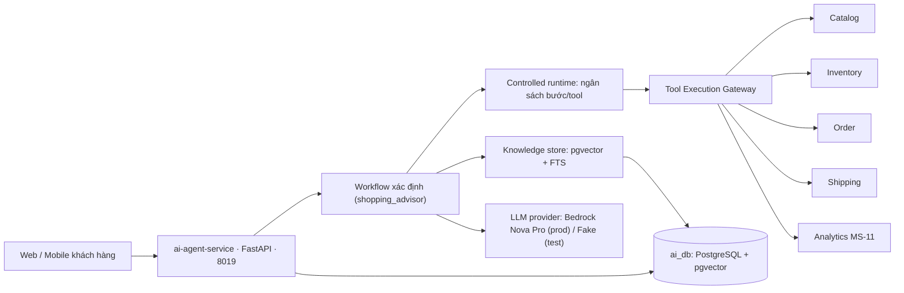

# 00 — Kiến trúc MS-19

## Phạm vi và ownership

AI Agent sở hữu: điều phối hội thoại và agent runtime, lời gọi LLM/embedding qua lớp provider, kho tri thức RAG riêng (`ai_db` + pgvector), lịch sử chat và consent lưu lịch sử chat, cùng bản ghi thực thi (agent run, tool call, feedback, audit). AI Agent **không** sở hữu dữ kiện nghiệp vụ: Catalog sở hữu Product/SKU và giá, Inventory sở hữu tồn, Order sở hữu đơn, Shipping sở hữu phí vận chuyển, Analytics (MS-11) sở hữu engine và consent gợi ý. Mọi trao đổi đi qua contract của service nguồn, thông qua Tool Gateway. MS-19 không bao giờ chạm cơ sở dữ liệu của service khác.

Ranh giới hành vi: AI chỉ gợi ý và soạn nháp. Không có đường code nào trong service ghi dữ liệu nghiệp vụ ra ngoài — toàn bộ tool đợt 1 là chỉ đọc.

## Thành phần

| Thành phần | Trách nhiệm |
| --- | --- |
| API layer (`modules/shopping_advisor/routes.py`) | REST + SSE, xác thực khách/khách vãng lai, kiểm tra sở hữu phiên, consent, feedback, ingestion tri thức. |
| Workflow (`modules/shopping_advisor/workflow.py`) | Sở hữu thứ tự bước của một lượt chat: định tuyến intent → trích xuất nhu cầu → hỏi làm rõ → gọi tool → soạn trả lời → hậu kiểm grounding. |
| Controlled runtime (`platform/runtime.py`) | Ngân sách mỗi lượt: tối đa số bước và số lần gọi tool (mặc định 8 / 10, cấu hình được). |
| Tool Execution Gateway (`platform/gateway.py`) | Đường bắt buộc duy nhất cho mọi tool call: allowlist → yêu cầu khách đăng nhập → validate schema → timeout → kiểm tra kết quả → metric/audit. |
| Product Eligibility (đợt 1.5 — đã triển khai 10/11/2026) | Lớp dùng chung mà mọi Product Card phải đi qua: resolve published qua Catalog → lọc ngân sách cứng → kiểm tồn song song fail-closed theo SKU, kèm outcome taxonomy. Thiết kế tại [chương 13](13_unified_eligibility.md). |
| Knowledge (`platform/knowledge.py`) | Ingestion, chunking và truy hồi hybrid (vector + từ khóa) với bộ lọc hiệu lực áp ngay trong truy vấn. |
| Providers (`providers/`) | Trừu tượng LLM và embedding theo kiểu chuẩn Bedrock Converse; code nghiệp vụ không rẽ nhánh theo provider. |
| Stores (`platform/conversations.py`) | Phiên, tin nhắn, slot làm việc, consent — hai hiện thực: PostgreSQL (production) và in-memory (fixture/test). |
| Adapters (`integrations/`) | Ánh xạ API công khai của Catalog/Inventory/Order/Shipping/Analytics về interface nội bộ; chế độ fixture thay bằng dữ liệu mẫu cùng interface. |

## Lát triển khai và cô lập lỗi

1. Đợt 1 chạy hoàn chỉnh ở chế độ fixture (`AI_FIXTURES=1`): adapter trả dữ liệu mẫu trong repo, store in-memory, LLM FakeProvider xác định — đủ để kiểm thử đầu-cuối và CI mà không cần service bạn hay khóa API.
2. Chế độ thật (`AI_FIXTURES=0`): store PostgreSQL, adapter HTTP, provider theo cấu hình. Chuyển đổi chỉ bằng biến môi trường; điểm nối dây duy nhất là `integrations/http_clients.py` ([chương 07](07_integrations_and_contract_gaps.md)).
3. Cô lập lỗi: LLM lỗi/timeout → sự kiện SSE `error` mã `llm_unavailable` kèm liên kết danh mục đã lọc; tool lỗi/timeout/quá ngân sách → mã `tool_unavailable` cùng fallback. Analytics lỗi → gợi ý suy biến về danh sách phổ biến. Service bạn dừng không làm sập phiên chat. Đợt 1.5 bổ sung chính sách lỗi ở tầng hiển thị: kiểm tồn không xác minh được thì loại riêng SKU đó (fail-closed theo SKU), các SKU còn lại vẫn hiển thị — xem ADR-03 tại [chương 13](13_unified_eligibility.md).

## Đơn giản hóa đã biết (đợt 1)

- Trả lời được soạn trọn bằng `generate()` rồi mới cắt nhỏ thành sự kiện SSE `token`, để hậu kiểm grounding chạy **trước khi** phát bất kỳ token nào. Streaming token thật là tối ưu đợt sau, giữ nguyên giao thức sự kiện.
- Các lời gọi store/knowledge là psycopg đồng bộ trên truy vấn ngắn, ngoài đoạn soạn trả lời.
- Chưa có route Kong cho MS-19; API phơi trực tiếp ở cổng 8019 (xem [chương 07](07_integrations_and_contract_gaps.md)).
