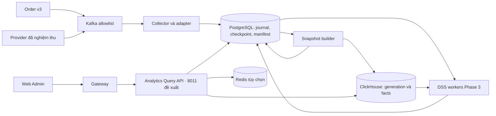

# 00 — Kiến trúc MS-11

## Phạm vi và ownership

Analytics sở hữu định nghĩa metric có phiên bản, dữ liệu chiếu tối thiểu, snapshot truy vấn, phiên chạy và kết quả DSS. Order sở hữu mốc đơn và thanh toán nghiệp vụ. Finance sở hữu định nghĩa tài chính và trạng thái chốt kỳ. Inventory sở hữu lượng tồn, tính khả dụng và HSD. Catalog sở hữu Product/SKU. Profile và Identity cung cấp quan hệ khách hàng và quyền. Mọi trao đổi đi qua contract của service nguồn.

Analytics nhận dữ liệu bất đồng bộ. Marketing, Promotion và Procurement có thể nhận tham chiếu insight qua API đã duyệt và xử lý đề xuất theo quy trình riêng. Web Admin đọc qua Gateway. Conversation, RAG và luồng gợi ý giỏ quà thuộc đề xuất AI Agent riêng.

## Thành phần

| Thành phần | Trách nhiệm |
| --- | --- |
| Collector | Validate phiên bản và key, lưu projection tối thiểu và checkpoint. |
| Builder | Đóng băng cutoffs, tạo generation, kiểm parity và cập nhật con trỏ phục vụ. |
| Query API | Xác thực và áp scope, đọc snapshot, giới hạn truy vấn và trả chất lượng theo card. |
| DSS workers | Chạy job theo snapshot đã chốt, phiên bản dataset/model và giới hạn tài nguyên riêng. |

PostgreSQL là control plane và journal ngắn hạn cho replay. ClickHouse giữ serving data theo generation. Redis chỉ là cache tùy chọn. MongoDB/clickstream theo định hướng HLD được xét ở Phase 3 sau khi chốt consent, nguồn và retention.

## Lát triển khai và cô lập lỗi

1. Bản thử nội bộ Order dùng `order.events.v3` theo cohort, hiển thị hai mốc và coverage. Các card còn thiếu nguồn trả trạng thái theo từng metric.
2. Hoàn tất Dashboard US-DSS-01 khi Finance, Customer và Inventory có nguồn được duyệt, kỳ so sánh và drill-down qua kiểm thử quyền.
3. DSS Phase 3 mở từng capability theo dữ liệu, đánh giá mô hình và quy trình tiếp nhận của Epic đích.

Order và các service nguồn tiếp tục giao dịch khi Analytics dừng. Analytics phục vụ generation đã kiểm chứng nếu còn trong giới hạn sử dụng, hoặc trả trạng thái unavailable khi không có snapshot dùng được. Một lỗi source có thể làm xấu chất lượng card phụ thuộc nguồn đó. Mất control plane hoặc hết ngân sách truy vấn được xử lý ở cấp API. [Recovery](04_messaging_and_recovery.md) · [Deployment](../../../05_deployment/analytics_service_deployment.md)
