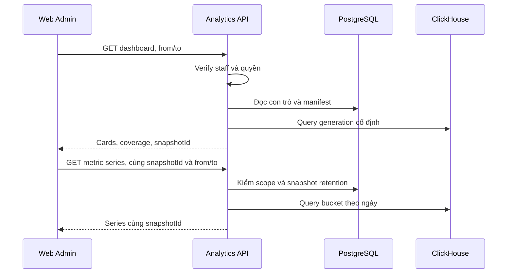
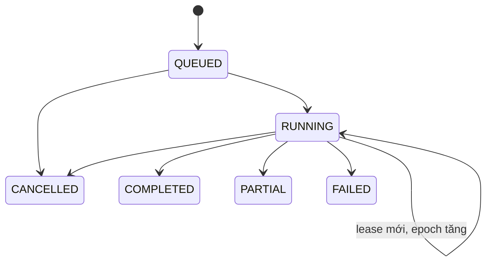

# 02 — Use cases và vòng đời

## Executive Dashboard

1. Xác thực JWT staff và quyền đọc. Chuẩn hóa kỳ theo ngày Việt Nam, giới hạn 1–90 ngày và xác định scope server-side.
2. Lấy con trỏ generation cùng manifest. Với drill-down, mở generation người dùng đã nhận từ Dashboard và đánh giá lại quyền hiện tại trước khi đọc.
3. Đọc KPI trong budget, áp coverage và freshness theo card. Metric tài chính chỉ hiển thị với definition đã duyệt; gửi trạng thái chốt kỳ nếu có.
4. Trả định nghĩa, đơn vị, nguồn, cutoff, chất lượng và giá trị từng metric. Client dùng lại `snapshotId`, ngày và metric ID cho drill-down. Khi generation hết hạn, client tải lại Dashboard.

## Phiên phân tích Phase 3

- Scheduler dùng khóa nghiệp vụ gồm analysis type, scope chuẩn hóa, dataset generation và phiên bản cấu hình/model. Cùng khóa trả cùng run. Lần chạy lại với cùng dữ liệu sau khi chốt kết quả dùng run mới có `supersedes_run_id` và lý do.
- Worker claim bằng lease + epoch trong PostgreSQL. Artifact staging thuộc run/attempt; publish kiểm tra epoch và state trong cùng transaction. Worker bị thu hồi lease chỉ có thể bỏ staging cũ. Cancel khi đang chạy dùng cờ và được serialize cùng publish; quyết định commit trước xác lập kết quả.
- `COMPLETED` đạt chất lượng và tạo kết quả chính thức cho phiên. `PARTIAL` ghi coverage, chỉ công bố phần đủ điều kiện. `FAILED` giữ mã lỗi phân loại. Run history giữ input cutoff, config, version code/model và quality summary.
- Recommendation ở trạng thái `ACTIVE` khi đủ căn cứ và trong thời hạn. Có thể chuyển `ACCEPTED`, `REJECTED`, `EXPIRED` hoặc `SUPERSEDED`. Đánh giá thời hạn trong transaction khi ghi quyết định. Kết quả sau này được liên kết như outcome; giữ nguyên quyết định và phiên nguồn.
- Quyết định lưu actor, lý do, thời điểm, revision và audit cùng transaction. API Phase 3 sẽ cần idempotency key và expected revision. Nếu đã có contract bàn giao, commit thêm outbox tham chiếu; peer nhận theo idempotency key riêng và tự kiểm quyền/phê duyệt nghiệp vụ. [Bảo mật](05_api_contracts_and_security.md) · [ADR](../../adr/analytics-service/adr_003_dss_and_privacy.md)
