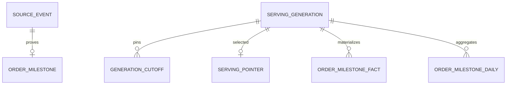

# 03 — Persistence và snapshot

## Grain và ownership

| Store | Grain | Vai trò |
| --- | --- | --- |
| PostgreSQL `partition_cursor` | pipeline/topic/partition | Offset kế tiếp, lease epoch và checkpoint có thể đối soát. |
| PostgreSQL `source_event` | producer source/event key | Digest ổn định, event time và provenance. Body gốc không thuộc journal. |
| PostgreSQL `order_milestone` | cohort/order/milestone | Mốc nghiệp vụ duy nhất. Khóa ngoại giữ nguồn và timestamp theo event. |
| PostgreSQL `source_quarantine` | pipeline/topic/partition/offset | Lý do và tham chiếu đã lọc để sửa hoặc đối chiếu với broker. |
| PostgreSQL `metric_definition` | metric/version | Đơn vị, policy, phê duyệt, hiệu lực và source owner. |
| PostgreSQL `serving_generation` / `serving_pointer` | generation / serving scope | Cutoffs, coverage và publish CAS. |
| ClickHouse `order_milestone_fact` | generation/cohort/order/milestone | Fact bất biến theo generation. |
| ClickHouse `order_milestone_daily` | generation/cohort/ngày nghiệp vụ/milestone | Breakdown và tổng Dashboard nhanh trong lát đầu. |

Phase 3 bổ sung `order_line_fact`, `refund_fact`, `inventory_batch_snapshot`, Catalog history và customer pseudonym theo từng provider contract. Grain đích lần lượt là order/line/revision, refund/settlement revision, kho/SKU/batch/revision, product/SKU/revision và customer key/version. Không dùng kho tự đoán từ mã SKU. Clickstream có purpose/retention tách biệt.

## Xây và công bố generation

1. Tạo `BUILDING` với scope cố định và con trỏ hiện tại làm `expected_generation`. Trong một read snapshot nhất quán của PostgreSQL, chụp vector `next_offset`, version metric và bộ mốc đã chuẩn hóa. Chốt kỳ retention, watermark và gap; spool bộ dữ liệu bằng giới hạn dung lượng, thời gian và mã hóa. Nếu vượt budget, bỏ attempt và điều chỉnh lịch/window.
2. Sinh fact và rollup từ cùng tập mốc. Ghi ClickHouse theo ID generation mới, dùng synchronous inserts. Lỗi hoặc ACK không rõ khiến bỏ toàn bộ generation đó và dựng attempt có ID mới. Bỏ staging sau đối soát; không insert lại vào generation đang phục vụ.
3. Trước publish, đối chiếu row count, unique grain, digest của fact theo thứ tự chuẩn và toàn bộ nhóm rollup. Kiểm thử việc đọc từ đúng đường phục vụ; ở cấu hình nhiều replica cần chứng minh visibility trên replica đủ điều kiện. Empty generation chỉ được công bố với coverage tương ứng.
4. Trong một transaction PostgreSQL, cập nhật pointer theo scope với điều kiện generation hiện hành bằng expected generation. Lần publish đầu insert với khóa scope duy nhất. Cùng transaction, xác nhận manifest và đánh dấu `PUBLISHED`. Pointer CAS thua thì bỏ staging và dựng từ nguồn mới. Nếu mất ACK commit, đọc manifest và lịch sử generation từ PostgreSQL để phân biệt đã publish hoặc còn có thể retry metadata transaction.
5. API pin ID và scope khi bắt đầu request. GC có cửa sổ bảo vệ lớn hơn tuổi pin của API. Giữ snapshot drill-down tối thiểu 24 giờ sau khi bị thay thế, trừ trường hợp thu hồi khẩn vì dữ liệu/quyền. GC chỉ xóa ClickHouse sau khi chặn pin mới và chờ request đang đọc hết deadline. Redis, nếu bật, chỉ cache theo generation, scope và permission policy version. Kiểm quyền trước cache hit.

ClickHouse `MergeTree` giữ rows đã publish; `ORDER BY` hỗ trợ truy vấn và không cung cấp unique constraint. Bảo đảm grain ở journal PostgreSQL và kiểm độc lập lúc build. Không dựa vào merge nền hoặc cửa sổ dedup của ClickHouse để quyết định một KPI đã tính đúng.

## Retention và khôi phục

- Đề xuất mặc định giữ tối đa 90 ngày query trong API. Journal/dedup phải bao phủ cửa sổ query, replay và correction đã duyệt. Trước GC cần snapshot nguồn có thể dựng lại và bằng chứng checkpoint. Nếu thiếu bằng chứng, khóa khả năng backfill cho phần dữ liệu đó.
- Lưu `sourceAsOf`, độ đầy đủ theo cohort/phạm vi và cutoffs trong manifest. Quarantine đang mở hạn chế coverage của card phụ thuộc đến khi sửa xong và rebuild.
- Sao lưu PostgreSQL và manifest. ClickHouse có thể dựng từ journal còn retention hoặc export nguồn có revision. Sau restore, giữ API ở generation cũ đã kiểm chứng hoặc trả degraded/unavailable cho tới khi đối chiếu xong.
- [PostgreSQL candidate](analytics_control.candidate.sql) · [ClickHouse candidate](analytics_olap.candidate.sql) · [Runbook](../../../06_operations/analytics_service_runbook.md)
