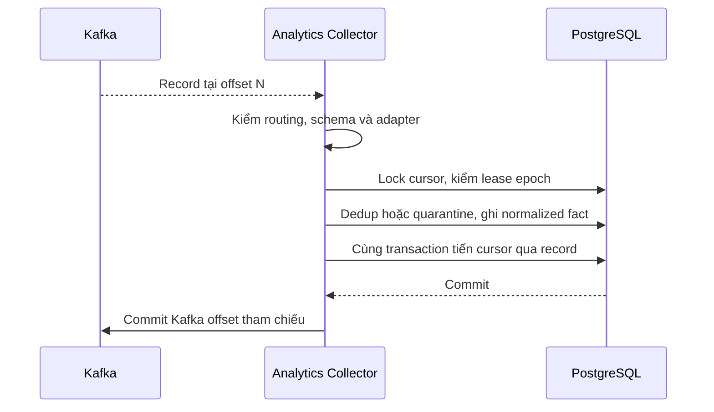

# 04 — Messaging, checkpoint và replay

Pipeline Dashboard dưới đây ingest Kafka. Recommendation nhập full snapshots có revision từ owner, cùng event first-party có consent và dedup, theo [hợp đồng nguồn](13_recommendation_source_contracts.md) và [vòng đời publish riêng](15_recommendation_persistence_and_delivery.md#2-worker-và-vòng-đời-publish).

## Ingest theo allowlist

Cấu hình theo môi trường chỉ mở topic/type/cohort đã nghiệm thu ở [chương tích hợp](07_integrations_and_contract_gaps.md). Mỗi partition xử lý tuần tự. Broker ACL cho nhóm Analytics quyền đọc các topic được duyệt. Dùng một pipeline riêng cho shadow/backfill. Broker key, schema và mapping phiên bản được pin cùng release.

- Kafka assignment xác định worker nào được claim. Worker khóa cursor, claim lease với epoch tăng khi lease hết hoặc chủ cũ đã release. Revoke hủy intake và release có điều kiện. Bên nhận assignment mới chờ lease cũ hết/release trước seek lại. Cùng transaction với dữ liệu phải xác nhận epoch, lease và cursor dự kiến. Lỗi PostgreSQL giữ nguyên cursor.
- DB cursor là nguồn khôi phục. Kafka commit để theo dõi lag và phục vụ tooling. Chỉ tiến sau record đã validate/lưu, record được phép bỏ qua theo policy hoặc quarantine đã lưu bền. Client đọc tuần tự các record nhìn thấy; có thể nhảy qua offset control/aborted record theo broker semantics khi đã xác minh log range. Khi log bị truncate, cursor ngoài retention hoặc topic được tái tạo, giữ partition ở trạng thái gap và yêu cầu đối soát/backfill.
- CloudEvents dedup theo `source + id`. Digest tính trên biểu diễn chuẩn hóa xác định cho từng adapter, giữ version của adapter. Cùng key/digest là duplicate; khác digest là conflict cần quarantine. Khóa nghiệp vụ `cohort/order_id/milestone` chặn producer phát lại mốc với event ID khác. Mốc lặp chỉ được coi là tương đương khi projection nghiệp vụ trùng; khác timestamp/nội dung cần owner xử lý.
- Adapter có thể nhận version cũ tới muộn. Lưu hai milestone độc lập khi cả hai hợp lệ; CANCELLED/refund không xóa PAID hoặc COMPLETED. `version/ordinal` phục vụ kiểm tra revision, không coi mọi khoảng nhảy là mất record vì topic có event loại khác.
- Lỗi tạm thời retry có jitter và budget. DB/broker outage giữ checkpoint, tạm dừng partition thay vì đánh dấu lỗi schema. Payload lỗi đã xác định ghi reason, tọa độ và digest; quyền lấy payload từ broker thuộc operator được cấp. Khi quarantine chưa đóng, giảm coverage của metric có thể bị ảnh hưởng; nếu chưa xác định được loại thì áp trên phạm vi nguồn liên quan.

## Freshness, late data và replay

- Vector checkpoint thể hiện đã đọc tới đâu. Watermark nghiệp vụ cần thêm bằng chứng từ peer về cohort, kỳ đủ dữ liệu và độ trễ cho phép. Snapshot/manifest ghi hai khái niệm riêng. Partition im lặng có thể hợp lệ khi có heartbeat hoặc đối soát nguồn còn hiệu lực.
- Sự kiện đến sau generation được journal theo timestamp gốc, đánh dấu cửa sổ ngày bị ảnh hưởng và dựng generation mới cho kỳ đó. UI drill-down đang ghim generation vẫn đọc giá trị trước correction tới khi refresh hoặc hết hạn.
- Re-drive quarantine giữ nguyên tọa độ/identity khi còn source record. Dùng repair job có audit, xác nhận cùng digest hoặc nhận correction có revision từ owner, rồi rebuild và đối soát. Live cursor giữ nguyên chiều tiến. Chỉ đóng gap sau khi chứng minh coverage của generation mới.
- Khi replay diện rộng, dùng namespace/pipeline và journal staging riêng, tính lại từ offset được kiểm chứng hoặc export có cutoffs. So sánh count, checksum và coverage trước promotion. Việc promote phải chọn cả live source namespace tương ứng và serving pointer trong quy trình có fence. Tiếp tục bắt kịp live cutoffs hoặc giữ nguyên hệ đang phục vụ.
