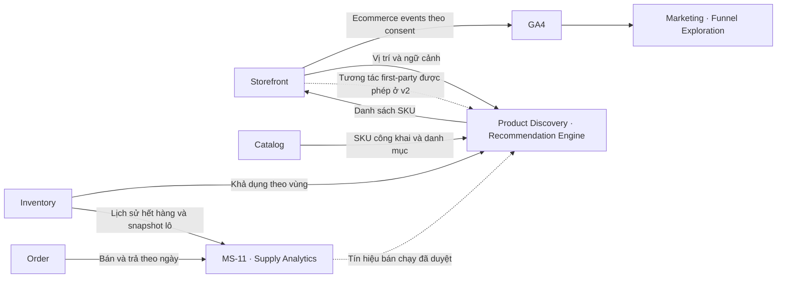

# 10 — Phễu GA4 và Recommendation Engine

**Thiết kế đề xuất · 06/11/2026 · Nhánh `feat/analysis-service`.**

Thiết kế gồm hai lát có thể phát hành độc lập. Marketing đo chuyển đổi bằng GA4. Product Discovery đưa gợi ý lên Storefront. Supply Analytics có thể bổ sung tín hiệu bán chạy sau khi nguồn tự động đạt coverage và scope phù hợp với kênh D2C.

## 1. Ranh giới và nguồn dữ liệu

| Thành phần | Trách nhiệm |
| --- | --- |
| Marketing / MS-14 | Sở hữu GA4 property, quy ước tracking, phễu và KPI theo chiến dịch. Dùng GA4 Explore trong pilot. Tích hợp báo cáo vào Web Admin khi MS-14 có runtime và quyền đọc riêng. |
| Product Discovery | Sở hữu trải nghiệm gợi ý, quy tắc xếp hạng, fallback và hợp đồng phục vụ Storefront. Đề xuất đặt engine v1 trong lớp phục vụ Product Discovery hiện có. |
| MS-11 Analytics | Sở hữu báo cáo Supply và các tín hiệu tổng hợp được xuất bản theo scope. Có thể cung cấp tín hiệu bán chạy cho Product Discovery khi được phê duyệt. |
| Catalog / Inventory / Order | Catalog xác nhận SKU công khai và danh mục. Inventory xác nhận khả dụng theo vùng phục vụ. Order xác nhận giao dịch và cung cấp dòng đơn nếu cần phân tích mua hàng theo SKU/khách. |

[Ranh giới MS-11](00_analytics_service_hld.md#phạm-vi-và-ownership) · [Hợp đồng nguồn](07_integrations_and_contract_gaps.md) · [US-AI-04](../../../01_requirements/epics/EPIC_03_Product_Discovery.md#us-ai-04--product-recommendation-ai)

## 2. GA4 pilot

| Event | Điểm phát và dữ liệu tối thiểu |
| --- | --- |
| `view_item` | Trang chi tiết đã hiển thị sản phẩm. Gửi SKU mặc định thực sự hiển thị nếu xác định được SKU. |
| `add_to_cart` | Cart API xác nhận thêm hàng. Gửi SKU và số lượng vừa thêm. |
| `begin_checkout` | Khách vào bước checkout với giỏ hợp lệ. Gửi các dòng trong lần checkout đó, kiểm trùng theo checkout attempt. |
| `purchase` | Trong pilot web, Storefront phát khi đọc được xác nhận thanh toán từ Order và có dữ liệu mua hàng đã xác thực. Gửi `transaction_id` ổn định theo đơn, `currency`, `value` và `items`. |
| `view_item_list`, `select_item` | Khi dãy gợi ý xuất hiện trong vùng nhìn hoặc khách chọn mục. Gửi `item_list_id` theo vị trí gợi ý, SKU và thứ hạng. |

Dùng `items[].item_id = skuCode` cho các dòng SKU. Trong pilot, trang chưa xác định được variant chỉ ghi nhận thiếu coverage SKU, không phát `view_item` với SKU suy đoán. Chuẩn hóa thời gian phễu theo `Asia/Ho_Chi_Minh`. GA4 property dev tách riêng production. Tracking áp dụng consent và chỉ gửi các trường trong allowlist. Lọc URL/query chứa dữ liệu nhận dạng, thông tin khách hàng hoặc token. [GA4 Ecommerce](https://developers.google.com/analytics/devguides/collection/ga4/ecommerce) · [Chính sách dữ liệu GA4](https://support.google.com/analytics/answer/6366371)

Pilot giới hạn đơn chuyển khoản D2C. Chỉ phát `purchase` từ trạng thái đã xác nhận qua backend và dùng giá trị dòng hàng của Order theo quy ước GA4. Kiểm tra nguồn dữ liệu dòng đơn trước khi bật bước này. Trường hợp đóng tab trước khi xác nhận được ghi nhận là giới hạn coverage của pilot. Nếu cần bắt được các đơn đó, chuyển riêng `purchase` sang worker hậu thanh toán qua Measurement Protocol. Worker cần dòng đơn xác thực, `client_id` và `session_id` đã được phép thu thập, retry theo ID giao dịch và một bên phát event trên mỗi môi trường. [Trạng thái thanh toán web](../../../../apps/web-user/src/lib/payment/types.ts) · [Order PAID](../../../../packages/events/schemas/order/v3/paid.event.json) · [Measurement Protocol](https://developers.google.com/analytics/devguides/collection/protocol/ga4/sending-events?client_type=gtag) · [Transaction ID](https://support.google.com/analytics/answer/12313109)

Marketing dùng phễu đóng `view_item → add_to_cart → begin_checkout → purchase` cho pilot, theo dõi số người qua bước và tỷ lệ rời, với breakdown theo thiết bị hoặc chiến dịch thu hút người dùng khi dữ liệu đủ. Đối chiếu giao dịch GA4 với tập Order D2C pilot đã xác nhận có consent và phát thành công. Ghi riêng phần chênh do thiếu consent, tab đóng hoặc tracking bị chặn. Nếu cần báo cáo nội bộ, adapter của Marketing đọc báo cáo tổng hợp qua `runFunnelReport` (`v1alpha`), đóng gói contract nội bộ và cache theo bộ lọc. [GA4 Funnel Exploration](https://support.google.com/analytics/answer/9327974) · [GA4 Data API](https://developers.google.com/analytics/devguides/reporting/data/v1/funnels)

## 3. Recommendation Engine v1

Pilot một vị trí trên trang chi tiết sản phẩm. Ưu tiên SKU cùng danh mục và SKU do Catalog duyệt, rồi xếp hạng theo tín hiệu bán chạy nếu dữ liệu đã đủ phạm vi. Fallback là danh sách SKU Catalog duyệt cho vị trí đó. Lọc bỏ sản phẩm đang xem, SKU trùng, chưa công khai hoặc chưa xác nhận bán được. Kiểm tra khả dụng cả với fallback. Khi không có SKU hợp lệ, Storefront ẩn dãy gợi ý. Cart và Checkout vẫn kiểm giá và tồn theo luồng nghiệp vụ.

**API đề xuất** `GET /api/v1/products/recommended?placement=product_detail&productId=...&limit=6`. Chỉ nhận placement đã hỗ trợ và giới hạn số phần tử. Product Discovery giải quyết product context và vùng giao hàng qua ngữ cảnh Storefront. Response tối thiểu gồm `recommendationId`, `placement`, `strategy` (`RELATED`, `FALLBACK`, `EMPTY`) và `items[]` với `skuCode`, `productId`, `rank`. Storefront lấy thẻ hiển thị theo contract Catalog. Tuyến hiện nằm dưới prefix Catalog. Product Discovery cần chốt handler cho đường dẫn này trước khi mở Gateway. [API trong Service Boundary](../../service_boundary.md) · [Route Catalog](../../../../services/api-gateway/config/kong.yml)

**Tái sử dụng Supply.** `order_day` chỉ có số lượng bán/trả theo SKU, kho và ngày. Dùng được làm tín hiệu phổ biến sau khi MS-11 công bố bản tổng hợp có scope kênh/vùng D2C đã được owner xác nhận, kỳ đo, coverage, `asOf` và version. Bản xuất đề xuất có `scope`, `from`, `to`, `asOf`, `version`, `coverage` và `items[]` gồm `skuCode`, `soldUnits`, `returnedUnits`. Chỉ dùng pilot một kho nếu phạm vi recommendation cũng giới hạn đúng kho/vùng và cohort bán. `inventory_batches` là snapshot phục vụ ước lượng rủi ro. Trạng thái bán được trên Storefront cần contract khả dụng của Inventory có ngưỡng độ mới riêng. [Hợp đồng Supply v1](09_supply_analytics_v1.md)

**Cô lập nguồn.** Xuất bản tín hiệu theo lô. Tái sử dụng mẫu generation đã kiểm tra rồi mới cập nhật con trỏ phục vụ của MS-11, với pipeline/scope riêng nếu tín hiệu đi qua ClickHouse. Dữ liệu đầu vào cần revision và cutoff, xử lý lại cùng đầu vào cho cùng kết quả. Product Discovery đọc bản hợp lệ gần nhất trong ngưỡng độ mới đã chốt, sau đó dùng fallback. GA4, BigQuery và API Supply nằm ngoài đường phục vụ gợi ý. [Cơ chế snapshot và recovery](04_messaging_and_recovery.md)

## 4. Cá nhân hóa v2

Chỉ mở khi có chính sách sử dụng dữ liệu theo mục đích và dữ liệu đủ kiểm chứng. Thu sự kiện first-party theo allowlist cho khách đăng nhập được phép cá nhân hóa. Collector xác định subject từ phiên xác thực, ghi `eventId`, `eventTime`, `skuCode`, `eventType` và consent; xử lý trùng theo `eventId`. Job định kỳ tạo tín hiệu theo danh mục/SKU dựa trên lượt xem hoặc thêm giỏ gần đây. Chỉ thêm lịch sử mua khi Order cung cấp dòng đơn và liên kết khách hàng đã được duyệt. Khi quyền thay đổi, ngừng phục vụ kết quả cá nhân hóa và thu hồi dữ liệu/cache liên quan theo chính sách. Khách chưa đăng nhập hoặc thiếu tín hiệu nhận kết quả v1.

GA4 dùng để đo lượt thấy, lượt chọn và chuyển đổi theo vị trí. Nếu Marketing cần phân tích chi tiết hơn, BigQuery Export là nguồn bất đồng bộ theo hợp đồng riêng. Nếu dùng GA4 làm tín hiệu xếp hạng, Marketing có thể xuất số lượt xem/thêm giỏ tổng hợp theo ngày và SKU cùng `asOf`, coverage và version. Product Discovery thử tín hiệu này như một yếu tố bổ sung trong cùng danh mục. Số lượt phát sinh từ dãy gợi ý được tách theo placement để đo riêng hiệu ứng hiển thị. Lượt nhập theo ngày phải xử lý các phân vùng GA4 còn có thể nhận sự kiện muộn và công bố cutoff. Báo cáo GA4 và số giao dịch Order giữ định nghĩa và phạm vi riêng. [GA4 BigQuery Export](https://support.google.com/analytics/answer/9358801) · [Schema và dữ liệu đến muộn](https://support.google.com/analytics/answer/7029846)

## 5. Thứ tự triển khai và nghiệm thu

| Lát | Có thể bắt đầu khi | Nghiệm thu |
| --- | --- | --- |
| Supply pilot hiện tại | Có staff, ClickHouse dev và bộ dữ liệu đã đối soát | Hoàn tất các tiêu chí Order, Inventory và FEFO của pilot Supply. |
| GA4 trên dev | Marketing cấp property dev, chốt consent và điểm phát event | DebugView thấy đúng SKU và chuỗi thao tác. Mua đã xác nhận xuất hiện một lần dù reload. Đơn chưa xác nhận và phiên từ chối consent được kiểm theo policy. Ghi nhận coverage khi khách đóng tab. |
| Gợi ý theo ngữ cảnh v1 | Catalog có danh sách được duyệt, Inventory có nguồn khả dụng đủ scope | SKU công khai và còn bán được. Có fallback hợp lệ khi MS-11 hoặc GA4 lỗi. Có event hiển thị/chọn theo placement. |
| Xếp hạng theo tín hiệu Supply | Nguồn tự động đã đối soát và có phạm vi D2C phù hợp | Revision mới đổi đúng bảng xếp hạng. Snapshot cũ hoặc thiếu coverage kích hoạt fallback. |
| Cá nhân hóa v2 | Product Discovery có consent, dữ liệu first-party và tiêu chí thử nghiệm | Cùng một ngữ cảnh, hồ sơ hành vi khác nhau cho gợi ý phù hợp. Kiểm tách dữ liệu giữa khách, thu hồi quyền và fallback. So sánh với v1 bằng CTR và tỷ lệ thêm giỏ theo placement trước khi mở rộng. |

**Cần chốt trước khi triển khai:** người sở hữu GA4 dev property; nguồn dòng đơn cho `purchase`; nguồn Catalog/Inventory theo vùng; phạm vi và ngưỡng độ mới của tín hiệu Supply. Các tên trường và endpoint mới trong tài liệu là đề xuất để review.
