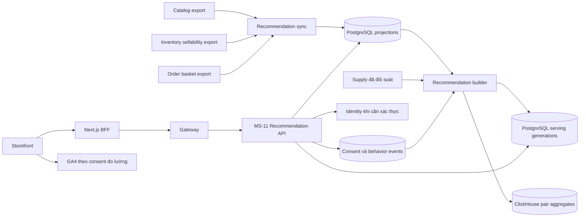

# 12 — Thiết kế Recommendation Engine của MS-11

**Thiết kế để triển khai · 07/11/2026 · `feat/analysis-service`.**

MS-11 `analytics-service` đảm nhận tính điểm, xây danh sách và API gợi ý cho Storefront. Bản pilot đã hiện thực đủ ba thuật toán; [chương 15](15_recommendation_persistence_and_delivery.md) ghi persistence/worker thực tế và [chương 16](16_recommendation_runtime_and_verification.md) ghi evidence, cách chạy và gate dev còn lại. Các phương án scale lớn bên dưới vẫn là thiết kế mở rộng.

## 1. Phạm vi và cách đọc

| Năng lực | Vị trí Storefront | Điều kiện sử dụng |
| --- | --- | --- |
| Sản phẩm tương tự | Trang chi tiết | Có Product/SKU công khai và nguồn khả dụng đủ mới |
| Thường mua cùng | Giỏ hàng | Có basket Order đã hoàn tất trong scope đã đối soát |
| Dành cho bạn | Trang chủ | Customer đăng nhập, consent hiện hành và lịch sử đủ tín hiệu |

Khách vãng lai nhận gợi ý theo ngữ cảnh hoặc danh sách dự phòng. Đợt đầu dùng một kho cho mỗi scope `D2C_WEB`, tối đa sáu sản phẩm mỗi dãy và một SKU đại diện cho mỗi product ID.

| Tài liệu | Nội dung triển khai |
| --- | --- |
| [13 — Hợp đồng nguồn](13_recommendation_source_contracts.md) | Trường cần thêm ở Catalog, Inventory, Order, Identity và Storefront; snapshot, revision và đối soát |
| [14 — API và tích hợp](14_recommendation_api_and_storefront.md) | Query, response, lỗi, consent, event, Gateway, BFF và đo GA4 |
| [15 — Persistence và vận hành](15_recommendation_persistence_and_delivery.md) | Grain, publish, concurrency, retention, cấu hình, kiểm thử và rollout |
| [11 — Nghiên cứu thuật toán](11_recommendation_algorithm_proposal.md) | Các thuật toán đã so sánh và căn cứ nghiên cứu |

Chương 12–15 là hợp đồng triển khai Recommendation v1 khi có khác biệt với phần phác thảo ở chương 10–11. Các metric Supply và Dashboard dùng định nghĩa của chương 01–09.

## 2. Ownership và giới hạn dữ liệu

| Thành phần | Sở hữu và trách nhiệm |
| --- | --- |
| MS-11 Analytics | Projection phục vụ, thuật toán, consent cá nhân hóa, profile, thống kê cặp, generation và API gợi ý |
| MS-05 Catalog | Product/SKU, category ID, giá theo kênh, trạng thái công khai, nội dung thẻ và danh sách dự phòng được duyệt |
| MS-01 Inventory | Kho, trạng thái SKU, tồn bán được sau giữ chỗ, lô bị chặn và hạn dùng |
| MS-04 Order | Basket ở mốc `COMPLETED`, cohort/kênh, owner tại thời điểm mua và bản sửa nghiệp vụ |
| Identity | Phiên hiện hành, `principalId`, loại Customer/Employee và trạng thái hoạt động |
| Profile | Mapping Customer hoặc guest claim có thẩm quyền nếu phát triển thêm liên kết lịch sử |
| Marketing | Quy ước đo GA4, phễu và báo cáo hiệu quả theo placement |
| Storefront | Chọn SKU, ngữ cảnh giỏ, giao diện consent, render và tương tác với dãy gợi ý |

Pilot tái sử dụng `order-core-1` cho cohort D2C đã xác minh. Cấu hình ánh xạ `scopeId → warehouseId nguồn → supplyWarehouseId` phải rõ ràng và có phiên bản. SKU bán ở một kho chỉ tham gia gợi ý trong scope kho đó. `warehouseId` nguồn là UUID, còn mã kho của Supply có thể là alias đã được cấu hình.

Đánh giá code cho thấy phần lớn dữ liệu thương mại và basket đã tồn tại. Pilot dùng owner export command theo lịch, xuất JSONL/manifest theo mẫu vận hành Supply. API job/cursor dành cho mở rộng transport sau khi có nhu cầu vận hành. Inventory sellability và principal mapping vẫn cần fixture/đối soát owner trước khi mở capability tương ứng. [Đánh giá khả thi và phần tối thiểu từng owner](13_recommendation_source_contracts.md#0-đánh-giá-khả-thi-từ-code-và-phần-phải-xác-minh)

Basket Recommendation ghi các SKU lúc đơn hoàn tất. `returnedUnits` trong Supply ghi lượng trả vật lý vào ngày trả. Số bán ròng dùng để phá hòa thứ hạng từ Supply. Basket mua cùng vẫn biểu diễn giao dịch đã xảy ra, có revision để sửa dữ liệu sai hoặc rút đơn không hợp lệ.

## 3. Kiến trúc và luồng



### 3.1. Đồng bộ và xây model

1. Worker nhận snapshot cố định của từng owner, kiểm scope, revision, completeness và checksum.
2. Công bố projection mới sau khi nhận đủ trang. Ghi `sourceAsOf` và `receivedAt` riêng để đo độ trễ nguồn.
3. Builder chụp vector projection IDs, cutoff Supply, version thuật toán và privacy epoch. Tạo dữ liệu ứng viên và thống kê theo cùng vector.
4. Kiểm grain, digest, eligibility và giới hạn dung lượng trước khi publish generation.
5. Recommendation API pin generation đang phục vụ và projection Catalog/Inventory hiện hành. Sau khi chọn ứng viên, API lọc lại điều kiện công khai, giá và khả dụng theo các projection này.

### 3.2. Ngân sách ban đầu

| Hạng mục | Mặc định dev |
| --- | --- |
| Đồng bộ Catalog | 300 giây; quá 600 giây thì dữ liệu công khai/giá hết hiệu lực |
| Đồng bộ Inventory | 60 giây; quá 120 giây thì thiếu xác nhận khả dụng |
| Đồng bộ Order | 900 giây; quá 1.800 giây thì ngừng phục vụ kết quả thống kê phụ thuộc basket |
| Builder | Mỗi 300 giây khi input digest thay đổi |
| Tín hiệu Supply dùng phá hòa | 14 ngày đã đóng, `sourceAsOf` mới trong 48 giờ |
| Profile cá nhân | Tính lại từ history hiện hành khi query, cache kết quả tối đa 60 giây theo consent version |
| Model xếp hạng | Tuổi tối đa 24 giờ, đồng thời kiểm độ mới từng nguồn phụ thuộc |
| BFF timeout | 1 giây, bỏ dãy gợi ý nếu quá hạn |
| API target | p95 dưới 300 ms tại 20 request/giây trên stack dev tích hợp |
| Giới hạn pilot | 1.000 SKU/scope, 100.000 basket/90 ngày, 1.000.000 event/30 ngày |

Vượt budget dừng generation mới, giữ generation còn hợp lệ và báo lỗi cho operator. Tham số là mặc định kỹ thuật để nghiệm thu, có thể đổi qua cấu hình cùng phiên bản policy.

## 4. Điều kiện chung của mọi thuật toán

- Product được duyệt và đang công khai, SKU đang hoạt động, có giá D2C dương và metadata thẻ hợp lệ.
- Inventory xác nhận `sellableUnits > 0` cho kho scope. Lô hết hạn, quarantine và SKU suspended được loại ở source.
- `eligibilityValidUntil` chưa qua thời điểm query. Hạn này là giá trị nhỏ hơn giữa tuổi snapshot cho phép và biên ngày hết hạn cần kiểm lại.
- Product/SKU mốc và các product đã nằm trong giỏ được loại theo placement. Gộp kết quả theo product ID, chọn SKU điểm cao nhất rồi phá hòa bằng `skuCode`.
- Thiếu thuộc tính để chấm một feature thì feature đó nhận 0 điểm và có quality flag. Thiếu điều kiện công khai, giá hoặc khả dụng thì SKU bị loại.

Danh sách dự phòng đi qua cùng bộ lọc. API có thể trả ít hơn sáu mục. `EMPTY` là kết quả hợp lệ khi các nguồn còn mới và xác nhận hết ứng viên. Nguồn Catalog/Inventory mất hoặc quá hạn khiến API trả `503 RECOMMENDATION_SOURCE_UNAVAILABLE` để phân biệt với danh sách rỗng đã xác minh.

## 5. Sản phẩm tương tự

Algorithm ID `related_content_v1`.

1. Lấy các SKU cùng `categoryId` với product mốc và thuộc product khác.
2. Nếu khách đã chọn `skuCode`, xác nhận SKU đó thuộc product mốc. Dùng nó để chấm điểm theo bảng dưới.
3. Nếu chưa chọn SKU, dùng cùng danh mục và thứ tự fallback của Catalog. UI hiện yêu cầu khách tự chọn khi có nhiều quy cách, nên request này giữ nguyên trạng thái chưa chọn.

| Feature | Điểm |
| --- | --- |
| `packagingType` giống nhau và đều có giá trị | 2 |
| `min(priceA, priceB) / max(priceA, priceB) >= 0.75` | 1 |
| `min(weightA, weightB) / max(weightA, weightB) >= 0.75` | 1 |

Giá và khối lượng trong phép chia đều dương, cùng đơn vị. Thứ tự chính là điểm giảm dần. Trong mỗi nhóm hòa điểm, chỉ bật bán ròng khi mọi SKU có đủ 14 ngày Order/Inventory cùng scope, nguồn mới trong 48 giờ và `stockoutMinutes = 0` cho toàn bộ các ngày. Nếu đạt, sort theo `soldUnits − returnedUnits` giảm dần, tiếp theo `fallbackRank` tăng dần và `skuCode`. Số bán ròng âm được giữ nguyên.

Nếu điều kiện phá hòa chưa đạt, sort theo `fallbackRank` rồi `skuCode`. Giá trị `fallbackRank = null` đứng sau mọi thứ hạng được duyệt. Điền chỗ trống từ fallback của scope, bỏ trùng product và áp bộ lọc chung. Manifest ghi các nhóm đã sử dụng tín hiệu bán ròng.

Ví dụ mốc là hộp 500 g giá 100.000 đ. Hộp cùng loại bao bì 450 g giá 95.000 đ đạt 4 điểm. Hộp 250 g giá 65.000 đ cùng bao bì đạt 2 điểm. Trọng số/ngưỡng là giả thuyết pilot và cần đối chiếu review Catalog.

## 6. Thường mua cùng

Algorithm ID `basket_pairs_v1`, cửa sổ 90 ngày tính tới cutoff nguồn Order.

- Đơn đủ điều kiện có milestone `COMPLETED`, cohort/kênh đúng scope và `eligible=true` do Order xác nhận. Mỗi basket là tập SKU distinct. Basket một SKU vẫn tham gia mẫu số.
- `N` là số basket đủ điều kiện. `n(A)` là số basket chứa A. `n(A,B)` là số basket có cả A và B.
- `support(A,B) = n(A,B) / N`, `confidence(A→B) = n(A,B) / n(A)`, `lift(A→B) = confidence(A→B) / (n(B)/N)`.
- Chỉ dùng khi `N >= 20`, `n(A,B) >= 5`, các mẫu số dương và `lift > 1`. Điều kiện lift dùng so sánh số nguyên `n(A,B) * N > n(A) * n(B)` để tránh sai số quanh ngưỡng 1. Hai SKU cùng parent product được loại khỏi cặp phục vụ.
- Với giỏ có nhiều SKU, điểm của B là confidence lớn nhất từ một SKU A trong giỏ. Nếu hòa, dùng số basket chung lớn nhất trong các anchor có cùng confidence, rồi `skuCode` tăng dần.
- Loại mọi product có trong giỏ, áp eligibility và gộp mỗi product một SKU. Chỗ còn trống dùng fallback cùng scope.

Query rỗng giỏ trả `EMPTY`. Thiếu mẫu hoặc không có cặp đạt ngưỡng trả fallback kèm `INSUFFICIENT_BASKETS` hoặc `NO_QUALIFIED_PAIR`. Nếu nguồn Order quá hạn, dùng fallback kèm `STALE_ORDER_SOURCE`. Thống kê cặp được tính theo tập hợp, có kiểm grain để revision/retry không cộng trùng đơn.

## 7. Dành cho bạn

### 7.1. Consent và tập lịch sử

Subject nội bộ là HMAC-SHA256 của `principalId` Identity theo key version. Phiên Customer active và consent `PERSONALIZATION` hiện hành là điều kiện trước khi sử dụng history. Đợt đầu chỉ lấy dữ liệu từ `grantedAt` của lần đồng ý hiện tại.

| Tín hiệu | Nguồn có thẩm quyền | Trọng số |
| --- | --- | --- |
| `VIEW_ITEM` | Web qua collector MS-11 sau kiểm phiên/consent | 1 |
| `ADD_TO_CART` | Web sau Cart API xác nhận thành công | 3 |
| `PURCHASE` | Basket Order của Customer tại mốc hoàn tất | 5 |

Client chỉ gửi hai loại đầu. Mua hàng cá nhân hóa dùng principal mapping Order đã xác nhận. Purchase trước `grantedAt` hoặc không có mapping hợp lệ chỉ phục vụ aggregate basket.

Trong cửa sổ 30 ngày, mỗi subject/SKU/ngày chỉ giữ đóng góp tối đa một lượt xem và một lần thêm giỏ. Purchase đếm một lần theo order ID/SKU. Mỗi tín hiệu được nhân `2^(-ageDays/7)` với age tính theo thời gian UTC thực, giới hạn từ 0 đến 30 ngày. Mốc ngày dùng timezone Việt Nam khi áp giới hạn đếm theo ngày.

### 7.2. Baseline theo danh mục

Algorithm ID `category_affinity_v1`.

Tổng trọng số sau time decay của các SKU trong category tạo điểm category của khách. Chỉ chọn ứng viên có điểm category dương, sort giảm dần theo điểm, phá hòa bằng fallback rank rồi `skuCode`. Gợi ý có thể xuất hiện lại sản phẩm đã mua để phù hợp hàng tiêu dùng mua lặp. SKU đã có trong ngữ cảnh giỏ, nếu được cung cấp, bị loại theo bộ lọc chung.

Nếu chưa có category có điểm dương, dùng fallback scope với `NO_HISTORY`. Nếu khách vãng lai hoặc chưa đồng ý, dùng fallback với `PERSONALIZATION_NOT_ENABLED`. Tên dãy fallback trên UI là “Sản phẩm nổi bật”.

### 7.3. Item-to-item collaborative filtering

Algorithm ID `item_cosine_v1`.

Builder lập tập Customer đã tương tác với mỗi SKU trong 30 ngày từ history được phép dùng. Ma trận là nhị phân theo subject/SKU sau dedup. Đặt `n(i)` là số Customer tương tác i và `n(i,j)` là số Customer chung.

```text
similarity(i,j) = n(i,j) / sqrt(n(i) * n(j))
adjustedSimilarity(i,j) = similarity(i,j) * n(i,j) / (n(i,j) + 10)
personalScore(u,j) = sum(historyWeight(u,i) * adjustedSimilarity(i,j))
```

Giữ cặp có ít nhất 3 Customer chung và điểm dương, bỏ self-pair. Lưu tối đa 100 hàng xóm/SKU theo điểm giảm dần, rồi SKU tăng dần. Query dùng history có trọng số/time decay của khách để cộng điểm, sort personalScore giảm dần rồi SKU tăng dần. Nếu có kết quả hợp lệ, xếp nhóm đó trước, rồi điền từ category affinity và fallback. Gộp mỗi product một SKU và ghi algorithm ID cho từng mục.

Model cá nhân hóa pin `privacyEpoch`. Rút consent hoặc yêu cầu xóa tăng epoch, khóa model CF cũ đối với request mới và kích hoạt rebuild. Trong lúc rebuild, khách khác có thể dùng category affinity của riêng họ với consent còn hiệu lực.

Cách dùng bảng hàng xóm theo item có cơ sở trong nghiên cứu item-to-item. Các trọng số và ngưỡng trong tài liệu là lựa chọn riêng của pilot. [Linden, Smith & York](https://www.cs.umd.edu/~samir/498/Amazon-Recommendations.pdf)

## 8. Trạng thái chất lượng và nghiệm thu

| Trạng thái | Hành vi |
| --- | --- |
| Catalog/Inventory đạt freshness, có kết quả | `200`, trả danh sách đã lọc |
| Có điều kiện bán, thiếu lịch sử hoặc model | `200`, fallback hoặc category affinity với lý do cụ thể |
| Nguồn đạt, xác nhận hết ứng viên | `200 EMPTY` |
| Catalog/Inventory hết hiệu lực | `503`, UI ẩn dãy |
| Đã gửi credential nhưng phiên sai hoặc hết hạn | `401`, UI cập nhật phiên |
| Identity tạm lỗi khi cần xác minh credential | `503`, UI ẩn dãy |

Nghiệm thu đầy đủ gồm producer của ba service, kiểm retry/revision, đúng scope kho, hai khách có history khác nhau, consent revoke, ba placement trên Web và kiểm hồi quy Dashboard/Supply. Chất lượng xếp hạng được so với baseline trên cùng tập ứng viên. Đánh giá lịch sử chỉ dùng dữ liệu thật sự khả dụng tại cutoff. [Tiêu chí và rollout chi tiết](15_recommendation_persistence_and_delivery.md#6-kiểm-thử-và-tiêu-chí-nghiệm-thu) · [Nghiên cứu temporal leakage](https://arxiv.org/abs/2010.11060)
