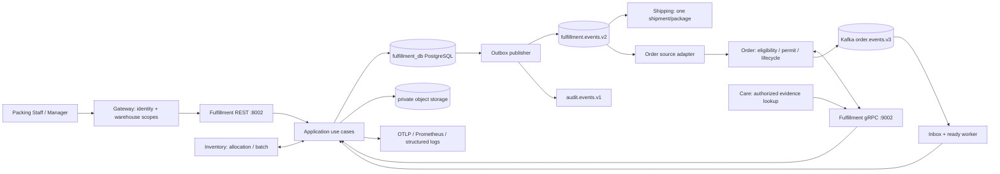

# 00 — High-level design Fulfillment

Baseline 1.0, 30/10/2026, candidate. [Index](README.md) · [Domain](01_domain_and_invariants.md) · [Integration](08_integration_and_extensibility.md).

## 1. Bài toán và quality attributes

Mè xửng có nhiều quy cách SKU, hạn sử dụng và batch; đơn từ Web trước, các kênh khác về sau. Fulfillment phải đảm bảo nhân viên dùng đúng snapshot và batch đã cấp, phân biệt công việc bị chặn, lưu bằng chứng niêm phong, và không tạo vận đơn từ thông báo chưa được kiểm chứng. Chọn consistency cho admission/seal; queue đọc có thể trễ có chỉ báo freshness.

| Thuộc tính | Quyết định | Giới hạn |
| --- | --- | --- |
| Correctness | PostgreSQL private DB, unique task/order, barrier lock/order | Không distributed transaction với Order/Inventory |
| Recoverability | Registry, exact revisions, inbox/outbox, stable identities | At-least-once delivery; không hứa exactly-once Kafka |
| Security | Staff + service identities, warehouse ABAC, private media | Quyền IAM/production scanner còn cần provider |
| Availability | Queue read độc lập broker; mutations fail closed khi thiếu authority | Không fallback giả lập vào production |
| Extensibility | Ports, policy snapshot, task/parcel riêng, protocol versions | MVP chưa cho split shipment hoặc accepted-stop |
| Operability | Separate admission, packing, delivery, integration health | Không dùng trạng thái “thành công” chung cho mọi bước |

## 2. Boundary và hệ thống bên ngoài



Ports là **đề xuất** theo convention 800x/900x; actual Compose binding phải kiểm va chạm. Không expose gRPC/DB/S3 admin trực tiếp Internet. `fulfillment_db` có migrations riêng; Redis không cần cho correctness, chỉ cân nhắc read cache sau đo.

## 3. Modules và dependency direction

| Module | Responsibility | Không làm |
| --- | --- | --- |
| Admission | Order/generation barrier, permit, registry, tombstone | Không quản payment |
| Packing workflow | Queue, assignment, picking, checklist, local blocks | Không chọn batch bằng FEFO query chung |
| Parcel | Measurements, seal, package identity, immutable handoff | Không tạo shipment |
| Evidence | Upload session, verification, links, controlled read | Không dùng Care bucket/ticket DB làm DB chung |
| Integration | Peer adapters, inbox/outbox, exact revision, durable jobs | Không biến event thành authority vượt ACL |
| Operations | SLA, recovery cases, audit, telemetry, config gates | Không cho staff PATCH state tùy ý |

Chỉ application layer phối hợp các module trong một local transaction. Domain trả decisions/events dự kiến; infrastructure thực hiện save. Query projection không được gọi trực tiếp vào domain mutation.

## 4. Happy path đã phân ranh giới commit

```mermaid
sequenceDiagram
    participant O as Order
    participant F as Fulfillment
    participant I as Inventory
    participant D as Fulfillment DB
    participant P as Packing Staff
    participant S as Shipping
    O-->>F: fulfillment_ready.v3 (inbox durable)
    F->>O: GetFulfillmentPermit(order,generation,key,digest)
    F->>O: GetPackingSnapshot (candidate provider)
    F->>I: GetCommittedPackingAllocation (candidate provider)
    F->>O: ValidateFulfillmentPermit
    F->>D: Lock Order guard; ACCEPTED + task + revision + outbox
    F-->>O: task.accepted.v1 candidate -> exact accepted source adapter
    D-->>P: READY task
    P->>F: Assign, start, scans, checklist, media verify
    P->>F: Seal(expected_version, stable key)
    F->>I: ValidatePackingAllocation (candidate provider)
    F->>D: Lock task; verify proofs; COMPLETED + package + revision + outbox
    F-->>O: Adapter resolves PACKING_SEALED exact revision
    F-->>S: packing.completed.v2 via outbox
    S->>O: GetShippingSnapshot(order,package)
    O-->>S: Snapshot eligible after authoritative packing proof
    S->>S: Create one shipment/package
```

Các RPC candidate không tồn tại mặc nhiên. Registry gate chặn integrated mode tới khi provider và consumer đạt. Nếu Shipping đọc Order sớm hơn adapter áp seal: retry/defer, không dùng địa chỉ hiện tại từ Profile thay snapshot và không tạo shipment thiếu điều kiện.

## 5. Các luồng không thuận

- **Hold trước admission:** Order không cấp permit; ready observation vẫn retained, task chưa được tạo. Retry đúng stage và cùng identity khi eligibility được khôi phục theo generation mới.
- **Cancel vs accept:** một Order guard ở Fulfillment quyết định winner. Cancel trước → durable CANCELLED; accept trước → Cancel REJECTED, Order giữ workflow xử lý thực tế; không tự restock.
- **RPC timeout:** caller UNKNOWN; query original key/action. Không map timeout thành no-op hoặc generate key mới.
- **Batch hỏng/hết hạn:** local block, không seal; Inventory quyết định recall/reallocation. Proof chỉ xác nhận checkpoint, không ngăn mọi quarantine xảy ra sau đó.
- **Kafka lỗi sau seal:** package đã đóng gói cục bộ; outbox pending, Shipping chưa chắc có vận đơn. UI có trạng thái pending integration.
- **S3 lỗi:** task video-required không seal. Task không cần video ở domain vẫn có thể hoàn tất local nhưng không được phát event v2 hiện tại nếu thiếu video.
- **Restore:** giữ admission/publisher disabled, reconcile peer và object versions, không replay command bằng key mới.

## 6. Read model, SLA và performance target

Queue dùng PostgreSQL primary, filter theo warehouse + state + assignee + channel; cursor keyset theo `(packing_due_at NULLS LAST, admitted_at, task_id)`, có `queue_as_of`. Deadlines do Order snapshot/policy version cấp, không tự cộng 4 giờ cho mọi đơn. Task blocked hiển thị lý do và không trộn vào queue ready.

Mục tiêu **đề xuất để benchmark**, chưa là SLA: read P95 ≤300ms/P99 ≤800ms ở 50 concurrent staff, 100k tasks/10k active; local mutation P95 ≤500ms chưa tính upload và peer RPC; outbox handoff P95 ≤5s khi Kafka khỏe. Peer deadline 2s/attempt, bounded fan-out, retry backoff. Đo với dữ liệu/queries/DB/network thực; không lấy unit benchmark làm network latency.

Scaling API stateless; workers claim jobs/outbox bằng `SKIP LOCKED` và lease. Không chia DB theo warehouse từ đầu; index + partition archival khi đo chứng minh cần. One Order serialization là chủ đích, các Order khác xử lý song song.

## 7. Trade-offs đã chọn

PostgreSQL row locks dễ kiểm chứng hơn distributed Redis lock cho admission; DB unique constraints chặn absence race. Online permit thêm một dependency nhưng giữ authority ở Order. Event-driven handoff tránh transaction qua broker nhưng cần projection/recovery. Một task/package MVP giảm rủi ro proof và split-shipment; schema vẫn tách parcel để mở rộng mà không đổi identity cũ. Media storage qua port theo kiểu Care, nhưng owner Fulfillment và retention riêng.
