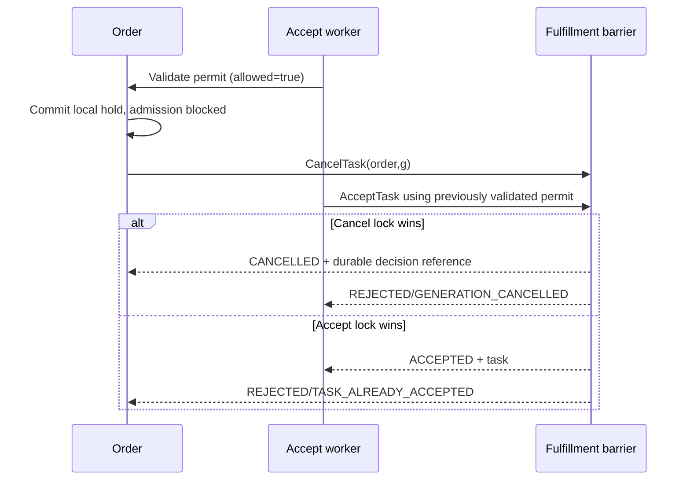

# 02 — State machines, generation và concurrency

[Index](README.md) · [Use cases](04_usecases_and_orchestration.md). Các state dưới đây là thiết kế mục tiêu, không phải enum runtime đã có.

## 1. Tách các lớp trạng thái

| Layer | States | Authority |
| --- | --- | --- |
| Admission decision | OPEN, ACCEPTED, CANCELLED | Fulfillment barrier; trả trong TaskDecision |
| Packing workflow | READY, ASSIGNED, IN_PROGRESS, BLOCKED, COMPLETED | Task aggregate |
| Package | DRAFT, SEALED; VOID dành future rework | Package trong task transaction |
| Evidence | CREATED, UPLOADED, VERIFYING, VERIFIED, REJECTED, EXPIRED, DELETE_PENDING, DELETED | Media worker/storage adapter |
| Worker job | PENDING, RUNNING, RETRY_WAIT, SUCCEEDED, MANUAL_REVIEW | Worker; không ghi vào resource state |
| Integration observation | PENDING, ACKNOWLEDGED, DEFERRED, MANUAL_REVIEW | Theo peer và source revision, không là task lifecycle |

Một `READY` task nghĩa là đã ACCEPTED admission và đủ input local; chưa có nhân viên. Ready observation chưa được accept không tạo `READY` task giả. `BLOCKED` không biến admission về OPEN/CANCELLED. Task không có `CANCELLED` trong MVP: chỉ barrier chưa accept mới hủy được. Domain state trong EPIC được tinh chỉnh để giữ terminal protocol; xem ADR001.

## 2. Admission barrier

```mermaid
stateDiagram-v2
    [*] --> OPEN: first durable decision context
    OPEN --> ACCEPTED: valid online permit + lock + task commit
    OPEN --> CANCELLED: Order CancelTask + lock
    ACCEPTED --> ACCEPTED: query/replay; CancelTask REJECTED
    CANCELLED --> CANCELLED: query/replay; AcceptTask REJECTED
```

Absence khác OPEN: chưa thấy row thì query trả NOT_FOUND. Command mutation mới được tạo guard/OPEN row. Cả query NOT_FOUND và OPEN đều không phải remote-stop proof.

| Command | Current | Guard | Kết quả durable |
| --- | --- | --- | --- |
| AcceptTask | absent/OPEN | Permit verified, active generation, snapshot/allocation khớp, chưa ever-accepted | ACCEPTED + task + PACKING_ACCEPTED revision |
| AcceptTask | CANCELLED | Bất kỳ permit mới/cũ | REJECTED/GENERATION_CANCELLED; không reopen |
| AcceptTask | ACCEPTED | Same scope/key/hash | Original outcome; current admission vẫn ACCEPTED |
| AcceptTask | ACCEPTED | New key, cùng business binding | ALREADY_APPLIED + existing task; không task thứ hai |
| AcceptTask | bất kỳ | Different digest/warehouse/order intent | FAILED_PRECONDITION, không effect |
| CancelTask | absent/OPEN | Trusted Order, generation hợp lệ, guard chưa từng có task accepted | CANCELLED tombstone + DecisionReference |
| CancelTask | CANCELLED | New key đúng binding hoặc replay | Terminal current decision + original command evidence tương ứng |
| CancelTask | ACCEPTED | Any cancel reason | gRPC OK + REJECTED/TASK_ALREADY_ACCEPTED + task identity |
| GetTaskDecision | any existing | Authorized query | Current resource + optional original command; không mutate |

`ALREADY_APPLIED` chỉ cho same intended accepted resource, không cho phép digest/warehouse khác. Business reject được lưu registry với original reason/decision_id/time; timeout/DB unavailable không giả ra REJECTED. Validation syntax/ACL/hash mismatch là transport error theo Order3.2.

## 3. Order guard và generation

Guard keyed `order_id` gồm `highest_generation`, `accepted_task_id` và timestamps. Lock order là **guard → admission → task → package → media IDs tăng dần → command/outbox/audit**. Mọi path dùng cùng thứ tự, kể cả initial insert/cleanup. Không lock remote service.

1. `INSERT guard ... ON CONFLICT DO NOTHING`, sau đó `SELECT ... FOR UPDATE`. Unique key bảo đảm absence race không tạo hai guard.
2. Generation phải dương, do Order phát hành. `g < highest_generation` không được accept dù permit cũ còn hạn. Query generation cũ vẫn trả lịch sử nếu có.
3. Mở generation cao hơn chỉ khi Order cấp permit mới hợp lệ, các generation đang tồn tại trước đó đã CANCELLED và guard chưa có accepted task. Fulfillment không tự tăng generation để vượt tombstone.
4. `CancelTask(g)` từ Order có thể đến trước ready hoặc accept và tạo tombstone g. Nếu Order gửi g cao hơn, tăng high-watermark và chặn late accept thấp hơn; không tự biến record OPEN khác thành CANCELLED. Query generation cũ giữ đúng state/NOT_FOUND; Order phải cancel đúng generation để nhận proof cho Inventory. Cancel generation thấp vẫn được đóng đúng record khi chưa có task ever-accepted; high-watermark chỉ chặn accept cũ, không cấm thu hồi nghĩa vụ cũ.
5. Guard đã từng accepted giữ identity vĩnh viễn theo lifetime Order, không mở generation mới ngay cả task COMPLETED. Rework chưa được bật không xóa/đổi flag.

Nếu CancelTask yêu cầu một generation khác sau khi guard đã có accepted task, trả FAILED_PRECONDITION/ORDER_ALREADY_ACCEPTED với accepted task/generation reference, không tạo CANCELLED tombstone cho generation mới. Trả proof CANCELLED của generation chưa chạy trong khi generation cũ đã accepted có thể làm Inventory hiểu sai rằng cả Order đã dừng. Với đúng generation đã accepted, trả TaskDecision ACCEPTED + REJECTED như bảng trên.

Hai số version độc lập: `TaskDecision.resource_version` là version admission của `(order,generation)`; `TaskRevision.resource_version` là version task. `DecisionReference` cho Inventory bind admission version; packing event bind task version. Không dùng task version để validate cancelled barrier hoặc ngược lại.

## 4. Accept/cancel race và Order hold

Online validation không loại hết khoảng đua tới Fulfillment commit. Chính barrier quyết định winner. Order chỉ báo hard-stopped sau proof CANCELLED, không từ local hold. Khi task đã accepted, hard stop/reversal phải đi protocol khác chưa có; local block hỗ trợ vận hành nhưng không đủ restock authority.

Permit expiry được kiểm bằng DB clock sau khi lock, `decision_now < expires_at`; equality là hết hạn. Dùng `clock_timestamp()` tại điểm quyết định, không `now()` lấy từ transaction bắt đầu trước khi chờ lock. Peer clock skew phải có budget (đề xuất 2s guard margin), chưa đạt clock acceptance thì không mở cohort.

## 5. Packing task workflow

```mermaid
stateDiagram-v2
    [*] --> READY: ACCEPTED + full input snapshot
    READY --> ASSIGNED: AssignSelf / manager assign
    ASSIGNED --> READY: unassign before work
    ASSIGNED --> IN_PROGRESS: Start
    IN_PROGRESS --> BLOCKED: mismatch / quality / media / authority
    ASSIGNED --> BLOCKED: operator records issue
    READY --> BLOCKED: quality/integrity signal
    BLOCKED --> READY: resolve all blocks; resume_state READY
    BLOCKED --> ASSIGNED: resolve all blocks; resume_state ASSIGNED
    BLOCKED --> IN_PROGRESS: resolve all blocks; resume_state IN_PROGRESS
    IN_PROGRESS --> COMPLETED: Seal with all guards
    COMPLETED --> COMPLETED: replay / append evidence amendment
```

`resume_state` pin lúc first block; nhiều block độc lập theo `(task,source,source_reference)` và status ACTIVE/RESOLVED. Resolve một block không clear các block khác. Recheck quyền, assignment, allocation/policy và existing active blocks trước resume; không reset picks/checklist đã đúng. Nếu cần sửa input thì explicit revision/migration, không silently rewrite snapshot.

| Mutation | State cho phép | Version / authority | Outcome |
| --- | --- | --- | --- |
| AssignSelf | READY | expected task version; warehouse permission | ASSIGNED, assignee=actor |
| Reassign | ASSIGNED hoặc BLOCKED | Manager + reason + version | History append, assignee changed; picks/checklist actor history retained |
| Unassign | ASSIGNED, chưa picks/checklist work | Current assignee hoặc manager | READY |
| Start | ASSIGNED | Actor=current assignee | IN_PROGRESS |
| RecordPick | IN_PROGRESS | Assignee, exact allocation revision | Upsert counted result theo stable line/batch slot; không blind increment retry |
| ConfirmChecklist | IN_PROGRESS | Assignee, template item exists | Store per-item result/evidence/actor |
| Block | READY/ASSIGNED/IN_PROGRESS | Staff entitlement hoặc trusted signal | BLOCKED + source reason |
| ResolveBlock | BLOCKED | Source authority/manager đúng scope, revalidate | Còn block → BLOCKED; hết → resume_state |
| Seal | IN_PROGRESS | Assignee + no blocks + all guards | COMPLETED, SEALED, immutable source revision |
| Reopen | COMPLETED | Feature disabled MVP | 409 FEATURE_DISABLED, no change |

Task version tăng trên mỗi mutation mới có effect kể cả assignment/checklist/block. Replay cùng command không tăng version. `If-Match` stale với key mới →412; replay same key/hash trả original outcome trước so version hiện tại, nhưng luôn kiểm quyền hiện tại.

## 6. Package và handoff

Package DRAFT được tạo trong admission transaction; measurements/scans có thể sửa trước seal theo version. Seal atomically cố định `package_id, seal_code, actual parcel, task_version, packed_at, ready_generation, input snapshot references`. Unique task→package MVP. Order source adapter và Shipping phải cùng dùng package ID này.

`COMPLETED` chỉ kết thúc công việc local. Integration projections theo peer: `order_source` và `shipping` riêng. Kafka ACK chỉ chứng minh broker nhận; để hiển thị “Order đã PACKED”/“vận đơn đã tạo” phải đọc peer authority hoặc event đã verify. Stale projection không được disable outbox recovery hay tự gọi carrier lần hai.

## 7. UNKNOWN, expiry và terminality

- Worker chưa biết accept/seal có commit không: giữ request bytes/hash/key, query command registry/resource rồi retry original. Không renew permit bằng cách sửa request đang UNKNOWN.
- Nếu original accept request hết hạn mà chưa effect, gửi lại original để nhận durable REJECTED; chỉ sau kết quả terminal mới tạo admission attempt mới với key và permit mới. `NOT_FOUND` một lần chưa đủ kết luận request trước không thể còn đang bay.
- Evidence upload hết TTL không gia hạn URL vô hạn; new session key/object mới, old session EXPIRED. Object đã VERIFIED/attached không bị orphan cleanup xóa.
- Checklist/policy/task không tự expire vì permit hết hạn sau ACCEPTED. Permit chỉ cấp quyền admission; replay accepted không bị thu hồi hồi tố.
- Outbox published flag, resource terminal và remote integration terminal là ba điều khác nhau. Không dùng cleanup worker để gán chúng cùng “DONE”.
