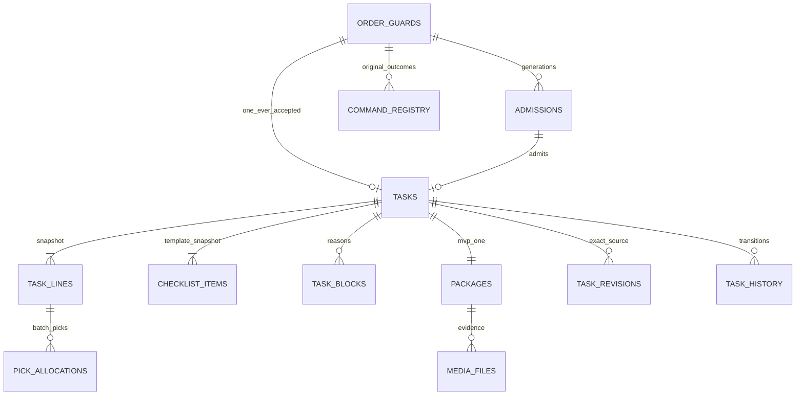

# 03 — Persistence, transactions và retention

[DDL candidate](fulfillment_persistence.candidate.sql) · [Lifecycle](02_state_machine_and_lifecycle.md). PostgreSQL private DB, reference schema `fulfillment`; SQL là **candidate**, chưa phải migration runtime. Extensions và roles thực tế do deployment review.

## 1. Logical/physical mapping

| Table | Key / unique | Nội dung |
| --- | --- | --- |
| order_guards | order_id PK | generation high-watermark, accepted_task_id lifetime |
| admissions | (order_id,generation) PK | OPEN/ACCEPTED/CANCELLED, admission version, decision identity/time |
| tasks | task_id PK; order_id UNIQUE | Workflow/version, immutable packing/policy/allocation snapshots, assignee, deadlines |
| task_lines | line_id PK; (task,order_line_id) UNIQUE | SKU/name/packaging/required quantity |
| pick_allocations | (task,line,batch) UNIQUE | Inventory allocated qty + observed counted qty, allocation revision/eligibility |
| checklist_items | (task,item_code) PK | Template text/version, required flag, result, actor/time |
| task_blocks | block_id PK; active source unique | source/reason/resume context, resolution audit |
| packages | package_id PK; task_id UNIQUE MVP; seal_code UNIQUE | Measurements, DRAFT/SEALED, seal time/version |
| media_files | file_id PK; object_key UNIQUE | Session/object version/checksum/scanner/lifecycle/link/retention |
| task_revisions | (task_id,resource_version) PK | Kind + original occurred_at + immutable source payload |
| command_registry | (caller,action,order,key) PK | Hash, original decision, task reference and response snapshot |
| task_history | history_id PK | Before/after, actor, reason, task version |
| inbox | (source,event_id) PK | Payload hash/original bytes, source position/disposition |
| outbox | event_id PK; stream/version/ordinal UNIQUE | Immutable envelope, topic/key, lease, delivery attempts |
| jobs | job_id PK; dedupe_key UNIQUE | Stage/input/key, attempts, retry/reconcile schedules, lease/epoch |
| audit_entries | audit_id PK; entity sequence UNIQUE | Local append-only audit + hash links; exported via outbox |

Các JSONB snapshot là typed/versioned data để preserve original proof, không thay toàn bộ relational checks bằng blob. `schema_version` nằm trong snapshots. `CHECK` không kiểm sum qua child rows; aggregate invariants bắt buộc trong task transaction, có test độc lập. Không giả DB CHECK là đủ cho FUL-I08/11/12.

## 2. Transaction catalog

| Tx | Reads/locks | Atomic writes | Remote calls ngoài Tx |
| --- | --- | --- | --- |
| T0 inbox | Dedup inbox key/hash | Inbox disposition + ready job | Không gọi peer trong consumer transaction |
| T1 accept | Guard, admission, registry; snapshot/proof input already verified | ACCEPTED, guard accepted identity, task/lines/allocations/checklist/package, revision1, history/audit/outbox, registry | Order snapshot/permit + Inventory query/online validation trước lock |
| T2 cancel | Guard/admission/registry | CANCELLED tombstone hoặc REJECTED registry; audit | Không bắt buộc gọi Order ngược; transport identity Order |
| T3 task mutation | Guard, admission, task; relevant child rows | Version+1, affected picks/checklist/block/assignment, history/audit/registry | Authority lookup nếu cần trước lock |
| T4 seal | Guard/task/package/media, registry; validate versions/deadline | COMPLETED/SEALED, exact revision, command result, history/audit, packing outbox | Inventory freshness check, media verification trước Tx |
| T5 media verify | File/session row + expected version | VERIFIED hoặc REJECTED; durable audit/job | HEAD/version/checksum/scanner ngoài Tx |
| T6 media access | File/task + permission evidence | Access audit + audit outbox | URL signing sau audit commit; log không chứa URL |
| T7 publish | Stream-head claim/lease | ACK disposition sau broker ACK | Kafka send nằm giữa claim và ACK Tx |

Mọi mutation có relevant expected version. File verify chỉ apply khi session/object version và lease epoch còn đúng; stale scanner result không thay media mới. Seal proof phải bind task input/allocation version đã đọc; task thay trong khoảng remote query → DB lock thì abort/retry original command với logic query lại, không đổi payload expected_version.

## 3. Isolation và lock protocol

READ COMMITTED + explicit guard/task locks đủ cho một Order aggregate; multi-row uniqueness bảo vệ race. Khi command scope chưa có row, lock guard trước lookup/insert registry. Không `SELECT ... FOR UPDATE` trên row chưa tồn tại rồi cho rằng đã khóa absence. Constraint violation được map thành re-read/replay/conflict, không generic 500 tạo retry identity mới.

Seal lock package và media IDs theo thứ tự tăng. Upload completion trước khi attach không cần giữ guard lâu; attach/seal đồng thời media cleanup: cleaner lock media và kiểm attached under lock; cleaner không lock task sau media. Nếu cần task mutation, release và đi lại canonical lock order. Tránh deadlock task→media vs media→task.

Read methods query primary khi dùng làm proof. Replica/cache chỉ queue display có `as_of`; không dùng replica lag để trả terminal absence. `observed_at` lấy DB clock, original decision timestamp giữ nguyên. Peer call không kéo dài SQL lock.

## 4. Ambiguous commit, retries và durable results

Sau `COMMIT` mất ACK, caller giữ UNKNOWN. Recovery dùng connection mới đọc registry trên primary với scope/key/hash, kết hợp business resource. Nếu row có outcome → trả original outcome. Nếu chưa thấy row và original transaction còn có thể commit → không nói FAILED chắc chắn; retry cùng command qua guard sẽ serialize với transaction đó. Statement retry chỉ cho serialization/deadlock có bounded attempts; không tự retry side effect peer/Kafka/S3 bằng key mới.

Response cache có thể hết hạn, registry identity/hash/original decision và business uniqueness phải còn. DDL giữ response JSONB cho dễ implement; nếu prune response về sau, reconstruct từ immutable decision/revision, trả 410 outcome-expired khi không đủ chi tiết, vẫn không cho reuse key. No-op replay không tạo history/outbox mới.

## 5. Index và query design

Queue index `(warehouse_id,workflow_state,packing_due_at,admitted_at,task_id)`; assignee queue index riêng. Keyset dùng cùng null order và tuple ordering, cursor opaque có scope/filter hash; không nhận client SQL sort tùy ý. List limit 1–100, default25. Record keyset high-water `queue_as_of` để filter newly-created tasks giữa pages; deadline update có thể đổi vị trí, client refresh thay vì hứa snapshot isolation qua nhiều HTTP calls.

Reconcile jobs index `(state,next_run_at)` và lease expiry. Outbox index pending stream head; poison event không chặn unrelated Order streams. Không partition active tables sớm; archive history/media metadata theo policy khi measured size cần. UUID/order/task/seal không dùng làm metric label.

## 6. Integrity, audit và privileges

Application role không UPDATE/DELETE `task_revisions`, committed audit entries và admission terminal state qua API tổng quát; migrations role riêng. Schema candidate có constraints phổ biến; immutable transition rules còn cần repository transaction và role policy khi implement. Audit hash-chain sequence per entity, serialize cùng task; canonical codec phải pin. Append reason actor/source, redacted before/after; Audit exporter unavailable không rollback successful business mutation khi local audit đã durable.

Package `seal_code` normalized trước ghi, giữ unique sau archival bằng seal registry hoặc archive cùng uniqueness key. Đừng drop archived package rows nếu làm mất seal reuse guard. Media object key không tái dùng; storage version pin, không tin ETag multipart là SHA-256.

## 7. Retention đề xuất, không phải kết luận pháp lý

| Data | Đề xuất kỹ thuật | Điều kiện xóa |
| --- | --- | --- |
| Command response cache | ≥7 ngày | Không xóa identity/hash/outcome cùng lúc |
| Registry detail | ≥30 ngày, compact identity suốt lifetime Order | Không còn inflight/replay window chưa kiểm soát; giữ permanent denial identity |
| Guard/tombstone/accepted task/seal identities | Lifetime Order + replay/restore horizon; không tái dùng IDs | Không TTL tự động cho anti-replay authority |
| Media original | Policy đề xuất90 ngày; legal/case hold override | Không active case/hold, không pending proof/rework; manager policy sign-off |
| Unattached upload | Sau session expiry + grace24h | Under-lock check not attached/verified-required; object version exact |
| Revisions/audit/outbox archive | Theo operational retention đã chốt | Không mất original proof khi peer replay/dispute/restore |

Media deletion có DELETE_PENDING ledger, object-version delete idempotent và final metadata receipt. Không xóa original evidence bằng thao tác “replace file”. Khi phải xóa nội dung theo policy, giữ metadata hash/timestamps/access reason cần thiết và ghi `content_unavailable`, không trả URL giả.

## 8. Backup/restore

Backup DB phải đi cùng object version manifest và Kafka checkpoint/remote association ledger. Restore không rollback peer: disable admission/seal/effect workers/publisher, giữ read/query restricted, so guard/task/package revisions với Order/Shipping và object HEAD. Query exact command/resource bằng key gốc, xử lý accepted task hoặc shipment tồn tại ngoài DB backup qua durable recovery case. Không xóa guard để “thử lại”. Chỉ mở lại cohort mới sau reconcile và sign-off; nghĩa vụ cũ tiếp tục recovery theo protocol cũ.
