# 07 — Media, authorization và threat model

[API](05_api_contracts_and_transports.md) · [Persistence](03_database_and_persistence.md). NFR-04/05/08/09, BR-PACK-03/04/05. Chọn private S3-compatible storage qua port, cùng kiểu lifecycle đã thấy ở Care nhưng **metadata, bucket/prefix, permissions và ownership riêng**.

## 1. Identity and trust boundaries

REST verify JWT issuer/signature/time và dedicated audience `fulfillment-api` hoặc verified Gateway delegation profile đã thống nhất. Không suy Order token `order-api` dùng được ở Fulfillment. Internal gRPC cần verified service identity/audience, TLS và method ACL; MVP local token profile chỉ môi trường isolated, không tuyên bố mTLS production đã có.

Public headers `X-User-ID`, `X-Role`, `X-Permissions`, `X-Warehouse` không phải authority. Gateway phải strip browser input, chỉ inject context qua authenticated trusted channel. Backend verify trust channel và signed/verified principal; không nhận direct network request dùng forged headers. Identity revoke/employee membership changes phải được kiểm ở thời điểm mutation/access theo policy cache TTL đã nghiệm thu.

## 2. Permission/ABAC matrix

| Capability | Packing Staff | Warehouse/Sales Manager | Care | System admin |
| --- | --- | --- | --- | --- |
| Read queue/task | Assigned warehouse | Scoped warehouses | Chỉ data cần case nếu allowlisted | Chỉ khi có business permission |
| Assign self/work/seal | Current assignee+warehouse | Có thể assign/reassign; seal vẫn cần assignment | Không | Không mặc định |
| Resolve block | Operator source theo policy | Quality/operational scope + reason | Không clear stock/financial gate | Không override authority |
| Upload/link evidence | Assigned active task | Explicit repair permission pre-seal | Không | Không mặc định |
| View video | Explicit task permission | Scoped purpose | Case entitlement+purpose/delegated actor | Explicit permission, no blanket role bypass |
| Cancel admission | Không | Không | Không | Không; Order service only |
| Exact revision query | Không raw proof surface | Recovery read permission | Media-only scope | Service ACL riêng |

Object reference không cấp quyền. Cross-task/package/warehouse access bị chặn dù file_id đoán đúng. User role string trong legacy gRPC request chỉ được so với verified delegated context; requester mismatch reject. Customer-facing video access mặc định disabled tới khi Order ownership API đã ratify; không lấy customer_id self-declared làm proof.

## 3. Media lifecycle và immutable object

```mermaid
stateDiagram-v2
    [*] --> CREATED: server creates scoped session
    CREATED --> UPLOADED: CompleteUpload + object observed
    UPLOADED --> VERIFYING: durable scanner job
    VERIFYING --> VERIFIED: checksum/type/scan pass; CAS object version
    VERIFYING --> REJECTED: validation/scanner rejection
    CREATED --> EXPIRED: session deadline passed
    UPLOADED --> EXPIRED: verification policy deadline
    REJECTED --> DELETE_PENDING: orphan cleanup eligible
    EXPIRED --> DELETE_PENDING: orphan cleanup eligible
    VERIFIED --> DELETE_PENDING: retention + no hold + explicit eligibility
    DELETE_PENDING --> DELETED: exact object version confirmed deleted
```

Upload session binding: file_id/task_id/package_id/purpose/uploader/declared size/type/SHA256, object_key server-generated, expiry immutable. Đề xuất TTL10 phút, video MP4/WebM allowlist, max200MiB/max10 phút, one primary video/package; đây là policy proposal cần capacity/UX review, không claim browser/runtime hỗ trợ codec đầy đủ. Không nhúng extension file hoặc order number người dùng vào filesystem path.

Direct upload policy scoped exact key/method, content size/type nếu backend hỗ trợ; complete dùng server HEAD size/type/version và checksum thật. Không tin MIME từ browser; magic/container probe và scanner adapter cần acceptance. SHA256 khai báo so actual storage checksum hoặc stream hash an toàn; ETag multipart không phải SHA256. Storage capability thiếu checksum/versioning phải dùng staged object + server promotion vào immutable final key; cohort không được bật khi still mutable.

Presigned upload URL có thể replay trước expiry. **Không verify một key còn có thể bị overwrite rồi coi đó là bằng chứng bất biến.** Chọn bucket versioning + pin version_id cho HEAD/GET và event resolution, hoặc upload vào staging rồi COPY verified bytes vào final key write-once, deny client writes/deletes. Event v2 chỉ có object key, không version_id: chọn final immutable key trong event; DB vẫn pin version/checksum. G02/G09 giữ gate nếu storage chưa đáp ứng.

## 4. Link evidence và seal

Mỗi file được tạo sẵn cho một task/package; attachment không “chuyển owner”. Seal lock media rows và kiểm VERIFIED, current safe scan policy, exact checksum/object_version, same task/package, not deletion-pending, retention hold. Required media chọn `primary_evidence_id`, event v2 uses immutable final object key/checksum. Additional videos có thứ tự liên kết; không phát nhiều packing.completed cho mỗi video.

Post-seal amendment append record/link mới với reason/actor, giữ primary evidence của original seal revision. Nếu cần thay primary vì chứng cứ sai → integrity case, không mutate original event/revision. Media view có thể hiển thị amendment lineage; không trình bày file mới như original packing proof.

## 5. Access URLs và audit

Read metadata không chứa raw object key trừ service ACL. `POST access` requires purpose + case reference khi Care; verify actor scope và case entitlement từ owning authority. Gọi case provider down →503, không relax permission. Sau local audit commit, sign GET exact immutable object with TTL min(policy,900s), đề xuất300s default. Không log URL/query signature; `Cache-Control: no-store`, trusted TLS only, referrer policy ở frontend.

URL là bearer capability tới hết hạn; revoke user sau khi cấp không thu hồi URL ngay. Nếu business cần revoke tức thời, dùng authenticated media proxy thay vì presigned GET; chưa implement thì ghi giới hạn và TTL ngắn. Credential storage read scope chỉ bucket/prefix cần thiết; video không public ACL/CDN cache. Storage direct deny anonymous và other tenant key.

Local access audit durable trước trả URL, không cần chờ Audit service online; persist failure to sign as separate attempt outcome. App không hứa đã ghi nhận mỗi byte download: URL issuance audit và object access logs là hai evidence khác nhau. Khóa audit append-only/privileges; hash chain đơn thuần không chống DBA rewrite toàn chain, cần independent checkpoint/signature storage theo Audit platform khi có.

## 6. Threat/control matrix

| Threat | Control | Verification |
| --- | --- | --- |
| Forged actor/role/service | Transport JWT/delegation + ACL; reject request body identity mismatch | FUL-T23/36 |
| IDOR/cross-order file link | Same task/package owner binding under lock | FUL-T20/23 |
| Late upload overwrites verified video | Staging/promotion or immutable version-pinned key | FUL-T21 |
| Fake checksum/type/scanner proof | Server-side checks, actual scan, CAS on object version | FUL-T18/19/22 |
| Expired URL/new session reuse | Immutable expiry and unique object key; no extend same URL | FUL-T19/24 |
| Presigned URL exfiltration | No logs/cache, minimum TTL, scoped key/version | FUL-T24/25 |
| Quarantine/cleanup races with seal | Task→package→file lock protocol, attached/legal hold recheck | FUL-T22/23 |
| Sensitive event leakage | Topic ACL, no customer PII/access URL, private object keys | FUL-T36 |
| Admin bypass | No blanket admin read/work rights, explicit business permissions | FUL-T23 |

## 7. Retention/cleanup và resource limits

Orphan cleanup chỉ CREATED/EXPIRED/REJECTED unattached eligible rows sau grace; lock file, mark DELETE_PENDING with exact key/version, commit; delete outside Tx; persist receipt. Nếu attachment race thắng trước → cleaner abort. Sealed evidence/legal hold không orphan dù job/upload session quá hạn. Object listing không là authority để xóa; DB file association là source.

Scanner sandbox limits CPU/memory/time, max inflight/file size; decode untrusted media ngoài API process nếu cần. Rate-limit session creation và access signing theo actor, global gateway và per-instance safeguards; không đặt unlimited in-memory map. Storage errors retry bounded, scanner UNKNOWN giữ VERIFYING/BLOCKED chứ không VERIFIED. Không tự gọi external scanning provider thật trong bước thiết kế này.
