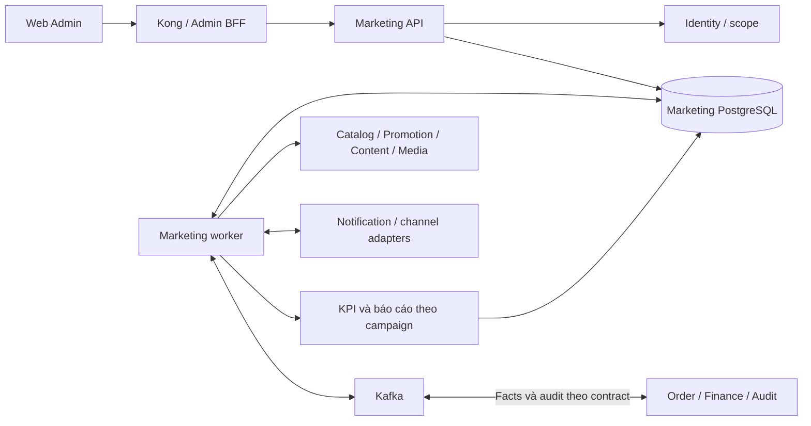

# MS-14 · Marketing Service

**Trạng thái đề xuất cho Phase 2.** Thiết kế triển khai BC-14 và EPIC 21. Dùng vòng đời chi tiết của EPIC 21 thay cho tên trạng thái khái quát trong mô hình BC-14. Các quyết định pilot ở mục 0 đã được chốt. Mã permission, endpoint và sự kiện vẫn là đề xuất cho đến khi được xác nhận trong contract.

Nguồn đọc [EPIC 21](../../../01_requirements/epics/EPIC_21_Marketing.md) · [BC-14](../../bounded_context.md#bc-14-marketing--campaign-context) · [MS-14](../../service_boundary.md#ms-14-marketing-service) · [Analytics runtime](../../../../services/analytics-service/README.md) · [Quy tắc contract](../../../03_api_specs/README.md).

[Thiết kế triển khai lát 1](01_planning_and_approval.md) mô tả workflow, transaction, Admin API draft và các ca nghiệm thu.

## 0. Quyết định đã chốt cho pilot

| Quyết định | Chính sách |
| --- | --- |
| Scope Campaign | Dùng scope IAM DEPARTMENT. Mỗi Campaign lưu departmentId, lấy theo mã phòng ban Marketing chính thức do Identity quản lý. Kiểm permission và scope từ cùng một permissionGrant. Chỉ cấp GLOBAL cho quyền cần thao tác xuyên phòng ban. |
| Duyệt ngân sách | Một cấp Executive với quyền duyệt Marketing theo scope. Cả người lập revision và người gửi duyệt đều không được tự duyệt. Lưu người duyệt, thời điểm, revision và số tiền được duyệt. Nếu pilot áp dụng hạn mức, cấu hình một trần do Executive xác nhận và chặn duyệt khi vượt trần. Ma trận nhiều cấp áp dụng khi có chính sách riêng. |
| Hồ sơ gửi duyệt | Mỗi kênh dự kiến triển khai có Content Brief. Khi gắn Product, kiểm Product đã được duyệt và đang công khai, lưu productId và version vào snapshot gửi duyệt. Nhu cầu Article, Promotion và Media được ghi trong brief. Khi kênh cần các asset này để chạy, chỉ cho triển khai sau khi xác minh tại nguồn. |

APPROVED xác nhận kế hoạch và ngân sách. Readiness triển khai được kiểm riêng theo từng kênh. Lấy mã phòng ban Marketing chính thức và cấu hình permission trong IAM trước khi mở pilot.

Căn cứ từ origin/dev tại 239c8db. Identity cung cấp GET /api/v1/users/me với permissionGrants theo scope. Catalog Admin cung cấp GET /api/v1/admin/catalog/products/{productId} với productId, slug, revision, approvalStatus và listingStatus. Endpoint public chỉ trả bản chiếu công khai.

## 1. Ranh giới dữ liệu

| Nguồn | Trách nhiệm của nguồn | MS-14 lưu hoặc sử dụng |
| --- | --- | --- |
| MS-14 | Campaign, revision, thẩm quyền áp dụng lúc duyệt, kế hoạch kênh, content brief, execution, KPI target và kết quả theo campaign | Dữ liệu nghiệp vụ trong PostgreSQL riêng |
| Catalog / MS-07 Promotion | Thông tin Product/SKU đã duyệt, hiệu lực và điều kiện Promotion; MS-07 sở hữu voucher hold, discount, loyalty | ID, version, readiness và bằng chứng kiểm tra. Checkout hoạt động độc lập với MS-14 |
| Content / Media | Article, publication, upload, scan, quyền sử dụng media | ID và version nguồn, trạng thái publication, immutable fileId. Upload qua session tới object storage |
| Identity / Audit | Phiên nhân viên, permission, scope; lưu audit tập trung theo contract | Actor ID, quyết định và audit nghiệp vụ, chuyển bản ghi sang Audit khi tích hợp sẵn sàng |
| Analytics / Profile | Segment theo version, dữ liệu đo lường dùng chung, consent theo mục đích | Segment reference/version. Danh sách người nhận được xử lý tại nguồn hoặc dịch vụ gửi |
| Notification / kênh ngoài | Dispatch, suppression, kết quả gửi; platform cung cấp số liệu của chính nó | Lịch, execution ID, external ID và trạng thái xác nhận. Kênh thủ công có bằng chứng thực hiện |
| Order / Payment / Finance | Đơn, giao dịch, hoàn tiền, chi phí và doanh thu đối soát | Tín hiệu nối Order–Campaign và facts tối thiểu có version/nguồn. Báo cáo tài chính lấy số liệu theo hợp đồng Finance |

Repo có Analytics Service đọc PAID/COMPLETED từ Kafka và dựng snapshot ClickHouse. Order v3 có schema paid, cancelled và refund_succeeded. Cần contract riêng để chứng minh tín hiệu nối với Campaign, phạm vi dữ liệu và số tiền Finance đã đối soát. Repo hiện chưa có runtime Marketing Service. Xác minh từng adapter bằng contract và smoke test trước khi bật trên môi trường dùng chung.

## 2. Topology và runtime

Đề xuất Spring Boot, Gradle, Flyway và PostgreSQL theo kiểu triển khai JVM sẵn có trong repo. Một image có hai runtime role API và worker, migration chạy riêng. API nhận command, kiểm quyền và trả read model. Worker xử lý lịch, outbox/inbox, đồng bộ và dựng tổng hợp. Các module trong service gồm campaign, approval, execution, measurement, attribution và adapters. API và worker scale độc lập, DB có credential theo vai trò, endpoint vận hành chỉ truy cập từ mạng nội bộ. Dùng tên DNS nội bộ với container port theo service registry, tránh host port cố định trên stack dùng chung. MS-14 được quy hoạch cổng 8014 và tài liệu Analytics cũng dùng 8014 cho metrics của một runtime, cần kiểm tra binding theo network trước khi chạy chung.

PostgreSQL đủ cho số liệu ngày theo campaign/kênh trong pilot. Đo dữ liệu và truy vấn trước khi cân nhắc đẩy bản sao fact sang ClickHouse của Analytics qua contract. Service nào sở hữu dữ liệu thì service đó cung cấp interface, không đọc DB chéo. Kết nối ngoài có timeout, quota riêng và secret reference. Adapter chưa có bằng chứng tích hợp được cấu hình tắt.

## 3. Domain và schema đề xuất

UUID cho ID nội bộ, TIMESTAMPTZ cho thời điểm. Lịch và báo cáo lưu thêm IANA timezone. Kỳ dùng khoảng nửa mở [start, end). Tiền VND pilot dùng BIGINT đơn vị đồng, metric/tỷ lệ dùng NUMERIC. Nguồn ngoại tệ giữ số tiền gốc, currency và độ chính xác. Chỉ quy đổi khi có tỷ giá, ngày áp dụng và version từ Finance.

| Bảng | Dữ liệu chính và ràng buộc |
| --- | --- |
| campaigns | id, department_id theo IAM, owner, current revision, scheduled/active revision, version. FK tổ hợp bảo đảm revision trỏ về đúng campaign |
| campaign_revisions | campaign_id, revision_no, base_revision_id, name, objective, thời gian/timezone, planned budget, state, version, submitted_at, plan_hash. UNIQUE(campaign_id, revision_no). Nội dung bị đóng băng lúc submit |
| channel_plans, content_briefs | revision_id, channel/account, lịch, required, owner, deadline, thông điệp, định dạng; lịch nằm trong kỳ revision. Thông tin quản trị kênh dùng account reference |
| revision_references | revision_id, channel/brief, kind, source_id, source_version, required, evidence_at, usage_valid_until. Audience chỉ lưu segment ID/version và mục đích |
| kpi_targets | revision_id, metric_definition_version, scope, source, period, unit, target và chiều so sánh. Version metric quy định công thức và aggregation |
| approval_requests, approval_decisions | revision, plan_hash, approval_policy_version, ngân sách đề xuất, số tiền duyệt, trạng thái, actor, lý do, thời điểm. Unique partial index cho một yêu cầu mở trên mỗi campaign. Quyết định lưu nối tiếp |
| executions | revision/channel plan, schedule slot, execution generation, desired state, observed state, external ID, version, next_attempt_at. UNIQUE(revision, channel_plan, slot, generation) |
| provider_mappings | provider, account, external campaign ID, internal campaign/execution, effective range, version. Cấm các mapping trùng khóa nguồn có kỳ hiệu lực chồng nhau |
| sync_runs, metric_fact_versions | checkpoint, kỳ, coverage và lỗi của lần chạy; fact theo provider/account/external ID, metric version, grain/kỳ nguồn, dimensions, unit/currency. Lưu version, hash, lineage và giá trị nguồn; current projection chọn bản hợp lệ mới nhất |
| attribution_assignments, finance_fact_versions | order reference, campaign/execution, evidence, model version và lịch sử điều chỉnh; facts theo source + fact ID + revision, có ngày nghiệp vụ, currency, reconciliation status |
| report_snapshots, audit_entries | kết quả tổng hợp theo campaign/revision/kỳ/version, coverage, source watermark, as_of; audit lưu actor/scope/action, object/version, lý do và thay đổi đã lọc dữ liệu nhạy cảm |
| outbox, inbox, idempotency_records | outbox có event ID cố định; inbox unique theo consumer + event ID; command record lưu actor/scope/action/key, hash chuẩn hóa và kết quả |

Index phục vụ danh sách campaign theo scope + updated_at + id, lịch theo scope + due_at và report theo campaign + kỳ + metric version. Facts được query theo grain đã định nghĩa; thêm partition theo ngày/tháng sau khi đo quy mô. Khi đọc dashboard lấy cùng report generation để số liệu, coverage và watermark nhất quán.

## 4. Vòng đời và nhất quán ghi

| Command | Từ → đến | Điều kiện và hiệu ứng |
| --- | --- | --- |
| Create / edit | ∅ → DRAFT / DRAFT → DRAFT | Kiểm scope, lịch, owner và version. Bản chỉnh từ revision cũ tạo revision mới và lưu base_revision_id |
| Submit | DRAFT → IN_REVIEW | Đủ kế hoạch, KPI, kênh, ngân sách và asset bắt buộc. Đóng băng plan hash và phiên bản chính sách, mở yêu cầu duyệt theo cấp ngân sách |
| Withdraw | IN_REVIEW → DRAFT | Yêu cầu đang mở, có lý do. Đóng request, lưu snapshot bằng chứng của lần submit trước khi mở lại bản chỉnh |
| Approve / reject / request changes | IN_REVIEW → APPROVED / REJECTED / NEEDS_CHANGES | Quyết định khớp request, revision, hash và version; kiểm scope và thẩm quyền còn hiệu lực. Từ chối/yêu cầu sửa có lý do, tạo DRAFT mới khi tiếp tục |
| Schedule | APPROVED → SCHEDULED | Lệnh riêng sau duyệt. Kiểm lại asset/quyền/kỳ và tạo execution cùng lịch trong transaction |
| Start | SCHEDULED → ACTIVE | Đến lịch, phê duyệt còn hiệu lực, ít nhất một execution được xác nhận chạy. Trạng thái từng kênh có thể khác nhau |
| Pause / revoke / cancel | SCHEDULED hoặc ACTIVE → PAUSED; APPROVED/SCHEDULED/PAUSED → CANCELLED theo điều kiện | Ghi lý do, vô hiệu hóa dispatch mới. Kênh từng chạy phải xác nhận dừng trước khi báo hoàn tất. Thu hồi approval trước chạy có thể hủy ngay nếu không có side effect đang chờ |
| Resume | PAUSED → SCHEDULED | Kiểm approval, tài sản, thời hạn và trạng thái kênh. Approval đã thu hồi yêu cầu revision mới được duyệt. Phục hồi theo operation kênh, giữ nguyên dedup key cho cùng lần gửi |
| Complete | ACTIVE hoặc PAUSED → COMPLETED | Kỳ kết thúc hoặc có quyết định kết thúc, các execution đã terminal. Dữ liệu đến muộn vẫn cập nhật report |

Campaign ID tồn tại xuyên suốt. Revision đang chạy giữ nguyên khi tạo hoặc duyệt revision kế tiếp. Đề xuất pilot chỉ có một revision được schedule/chạy cho mỗi campaign; lên lịch bản mới sau khi bản cũ đã đóng. Thay đổi ngân sách, target, audience, tài sản bắt buộc hoặc lịch đã duyệt đi qua revision mới. Kiểm hồ sơ gửi duyệt theo mục 0. Kiểm readiness của từng kênh khi schedule và ngay trước dispatch. Khi version nguồn đã chốt thay đổi, giữ snapshot đã duyệt, ghi lý do chặn và yêu cầu rà soát. Áp dụng chính sách một cấp Executive, cấm tự duyệt và kiểm trần ngân sách nếu được cấu hình theo mục 0.

Mỗi mutation dùng transaction cập nhật version, audit và outbox. Kiểm nguồn từ xa ngoài transaction; khi ghi xác nhận version nội bộ chưa đổi và bằng chứng nguồn còn hiệu lực, rồi kiểm lại tại dispatch. CAS theo expected version chống ghi đè; lock campaign theo thứ tự cố định trước revision/request cho lệnh đổi trạng thái. Idempotency-Key bắt buộc cho create/action. Cùng scope/actor/action/key và payload trả kết quả đã lưu sau khi kiểm quyền hiện hành; cùng key khác payload trả 409. Với submit lặp bằng key khác, trả request đang mở nếu cùng revision và plan hash. Audit gồm actor, quyết định, scope, hash/version, lý do, thời điểm và request ID.

## 5. Scheduler và side effects

1. Worker claim execution đến hạn bằng transaction ngắn và lease có generation. Dùng SKIP LOCKED cho nhiều worker, xử lý network bên ngoài transaction. Trước gọi adapter, kiểm generation, desired state, approval, asset readiness và consent/suppression tại điểm gửi do dịch vụ gửi thực thi.
2. Lưu intent trước khi gọi với command ID ổn định. Worker chỉ commit kết quả nếu còn lease/generation hiện hành. Khi timeout sau khi gửi, truy vấn bằng command ID hoặc replay cùng key nếu provider bảo đảm idempotency. Nếu chưa có bằng chứng, đặt trạng thái cần đối soát và chặn retry tự động có thể gửi trùng.
3. Pause/cancel cập nhật desired state và ghi stop intent. Nếu start đã bay tới provider, đối soát rồi gửi stop khi có external ID; giữ observed state là pending/unknown đến khi có xác nhận. UI hiển thị kênh đã dừng, còn chạy hoặc chưa rõ. Kênh thủ công ghi actor và evidence ref.
4. Outbox publish sau commit theo at-least-once. Consumer ghi inbox cùng transaction với side effect nội bộ rồi mới commit offset. Callback trùng/bị đảo thứ tự dùng event ID và version nguồn, callback mất thứ tự cần poll provider. Retry lỗi tạm thời có backoff/jitter; credential lỗi chuyển sang trạng thái cần xử lý. Replay dùng cùng identity và giữ lịch sử.

Ứng viên tích hợp Kafka gồm revision approved, execution requested/state changed và audit. Dùng CloudEvents, partition theo campaign ID cho các fact Marketing và mang aggregate version, correlation ID, request ID. Payload tối thiểu chứa ID nghiệp vụ và trạng thái, bằng chứng audit có quyền riêng. Bật publish khi có schema version, topic/ACL và consumer contract. Không dùng sự kiện approved để tự gửi notification khách hàng.

## 6. Đo lường và attribution

**Đồng bộ kênh.** Lịch sync theo provider/account và kỳ với một lease cho mỗi phạm vi. Tải từng trang vào staging, validate schema và ánh xạ theo mapping hiệu lực tại kỳ nguồn. Quarantine bản ghi thiếu hoặc mơ hồ. Cùng khóa và version/hash thì bỏ qua; cùng version khác hash thì đưa đi đối soát; correction có version mới tạo fact mới và cập nhật current projection. Nếu provider chỉ có snapshot, adapter cấp sequence theo lần nhận snapshot có thẩm quyền và serialize cùng phạm vi. Chỉ ghi checkpoint của trang đã commit. Trang/kỳ thiếu được đánh PARTIAL, giữ bản hợp lệ cũ với watermark cũ. Có backfill theo range và rebuild khi mapping đổi, mọi điều chỉnh có audit. Nếu bucket ngày của provider lệch timezone và thiếu dữ liệu theo giờ, giữ bucket nguồn và đánh dấu không thể quy đổi chính xác.

**KPI.** Report trả target, actual, variance = actual − target, tỷ lệ hoàn thành theo hướng KPI, formula version, unit, kỳ, coverage và as_of. Pilot ưu tiên impressions/clicks, provider-reported conversions và CTR = tổng clicks / tổng impressions theo cùng định nghĩa/coverage. Reach và unique users chỉ dùng aggregate do nguồn cung cấp cho đúng grain. Mẫu số bằng 0 cho giá trị tỷ lệ null. Coverage đề xuất NOT_SYNCED, NO_DATA, PARTIAL, COMPLETE, NOT_APPLICABLE, kèm freshness độc lập. Zero chỉ xuất hiện khi nguồn có giá trị 0 hoặc xác nhận coverage đầy đủ cho phép suy ra 0. Khi phân quyền, metric tài chính và metric suy ra tài chính bị loại từ API tổng hợp.

**Attribution đề xuất pilot.** Một Order được gán tối đa một Campaign trong một model version. Ưu tiên campaign/execution token first-party được xác thực và lưu tại thời điểm checkout, dùng touch hợp lệ gần nhất trước order_accepted_at trong window cấu hình. Chốt window, TTL token, scope và consent với Order/Product trước khi mở tích hợp. Kênh offline, cross-device và marketplace cần bằng chứng/contract riêng. Thiếu tín hiệu để unassigned và báo coverage; conversion từ provider chỉ lên KPI ngoài. MS-14 không nằm trên đường đồng bộ checkout. Replay dùng cùng evidence và model version; thay mô hình hoặc điều chỉnh assignment tạo bản ghi audit và report generation mới.

**Báo cáo tài chính.** Planned lấy ngân sách revision duyệt, committed/actual lấy fact Finance phù hợp, doanh thu quy gán lấy net revenue Finance theo Order đã match và trạng thái đối soát. Chốt cách tính thuế/phí/discount, kỳ ghi nhận và refund với EPIC 24. Mỗi refund hoặc điều chỉnh có ID nghiệp vụ, currency, kỳ và version; cùng ID không trừ hai lần. Giữ snapshot as_of cũ, rebuild kỳ ảnh hưởng theo chính sách khi hủy/hoàn/điều chỉnh tới muộn. Đề xuất hiển thị tỷ lệ doanh thu quy gán / actual cost với nhãn công thức rõ ràng. Chỉ gọi ROAS khi mẫu số là chi quảng cáo, chỉ gọi ROI khi đã có định nghĩa lợi nhuận được duyệt. Mẫu số bằng 0, thiếu nguồn hoặc khác currency chưa quy đổi trả null và lý do. So sánh nhiều campaign dùng cùng model/window, kỳ và currency, đồng thời hiển thị chênh lệch coverage.

## 7. Giao diện quản trị dự kiến

Prefix ứng viên /api/v1/admin/marketing. Danh sách bên dưới định hướng giao diện, cần đưa vào admin-draft-planned.openapi.yaml và cập nhật admin state matrix trước hoặc cùng lúc triển khai. Chuyển stable khi policy, auth/scope, ví dụ và contract tests được duyệt.

| Tài nguyên / thao tác | Quyền ứng viên ngoài scope phòng ban | Phản hồi chính |
| --- | --- | --- |
| GET/POST /campaigns, GET /campaigns/{id} | MARKETING_CAMPAIGN_VIEW / MARKETING_PLAN_EDIT | 200 list/detail, 201 create. Lọc state/owner/kỳ, cursor ổn định theo updated_at + id |
| POST /campaigns/{id}/revisions, PATCH /campaigns/{id}/revisions/{revisionId} | MARKETING_PLAN_EDIT và MARKETING_BUDGET_EDIT khi đổi ngân sách | 201/200, kiểm version bằng If-Match hoặc expectedVersion thống nhất trong contract |
| POST dưới revision cho submit, withdraw, approve, reject, request-changes | MARKETING_PLAN_SUBMIT / MARKETING_PLAN_APPROVE theo action; thêm budget authority khi duyệt | 200 trạng thái mới, 409 cho phiên bản cũ/xung đột workflow |
| POST dưới revision cho schedule, pause, resume, cancel, revoke; GET executions | MARKETING_EXECUTION_MANAGE / MARKETING_CAMPAIGN_VIEW, thu hồi approval cần MARKETING_PLAN_APPROVE | 202 và operation ID nếu đang chờ provider, GET operation trả kết quả từng kênh |
| GET KPI / sync runs; POST retry hoặc sửa mapping | MARKETING_KPI_VIEW / MARKETING_CHANNEL_MANAGE | 200 với coverage, 202 khi nhận job, trạng thái lỗi theo nguồn |
| GET financial performance | MARKETING_FINANCE_VIEW và scope | 200 với công thức và coverage, 403 nếu thiếu quyền tài chính |
| Gắn asset hoặc audience vào draft | MARKETING_PLAN_EDIT cùng MARKETING_MEDIA_USE hoặc MARKETING_AUDIENCE_USE và quyền từ nguồn | 200 với version/readiness hoặc lỗi theo trường; upload qua fileId bất biến |

Identity xác thực phiên employee và quyền hiện hành; Marketing kiểm scope ở query và command, kể cả cursor, operation và export nếu có. Role dùng để cấp bundle quyền. Mọi error dùng code/message/requestId, kèm lỗi trường khi phù hợp. 401 phiên absent/invalid, 403 thiếu permission/scope, 404 ID không tồn tại theo chính sách resource visibility, 409 xung đột revision/state/key, 422 dữ liệu nghiệp vụ không hợp lệ, 503 phụ thuộc cần thiết không khả dụng. Danh sách rỗng trả 200 với mảng rỗng và total=0. UI cần trạng thái loading, empty, lỗi, phiên hết hạn, quyền thiếu, stale revision và thao tác kênh đang chờ. Báo cáo quyền thường dùng DTO riêng với báo cáo tài chính để tránh rò rỉ qua field, filter và tổng hợp.

## 8. Vận hành và kiểm chứng

- Telemetry nối request, audit, outbox, job và callback qua correlation ID. Đo latency/error API, oldest due job, outbox age, sync coverage/freshness, execution chưa rõ kết quả, quarantine và reconciliation lag. Không dùng campaign ID làm metric label có cardinality cao. Log lọc token, PII và payload nguồn. Retention của fact/audit/evidence được xác nhận theo mục đích và yêu cầu truy vết.
- Migration theo expand/contract. Pilot có cờ riêng cho route, dispatch, provider sync và finance. Khi tắt dispatch, giữ đối soát và các lệnh dừng đang chờ. Backup/restore PostgreSQL phải thử cùng outbox và checkpoints; trước khi bật lại sender sau restore, đối soát external execution IDs và command evidence.
- Test workflow theo bảng transition, bao gồm tự duyệt, thiếu thẩm quyền và version cũ. Test tích hợp với PostgreSQL/Kafka cho concurrent submit, approve vs withdraw, crash trước/sau publish, expired lease và cancel vs provider start. Test adapter cho timeout sau side effect, callback trùng/đảo thứ tự, token hết hạn và provider quota. Test report cho correction/partial/no data, timezone, tiền tệ, không cộng reach, refund lặp và cô lập quyền/scope.
- Điều kiện mở pilot gồm E2E qua Kong với phiên staff thật, source adapter được owner xác nhận, dữ liệu KPI/Finance đối soát với nguồn, diễn tập tắt dispatch và phục hồi worker. Chốt SLO, freshness và giới hạn truy vấn theo khối lượng pilot trước khi công bố.

## 9. Các lát triển khai

| Lát | Kết quả và điều kiện nghiệm thu | Truy vết |
| --- | --- | --- |
| 1. Planning và approval | Schema, CRUD draft, brief, asset references, policy, review và audit. Test version, scope, submit lặp và approval | US-MKTG-01~04, FR-MKTG-01~12, 24~25 |
| 2. Execution | Lịch và kênh thủ công có evidence, sau đó adapter Notification hoặc một kênh được duyệt. Diễn tập dừng một phần và đối soát timeout | FR-MKTG-12, 25~26 |
| 3. Measurement | Một nguồn/kênh có mapping rõ, sync, quarantine, KPI và coverage. Chứng minh replay, correction và dữ liệu một phần | US-MKTG-05~06, FR-MKTG-13~20 |
| 4. Finance | Chốt signal nối Order, facts Finance, chính sách attribution và công thức. Đối soát hủy/refund, quyền tài chính và report as_of | US-MKTG-07, FR-MKTG-20~25 |

Marketing và Executive chốt taxonomy, các trường bắt buộc còn lại và chính sách sửa lịch/ngân sách. Xác nhận mã phòng ban với Identity và mức trần ngân sách với Executive nếu pilot áp dụng hạn mức. Content, Promotion, Media, Analytics và Notification chốt version/readiness, quyền audience, consent và contract gửi. Marketing Ops chốt provider, KPI dictionary, lịch đồng bộ và retention. Order và Finance chốt bằng chứng attribution, window, tiền tệ, doanh thu, điều chỉnh và kỳ đối soát. Có thể triển khai domain và test với fixture trước khi các tích hợp tương ứng được xác nhận.

[Lộ trình bàn giao Web Admin và lát triển khai tiếp theo](02_handoff_and_next_steps.md)
