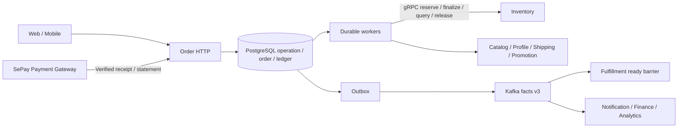
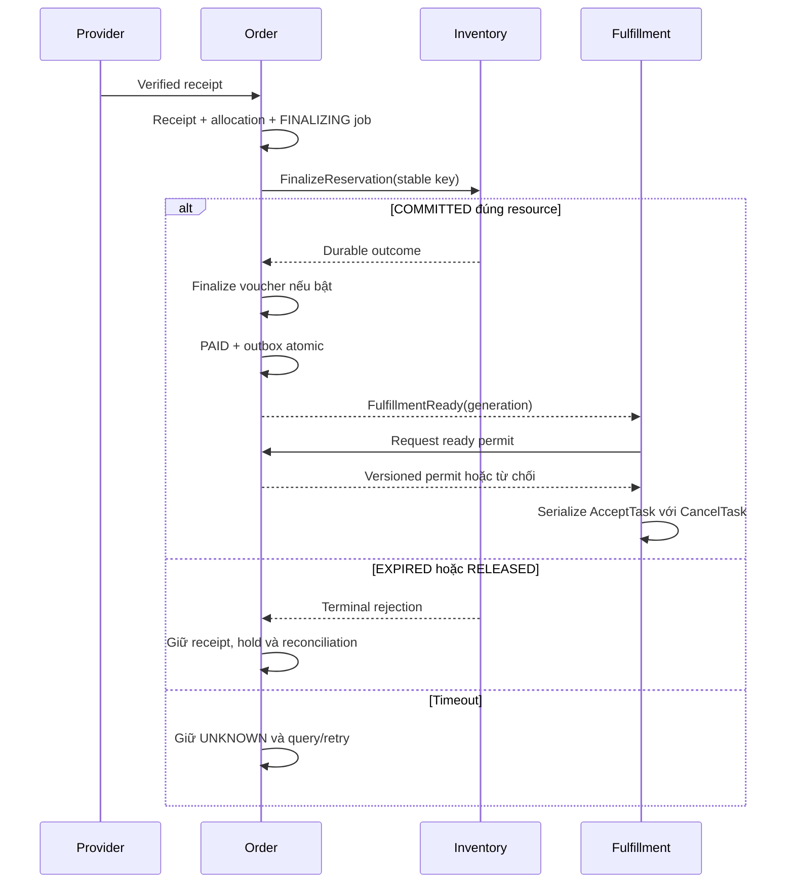

# MS-04 Order Service — HLD mục tiêu 3.2

> **Phạm vi áp dụng MVP 1 — 15/10/2026:** đọc [quyết định giao bản đầu](13_mvp_delivery_decisions.md). Chỉ khách đăng nhập, VietQR chuyển khoản qua SePay Payment Gateway; không COD/Guest/voucher, không phương thức phụ, hoàn tiền thủ công có kiểm soát và dừng tự động tại DELIVERED. Các nhánh mở rộng dưới đây không bật trong MVP. Implementation sandbox của đợt đầu được ghi ở [báo cáo](14_mvp_implementation_and_adr_report.md); baseline 3.2 chưa được nghiệm thu tích hợp production.

Ngày hoàn thiện: 14/10/2026. Trạng thái: **baseline thiết kế để phối hợp tích hợp**. Provider phải xác nhận và triển khai capability trước khi bật integration; không tuyên bố đã deploy 3.2.

[Chỉ mục](README.md) · [ADR và gaps](07_decisions_and_contract_gaps.md) · [Báo cáo thay đổi](10_order_design_change_report.md)

## 1. Phạm vi và nguồn chuẩn

HLD này là nguồn chuẩn cho luồng Order và các tương tác liên quan trong HLD hệ thống. LLD 01–07 cụ thể hóa cùng baseline. Chương 08 giữ hành vi/bằng chứng sandbox 3.1; wire proposal 15/10 ghi contract mục tiêu; chỉ code/runtime evidence chứng minh phần đã implement. Chương 09 là review lịch sử tại SHA đã ghi; chương 10 giải thích thay đổi.

MVP 1: khách đã đăng nhập, một địa chỉ, một kho mặc định, VND, VietQR chuyển khoản qua SePay Payment Gateway. Không COD, Guest, voucher/loyalty hoặc phương thức phụ. Hoàn tiền thủ công có duyệt và bằng chứng; dừng tự động ở DELIVERED. Chi tiết và trade-offs tại [quyết định MVP](13_mvp_delivery_decisions.md).

## 2. Quyền sở hữu

| Chủ quản | Quyết định / dữ liệu |
| --- | --- |
| Order | snapshot, lifecycle, owner, operation, saga/jobs, readiness intent |
| Payment component trong Order | receipt, allocation, refund obligation/execution, provider reconciliation |
| Inventory | stock ledger, FEFO, reserve/finalize/expire/release/reverse, tombstone |
| Catalog / Shipping quote | coherent SKU/price/weight snapshot; phí, quote reference/validity |
| Promotion | voucher budget/hold/finalize/release, loyalty ledger |
| Fulfillment | task acceptance/cancel barrier, package/evidence |
| Shipping | shipment, dispatch/delivery checkpoints |
| Profile / Identity | profile/address, principal và user→customer mapping |
| Care / Finance | quyết định hỗ trợ/refund; accounting/settlement |

Payment là module MS-04 với port provider riêng; tách process sau cần ADR. Finance không thực hiện refund thứ hai hoặc sửa Inventory. Order gửi SKU/quantity; Inventory chọn batch FEFO theo hạn sử dụng.

## 3. Transport được chọn

MVP chọn durable worker + gRPC command/query tới Inventory. RPC là attempt có deadline; không giữ HTTP request hoặc SQL transaction suốt workflow. Kafka chuyển facts; OrderPaid không ra lệnh trừ kho. Fulfillment nhận ready qua Kafka và vượt barrier trước khi bắt đầu. Notification/Analytics/Audit không chặn checkout.

Async finalize command + reply event cũng hợp lệ nhưng chưa chọn: thêm command topic, correlation, deadline/reply recovery. Không dùng hai command path cho cùng effect.

## 4. Operation-first checkout

1. Quote preview không giữ stock. Client confirm bằng stable idempotency key.
2. Order kiểm ownership/input, ghi operation + encrypted input + planned_order_id + registry atomic.
3. Trả 202 và Location checkout-operations/id; order_id public null.
4. Worker lấy canonical Catalog/Profile/Shipping. Giá/phí đổi so với quote khách chấp nhận → PRICE_CHANGED.
5. Ghi canonical snapshot/deadline/acquisition intent trước side effect. Nếu voucher bật: hold rồi reserve stock; mỗi bước stable key.
6. Reserve tất cả items atomic. Timeout → UNKNOWN; query/retry cùng key.
7. Tạo Order/items/history/outbox và operation SUCCEEDED atomic khi còn đủ cửa sổ thanh toán.
8. Failure sau acquisition giữ compensation obligation đến khi resource terminal; không rõ → MANUAL_REVIEW.

Quote preview 5 phút; hold yêu cầu tối đa 15 phút nhưng dùng remote expires_at thực trả. payment_expires_at=min(stock, voucher nếu có, commercial, Catalog/Shipping validity). Commercial deadline bắt đầu khi canonical snapshot được chốt; retry không reset. Cần còn >30 giây để cấp QR. Các số là policy versioned, không phải SLO đã đo.

## 5. Tiền, kho và fulfillment

PAID lần đầu = verified receipt + allocation đủ final + stock COMMITTED + voucher finalized nếu bật. Receipt được giữ ngay cả khi chưa PAID; payment summary có thể CONFIRMED trong PAYMENT_FINALIZING. UI: “đã nhận tiền, đang xác nhận đơn”.

OrderPaid là fact. FulfillmentReady chỉ cho đơn trả trước đủ điều kiện; task acceptance còn cần barrier hiện hành. COD bị từ chối. Một Order có một payment attempt; nhiều giao dịch ngân hàng vẫn phải được phát hiện và đối soát.

## 6. Expiry, cancel và recovery

Inventory tự expire lease bằng cùng transaction/row lock với finalize/release. Order điều phối cancellation/reconciliation. Finalize chỉ thắng khi Inventory DB decision time < expires_at; bằng/sau hạn → EXPIRED. COMMITTED replay sau hạn vẫn thành công vì effect đã xảy ra.

Hủy pending: Order guard với receipt, lưu cancel + compensation intent atomic; compensation PENDING cho đến remote terminal. Release trước reserve phải tạo tombstone theo planned_order_id để chặn request trễ.

Hủy committed/paid do quản trị xét duyệt: local hold, Fulfillment CancelTask barrier, approval/policy rồi reverse stock. ACCEPTED task → self-cancel bị từ chối, Care xử lý. Timeout barrier → query; không đoán từ local state. Reversal không tự refund; refund không tự restock.

## 7. Vận hành và trade-off

Trusted principal/service identity và ownership; PII encrypted, event chỉ references/state/version. PostgreSQL giữ obligations, Redis giữ cart/preview/cache. Inbox/outbox + stable keys bảo vệ retry, không hứa distributed exactly-once.

Đo acceptance, placement completion, receipt→finalization, oldest obligation và broker lag. Mục tiêu workload chuẩn: acceptance p95<=200ms, placement p95<=3s, receipt→finalization p95<=5s; đây là target cần đo, không phải kết quả. Acceptance nhanh cần UI polling; stock-before-PAID thêm latency/dependency nhưng chặn fulfillment khi chưa có hàng. Remote lỗi giữ job cho recovery.

Thiết kế được hiện thực khi provider thật hỗ trợ protocol, race/crash tests kiểm ledger hai phía, consumer migration không còn legacy trigger, và Ops có runbook. [Chương 06](06_testing_and_failure_recovery.md) ghi gates, [chương 07](07_decisions_and_contract_gaps.md) ghi ownership.

