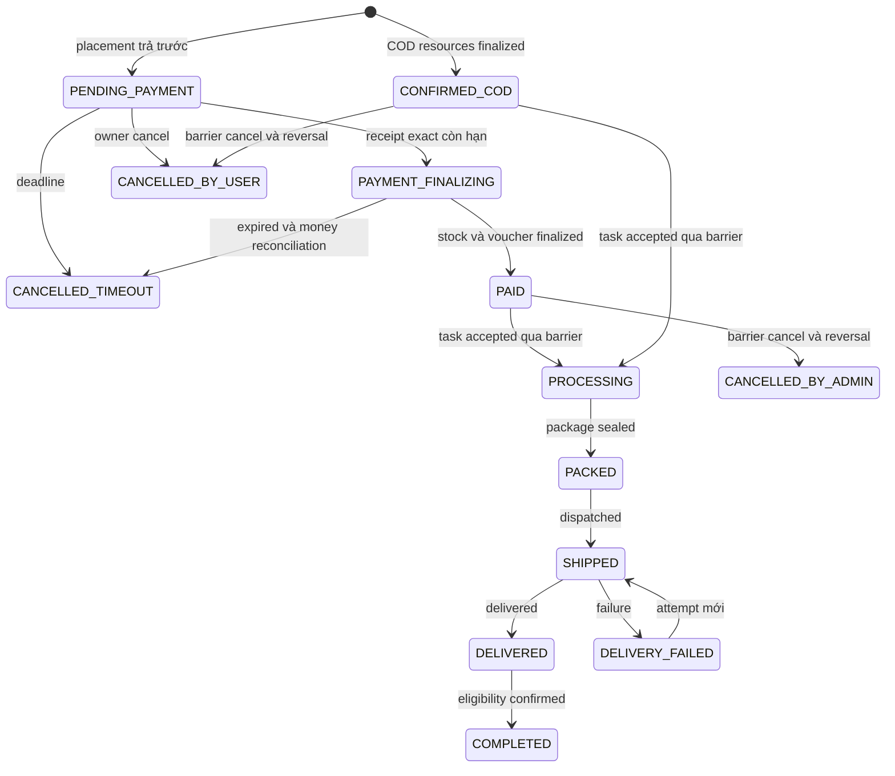

# 02 — State machine và cạnh tranh, baseline 3.2

[Trước](01_order_domain_and_boundary.md) · [Tiếp](03_database_and_persistence.md)

## 1. Các trục độc lập

[Runtime13 mục3](13_order_saga_worker_runtime.md) bổ sung workflow state và job state độc lập với các business projections bên dưới. UNKNOWN là external outcome; MANUAL_REVIEW của workflow không làm dừng reconciliation. Operation status hiện hữu được project từ workflow, không dùng enum job để trả thẳng qua API.

Addendum review [Order Core12](12_order_core_design.md) chuẩn hóa transition guards và race matrix. Với cohort mới, verified Care approval có thể hủy PENDING_PAYMENT thành CANCELLED_BY_ADMIN khi chưa allocation và còn đủ guard; Hold là nhiều control records, không thêm lifecycle HELD. Khi khác cách diễn đạt ngắn gọn của bảng/sơ đồ baseline, xem preconditions/proofs ở chương12 trước khi chốt contract.

| Trục | Giá trị |
| --- | --- |
| Operation | ACCEPTED, PROCESSING, WAITING_RETRY, COMPENSATING, SUCCEEDED, FAILED, MANUAL_REVIEW |
| Order | PENDING_PAYMENT, PAYMENT_FINALIZING, PAID, CONFIRMED_COD, PROCESSING, PACKED, SHIPPED, DELIVERED, DELIVERY_FAILED, COMPLETED, CANCELLED_TIMEOUT/BY_USER/BY_ADMIN |
| Payment | UNPAID, PENDING, CONFIRMED, RECONCILIATION_REQUIRED, PARTIALLY_REFUNDED, REFUNDED |
| Stock projection | RESERVED, COMMITTING, COMMITTED, RELEASING, RELEASED, EXPIRED, UNKNOWN; REVERSED là target extension |
| Refund | APPROVED, SUBMITTED, UNKNOWN, SUCCEEDED, FAILED, MANUAL_REVIEW |
| Fulfillment barrier | OPEN(generation), ACCEPTED(task), CANCELLED; Fulfillment serialize |

DRAFT/CHECKOUT_FAILED/CANCELLED_OUT_OF_STOCK còn trong legacy proto để compatibility; operation-first không tạo public Order khi validation/stock reject. Order enum đã bổ sung ở nhánh Order, provider compatibility vẫn cần test.

## 2. Lifecycle

COD receipt sau shipping cập nhật payment, không kéo Order về PAID. Refund/return không ghi đè lifecycle. Local chưa PROCESSING không chứng minh task chưa được remote accept.

## 3. Guards và atomic effects

Addendum đang review [Cart/Checkout11](11_cart_checkout_design.md) mở rộng Accept với quote consumption/submission guard cùng T0; Place VIETQR thêm PaymentIntent, mọi Place thêm durable cleanup intent cùng transaction. Cart admission point tại Redis khác durable SQL acceptance; xem mục6.2 của addendum, không suy bảng này thành cross-store transaction.

| Decision | Guard | Local transaction |
| --- | --- | --- |
| Accept | principal/quote/key/input | operation + registry + input + audit |
| Place | đúng resource/digest/warehouse, snapshot valid; COD finalized | Order/items/history/outbox + operation SUCCEEDED |
| Receipt → FINALIZING | lock Order, exact receiver/reference/currency/amount, pending, now<expiry | receipt + allocation + job + history |
| → PAID | đúng COMMITTED, voucher finalized, amount đủ | projections + history + paid outbox + ready intent |
| Pending cancel | lock/owner/deadline, chưa finalizing | cancellation fact + history + compensation job |
| Committed cancel | hold, barrier CANCELLED, reversal outcome | terminal cancel + history/outbox |
| → PROCESSING | authentic task/order/generation, barrier accepted | inbox + projection/history |
| ShipmentCreated | source/reference valid | chỉ shipment reference, không SHIPPED |
| Dispatch/delivered | association/sequence đúng | inbox + checkpoint/history |
| Refund success | verified provider key/budget | financial summary/outbox; không restock |
| Complete | delivered window + Care barrier + settlement + không unresolved obligation | history/completed outbox một lần |

PAID guard ở transition đầu; refund sau đó không xóa sự thật PAID lịch sử.

## 4. Deadline/race

Order receipt/timeout cùng row lock, lấy DB clock sau lock. now<expiry mới auto allocate; now>=expiry timeout thắng. Provider time là evidence, không hồi sinh đơn. Grace period cần remote hold protocol, chưa bật.

Inventory finalize/expire/release cùng reservation lock, kiểm DB decision time. Equality hết hạn. Replay COMMITTED không xét lại deadline để đảo outcome. Local CAS không thay guard remote.

| Race | Outcome |
| --- | --- |
| Receipt thắng local, remote còn hạn | finalize → PAID |
| Receipt thắng local, remote expired | giữ tiền/hold/reconciliation, không ready |
| Local cancel/timeout thắng | late receipt giữ lại, không auto allocate |
| Finalize thành công, ACK mất | query/retry key cũ, không release theo timeout |
| Cancel trước reserve trễ | tombstone chặn hold mới |
| Lease mất sau remote success | worker mới query key cũ; stale không ghi local |

## 5. Ready/cancel barrier

Order đặt local hold dưới lock trước cancel/hold call remote. Ready permit chỉ cấp khi local eligible; bind order/generation/items digest/policy/expiry và caller identity. Fulfillment serialize AcceptTask và CancelTask trên cùng order/generation:
- Cancel thắng → durable CANCELLED/tombstone; delayed event/permit không mở task.
- Accept thắng → ACCEPTED/task; cancel trả ACCEPTED, không tuyên bố đã hủy. In-flight accept có thể thắng trước remote cancel: điểm quyết định tại Fulfillment.
- Timeout → query, cancellation PENDING; không đoán từ local status.
- Hard hold chỉ hoàn tất sau remote barrier ACK; UI pending/rejected nếu task đã nhận. Resume generation mới, không tái sử dụng generation đã đóng.

READY chưa phải PACKING_STARTED. Chương 05 quy định handshake/caller authorization.

## 6. Completion

Care serialize completion decision với case-open, key/version bền vững. Case trước decision → deny; case sau decision theo post-completion policy. Mất ACK query key cũ. Auto-completion chỉ bật khi protocol và cửa sổ (default đề xuất 7 ngày) được chốt. Hết retry giữ MANUAL_REVIEW/hold; không FAILED cho kết quả còn UNKNOWN.
