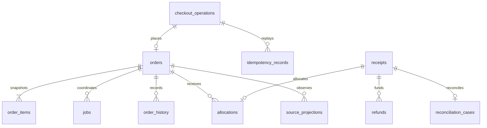

# 03 — Persistence và transaction, baseline 3.2

[Trước](02_state_machine_and_lifecycle.md) · [Tiếp](04_usecases_and_saga_orchestration.md)

## 1. Runtime schema và target

**Physical mapping amendment:** [chương17](14_order_persistence_messaging_design.md) và [DDL candidate](order_persistence_messaging.candidate.sql) hợp nhất schema mới, READ COMMITTED/lock order, SQL commit recovery và messaging protocol. Bảng/ERD dưới là baseline khái quát; jobs mới đi qua workflow, không đòi Order FK; receipts/refunds có thể unmatched. Không dùng schema sandbox bên dưới làm migration mục tiêu.

Target runtime model chung ở [chương13 mục3–6](13_order_saga_worker_runtime.md): workflow/job/effect/attempt/observation tách nhau, order_id nullable cho pre-placement và unmatched payment. Đây là logical model để review, không phải migration đã áp dụng.

Thiết kế Order Core bổ sung tại [chương12](12_order_core_design.md): versioned immutable snapshot/logical hash, order_holds độc lập, command/cancellation workflow và first-paid/completion milestones. Đây là target persistence để review; snapshot schema machine-readable không tự bảo đảm cross-field arithmetic hoặc remote evidence.

PostgreSQL là source of truth. [Migrations 3.1](../../../../services/order-service/migrations/000001_order.up.sql) và [schema snapshot](order_schema_candidate.sql) mô tả runtime sandbox. Bảng dưới dùng tên runtime thật; field target chưa có được ghi rõ, không coi tài liệu là migration đã áp dụng.

| Bảng | Trách nhiệm và constraint |
| --- | --- |
| checkout_operations | input/canonical encrypted, planned_order_id unique, status/stage, lease/epoch, reservation reference/expiry |
| idempotency_records | PK(scope,kind,key), hash, operation FK, response retention |
| orders / order_items | unique operation/order code, snapshot immutable, quantity/money CHECK, PK(order,sku), version |
| receipts / allocations | unique(provider,transaction_id); nullable matched Order; allocation unique receipt và Order cho MVP exact |
| reconciliation_cases | receipt reference/reason, trạng thái xử lý riêng |
| jobs | unique command key, stage/status/attempts/lease/epoch |
| command_registry | scope/kind/key/hash + stored outcome cho commands |
| cancellation_requests | request/reviewer/outcome; target bổ sung barrier proof reference |
| refunds | unique approval/operation key, amount/state/provider ref |
| order_history | unique(order,version), actor/source/reason/time |
| outbox / inbox | stable event ID/version/ordinal; inbox source/event/hash + durable outcome |
| source_projections | unique(order,source,resource), last applied version |
| audit_records / quarantine | append-only audit; durable rejected-message reference/hash |
| target resource operations | per-action key/hash/digest, last outcome/version/decision time, barrier evidence, next query time |

Không có cross-database FK; remote IDs là references phải validate qua port. Target resource operations có thể nằm trong job payload đã kiểm schema hoặc bảng riêng, nhưng phải truy vấn được theo obligation và không chỉ nằm memory.

## 2. Local transaction boundaries

**Cart/Checkout addendum để review:** [chương11](11_cart_checkout_design.md) mở rộng T0 bằng quote consumption/submission guard + selected snapshot; T3 VIETQR thêm PaymentIntent, cả VIETQR/COD thêm cleanup job cùng Order commit. Cleanup Redis là effect riêng có CAS/replay, không nằm trong SQL transaction. Bảng sau giữ baseline tổng quát; migration mới chưa được áp dụng.

| Tx | Atomic writes | Sau commit |
| --- | --- | --- |
| T0 acceptance | operation + dedup + encrypted input + planned ID + audit | trả 202; worker claim |
| T1 canonical | validated snapshot + deadline + acquisition intent/key | voucher/stock call |
| T2 remote result | identity/digest/version/outcome + next stage | step tiếp/query nếu UNKNOWN |
| T3 placement | Order/items/history/placed outbox + operation SUCCEEDED | client query thấy Order |
| T4 receipt | verified receipt + allocation hoặc reconciliation + finalize job | gọi Inventory/Promotion |
| T5 finalize | resource proof + PAID/history/paid outbox + ready job | publish ready khi đủ guard |
| T6 cancel pending | cancelled/history/outbox + release intent | release-by-order |
| T6b cancel committed | hold + cancel intent; sau terminal barrier/reverse ghi cancelled | refund approval/execution độc lập |
| T7 event consume | inbox + effect/history/outbox hoặc DEFERRED/REJECTED durable | commit Kafka offset |
| T8 refund budget | lock receipt, reserve obligation, approval/key | provider refund/query |
| T9 refund result | verified settlement + summary/history/outbox | accounting/notify |

Không giữ SQL transaction trong network call. Kết quả commit SQL bị mất ACK: đọc registry/operation/Order trước khi quyết định compensate.

## 3. Locks, fencing và time

Lock hierarchy chi tiết dùng [Persistence17 mục5](14_order_persistence_messaging_design.md): Order → checkout/control → receipts → refunds → workflows → effects → jobs → event streams, cùng nhóm sort ID. Pre-placement và unmatched paths có parent/lock exceptions rõ, không đảo thứ tự về Order trong cùng transaction. Cross-row refundable tính dưới receipt lock. Mọi mutation guard/version/history phải atomic; rows affected=0 phải xử lý conflict. READ COMMITTED là default, SQL40P01/40001 retry whole transaction bounded; mất COMMIT ACK lookup business identity trên primary, không tạo key mới.

Worker claim SKIP LOCKED, lease default10s/epoch tăng; chỉ owner+epoch còn hạn được apply outcome lên job/workflow/Order. Worker cũ vẫn có internal append-only observation path có xác thực/association; validator/current owner mới quyết định apply. Crash trước append được phục hồi bằng query từ durable effect intent. Remote stable key không đổi theo epoch. Lease local không chặn RPC cũ còn bay: provider tombstone/idempotency và reconciliation giải quyết. Heartbeat/stage deadline/business deadline độc lập theo [Runtime13](13_order_saga_worker_runtime.md).

Decision clock lấy sau row lock; Inventory dùng DB clock của Inventory. Không giả định đồng hồ hai DB tuyệt đối giống nhau; final authority là remote outcome. Deadline local lấy min và safety margin để giảm payment sát hạn, không bảo đảm finalize nếu network delay.

## 4. Idempotency và retention

Canonical hash gồm scope/action, immutable planned order/resource, sorted consolidated items, warehouse/method và policy có ảnh hưởng effect. Cùng key/hash → cùng effect; khác hash → conflict. Query trả current resource state riêng với original command result để tránh trả stale RESERVED như hold còn sống.

Checkout response retention 7 ngày; terminal replay sau đó 410 + operation reference. Registry giữ tối thiểu 30 ngày và không auto reuse key trong MVP. Nghĩa vụ chưa terminal, receipt/refund uniqueness và remote cancellation tombstone phải giữ vượt mọi retry/replay window. Khi chưa giới hạn được lifetime request cũ, không xóa tombstone. Compaction/PII deletion cần policy riêng; không xóa ledger để “dọn cache”.

## 5. Outbox / inbox

Outbox effect + event cùng transaction, stable ID và generic aggregate_type/id/version/ordinal NOT NULL; order_id optional cho financial streams. Order key vẫn order_id. Publisher claim stream, replay head chưa confirmed rồi mới next, chỉ advance sau broker ACK và fenced SQL commit. Crash trước mark published → duplicate cùng ID. DB lease không fence Kafka request đang bay: late duplicates vẫn cần consumer guards theo [Persistence17 mục6–8](14_order_persistence_messaging_design.md). Không có broker thật thì production fail readiness, không log-only rồi mark published.

Inbox dedup theo source/event ID + payload hash, kết hợp business resource/version. Event thiếu prerequisite → DEFERRED + payload bền vững; worker query source và apply sau. Poison event → durable quarantine/DLQ intent trước ACK. Message N lỗi transient không được commit N+1 cùng partition vượt N, trừ khi N đã vào durable retry queue. Không claim exactly-once xuyên PostgreSQL/Kafka.

Physical inbox identity còn namespace consumer_contract; APPLIED và business effect commit atomic, DEFERRED/quarantine phải có durable responsibility. Offset chỉ commit next offset sau contiguous eligible prefix; rebalance không undo SQL đã commit, redelivery đi qua dedup. Protocol chi tiết và restore-before-mutation ở chương17.

## 6. Data operations

Redis: cart revision/TTL30d, encrypted preview TTL5m, read cache; mất Redis không mất accepted input/obligation. Không cache ownership/money quyết định như nguồn chuẩn.

Index: operation/job run_after+lease; pending payment expiry; customer keyset(created_at,id); queue(stage,sla_due_at,id); receipt uniqueness; outbox aggregate sequence. SLA theo state entry/policy, không hard-code created_at cho mọi stage.

Migrations expand/backfill/validate; không xóa ledger ở rollback. Restore drill phải reconcile Inventory/provider mới hơn backup trước resume. Key rotation giữ khả năng decrypt snapshots đang cần; local audit hash chain chưa chứng minh chống tail deletion bởi privileged actor. PITR/HA/retention là gate vận hành, chưa được chứng minh bởi tài liệu này.
