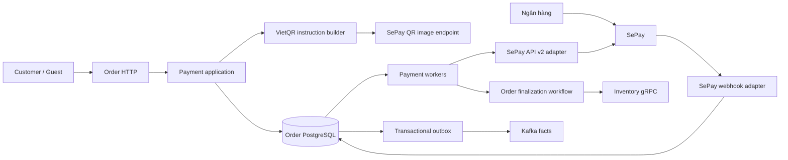
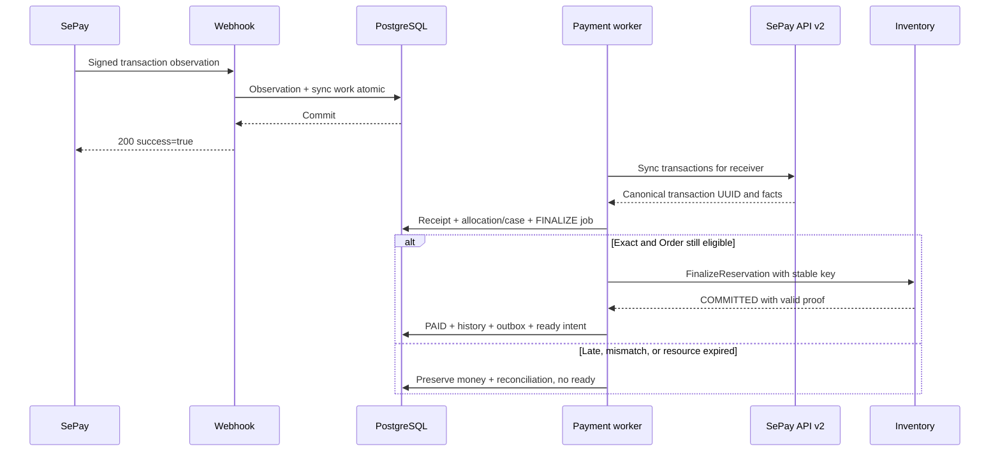

# 09 — Thiết kế Payment: SePay + VietQR

**Phiên bản:** `payment-sepay-1.1-review` · **Ngày:** 16/10/2026 · **Trạng thái:** Đề xuất đã cập nhật sau review, chưa triển khai.

[Chỉ mục Order](README.md) · [HLD Order 3.2](00_order_service_hld.md) · [OpenAPI Payment candidate](../../../03_api_specs/order-payment-sepay.candidate.openapi.yaml)

[OpenAPI Staff/Refund candidate](../../../03_api_specs/order-payment-staff.candidate.openapi.yaml) · [Phản hồi 6 điểm review](10_payment_sepay_review_resolution.md)

## 1. Quyết định thiết kế

Runtime worker chung dùng [chương13](13_order_saga_worker_runtime.md): workflow/job state tách business state, stable effects/proofs, execution budget khác reconciliation budget và stale observation recovery. Các quy tắc provider, financial guards, dispatcher quota và checkpoint trong chương09 tiếp tục là authority của Payment; MANUAL_REVIEW không dừng account sync/refund UNKNOWN queries.

Chọn **SePay Webhooks + SePay API v2 + VietQR chuyển khoản**. Khách quét QR và chuyển tiền vào tài khoản ngân hàng của cửa hàng. Payment là module của MS-04 Order, lưu sổ thu/hoàn tiền trong PostgreSQL của Order. SePay cung cấp thông báo và dữ liệu giao dịch ngân hàng; Order quyết định khoản thu được thanh toán cho đơn nào và khi nào đơn đủ điều kiện fulfillment.

SePay có sản phẩm hosted Payment Gateway riêng. Thiết kế này chọn nhánh API ngân hàng trên trang [tổng quan sản phẩm SePay](https://developer.sepay.vn/vi); không dùng checkout redirect, IPN hay merchant signing của hosted gateway. Tên `SePayAdapter` trong mã nguồn chỉ adapter cho nhánh đã chọn.

| ID | Quyết định đề xuất | Lý do / đánh đổi |
| --- | --- | --- |
| PAY01 | Một merchant, một receiver profile đang cấp QR, VND, một intent/Order trong MVP | Giảm nhầm tài khoản và số tiền; vẫn giữ profile lịch sử để nhận tiền đến muộn |
| PAY02 | QR gắn số tiền + mã thanh toán bất biến; tái hiển thị cùng intent | Reload không tạo nghĩa vụ trả tiền mới hoặc gia hạn kho |
| PAY03 | Webhook HMAC → observation bền vững → worker xác nhận bằng API v2 | Một định danh thu tiền chuẩn; thêm độ trễ/phụ thuộc API đọc |
| PAY04 | Receipt dùng UUID giao dịch API v2; numeric ID webhook chỉ định danh observation | Tránh webhook và reconciliation ghi đôi một khoản thu |
| PAY05 | Chỉ exact payment tự allocate; không tự cộng các khoản thiếu hoặc tách khoản thừa | Giữ semantics Order 3.2; các ngoại lệ có hồ sơ riêng |
| PAY06 | Receipt đủ tiền → PAYMENT_FINALIZING → kho COMMITTED → PAID | Đã nhận tiền chưa đồng nghĩa có hàng để giao |
| PAY07 | Webhook là tín hiệu nhanh; đồng bộ giao dịch toàn receiver là đường phục hồi | Tìm được cả tiền không mã và tiền tới đơn đã hủy |
| PAY08 | Refund qua API chỉ bật khi receiver và giao dịch thật đủ capability | SePay hỗ trợ hoàn tiền có điều kiện; sandbox không chứng minh live capability |
| PAY09 | Nếu chưa có automatic refund, dùng quy trình manual có approval/evidence, cùng ledger | Không để khoản tiền cần hoàn bị bỏ quên; không có hai executor đồng thời |
| PAY10 | Production activation theo capability và kết quả kiểm thử | Có tài liệu/SDK không có nghĩa adapter đã chạy đúng với ngân hàng thực |

**Phạm vi:** D2C Customer/Guest, thanh toán chuyển khoản, polling trạng thái, nhận/đối soát khoản thu, xử lý ngoại lệ, hoàn tiền. COD giữ thiết kế hiện có và không đi qua SePay receipt handler. Hosted checkout, thẻ, ví điện tử, multi-merchant, nhiều lần thử cùng Order, VA động theo từng đơn và tự chia/cộng tiền nằm ngoài bản này.

**Thông tin chưa có:** ngân hàng, loại tài khoản, tài khoản/VA nhận tiền, SePay company và public domain. Đây là tham số triển khai phải xác nhận bằng tài khoản thật; không điền số tài khoản hay secret giả vào cấu hình production. Kiến trúc bên dưới vẫn có thể review đầy đủ trước khi có các giá trị đó.

## 2. Hiệu lực đối với baseline Order 3.2

Liên kết Order Core: [chương12](12_order_core_design.md) định nghĩa lock/transition guards dùng chung khi receipt allocation, hold/refund, cancel và timeout cạnh tranh. Receipt ingestion tiếp tục dưới Hold; paid-first/readiness vẫn cần no blocking obligation. Core snapshot lưu payment terms bất biến, không chứa ledger giao dịch.

Tài liệu này là provider-specific addendum đang chờ review. Các invariant Order 3.2 về deadline, kho, paid/ready, cancel và compensation vẫn áp dụng. Các thay đổi đề xuất dưới đây cần được áp dụng cùng nhau khi implement cohort SePay:

1. **ACK webhook sau observation + công việc phục hồi durable**, thay cho diễn đạt tổng quát “ACK sau receipt”. Observation đã xác thực được giữ nguyên như bằng chứng nhận thông báo; receipt tài chính chỉ được tạo từ API v2. ACK không có nghĩa đã xác nhận tiền hoặc PAID.
2. Bổ sung payment intent, provider observation, receiver profile và sync checkpoint; mở rộng receipt/reconciliation/refund để xử lý giao dịch không có Order.
3. Route mới `/api/v1/payments/sepay/webhook`; route `/payments/vietqr/callback` cũ vẫn thuộc simulator/legacy cohort. Không đổi ngầm payload hoặc secret của route cũ.
4. Bổ sung các facts của receipt/refund độc lập `order_id`; schema payment mới cần Finance/consumer review. Order events v3 không bị sử dụng thay cho ledger khoản thu.
5. Chọn provider đã giải quyết phần “chưa chọn nhà cung cấp” của G08. Adapter, migration, ngân hàng thật và evidence vẫn chưa hoàn tất.

OpenAPI candidate đi kèm chỉ mô tả API mới của module, chưa thay OpenAPI Order 3.2 hoặc sandbox 3.1. Các file code/runtime evidence hiện có không phải bằng chứng triển khai bản thiết kế này.

## 3. Kiến trúc và trách nhiệm



| Component | Sở hữu | Không được tự quyết định |
| --- | --- | --- |
| Checkout / Order | Giá snapshot, deadline, Order lifecycle, finalize/cancel/ready | Coi frontend return URL là đã thu tiền |
| Payment application | Intent, receipt, allocation, reconciliation, refund budget | Giá mới, trừ kho, duyệt refund thay Care |
| SePay webhook adapter | Raw-body auth, decode, observation envelope | PAID, fulfillment, sửa tổng tiền đơn |
| SePay API adapter | Bearer auth, mapping, pagination, rate limit, provider errors | Ghép giao dịch mơ hồ hoặc tự sinh key refund mới |
| Payment workers | Đồng bộ, ingest receipt, xử lý inbox/retry, refund tracking | Xóa nghĩa vụ UNKNOWN khi hết retry |
| Care | Approval và quyết định hỗ trợ theo quyền | Tự gửi thêm một lệnh chi tiền ngoài Payment workflow |
| Finance | Đối soát kế toán; thực hiện vai trò manual executor khi được phân công | Tạo refund ledger riêng rồi hoàn lần thứ hai |

Tổ chức mã nguồn mục tiêu, không yêu cầu tách process:

```text
internal/payment/
  domain/          intent, receipt, allocation, refund, money, policies
  application/     instructions, ingest, match, reconcile, refund
  ports/           transaction_reader, webhook_verifier, refund_executor
  adapters/sepay/  webhook, api_v2, qr, identity_resolver, error_mapping
  adapters/postgres/
  workers/         observation, account_sync, refund_status
  transport/       customer_payment, staff_reconciliation, sepay_webhook
```

Port tách theo năng lực: `WebhookVerifier.Verify(raw, headers)`, `TransactionReader.List/Get`, `InstructionBuilder.Build(snapshot)`, `RefundExecutor.Submit/Get`. Domain không import HTTP/SDK SePay. `RefundExecutor` chỉ được inject khi capability bật; một interface `Pay()` tổng quát sẽ che mất khác biệt giữa chỉ dẫn chuyển khoản, khoản tiền đã vào và lệnh hoàn.

## 4. Hồ sơ receiver, intent và VietQR

### 4.1 Receiver profile

Mỗi cấu hình có `provider_connection_id`, `environment`, `sepay_bank_account_uuid`, bank code/BIN, account number dạng string, account holder, currency=VND, receiver mode, expected VA nếu có, template nội dung và phiên bản. Secret lưu ngoài DB nghiệp vụ, DB chỉ giữ secret reference.

Chọn receiver cụ thể từ cấu hình server; không nhận account/bank/amount từ frontend. Không chuyển số tài khoản sang integer vì có thể mất số 0 đầu. Pin profile version vào intent. Khi đổi tài khoản, ngừng cấp QR từ profile cũ nhưng tiếp tục webhook/sync cho profile đó trong thời gian còn khoản thu hoặc nghĩa vụ cần theo dõi.

Quy tắc QR phụ thuộc ngân hàng và kiểu VA. SePay mô tả trường hợp VA chính thức dùng VA ở `acc`, VA theo nội dung dùng tài khoản gốc và chuỗi TKP; một số tài khoản VietinBank cần SEVQR. Onboarding phải xác nhận quy tắc của receiver đã chọn, không áp một mẫu chung cho mọi ngân hàng. [Nguồn QR](https://developer.sepay.vn/vi/tien-ich-khac/tao-qr-code).

### 4.2 Payment intent

Trong transaction PLACE của checkout, tạo Order và intent cùng lúc:

```text
intent_id             UUID nội bộ
order_id              UUID Order, unique trong MVP
provider              SEPAY
method                VIETQR
expected_amount       orders.final_amount, VND integer
payment_code          OMP + 12 ký tự ngẫu nhiên A-Z/0-9
receiver_profile_id   profile bất biến đã được xác nhận
expires_at            orders.payment_expires_at
status                ACTIVE
policy_version        payment-sepay-1.1
```

Sinh hậu tố bằng CSPRNG, unique `(provider_connection_id, payment_code)`, collision thì sinh lại trước commit. Mã thanh toán không chứa PII và không được coi là bằng chứng ownership. Không tái sử dụng mã đã hết hạn. `orders.provider_reference` có thể giữ payment_code để tương thích trong migration, nhưng intent là nguồn chuẩn mới.

Đề xuất cấu hình nhận diện SePay: prefix `OMP`, hậu tố min=max=12, alphanumeric. Mẫu này nằm trong khả năng cấu hình của SePay; phải được thử với nội dung ngân hàng thực tế. [Nguồn mã thanh toán](https://developer.sepay.vn/vi/sepay-webhooks/cau-hinh-ma-thanh-toan).

Ví dụ mã minh họa: `OMP7K9M2N4P6R8T`. Không dùng mã này cho giao dịch thật.

### 4.3 Sinh và hiển thị QR

QR URL dùng endpoint ảnh được tài liệu SePay hiện hành chỉ định, cấu hình allowlist ở server. Với profile thường, dạng xây dựng là `https://vietqr.app/img` cùng các tham số `acc`, `bank`, `amount`, `des`, `template=compact`. `des` chứa payment_code và các phần receiver bắt buộc; URL-encode bằng thư viện. QR không cần tạo một remote Order hoặc remote charge. [Nguồn cấu trúc URL](https://developer.sepay.vn/vi/tien-ich-khac/tao-qr-code).

API trả số tiền, tên ngân hàng, số tài khoản/VA, chủ tài khoản, nội dung, deadline, server time và QR URL. FE hiển thị cả thông tin chữ để khách kiểm tra. QR tải lỗi thì cho copy thông tin chuyển khoản khi intent vẫn ACTIVE; không tự đổi receiver hoặc số tiền. Cấu hình CSP chỉ cho host ảnh đã pin, `Referrer-Policy: no-referrer`, không đưa token hoặc địa chỉ khách vào URL.

`GET payment-instructions` là read-only, luôn tái hiện intent cũ. Refresh không gia hạn, không tạo reference mới. Chỉ cấp chỉ dẫn khi Order pending, không hold/cancel, intent ACTIVE và còn **hơn 30 giây** trước hạn. Ngưỡng này là policy của dự án; không bảo đảm ngân hàng/SePay xử lý kịp.

**QR chuyển khoản không bị vô hiệu ở ngân hàng khi countdown hết.** Hết hạn chỉ chặn UI cấp chỉ dẫn và auto allocation của Order; khách vẫn có thể chuyển qua ảnh đã lưu. Tiền đó phải vào reconciliation, không bị bỏ qua.

## 5. Contract SePay và định danh tiền

### 5.1 Hai đường nhận dữ liệu

| Đường | Vai trò trong thiết kế | Credential |
| --- | --- | --- |
| SePay → webhook Order | Lưu thông báo đã xác thực; đánh thức account sync | HMAC secret riêng cho webhook/environment |
| Order → SePay API v2 | Nguồn chuẩn để tạo receipt với transaction UUID | API Bearer token server-side |
| Browser → QR image host | Hiển thị hướng dẫn thanh toán | Không có API secret |

API live: `https://userapi.sepay.vn/v2`; test: `https://userapi-sandbox.sepay.vn/v2`. Token/dữ liệu test và live riêng. [Nguồn sandbox](https://developer.sepay.vn/vi/sepay-api/v2/sandbox).

Các API đọc sử dụng: `GET /transactions` và `GET /transactions/{transaction_id}`. API v2 dùng UUID; không gửi numeric webhook ID vào endpoint detail. [Nguồn migration](https://developer.sepay.vn/vi/sepay-api/v2/nang-cap-tu-v1), [detail](https://developer.sepay.vn/vi/sepay-api/v2/giao-dich/chi-tiet).

### 5.2 Chuẩn hóa observation

| Webhook | Observation nội bộ | Xử lý |
| --- | --- | --- |
| `id` | `webhook_transaction_id` | Parse integer chính xác rồi lưu string; không float64 |
| `gateway`, `accountNumber`, `subAccount` | receiver evidence | Đối chiếu profile được cấu hình |
| `transferType`, `transferAmount` | direction, amount | Chỉ `in` dương là ứng viên thu tiền |
| `transactionDate` | bank_occurred_at | Parse giờ Việt Nam, lưu UTC và raw evidence |
| `code`, `content` | candidate code, encrypted content | Có thể thiếu mã; giữ thông báo |
| `referenceCode` | bank reference | Có thể rỗng; không dùng làm global primary key |

Payload webhook được tài liệu mô tả bằng numeric ID và trường camelCase. API v2 dùng UUID và snake_case. Không hash toàn bộ hai payload rồi so chúng bằng nhau. [Nguồn webhook](https://developer.sepay.vn/vi/sepay-webhooks/tich-hop-webhook).

### 5.3 Một authority tạo receipt

**Chỉ API v2 response đã qua validation tạo receipt.** Worker đồng bộ nhận cả giao dịch không có webhook. Observation webhook chỉ liên kết vào receipt sau khi xác nhận ứng viên duy nhất; không cần liên kết observation thành công để lưu một giao dịch API hợp lệ.

Khóa tài chính: `(provider_connection_id, transaction_uuid)`. Connection là định danh merchant+environment ổn định, không đổi khi rotate token và không nhân bản cho cùng merchant trong cùng ledger. UUID receipt nội bộ khác transaction UUID của SePay.

Resolver ưu tiên bank reference + receiver scope, sau đó đối chiếu direction/amount/bank time/content. Không có reference hoặc nhiều ứng viên giống nhau → observation `MANUAL_REVIEW`, không đoán UUID bằng amount hay payment_code. Những API transactions tìm thấy vẫn được ingest riêng theo UUID của chúng. Một payment_code có thể nhận nhiều khoản tiền thật.

Receipt canonical lấy `id`, `bank_account_id`, `account_number`, `va_id`/`va`, `transfer_type`, `amount_in`, `amount_out`, `transaction_date`, `transaction_content`, `reference_number`. Đối chiếu receiver; inbound cần amount_in>0 và amount_out=0. Currency không có trong mẫu giao dịch API nên chỉ gán VND từ receiver profile đã xác nhận là tài khoản VND; không suy đoán tài khoản ngoại tệ. [Nguồn transaction detail](https://developer.sepay.vn/vi/sepay-api/v2/giao-dich/chi-tiet).

Phân biệt hai hash: raw hash cho evidence; financial hash cho immutable transaction facts. Financial hash dùng cùng canonical representation từ API v2, gồm receiver, direction, amount, bank time, reference và content gốc; loại `accumulated`, `webhook_success`, trường `code` dẫn xuất khỏi hash. Thay đổi code/mô tả phụ chỉ tạo observation mới; cùng UUID đổi money/receiver/content gốc tạo conflict case, không ghi đè receipt.

**Đánh đổi được chọn:** API v2 down thì webhook vẫn được lưu/ACK nhưng chưa auto-confirm tiền. Order có thể hết hạn trong lúc chờ. Thiết kế bảo toàn tiền và không tự hồi sinh đơn; thời gian xác nhận API phải được đo trước release. Fast path từ webhook trực tiếp cần ADR về định danh chung, không bật ngầm để giảm latency.

### 5.4 Điều kiện sản phẩm trước khi mở nhận tiền thật

Ví dụ giờ Việt Nam: đơn hết hạn 19:15:00, bank time là 19:14:55, nhưng API receipt được xử lý dưới Order lock lúc 19:15:05 → LATE_PAYMENT, không auto PAID. Tiền được giữ trong ledger, Care xử lý hoàn tiền hoặc hướng dẫn đặt đơn mới; không tự chuyển allocation sang đơn mới. Ngay cả receipt được xử lý lúc 19:14:59 vẫn có thể gặp Inventory EXPIRED khi finalize.

Product owner phải chấp thuận chính sách này và thông điệp hỗ trợ trước go-live; trạng thái hiện tại là **PENDING_PRODUCT_REVIEW**, không coi review kỹ thuật là business sign-off. Hạn payment vẫn là min expiry của resources/commercial terms; không tự tăng timeout để bù API lag khi Inventory chưa cam kết hold tương ứng.

Đo riêng bank time→webhook, webhook→API visible, API visible→local allocation và allocation→Inventory decision; ghi p50/p95/p99, tỷ lệ xác minh sau expiry và tỷ lệ phải hỗ trợ/hoàn. Bank time có sai số/độ phân giải riêng nên không suy latency chính xác tuyệt đối từ một đồng hồ. Canary được phép phải có mẫu sát hạn và API timeout/429. Product+Order+Inventory chốt QR safety margin và payment window từ dữ liệu này; 30 giây hiện chỉ là default chưa được chứng minh đủ.

## 6. Webhook nhận an toàn và trả ACK nhanh

### 6.1 Wire contract

`POST /api/v1/payments/sepay/webhook`, HTTPS, JSON. Chọn HMAC-SHA256:

```text
X-SePay-Timestamp: <Unix seconds>
X-SePay-Signature: sha256=<hex digest>
signed_bytes = timestamp_ascii + "." + raw_body
expected = HMAC-SHA256(webhook_secret, signed_bytes)
```

Kiểm timestamp trong ±300 giây và so MAC constant-time. Đây là giao thức được SePay công bố; raw bytes phải được giữ trước JSON parsing. [Nguồn xác thực](https://developer.sepay.vn/vi/sepay-webhooks/xac-thuc).

Giới hạn body 64 KiB là policy dự án. Reject duplicate JSON keys, trailing JSON và kiểu money/ID không chính xác; cho phép field mở rộng không dùng trong quyết định nghiệp vụ. Endpoint không dùng JWT Customer, không redirect login và không tin header principal do internet tự gửi. Gateway giữ nguyên body và header HMAC.

### 6.2 Transaction nhận

1. Kiểm method/content type/body limit/HMAC/timestamp.
2. Decode và xác định connection từ endpoint configuration, không từ field tự khai của request.
3. Trong một SQL transaction: insert observation hoặc xác nhận duplicate; lưu encrypted raw evidence, hashes, auth key version; tạo/upsert account-sync work hoặc durable quarantine nếu dữ liệu bất thường.
4. Commit rồi trả **HTTP 200, `{"success":true}`**. Worker đọc lại observation khi process restart; không dựa goroutine trong memory.

ACK thành công của SePay cần 200/201 với JSON success=true, trong 30 giây; thiết kế chọn 200 và mục tiêu nội bộ p95 dưới 500 ms. [Nguồn ACK](https://developer.sepay.vn/vi/sepay-webhooks/tich-hop-webhook).

| Tình huống | HTTP / effect |
| --- | --- |
| HMAC thiếu/sai, timestamp không hợp lệ | 401; không thay đổi business ledger |
| JSON hỏng, thiếu trường bắt buộc, duplicate key | 400; không ACK thành công |
| Body quá lớn / media type sai | 413 / 415 |
| DB lỗi, commit outcome chưa xác định | 503; retry sẽ dedup nếu commit trước đó đã thành công |
| Duplicate cùng normalized observation | 200 success=true sau kiểm bản ghi durable; cập nhật last_seen nếu cần |
| Cùng webhook ID nhưng financial fields khác | Lưu conflict evidence + case/job rồi 200; bản gốc bất biến |
| Tiền tới muộn, thiếu mã, sai số tiền, out/wrong receiver | Lưu observation/quarantine để điều tra rồi 200; không xác nhận Order |

ACK đối với dữ liệu bất thường là xác nhận hệ thống đã nhận trách nhiệm xử lý. Nếu chưa lưu được quarantine/case thì trả 503. Các request chưa xác thực chỉ ghi security metadata có giới hạn, không giữ payload tùy ý.

Đề xuất cấu hình Dashboard: chỉ receiver được chọn; Tiền vào; JSON; HMAC; retry bật; **không bật bỏ qua giao dịch không có mã và không lọc prefix**. Nhờ đó vẫn nhìn thấy khoản tiền khách nhập sai nội dung. [Nguồn cấu hình webhook](https://developer.sepay.vn/vi/sepay-webhooks/tao-webhook).

SePay có retry hữu hạn và replay thủ công. Không dùng replay window HMAC để từ chối giao dịch ngân hàng cũ: timestamp ký request khác bank transaction time. Kiểm thực tế timestamp được làm mới khi retry/replay; nếu replay cũ không qua auth, phục hồi bằng API sync, không tắt HMAC. [Nguồn retry](https://developer.sepay.vn/vi/sepay-webhooks/xu-ly-loi).

## 7. Receipt, matching và Order finalization



### 7.1 Matching algorithm

Sau normalize API transaction, xác định mã từ `transaction_content` bằng parser versioned: uppercase ASCII để nhận diện; tìm token `OMP[A-Z0-9]{12}` với ranh giới không phải alphanumeric; không fuzzy-match, không cắt một token dài hơn để lấy prefix. Giữ nguyên content gốc. `code` của SePay là hint: nếu khác token duy nhất tìm được thì mở `REFERENCE_CONFLICT`; nếu null nhưng content có một token hợp lệ thì được tiếp tục. Nhiều token → `AMBIGUOUS_REFERENCE`.

Match qua `(connection, payment_code)` đến intent. Kiểm thêm receiver snapshot và method VIETQR/SEPAY; chuyển khoản chứa mã đơn COD không được coi là COD settlement. Không match bằng số tiền, tên người gửi, số điện thoại hoặc order_code gần giống.

Ingest dùng cùng application function cho webhook-triggered sync, scheduled sync và replay có quyền:

1. Resolve candidate Order ngoài transaction chỉ để biết lock target; vào transaction phải đọc lại và kiểm association.
2. Nếu có Order: lock Order → intent → receipt/financial identity → jobs/refund theo thứ tự cố định. Cùng transaction insert receipt unique hoặc xử lý replay/conflict.
3. Nếu không có Order: chỉ ghi receipt/case, không quay ngược lấy Order lock trong cùng transaction. Link thủ công chạy workflow riêng.
4. Lấy `clock_timestamp()` **sau khi có Order lock**. Chỉ auto allocate khi pending, không hold/cancel, intent ACTIVE, `now < expires_at`, chưa allocation/refund obligation, và amount exact.
5. Ghi allocation, intent SETTLED, payment CONFIRMED, Order PAYMENT_FINALIZING, history và FINALIZE job cùng transaction. Không gọi Inventory trong transaction.
6. Worker finalize resource bằng stable key. Chỉ sau COMMITTED đúng order/reservation/digest và voucher finalized nếu bật mới chuyển PAID và phát paid/ready theo baseline.

Khi kiểm lại eligibility, ưu tiên nhận diện allocation đã tồn tại để phân loại khoản thu mới là EXTRA_RECEIPT trước các nhánh late/amount mismatch. Trước PAID lần đầu, worker phải đọc lại hold/cancel/refund obligations dưới lock: khoản thu đã hoàn hoặc đang được giữ budget để hoàn không còn đủ điều kiện xác nhận đơn. Không để FINALIZE job cũ vượt qua refund/hold mới; resource đã commit được giữ bằng chứng và chuyển sang workflow bù trừ có kiểm soát.

Receipt được phát hiện trước đó nhưng xử lý sau deadline vẫn đi reconciliation. `bank_occurred_at` và `webhook_received_at` là evidence, không được dùng để lùi decision clock hoặc kéo dài reservation. Một notification webhook chưa map xong không chặn timeout vô hạn.

### 7.2 Ma trận nghiệp vụ

| Khoản thu | Receipt/case | Allocation / Order |
| --- | --- | --- |
| Exact, đúng receiver, còn hạn | VERIFIED → ALLOCATED | Một allocation; FINALIZING rồi PAID khi kho hợp lệ |
| Thiếu | UNDERPAYMENT | Không tự cộng với lần chuyển tiếp theo; mở case |
| Thừa | OVERPAYMENT | Không tự split tiền thừa; mở case |
| Hai khoản đều nhỏ hơn tổng | MULTIPLE_PARTIAL_PAYMENTS | Không auto PAID dù tổng cộng vừa đủ |
| Đơn đã allocate, nhận khoản thứ hai | EXTRA_RECEIPT | Không phát paid lần nữa, không phá allocation cũ |
| Đã hủy/hết hạn | LATE_PAYMENT | Không reopen; review/refund |
| Không mã / mã không có intent | UNMATCHED_REFERENCE | Receipt.order_id null, giữ khoản thu |
| Sai receiver hoặc environment | RECEIVER_MISMATCH | Observation/quarantine; không đưa vào doanh thu receiver khác |
| Đúng tiền nhưng kho hết hạn khi finalize | STOCK_FINALIZATION_FAILED | Giữ receipt/allocation trace, hold + case; không ready |
| Transaction UUID lặp và cùng facts | Replay no-op | Không ghi tiền/OrderPaid thêm lần nữa |
| UUID cũ, money/receiver/content gốc khác | PROVIDER_DATA_CONFLICT | Receipt gốc bất biến; hold/review theo scope |

Under/over/multiple trên Order đang pending đặt `payment_status=RECONCILIATION_REQUIRED`, `payment_hold=true`, ngừng cấp QR và tự allocate khoản tiếp theo. Timeout vẫn phải cancel và release reservation đúng hạn dù hold; hold không gia hạn stock. Staff không dùng generic status PATCH để ép PAID. Chính sách MVP xử lý case bằng hoàn tiền/đặt đơn mới hoặc workflow có phê duyệt; chưa hỗ trợ manual split/merge allocation.

Extra receipt trên Order đã paid tạo case cho khoản tiền dư và `has_open_reconciliation=true`; giữ payment summary của allocation hợp lệ và không tự dừng fulfillment vì một khoản chuyển dư. Trường hợp security conflict có thể đặt hold theo policy riêng.

### 7.3 Các trục trạng thái

| Trục | Giá trị / quy tắc |
| --- | --- |
| Intent | ACTIVE → SETTLED hoặc EXPIRED/CANCELLED; receipt bất thường không kéo intent về ACTIVE |
| Observation | RECEIVED → RESOLVING → LINKED / IGNORED / MANUAL_REVIEW; conflict có evidence riêng |
| Receipt | VERIFIED / ALLOCATED / RECONCILIATION_REQUIRED; original facts bất biến |
| Payment summary | PENDING, CONFIRMED, RECONCILIATION_REQUIRED, PARTIALLY_REFUNDED, REFUNDED; COD vẫn UNPAID khi chưa thu |
| Order | Theo baseline 3.2; payment CONFIRMED có thể cùng PAYMENT_FINALIZING |
| Refund | APPROVED, SUBMITTED, UNKNOWN, SUCCEEDED, FAILED, MANUAL_REVIEW |

UI `VERIFYING` là display state khi có observation liên quan nhưng chưa có canonical receipt; không thêm trạng thái tài chính “đã nhận tiền” từ webhook hint. Intent SETTLED diễn tả đã allocate khoản thu, không diễn tả fulfillment đã được phép.

## 8. Persistence, transaction và tính bất biến

### 8.1 Schema mục tiêu

Tên dưới đây là thiết kế migration, chưa phải bảng đã deploy. Tận dụng `receipts/allocations/refunds` hiện có thay vì tạo một ledger cạnh tranh.

| Bảng | Trường / constraint chính |
| --- | --- |
| `payment_provider_connections` mới | provider, merchant identity, environment, secret refs; unique merchant+environment+provider |
| `payment_receiver_profiles` mới | connection, bank_account_uuid, bank/account/VA, currency, mode, template, config version, accepting_new_payments; lịch sử bất biến |
| `payment_intents` mới | unique order_id; unique connection+payment_code; amount>0, currency VND, receiver profile, expiry, status, version |
| `payment_order_projections` mới | unique order_id; payment_hold, has_open_reconciliation, verification_started_at/due_at, support_reference, display inputs, version; cập nhật cùng transaction nghiệp vụ, không dùng cache làm authority |
| `guest_payment_grants` mới | sid/order/jti, grant_version, expires_at/revoked_at; quyền payment:read gắn Order, không chứa plaintext bearer token |
| `payment_provider_observations` mới | unique connection+source_kind+external_id; raw_cipher/hash, normalized_hash, status, observed_at, last_seen_at, lease/epoch/run_after, linked_receipt nullable |
| `payment_observation_conflicts` mới | observation_id + incoming_hash unique; encrypted evidence, reason, reviewed_at |
| `payment_sync_runs/checkpoints` mới | connection+receiver scope, window boundaries, opaque cursor, page, run status, lease/epoch, durable coverage time |
| `receipts` mở rộng | connection_id, transaction_uuid alias, receiver_profile_id, reference nullable, normalized evidence, API observed time; unique connection+transaction_uuid |
| `allocations` hiện có | unique receipt_id và order_id trong MVP; amount=Order final qua application transaction |
| `reconciliation_cases` mở rộng | nullable receipt_id/observation_id, case_type, reason, assignee, resolution/evidence/version; CHECK có ít nhất một nguồn |
| `refunds` mở rộng | receipt_id, nullable order_id, execution_mode/state, obligation_state, approval snapshot, operation_key, budget state, claim owner/expiry, provider_ref, expected version |
| `refund_execution_attempts` mới | refund_id+attempt_no unique, request hash, stable provider key, external evidence, terminal result; không sửa attempt cũ |
| `payment_evidence` mới | immutable resource binding, uploader, encryption/object reference, size/hash/media type, scan state, retention; signed URLs không là authority |
| `payment_work_items` mới | kind, aggregate reference, stable key unique, payload version, lease/epoch/run_after/status; cho observation/refund không có Order |

`jobs.order_id` và `refunds.order_id` của sandbox đang NOT NULL. Vì vậy không thể xử lý unmatched money bằng cách tạo Order giả. Chọn queue `payment_work_items` cho công việc không phụ thuộc Order; FINALIZE vẫn dùng Order jobs. Refund order_id nullable là migration cần làm thật, approval phải bind receipt dù chưa có Order.

Unique `(provider, transaction_id)` cũ cần được thay thế có kiểm soát: backfill một connection riêng cho từng legacy provider/cohort, tạo và validate unique mới `(connection_id, transaction_id)` trước khi bỏ constraint cũ. Với SePay, `transaction_id` hiện có lưu UUID canonical dạng text; không cần thêm một cột UUID thứ hai có thể lệch nhau. Alias webhook ở observation, không insert thêm receipt. Projection version tăng khi thay đổi dữ liệu durable liên quan; `can_pay` tính thêm từ DB clock/circuit tại thời điểm read, có thể đổi do thời gian dù version chưa đổi.

Giới hạn giá trị Order vẫn ≤10^12 VND; giới hạn receipt phải cho phép lưu khoản chuyển thừa vượt giá trị Order. Đề xuất receipt amount dùng BIGINT dương, kiểm overflow trước parse; payload vượt miền biểu diễn được giữ trong quarantine, không ACK rồi mất evidence. Không dùng float để tính tiền. Raw nội dung và tài khoản/PII mã hóa; equality lookup dùng hash có key nếu cần.

### 8.2 Transaction boundaries

Physical mapping được hợp nhất ở [Persistence17](14_order_persistence_messaging_design.md) và [DDL candidate](order_persistence_messaging.candidate.sql): payment_work_items và observation/sync lease fields là logical worker roles, map sang jobs/workflows với nullable Order association; không có hai physical queue/lease cùng execute một effect. Financial event streams dùng receipt/refund UUID, không ép unmatched money vào Order stream. [Payment event schema candidate](../../../03_api_specs/order-payment-events.candidate.schema.json) vẫn cần Finance/consumer approval trước activation.

| Tx | Ghi atomic | Sau commit |
| --- | --- | --- |
| P0 PLACE | Order + items/history/outbox + intent + operation result | Cấp instruction nếu còn hợp lệ |
| P1 webhook | observation/conflict + durable pending work | ACK SePay |
| P2 API ingest | receipt + allocation hoặc case + history/finalize work + receipt outbox | Finalize Inventory nếu được phép |
| P3 finalized | resource proof + PAID + history/outbox + ready intent | Publish facts |
| P4 scan page | durable disposition cho từng row; checkpoint chỉ sau toàn page | Tiếp page/run; không mất row khi crash |
| P5 refund acceptance | verified approval + reserved budget + refund/attempt/work | Gọi provider hoặc giao manual task |
| P6 refund result | result evidence + budget update + payment summary + refund outbox | Finance/notification consume |

Không có transaction SQL xuyên network. Uniqueness constraint giải quyết concurrent webhook/sync. Lock order chung: Order nếu có → intent nếu cần → receipt theo ID tăng dần → refund/work. Worker chỉ ghi outcome khi lease owner+epoch còn hiệu lực; remote key không đổi theo epoch.

### 8.3 Bảo toàn và retention

Không xóa receipt/refund/keys khi Order hết hạn. Unknown và manual-review obligations tồn tại đến khi có kết quả giải quyết. Raw evidence đề xuất giữ encrypted 90 ngày sau khi case terminal; ledger/audit và dedup identity theo chính sách retention doanh nghiệp cần review, không suy thành yêu cầu pháp lý. Chưa có policy được duyệt thì không bật purge. Restore phải đồng bộ lại giao dịch/refund trước mở allocation và executor.

## 9. Đối soát và phục hồi callback bị mất

### 9.1 Cơ chế sync

API danh sách hỗ trợ lọc tài khoản, khoảng ngày, loại giao dịch, reference, phân trang tối đa 100 và `since_id`. Thời gian có thể yêu cầu ISO8601. Thiết kế dùng toàn receiver, không lọc theo Order pending hoặc `webhook_success=0`. [Nguồn API danh sách](https://developer.sepay.vn/vi/sepay-api/v2/giao-dich/danh-sach).

Chọn các lịch mặc định sau để review, không phải cam kết của SePay:

| Job | Trigger / lịch | Phạm vi |
| --- | --- | --- |
| Fast sync | Webhook wake-up, debounce 500 ms; hoặc mỗi 5 giây khi có intent ACTIVE | Fixed time window có overlap; since_id chỉ khi capability gate được bật |
| Idle sync | 60 giây khi không có intent ACTIVE | Vẫn phát hiện late/unmatched money |
| Overlap scan | Mỗi 5 phút | Cửa sổ 24 giờ gần nhất, nhận insert muộn |
| Daily reconciliation | 02:00 Asia/Ho_Chi_Minh | Quét 7 ngày gần nhất, đủ pages; so count/sum/UUID |
| Incident backfill | Khi phục hồi outage hoặc restore | Từ last durable coverage trừ overlap đến hiện tại; có thể mở rộng lịch sử |

Mặc định `sepay_since_id_optimization=false`. Provider mô tả since_id trả ID sau mốc theo thứ tự tăng, nhưng điều đó chưa chứng minh snapshot consistency giữa các page hoặc khi restart. Client coi cursor là opaque, không lấy `MAX(uuid)` hay suy thứ tự bằng so UUID cục bộ. Chỉ bật optimization khi fixture xác nhận thứ tự, pagination, insert đồng thời và recovery; rollback optimization không đổi financial identity. Nguồn: [transaction list](https://developer.sepay.vn/vi/sepay-api/v2/giao-dich/danh-sach).

Default trước khi chốt cursor: fast scan từ `last_fast_scanned_end - 2 phút` đến thời điểm bắt đầu run; lần đầu lấy thời điểm onboarding trừ 2 phút. Overlap scan 24h và backfill lịch sử vẫn bắt buộc để tìm giao dịch xuất hiện muộn hơn khoảng fast overlap. Các duration là policy dự án, không chứng minh provider chỉ trễ trong khoảng đó.

Mỗi cặp receiver+stream (`FAST`, `OVERLAP`, `DAILY`, `BACKFILL`) chỉ có một run đang hoạt động; trigger trùng coalesce vào dirty flag. Các stream có checkpoint riêng, cùng dispatcher quota và được xen kẽ ở ranh giới page để backfill dài không chặn fast sync. Không có hai worker cùng ghi một run/epoch. Run dài hơn chu kỳ lịch thì tiếp tục, không restart mỗi tick; tách historical window thành các đoạn có giới hạn thay vì một scan vô hạn. Nếu workload khiến fast coverage không bắt kịp thì gate QR mới và điều chỉnh capacity/provider contract.

Mỗi scan chốt window start/end, đi hết pages `has_more`, ghi durable outcome từng row trước advance page. API có thể thay đổi dataset khi đang phân trang; run thất bại/restart quét lại từ page 1 cùng window và dedup. Overlap/daily rescan tìm insert muộn, không tuyên bố bảo đảm đầy đủ vô hạn. Hằng ngày cần so với sao kê ngân hàng độc lập cho receiver; khoảng trống ngoài lookback mở backfill/case. Scan checkpoint “đã chạy hết pages” khác xác nhận ngân hàng “đã đối soát đầy đủ”.

Malformed API row có ID/evidence được quarantine bền vững rồi run tiếp, đồng thời đánh dấu coverage `INCOMPLETE_REVIEW`; không gọi run là reconciled. Response envelope/pagination hỏng hoặc lỗi auth → không advance checkpoint. Work item tồn đọng không bị xóa vì scan đã hoàn tất.

### 9.1.1 Checkpoint có thể triển khai và phục hồi

Mỗi `payment_sync_run` lưu `run_id`, connection/receiver/stream, `mode=WINDOW|CURSOR`, immutable filter/hash, `window_start/end`, optional `cursor_before/candidate`, `page_size`, `last_durable_page`, `observed_uuid_count`, `quarantine_count`, `status`, `lease_epoch`. `page_size=100`; pin sort/filter trong cả run. Cửa sổ bao gồm hai biên theo API; boundary duplicate được dedup bằng UUID.

Tách ba mốc: `last_fetch_at` chỉ chứng minh API trả lời; `last_scanned_end` theo từng stream là window đã duyệt hết pages và mọi row có disposition durable; `bank_reconciled_through` theo receiver chỉ tiến khi đã đối chiếu sao kê ngân hàng độc lập và giải quyết chênh lệch. Có quarantine thì run `COMPLETED_WITH_REVIEW`, lưu coverage gap riêng, không promote bank_reconciled_through. Circuit stale dùng coverage của fast sync, không dùng một request thành công đơn lẻ. Pause giữa pages vẫn giữ lease heartbeat hợp lệ; nếu thực sự mất lease thì áp dụng restart rule bên dưới.

| Điểm crash | Dữ liệu còn lại | Worker mới làm gì |
| --- | --- | --- |
| Sau fetch, trước ingest | Run/filter/epoch; page chưa durable | Fetch lại page; không advance |
| Giữa các row một page | Một phần receipts/cases đã commit | Ingest lại cả page; unique UUID chống trùng |
| Row cuối đã commit, chưa checkpoint | Toàn page có durable outcomes | Replay page, sau đó CAS epoch+page để checkpoint |
| Sau checkpoint, mất lease/restart | Progress còn trong DB nhưng API không có snapshot token | Restart cùng window từ page 1; last_durable_page chỉ là progress/audit |
| Fetch page kế lỗi / pagination lặp bất thường | Run chưa complete | RETRY/alert, không promote last_scanned_end |
| Sau page cuối | Tất cả rows có durable disposition | CAS epoch commit run complete + last_scanned_end; cursor candidate chỉ khi mode đã enable |

Chỉ advance last_scanned_end trên chuỗi window liên tục từ bootstrap, không nhảy qua gap chưa scan. Backfill có ledger coverage riêng; scan một window lịch sử không kéo high-water mark lùi. Worker cũ mất epoch không được ghi checkpoint. Bản ghi không có ID dùng hash+run/page/evidence key cho quarantine, tuyệt đối không sinh transaction UUID giả.

Test gate cho since_id phải có >100 records, nhiều record cùng bank time, insert trước/sau lúc chuyển page, response reorder, crash ở từng điểm trên và so tập UUID thu được với full window scan/sao kê. Nếu provider không cho đủ bằng chứng, giữ optimization tắt; cửa sổ overlap là cơ chế mặc định lâu dài.

### 9.2 Rate limit và lỗi API

SePay API v2 công bố 3 request/giây theo IP và header Retry-After khi 429. [Nguồn rate limit](https://developer.sepay.vn/vi/sepay-api/v2/xac-thuc).

Đề xuất một dispatcher có lease cho cùng egress IP, giới hạn khởi điểm 2 request/giây, burst 1, chia sẻ quota giữa sync/detail/refund. Nhiều replica không được mỗi replica tự dùng hết quota. Failover phải giữ limiter state hoặc đợi cửa sổ an toàn; không phụ thuộc Redis để quyết định tính đúng của tiền.

Ưu tiên fast sync cho intent gần deadline và refund UNKNOWN, nhưng dành quota tối thiểu cho backlog/daily scan để tránh starvation. Không mỗi browser poll là gọi SePay; UI chỉ đọc DB. Gộp webhook wake-up thành batch thay vì một API request/notification.

| Lỗi | Hành vi |
| --- | --- |
| 401/403 | Alert credentials/capability; giữ jobs, dừng cấp QR mới khi không còn đường xác minh |
| 404 detail sau notification | Retry bounded rồi review; không suy ra tiền chưa chuyển |
| 429 | Honor Retry-After + jitter; giữ scan state |
| Timeout/5xx/response không hợp lệ | Retry exponential full jitter, cap 30 giây; giữ durable obligation |
| Backlog quá hạn tự xử lý | MANUAL_REVIEW/alert; tiếp tục account sync |

Inbound transaction là bằng chứng tiền được provider ghi nhận theo account integration đã chọn; không hứa không bao giờ có correction/reversal. Provider facts thay đổi hoặc sao kê ngân hàng lệch mở case, giữ evidence cũ và chặn tự điều chỉnh. Onboarding phải kiểm loại bank connection và độ trễ thực tế, không chỉ gửi thử webhook mẫu.

## 10. Hoàn tiền

### 10.1 Capability thực tế và chế độ mặc định

Tài liệu SePay tại ngày tra cứu mô tả API hoàn tiền chỉ cho **VietinBank doanh nghiệp đã được bật**; sandbox có thể chạy trong khi live từ chối. Vì chưa biết receiver của dự án, giữ `automatic_refund=false`. MVP chọn manual refund, nhưng `manual_refund_enabled` chỉ bật sau khi API, ACL, evidence, UI và quy trình nhân viên qua nghiệm thu mục 10.4; hiện vẫn là thiết kế. [Nguồn khả năng refund](https://developer.sepay.vn/vi/sepay-api/v2/hoan-tien).

Refund là nghĩa vụ trên receipt, kể cả unmatched receipt. `order_id` có thể null. Care approval phải bind receipt, amount, currency, actor/policy/version và người thụ hưởng/phương thức nếu manual. Payment giữ budget; Finance có thể được phân công thao tác ngân hàng nhưng phải nhận task từ cùng workflow.

```text
refundable = receipt.amount
           - sum(succeeded refunds)
           - sum(reserved unresolved refund obligations)
```

Tính dưới receipt lock; mỗi obligation chỉ xuất hiện một lần trong tổng, không cộng cả APPROVED refund lẫn SUBMITTED attempt thành hai lần. FAILED attempt terminal mới cho phép chuyển sang attempt mới theo approval/policy; giữ obligation cho đến khi nghĩa vụ được hoàn hoặc hủy hợp lệ. Refund UNKNOWN luôn giữ budget. External refund phát hiện qua đối soát cũng phải đưa vào tổng và mở incident nếu không có approval nội bộ.

Nếu receipt đã allocate và Order chưa dispatch, P5 đặt financial hold và thu hồi readiness theo barrier của Order 3.2 trước khi workflow cho phép xử lý tiếp. Approval hoàn tiền không tự chứng minh Fulfillment đã dừng. Đơn đã giao dùng Care return/refund policy và chặn completion khi còn obligation; refund của receipt dư/unmatched không làm hold một Order không liên quan.

### 10.2 Nhánh automatic refund có điều kiện

Provider endpoint: `POST /v2/transactions/{transaction_id}/refund`, luôn truyền `refund_amount` đã phê duyệt; gửi `X-Idempotency-Key` dài tối đa 100 ký tự. [Nguồn refund theo giao dịch](https://developer.sepay.vn/vi/sepay-api/v2/hoan-tien/hoan-tien-giao-dich).

Key đề xuất `omp-rf-<refund_uuid>-<attempt_no>`; lưu key+request hash+execution mode trước network call. Response 200/pending chỉ map SUBMITTED. Chỉ provider succeeded mới ghi SUCCEEDED; failed/rejected map FAILED với reason gốc. `refund_id` được lưu ngay khi có; poll `GET /v2/bank-accounts/{bank_account_uuid}/refunds/{refund_id}` cho kết quả cuối. [Nguồn refund detail](https://developer.sepay.vn/vi/sepay-api/v2/hoan-tien/chi-tiet).

Mất ACK chưa có refund_id: replay cùng endpoint/body/key để lấy lại lệnh, không tạo key mới. Có refund_id thì query trước. List refund theo transaction dùng kiểm tổng và tìm lệch, không ghép một refund vào obligation chỉ dựa số tiền/thời gian. Cùng key đổi payload hoặc 409 → manual review. [Nguồn idempotency refund](https://developer.sepay.vn/vi/sepay-api/v2/hoan-tien/chong-trung-va-doi-soat), [refund list](https://developer.sepay.vn/vi/sepay-api/v2/hoan-tien/danh-sach).

**Contract cần xác nhận:** trang transaction v2 ghi UUID, nhưng ví dụ refund theo giao dịch có numeric ID. Adapter phải có `refund_target_id` được xác nhận bằng provider/test fixture của receiver; không ép UUID thành số và không dùng webhook ID theo phỏng đoán. Nếu chưa xác nhận được mapping, automatic refund giữ tắt. Đồng thời phải xác nhận thời hạn provider giữ idempotency keys; không tự replay vô hạn qua thời hạn chưa biết.

### 10.3 Nhánh manual refund

1. Care duyệt; Payment reserve budget và ghi `execution_mode=MANUAL_BANK`, trạng thái MANUAL_REVIEW với reason `AWAITING_MANUAL_EXECUTION`.
2. Nhân viên được phân công kiểm nguồn yêu cầu và người thụ hưởng. Không suy tài khoản gửi từ `accountNumber` webhook vì đó là tài khoản nhận của cửa hàng.
3. Claim execution task bằng version/lock; Payment ghi SUBMITTED trước thao tác ngân hàng. Mọi executor khác bị chặn. Nếu mất phản hồi, giữ UNKNOWN và xác minh với ngân hàng trước khi làm lại.
4. Người xác minh độc lập đối chiếu sao kê giao dịch ra, receiver/amount/reference và approval. Lưu evidence encrypted; unique bank outgoing reference trong receiver scope. Ảnh chụp khách gửi hoặc thao tác bấm “đã hoàn” không đủ xác nhận.
5. Payment ghi SUCCEEDED và outbox khi evidence hợp lệ. Đổi từ AUTO sang MANUAL chỉ sau khi chứng minh attempt AUTO chưa/không chi tiền; timeout không phải bằng chứng đó.

Contract cụ thể cho staff nằm ở mục 10.4 và [OpenAPI Staff/Refund candidate](../../../03_api_specs/order-payment-staff.candidate.openapi.yaml). Không bật manual execution chỉ bằng sửa trực tiếp status trong DB.

Hoàn tiền không tự reverse stock, không tự cancel Order và không kéo lifecycle về PROCESSING. Nếu Order có allocation, payment summary phản ánh hoàn trên allocation đó; refund của receipt dư/unmatched không làm Order hợp lệ khác thành REFUNDED.

### 10.4 Workflow manual refund và contract nhân viên

**Boundary:** Care vẫn là nơi duyệt. Payment không có nút staff tự duyệt refund. Service Care gọi `POST /internal/payments/refunds` với approval reference; Payment query authoritative approval, kiểm scope/receipt/amount/VND/beneficiary snapshot/policy/version rồi reserve budget atomic. Không nhận amount/account thay thế trong request này. Approval cho unmatched receipt phải bind receipt_id; chưa có contract Care phù hợp thì gate nhận tiền thật chưa đạt.

**Quyền và phân nhiệm:** role là nhóm cấp quyền, authorization thực tế dùng permission + merchant/receiver/case assignment. READ không suy ra EXECUTE; không có ngoại lệ Admin tự bypass separation-of-duties.

| Actor | Permission | Phạm vi |
| --- | --- | --- |
| Support/Sales | `payment.reconciliation.read` | Case đúng assignment/merchant, dữ liệu được che |
| Payment supervisor | `payment.reconciliation.manage` | Assign case, xác nhận disposition có evidence; không mark PAID |
| Finance executor | `payment.refund.execute` | Claim/start/report uncertainty/submit evidence cho task được giao |
| Finance verifier | `payment.refund.verify` | Kiểm chứng kết quả; actor khác executor và Care approver |
| Finance reader | `payment.refund.read` | Queue/detail đã che; không tự đọc số tài khoản đầy đủ |
| Evidence uploader/reader | `payment.evidence.write/read` | Chỉ evidence gắn resource mà actor được quyền xử lý |
| Care service identity | `payment.refund.accept` | Gửi approval reference; không thay actor phê duyệt |

Staff JWT phải có issuer/audience đúng và permission đã xác minh; các command start/verify yêu cầu MFA mới trong 15 phút. Actor/executor/verifier IDs lấy từ credential, không lấy từ request body. Chính sách TTL/MFA là đề xuất của dự án cần Identity hỗ trợ.

**State nghiệp vụ và execution tách biệt:** refund.status giữ enum ở baseline; thêm `execution_state=AWAITING_EXECUTOR|CLAIMED|STARTED|EVIDENCE_PENDING|VERIFYING|UNKNOWN|VERIFIED_SENT|VERIFIED_NOT_SENT`. Ban đầu refund MANUAL_REVIEW/AWAITING_EXECUTOR, budget reserved. Claim có hạn 5 phút và chưa cho phép gửi tiền; start ghi SUBMITTED/STARTED + immutable attempt trước khi hiển thị instruction cho executor. Claim hết hạn trước start có thể được người khác claim lại bằng lock/version. **Sau STARTED không tự thu hồi/quay về queue do lease hết hạn**; mất phiên hoặc 15 phút chưa có outcome → UNKNOWN, budget vẫn giữ.

| Endpoint | Semantics |
| --- | --- |
| `GET /api/v1/admin/payments/reconciliation-cases` và `/{case_id}` | Queue/detail theo ACL, cursor và trạng thái; không lộ case khác |
| `POST /api/v1/admin/payments/reconciliation-cases/{case_id}/assign` | Supervisor gán actor đủ quyền, kiểm scope/version, audit |
| `POST /api/v1/admin/payments/reconciliation-cases/{case_id}/resolve` | `REFUNDED` chỉ khi đủ refund đã SUCCEEDED; `NO_PAYMENT_CONFIRMED` chỉ khi xác minh observation false-positive; `EXTERNAL_FUNDS_RESOLVED` cần quyết định Care/Finance có chứng cứ; không thay receipt hay PAID |
| `POST /internal/payments/refunds` | Chấp nhận approval qua service auth, tạo/đọc lại một obligation |
| `GET /api/v1/admin/payments/refunds` và `/{refund_id}` | Queue/detail, amount/status/version/attempt/evidence refs; beneficiary che |
| `POST /api/v1/admin/payments/refunds/{refund_id}/claim` | Executor claim chính mình; không được claim nếu là approver |
| `POST /api/v1/admin/payments/refunds/{refund_id}/start` | Claim owner còn hạn + approval còn hiệu lực + version đúng; ghi STARTED trước thao tác ngoài |
| `POST /api/v1/admin/payments/refunds/{refund_id}/report-uncertain` | Executor báo không rõ kết quả → UNKNOWN, không cho gửi lại |
| `POST /api/v1/admin/payments/refunds/{refund_id}/evidence` | Gắn evidence đã upload/scan vào attempt; receipt chưa SUCCEEDED |
| `POST /api/v1/admin/payments/refunds/{refund_id}/verify` | Verifier độc lập quyết định SENT / NOT_SENT / INCONCLUSIVE theo evidence |
| `POST /api/v1/admin/payments/refunds/{refund_id}/retry-attempt` | Chỉ sau VERIFIED_NOT_SENT, không outstanding effect, approval hợp lệ; tạo attempt mới, giữ cùng obligation/budget |
| `POST /api/v1/admin/payments/refunds/{refund_id}/cancel-obligation` | Care withdrawal/cancellation decision hợp lệ và chưa STARTED hoặc đã VERIFIED_NOT_SENT; release budget atomic, không dùng cho UNKNOWN |
| `POST /api/v1/admin/payments/evidence-uploads` và `GET /evidence/{evidence_id}` | Upload ticket/download URL ngắn hạn, giới hạn size/type, scope refund/case |

Command mutation yêu cầu `X-Idempotency-Key` 16..128 ASCII và `expected_version` (riêng tạo obligation/evidence ticket chưa có version đích). Scope key = authenticated principal/service + action + target, hash canonical body. Replay cùng key/hash trả outcome cũ trước kiểm version cũ; body khác →409. Với replay start, server chỉ tái cấp credential/URL/instruction nhạy cảm sau kiểm quyền hiện tại và execution owner; không log/persist nguyên signed URL trong response registry. Thiếu key/field →400; thiếu auth→401; thiếu permission→403; resource ngoài scope→404; stale version/illegal transition/budget conflict→409; policy/evidence không hợp lệ→422. Audit actor, request key, trước/sau, reason, approval/evidence hashes cùng transaction effect.

**Start instruction:** trả attempt_id, amount, currency, beneficiary snapshot đã được Care xác minh, mã chuyển khoản refund duy nhất và thời điểm start; account đầy đủ chỉ cho executor được gán có quyền trong phiên MFA. Executor ghi mã này khi thao tác ngân hàng. Payment không tự gửi lệnh qua một API chưa được tích hợp. Khóa nội bộ ngăn hai task tự động cùng chạy, nhưng không thể ngăn nhân viên cố ý bấm chuyển hai lần trên app ngân hàng; cần phân quyền/duyệt lệnh ngân hàng và đối soát, không tuyên bố exactly-once cho thao tác tay.

**Evidence:** ticket upload gắn case/refund, file PDF/PNG/JPEG tối đa 10 MiB, SHA-256 và encryption; URL upload 5 phút. Service kiểm actual size/hash/type và malware scan, trạng thái UPLOADED/CLEAN trước attach/verify. Không fetch URL tùy ý do client gửi. GET evidence kiểm lại ACL, URL download tối đa 60 giây, audit access; không public bucket. Bằng chứng từ executor là khai báo chưa xác nhận; verifier phải có nguồn sao kê/tra cứu ngân hàng độc lập và xác nhận account nhận/amount/reference khớp immutable instruction.

**Verify outcomes:** SENT + bằng chứng giao dịch ra confirmed → refund SUCCEEDED, execution VERIFIED_SENT, unique `(source_bank_account, outgoing_reference)` và budget/outbox atomic. NOT_SENT cần bằng chứng terminal reject/cancel của ngân hàng hoặc attestation ngân hàng có thẩm quyền; chỉ không thấy giao dịch trong một khoảng sao kê chưa đủ. NOT_SENT → FAILED/VERIFIED_NOT_SENT, obligation vẫn reserve để xử lý tiếp; INCONCLUSIVE → UNKNOWN. Đổi beneficiary/amount cần Care approval version mới, không sửa attempt đã STARTED. Không retry khi còn execution unknown, kể cả đổi manual/auto.

`obligation_state=OPEN|FULFILLED|CANCELLED` tách khỏi outcome attempt. SENT hoàn tất obligation thành FULFILLED; NOT_SENT vẫn OPEN. Nếu Care hủy nghĩa vụ hợp lệ, cancel-obligation kiểm không có external effect đang pending/unknown rồi set CANCELLED, ghi reason và release budget; refund.status dùng FAILED với reason OBLIGATION_CANCELLED, không xóa lịch sử. Không release budget chỉ vì nhân viên bỏ claim hoặc báo lỗi thao tác.

Queue SLA đề xuất: case mới được gán trong 4 giờ làm việc; cập nhật khách trong 1 ngày làm việc; refund đã approve được executor xử lý trong 1 ngày làm việc, UNKNOWN cảnh báo ngay. Đây là SLA nội bộ để review, chưa phải cam kết thời điểm tiền về tài khoản khách. Case chỉ đóng khi disposition có bằng chứng và không còn nghĩa vụ chưa giải quyết. Go-live thu tiền yêu cầu supervisor/executor/verifier đã được phân công và diễn tập ít nhất một refund manual từ đầu đến cuối trên môi trường được phép.

## 11. API nội bộ sản phẩm và trải nghiệm khách hàng

Contract máy đọc được: [Customer/Guest/Webhook](../../../03_api_specs/order-payment-sepay.candidate.openapi.yaml) và [Staff/Refund](../../../03_api_specs/order-payment-staff.candidate.openapi.yaml). Checkout/cancel giữ Order contract; guest grant và manual refund là các endpoint đề xuất mới, chưa có runtime.

| Endpoint | Kết quả | Guard |
| --- | --- | --- |
| `GET /api/v1/orders/{order_id}/payment-instructions` | 200 instruction đã tồn tại | Authenticated Customer/Guest đúng owner, ACTIVE, >30s |
| `GET /api/v1/orders/{order_id}/payment` | 200 payment projection | Authenticated Customer/Guest đúng owner |
| `POST /api/v1/payments/sepay/webhook` | 200 `success=true` sau P1 | SePay HMAC, không dùng customer JWT |
| `POST /api/v1/orders/{order_id}/guest-payment-access` | 201 token đọc payment gắn một Order | Guest checkout session còn hiệu lực, sở hữu operation đã tạo Order |
| `DELETE /api/v1/orders/{order_id}/guest-payment-access` | 204 revoke toàn grant của session cho Order | Cùng Guest session owner; không hủy Order/tiền |

Owner lookup sai/không tồn tại → 404 cùng semantics. Authentication dùng trusted JWT/session mapping hiện hành, không nhận customer_id từ query. Instruction 409 nếu không còn payable, 422 nếu method khác, 503 nếu chưa có receiver capability/circuit đang chặn QR mới. Read status vẫn khả dụng khi SePay down. Cache-Control: no-store. API khách dùng error envelope Order 3.2 (`error.code`, `error.retryable`); webhook dùng success=true/false theo provider contract.

Projection có `order_status`, `payment_status`, `display_state`, `intent_status`, `expected_amount`, `allocated_amount`, `refunded_amount`, `expires_at`, `server_time`, `has_open_reconciliation`, `can_pay`, `version`. refunded_amount chỉ tính refund của allocated receipt, không gồm tiền dư chưa allocate. Không trả raw receipt, payer PII, tokens hoặc toàn bộ sao kê cho khách.

| Display state | Nội dung UI | Hành động |
| --- | --- | --- |
| WAITING_PAYMENT | Chuyển đúng số tiền và nội dung trước thời hạn | QR/copy khi can_pay=true |
| VERIFYING | Đang kiểm tra giao dịch, vui lòng không chuyển lại | Tạm ẩn QR khi observation đủ gợi ý liên quan |
| FINALIZING | Đã nhận tiền, đang xác nhận đơn | Poll local status |
| PAID | Thanh toán đã được xác nhận | Hiển thị bước xử lý đơn |
| RECONCILIATION_REQUIRED | Khoản thanh toán cần được kiểm tra | Mã hỗ trợ, không khuyến khích chuyển thêm |
| EXPIRED / CANCELLED | Đơn đã hết hạn / đã hủy | Nếu đã chuyển tiền, liên hệ theo mã hỗ trợ |
| PARTIALLY_REFUNDED / REFUNDED | Hiển thị số tiền hoàn đã xác nhận | Không suy thành tình trạng trả hàng |

Display precedence: cancellation/expiry với case tiền → RECONCILIATION_REQUIRED; refund confirmed → trạng thái refund; paid/fulfillment lifecycle + allocated receipt → PAID; finalizing → FINALIZING; open blocking case → RECONCILIATION_REQUIRED; observation pending → VERIFYING; còn lại WAITING_PAYMENT/EXPIRED/CANCELLED. API luôn trả cả order_status để không che việc đơn đã hủy. Extra receipt không ghi đè display PAID, dùng has_open_reconciliation.

FE poll DB mỗi 3 giây trong màn hình thanh toán, backoff tới 10 giây khi lỗi, giảm/dừng khi tab ẩn và khi terminal. Nút “Tôi đã chuyển khoản” chỉ refresh trạng thái DB, không ghi CONFIRMED và không ép một API SePay call cho mỗi lần bấm. Countdown dùng server_time; backend vẫn quyết định deadline. 30 giây cuối có thể hiển thị còn thời gian nhưng can_pay=false và ngừng cấp QR mới.

### 11.1 Guest access contract

Baseline chỉ nói Guest session có ownership; sandbox token hiện chưa có registry/revocation/order-bound claims. Đề xuất bên dưới là capability mới, cần Identity+Order implement và test, không coi token sandbox đủ production.

Trước checkout, Identity cấp Guest session xác thực có `sid`, subject ngẫu nhiên, issued_at/absolute expiry và server-side revocation. Policy đề xuất session tối đa 24 giờ, không sliding vô hạn. CheckoutOperation và Order lưu guest_session_id immutable; Order.customer_id vẫn null. Khi operation SUCCEEDED, cùng session gọi mint endpoint trên; chỉ biết order_id/payment_code không mint được. Mint phải query trạng thái session có thẩm quyền và so ownership trong DB, không nhận sid/owner từ body.

Order cấp access JWT riêng ký ES256 bằng key guest-access, `iss=order-service-guest`, `aud=order-payment`, `sub=guest subject`, `sid`, `order_id`, `jti`, `grant_version`, `scope=payment:read`, `iat`, `nbf`, `exp`. TTL 10 phút, exp không vượt session absolute expiry. Key/JWKS do server cấu hình, không tin alg/kid/jku tùy ý. Lưu grant jti/version/revoked_at trong PostgreSQL và rate-limit mint. Token chỉ đọc hai payment endpoints, không cancel/refund/claim owner; Customer bearer tiếp tục dùng profile riêng.

Mỗi GET: verify signature/issuer/audience/algorithm/time (skew tối đa30s), scope, order_id; query grant registry và authoritative session status; recheck Order vẫn thuộc sid và chưa được verified claim sang Customer. Không cache trạng thái revoked thành còn hiệu lực. Registry/Identity unavailable →503 fail closed; token hết hạn/revoked→401, Order ngoài scope→404. Quyết định revoke có hiệu lực với authorization decisions sau commit; không hứa thu hồi response đã được authorize và đang bay.

Refresh bằng mint endpoint với Guest checkout session còn sống, không dùng access token đã hết hạn để tự kéo dài session. Mint tăng grant_version của cặp sid/order và vô hiệu grant cũ; idempotent replay khi grant cũ đã superseded/expired/revoked trả409 thay vì hồi sinh. Mint và DELETE đều yêu cầu X-Idempotency-Key. DELETE revoke mọi grant sid/order hiện tại và tăng version; trả204 kể cả đã revoke; replay cùng key không revoke grant được mint sau command gốc. Logout/session revoke vô hiệu mọi grant bằng authoritative session check; owner claim vô hiệu quyền Guest bằng owner check. Sau expiry session hoặc mất credential, chỉ có verified recovery qua Identity/Care mới cấp phiên mới; không phục hồi bằng payment_code hoặc tên/phone tự khai. Recovery flow chưa đủ thì chỉ hỗ trợ CSKH đã xác minh, không mở API tra đơn công khai.

Browser giữ access token trong memory; nếu dùng BFF, session/refresh credential nằm trong cookie HttpOnly/Secure/SameSite và BFF kiểm CSRF/Origin ở mutation. API trực tiếp dùng Authorization Bearer; không đặt token vào URL/localStorage/log. Status/refund processing vẫn chạy khi session khách hết hạn.

### 11.2 VERIFYING có hạn và hỗ trợ exact-only

P1 chỉ tạo verification watch nếu notification đã xác thực, inbound, receiver khớp và payment_code trỏ duy nhất tới intent. Watch là hint chưa phải tiền verified. Lưu `verification_started_at` từ lần observation đầu và `verification_due_at=min(started_at+60s, payment_expires_at)`, support_reference ngẫu nhiên; retry/webhook mới/reload không reset đồng hồ. Mốc 60s là default sản phẩm cần review, không đổi deadline hay finality.

| Điều kiện | Display / hành động |
| --- | --- |
| Trước due_at, chưa canonical receipt | VERIFYING, can_pay=false, hiển thị countdown và lời nhắc không chuyển lại |
| Đến due_at mà chưa canonical receipt | VERIFICATION_DELAYED, can_pay=false; mở observation case + assignee/SLA, hiển thị support_reference |
| Order expired/cancelled trong lúc verification chưa xong | VERIFICATION_DELAYED kèm order_status thật; vẫn truy tìm khoản thu, không khẳng định đã nhận tiền |
| API xác nhận receipt khi còn hạn, exact và không financial hold khác | Đóng observation-only delay case, đi FINALIZING; việc quá UI threshold không tự tạo financial hold |
| API xác nhận sau hạn hoặc sai tiền | RECONCILIATION_REQUIRED, chuyển case sang receipt, giữ cùng support_reference và lịch sử |
| Đã xác minh observation không thuộc Order | Đóng observation case có audit; WAITING_PAYMENT chỉ nếu Order còn eligible và chưa có khoản thu/case blocking |

Timer worker tạo case/work idempotent; GET tính display từ stored due_at ngay cả khi timer worker chậm, không ghi financial state trong GET. Support reference được cấp khi tạo watch nên vẫn trả được khi timer chưa chạy. Nếu quá due_at nhưng chưa có case durable thì `has_open_reconciliation` vẫn phản ánh DB, display vẫn DELAYED; metric báo timer lag. Một heartbeat/retry không đưa DELAYED về VERIFYING.

OpenAPI thêm `verification_started_at`, `verification_due_at`, `support_reference`, `support_reason`, `next_poll_after_seconds`. Khi chưa có receipt, payment_status vẫn PENDING: không dùng CONFIRMED hoặc câu “đã nhận tiền”. VERIFICATION_DELAYED là UI state, không tự chặn receipt exact còn hạn; sau expiry vẫn tuân thủ mục 7. Display delayed chỉ ưu tiên khi chưa có canonical financial outcome; PAID/refund/receipt reconciliation ưu tiên hơn. Observation với code mơ hồ không gắn vào UI một Order đoán được.

Exact-only giữ nguyên. Underpayment: “Khoản chuyển chưa khớp số tiền đơn. Vui lòng không chuyển bổ sung, liên hệ mã hỗ trợ …”. Overpayment/multiple: “Khoản thanh toán cần kiểm tra. Vui lòng không chuyển thêm.” API chỉ trả tổng hợp của Order/receipts đã gắn ownership, không trả thông tin người gửi. Khách dùng support_reference qua Care; mã này chỉ tìm case cho nhân viên, không cấp quyền đọc. Notifications đi qua outbox→Notification service khi case mở/thay đổi/hoàn tiền confirmed, dedup theo case+version; lượt viết thiết kế này không gửi thông báo thật.

Poll 3 giây khi VERIFYING, 10 giây khi VERIFICATION_DELAYED; sau 5 phút chờ trên màn hình chuyển sang thông điệp hỗ trợ và nút refresh, ngừng spinner/poll liên tục. Background sync/case vẫn tồn tại. Khách rời màn hình không hủy tiền hay nghĩa vụ hoàn.

## 12. Events, bảo mật và vận hành

### 12.1 Events

`OrderPaid` và `FulfillmentReady` tiếp tục theo Order v3, chỉ sau resource proof. Đề xuất topic mới `payment.events.v1`, partition key receipt_id cho receipt/refund facts. Types: `vn.omama.payment.receipt_recorded.v1`, `reconciliation_required.v1`, `refund_succeeded.v1`. Payload gồm event ID, receipt/refund internal IDs, nullable order_id, amount/currency, version và evidence reference; không có raw bank content/account/PII.

P2 tạo receipt_recorded một lần cho mỗi canonical UUID, kể cả unmatched. P6 tạo refund_succeeded một lần. Outbox/inbox bảo vệ replay; consumer Finance ghi theo event/business key, không cộng tiền lần hai khi đồng thời nhận OrderPaid. Schema và ACL topic mới phải được bổ sung, review và contract-test trước publish; hiện chưa có trong event catalog.

Case chỉ có observation và chưa có receipt dùng audit/operational work với observation_id; không phát payment fact với receipt_id giả để thỏa partition key. API canonical receipt được lưu sau đó mới có receipt financial fact.

### 12.2 Secrets và isolation

- HMAC secret riêng và API Bearer token riêng; test/live khác endpoint, DB hoặc namespace, receiver, credentials và code prefix nếu dùng chung môi trường dev.
- Rotate HMAC bằng current+previous key trong cửa sổ có hạn; lưu key version trong auth evidence. Không fallback sang API Key/no-auth khi HMAC fail.
- TLS, trusted proxy chain, body size/rate limit; IP allowlist là lớp bổ sung được cập nhật từ SePay, không thay HMAC.
- Receiver config chỉ staff có quyền thay đổi và có audit; intent cũ pin config cũ. Secrets không vào OpenAPI examples/logs/URL.
- Raw evidence mã hóa, phân quyền riêng; log chỉ correlation/observation/receipt IDs, error code. Payment code không cấp quyền đọc đơn.
- Manual linking/approval/execution/replay cần actor, reason, expected version và audit; không tạo endpoint public “mark paid”.

### 12.3 Health và mục tiêu vận hành

Webhook DB persistence down → endpoint 503. API SePay down → vẫn nhận webhook, đọc Order bình thường; circuit gate ngừng cấp QR/accept checkout VIETQR mới khi lỗi auth hoặc sync stale >60 giây. Callback, sync recovery và refund query tiếp tục khi có thể; không tắt cả service làm mất đường nhận tiền. Tham số stale 60 giây là default dự án cần load test.

Metrics: webhook verification failures, durable ACK latency, observation oldest age, API quota/429, API visibility lag, sync coverage/incomplete runs, receipt→PAID latency, open reconciliation amount/count, UNKNOWN refunds amount/age. Không gắn order ID/account làm metric label.

Mục tiêu đề xuất: webhook ACK p95<500 ms; API observation→canonical receipt p95<5s khi provider healthy; canonical receipt→PAID theo mục tiêu Order 3.2. Không gộp thành cam kết “ngân hàng chuyển tiền là PAID trong 5s”. Alert khi observation pending>30s, sync stale>60s, conflict mới hoặc refund UNKNOWN. Nghĩa vụ cần người xử lý phải có assignee/SLA; không chỉ log rồi đóng job.

Runbook tối thiểu: kiểm auth và raw-body preservation; kiểm receiver/prefix; tra observation→UUID→receipt→allocation→Order job; query Inventory nếu FINALIZING; backfill nếu callback mất; query refund theo key/reference trước retry; sau restore reconcile cả khoản thu lẫn khoản hoàn rồi mới mở executor. Mọi recovery giữ nguyên business keys.

## 13. Kế hoạch triển khai và khác biệt với code hiện có

| Hiện tại sandbox | Thay đổi cần làm |
| --- | --- |
| Callback dùng X-Callback-* và trả accepted=true | Route SePay riêng, đúng X-SePay-*, trả success=true sau P1 |
| Receipt ghi trực tiếp từ simulator payload | Observation ingress + API-v2-authoritative receipt ingestion |
| Provider SIMULATOR, numeric statement cursor | Stable connection/environment, UUID canonical identity, scan checkpoints |
| Chưa có intent/receiver profile versioned | Tạo cùng PLACE, QR builder và 2 API read |
| `jobs.order_id` bắt buộc | Payment work queue hỗ trợ observation/unmatched receipt |
| `refunds.order_id` bắt buộc | Nullable khi approval bind unmatched receipt; mở rộng budget/execution schema |
| Receipt amount cap bằng cap Order | Tách khả năng ghi nhận tiền thực với giới hạn giá trị đơn |
| Generic simulator refund/query | Capability gated SePay refund hoặc manual workflow có evidence |
| v2 Order facts và runtime 3.1 | Chuyển cohort theo rollout Order 3.2; bổ sung payment facts riêng |

Trình tự:

1. Review PAY01–PAY10 và các trade-off ở mục 14; xác nhận receiver profile/bank capability.
2. Expand migration, backfill cohort metadata; không đổi provider của receipt SIMULATOR cũ thành SEPAY.
3. Implement receive-only webhook, sync, canonical receipt/quarantine; kiểm chứng identity và reconciliation trước bật allocation.
4. Implement intent/QR/read APIs, matching và resource finalization; contract-test với Inventory 3.2 thật.
5. Implement staff reconciliation/manual refund; automatic refund chỉ nếu capability gate đủ.
6. Sandbox SePay + fault suite → live canary có chủ đích và được phép → reconcile ledger → mở rộng. Mọi chuyển tiền thật nằm ngoài lượt viết tài liệu này.

Rollback ngừng cấp intent mới, giữ webhook/sync/ledger và xử lý pending obligations. Không revert schema bằng xóa receipt, không chuyển Order đang FINALIZING sang pipeline paidv1 để tương thích. Không mix hai authority tạo receipt cho cùng SePay cohort.

## 14. Ma trận nghiệm thu và điểm review

### 14.1 Acceptance tests cần có khi triển khai

**Release gates bổ sung sau review:** (a) Product sign-off policy xác minh sau hạn và báo cáo latency; (b) window checkpoint/crash suite; (c) manual refund API/UI/ACL/evidence/audit có nhân sự diễn tập; (d) Guest mint/revoke/expiry/ownership suite; (e) UI verification escalation. Giữ automatic_refund=false. Bank Webhooks Test mode + API v2 Sandbox là môi trường test của thiết kế này; hosted Payment Gateway Sandbox/IPN không thay thế được fixtures bank webhook và transaction API v2.

| ID | Kịch bản | Oracle |
| --- | --- | --- |
| SP01 | Reload/click checkout retry/concurrent instruction reads | Một intent/Order, cùng amount/code/deadline |
| SP02 | QR parse với receiver thường/VA/template ngân hàng | Account, bank, amount, content trùng snapshot; không token/PII |
| SP03 | HMAC đúng/sai, whitespace/Unicode, stale timestamp, duplicate JSON keys | Raw-byte validation đúng; không bypass bằng parse/reserialize |
| SP04 | DB crash trước/sau webhook commit, ACK mất | Không mất observation, không enqueue effect hai lần |
| SP05 | Webhook numeric ID và API UUID cùng khoản thu | Một canonical receipt, tối đa một allocation/paid |
| SP06 | Thiếu reference; hai giao dịch giống amount/content/time | Không ghép observation mơ hồ; lưu đủ các UUID thật |
| SP07 | Callback bị mất hoặc webhook không có code | Account sync vẫn lưu receipt, kể cả đơn đã hủy |
| SP08 | Exact/under/over/multiple/extra/late/wrong receiver/COD code | Kết quả đúng ma trận 7.2; không cộng/split ngoài policy |
| SP09 | Cùng UUID đổi tiền/receiver; chỉ đổi metadata | Conflict giữ evidence với facts thay đổi; metadata không double credit |
| SP10 | Trước/bằng/sau expiry, API lag, cancel/timeout cạnh tranh | DB lock clock quyết định; không reopen hoặc extend lease |
| SP11 | Inventory COMMITTED nhưng ACK mất; remote EXPIRED | Query key cũ; không paid sớm, không release nhầm committed |
| SP12 | Pagination nhiều trang, insert muộn, crash/restore checkpoint | Dedup đủ; coverage không advance qua dữ liệu chưa durable |
| SP13 | UUID cursor không sortable, malformed row, expired token, 429 | Không MAX UUID; quarantine/coverage incomplete; giữ jobs/quota |
| SP14 | Hai replica sync và nhiều browser polling | Một account sync owner; quota chung; FE chỉ đọc DB |
| SP15 | Guest/customer/staff khác scope, forged payment code | Không lộ instruction/ledger; code không phải credential |
| SP16 | Refund concurrent, timeout, pending, succeeded/failed/rejected | Budget đúng; một execution key/effect; UNKNOWN không giải phóng |
| SP17 | Manual và auto tranh execution, fake evidence | Một executor; manual success cần independent evidence |
| SP18 | Refund receipt unmatched hoặc extra | Không tạo Order giả; không đổi payment của allocation khác |
| SP19 | HMAC rotation/test-live isolation/receiver rotation | Không mất khoản thu trễ, không chấp nhận sai môi trường |
| SP20 | Refund sandbox chạy nhưng live chưa enable | Feature gate chặn; không kết luận production-ready |
| SP21 | Duplicate Kafka/outbox và Finance nhận paid+receipt | Một accounting effect, ledger vẫn trace đầy đủ |
| SP22 | QR hết hạn nhưng khách vẫn chuyển | Lưu receipt + case, không tái mở đơn |
| SP23 | API/webhook khác receiver/content, pending observation lúc expiry | Không dùng hint để confirmed; timeout không bị giữ vô hạn |
| SP24 | Receipt > cap Order nhưng còn trong BIGINT | Lưu khoản thu thật; manual review, không overflow/mất tiền |
| SP25 | Bank time trước hạn nhưng allocation decision sau hạn | Case late + support; không backdate decision hoặc reopen Order |
| SP26 | >100 rows, insert đồng thời, crash giữa row/page/checkpoint | UUID set không double-credit; gap chưa scan không bị high-water bỏ qua; since_id default off |
| SP27 | Executor/approver/verifier trùng actor, quyền READ tự gọi start | 403; MFA/assignment/scope enforced, audit denial |
| SP28 | Claim expiry trước/sau STARTED; start ACK mất | Chỉ pre-start có thể reclaim; started giữ attempt/UNKNOWN, không chuyển tiền lần hai |
| SP29 | Evidence sai hash/type/virus, cross-case access, reference dùng lại | Không verify success hoặc lộ file; bank reference unique |
| SP30 | NOT_SENT chỉ có sao kê ngắn không thấy tiền; cancel UNKNOWN | Reject/inconclusive; không release budget hoặc mở retry |
| SP31 | Guest mint bằng order_id/code; token hết hạn/revoked/sai audience/sid | Deny; token đọc không mint/cancel/refund được |
| SP32 | Session revoke, grant rotate, claim sang Customer, Identity outage | Request authorize sau revoke bị chặn; fail closed; không hồi sinh grant từ replay |
| SP33 | Duplicate observations/reload ở mốc60s/expiry; timer worker down | due_at không reset; UI DELAYED bằng clock; payment chưa CONFIRMED |
| SP34 | Receipt exact đến sau UI threshold nhưng trước/sau payment deadline | Trước hạn được FINALIZING nếu eligible; sau hạn reconciliation; UI timeout không là financial hold |
| SP35 | Under/over/multiple và notification retry | Không yêu cầu khách chuyển thêm; support ref giữ nguyên, case event dedup |

Test oracle phải kiểm cả ledger khoản thu, allocation, refund budget, Inventory outcome và số event; HTTP 200 đơn lẻ không đủ. Simulator, SePay Test mode và live receiver evidence là ba lớp khác nhau. Không chạy test chi tiền thật trong CI mặc định.

### 14.2 Những lựa chọn cần reviewer quyết định

| Điểm | Đề xuất trong bản này | Hệ quả cần chấp nhận |
| --- | --- | --- |
| Product SePay | Bank webhook + API v2 + VietQR | Không có hosted checkout session/redirect |
| Nguồn xác nhận tiền | API v2 canonical; webhook durable notification | Chậm hơn direct webhook; API outage có thể làm đơn hết hạn |
| Sai số tiền | Exact-only, under/over block auto allocation | Cần staff xử lý, không tự cộng nhiều khoản |
| Thời hạn | Giữ min expiry của Order 3.2, ngừng cấp QR khi ≤30s | Không hứa grace period hoặc vô hiệu QR tại ngân hàng |
| Ngân hàng/VA | Xác nhận một receiver profile trước triển khai | Quyết định template, mapping, khả năng refund |
| Refund mặc định | Manual có approval/evidence; auto chỉ có capability | Cần phân công executor/verifier, có SLA xử lý |
| Identity/cursor/refund ID | Kiểm chứng với tài khoản thật | Gate kỹ thuật; không thay bằng heuristic âm thầm |
| Operational defaults | Sync/quota/alerts/retention như trên | Cần điều chỉnh từ đo tải và chính sách doanh nghiệp |

### 14.3 Trạng thái kiểm chứng của bản tài liệu

Đã đối chiếu tài liệu chính thức SePay và code/schema sandbox trong repository. OpenAPI candidate và liên kết nội bộ được kiểm static trong lượt soạn thảo. Chưa có credential, cấu hình receiver thật, live identity mapping, load test hay transaction/refund thực. Các acceptance tests trên là kế hoạch triển khai, không phải kết quả PASS.

Phiên bản 1.1 xử lý sáu điểm review; [bảng phản hồi](10_payment_sepay_review_resolution.md) phân biệt phần đã cụ thể hóa ở thiết kế và release gate vẫn mở. Kiểm static không chứng minh manual workflow, Guest issuer hay ngân hàng thật đã sẵn sàng.

## 15. Nguồn và thời điểm tra cứu

Tra cứu ngày **16/10/2026**. Các capability provider là thông tin tại thời điểm tra cứu; policy PAYxx, lịch sync, schema và UI là đề xuất riêng của dự án. Tài liệu mới trên `developer.sepay.vn` được ưu tiên hơn các tutorial cũ trên `docs.sepay.vn`; không sao chép auth/payload hosted gateway sang bank webhook.

- [Phân biệt sản phẩm SePay](https://developer.sepay.vn/vi).
- [Bank Webhooks](https://developer.sepay.vn/vi/sepay-webhooks), [payload và ACK](https://developer.sepay.vn/vi/sepay-webhooks/tich-hop-webhook), [HMAC](https://developer.sepay.vn/vi/sepay-webhooks/xac-thuc).
- [Tạo webhook](https://developer.sepay.vn/vi/sepay-webhooks/tao-webhook), [mã thanh toán](https://developer.sepay.vn/vi/sepay-webhooks/cau-hinh-ma-thanh-toan), [retry](https://developer.sepay.vn/vi/sepay-webhooks/xu-ly-loi).
- [VietQR và quy tắc receiver](https://developer.sepay.vn/vi/tien-ich-khac/tao-qr-code).
- [API v2 migration](https://developer.sepay.vn/vi/sepay-api/v2/nang-cap-tu-v1), [transaction list](https://developer.sepay.vn/vi/sepay-api/v2/giao-dich/danh-sach), [transaction detail](https://developer.sepay.vn/vi/sepay-api/v2/giao-dich/chi-tiet), [auth/rate limit](https://developer.sepay.vn/vi/sepay-api/v2/xac-thuc), [sandbox](https://developer.sepay.vn/vi/sepay-api/v2/sandbox).
- [Refund capabilities](https://developer.sepay.vn/vi/sepay-api/v2/hoan-tien), [refund transaction](https://developer.sepay.vn/vi/sepay-api/v2/hoan-tien/hoan-tien-giao-dich), [refund detail](https://developer.sepay.vn/vi/sepay-api/v2/hoan-tien/chi-tiet), [refund list](https://developer.sepay.vn/vi/sepay-api/v2/hoan-tien/danh-sach), [refund idempotency](https://developer.sepay.vn/vi/sepay-api/v2/hoan-tien/chong-trung-va-doi-soat).
- Nội bộ: [Payment requirements](../../../01_requirements/epics/EPIC_07_Payment.md), [Order lifecycle](02_state_machine_and_lifecycle.md), [use cases](04_usecases_and_saga_orchestration.md), [gaps](07_decisions_and_contract_gaps.md), [runtime payment code](../../../../services/order-service/internal/app/payments.go), [runtime migration](../../../../services/order-service/migrations/000001_order.up.sql).
