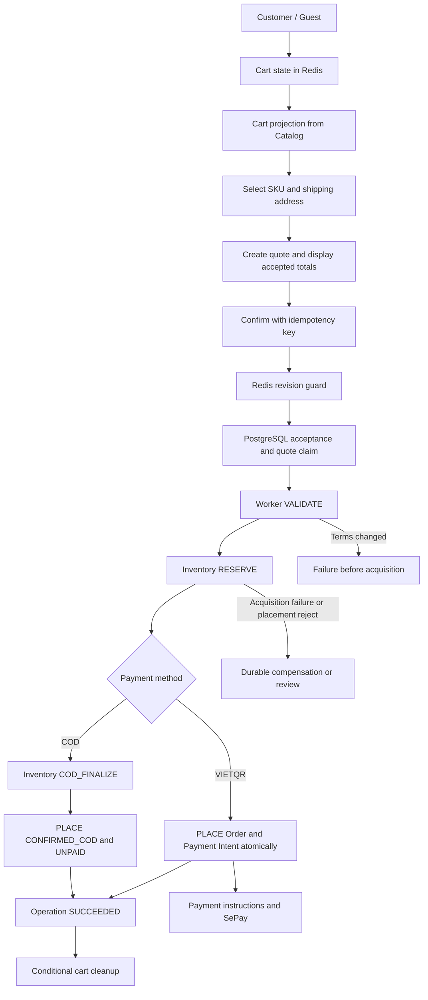

# 11 — Thiết kế Cart và Checkout

**Phiên bản:** `cart-checkout-1.0-review` · **Ngày:** 16/10/2026 · **Trạng thái:** Đề xuất để review, chưa triển khai.

[Chỉ mục](README.md) · [HLD Order](00_order_service_hld.md) · [Payment SePay 1.1](09_payment_sepay_vietqr_design.md) · [OpenAPI candidate](../../../03_api_specs/order-cart-checkout.candidate.openapi.yaml)

## 1. Phạm vi và bốn quyết định ưu tiên

Claim/lease/epoch, stale external proof, retry/reconciliation và registry dùng [Runtime13](13_order_saga_worker_runtime.md). Workflow placement ở đây tồn tại trước Order; recovery phải theo operation/effect intent.

Cart/Checkout là module của MS-04 Order. Redis giữ lựa chọn mua hàng và quote preview; PostgreSQL giữ quyết định nhận checkout, snapshot đã chấp nhận, quyền dùng quote và toàn bộ nghĩa vụ sau đó. Catalog quyết định dữ liệu sản phẩm/giá; Shipping cung cấp quote giao hàng; Inventory sở hữu reservation, FEFO và stock ledger. Payment nhận Order đã placement thành công.

Chốt trong bản đề xuất này:

1. **Một quote chỉ có một operation được chấp nhận**, kể cả hai request sử dụng hai idempotency key khác nhau. Quote đã được claim không mở lại sau thất bại.
2. **Input của operation bất biến sau durable acceptance**; worker đọc PostgreSQL, không cần quote hoặc cart Redis để tiếp tục. Việc khách sửa giỏ sau đó không thay đổi đơn đang đặt.
3. **VIETQR PLACE tạo Order và Payment Intent cùng transaction**. SUCCEEDED bảo đảm tồn tại cả hai. COD có finalize riêng và không tạo intent SePay.
4. **Cleanup sau PLACE, theo cart incarnation + revision**, chạy async/retry; không xóa thay đổi mới, không rollback Order do Redis lỗi.

Hỗ trợ Cart Projection và checkout SKU được chọn trong cùng MVP thiết kế. Không tự gộp giỏ Guest vào Customer, không buy-now bypass quote, không split warehouse/address, không voucher/loyalty khi capability chưa bật. API candidate thay đổi response Cart và request Quote, nên cần cohort/version rollout; không sửa ngầm sandbox OpenAPI 3.1.

Điểm cần reviewer chú ý: kiểm revision ở Redis và durable commit ở PostgreSQL là hai thời điểm khác nhau. Mục 6.2 chốt ranh giới admission và nêu rõ khoảng race còn được cho phép, tránh tuyên bố transaction chung giữa hai kho dữ liệu.

## 2. Luồng mục tiêu



Cart và quote không reserve. Checkout trả202 để xác nhận đã nhận yêu cầu bền vững; frontend chỉ báo đặt thành công khi operation SUCCEEDED và đã có order_id. Cleanup không chặn việc mở màn hình thanh toán.

## 3. Quyết định, invariant và failure behavior

| ID | Quyết định / invariant | Boundary và failure behavior | Acceptance |
| --- | --- | --- | --- |
| CART01 | Owner từ principal/session; không nhận owner từ body | Auth trước mọi read/mutation; sai scope→404 | CC01 |
| CART02 | Redis lưu cart_id/revision/SKU/quantity; revision monotonic trong một cart incarnation | Mutation Lua/CAS atomic; stale cart_id/revision→409 | CC02/03 |
| CART03 | Projection lấy giá server, không sửa cart revision | Catalog lỗi vẫn đọc được items; price/total null, không trả0 giả | CC04 |
| CART04 | Kiểm sellability khi add/increase; không reserve ở Cart | Catalog lỗi→503 khi cần validation; delete/decrease vẫn thực hiện được | CC05 |
| CART05 | Cleanup chỉ xóa selected items khi incarnation/revision còn khớp | Job durable sau PLACE; Redis lỗi không rollback Order | CC17–20 |
| CHECK01 | selected_sku_codes bắt buộc, không rỗng, không trùng, thuộc cart | Quote chỉ dùng quantity từ cart snapshot | CC06 |
| CHECK02 | Quote bind owner/cart/revision/selection/address/method và accepted totals | Ciphertext + canonical digest; client không sửa money | CC07 |
| CHECK03 | Quote preview tối đa5m; accepted operation độc lập TTL quote | Hết hạn trước T0→409; sau T0 worker dùng SQL snapshot | CC08/09 |
| CHECK04 | Same principal/key/hash → cùng operation | SQL registry+operation atomic; payload đổi→409 | CC10 |
| CHECK05 | quote_id unique cho mọi accepted operation | SQL quote consumption cùng T0; khác key cùng quote→409 | CC11 |
| CHECK06 | Snapshot accepted durable trước mọi resource side effect | Input/canonical tách biệt; Redis mất sau202 vẫn resume được | CC09/12 |
| CHECK07 | VALIDATE→RESERVE→PLACE, từng bước có durable intent/key | Network call ngoài SQL transaction; UNKNOWN cần query/replay | CC13/14 |
| CHECK08 | Compensation chỉ close khi có terminal proof đúng resource | Không đánh đồng HTTP200 với RELEASED; unknown→review | CC15 |
| CHECK09 | Worker lease/epoch chặn stale local writes, key remote ổn định | Lost ACK đọc registry/query trước retry hoặc bù trừ | CC14/16 |
| CHECK10 | VIETQR SUCCEEDED ⇒ Order+Intent+history/outbox/result đều commit | T3 rollback toàn bộ khi intent insert fail | CC21 |
| CHECK11 | COD commit stock trước PLACE, vẫn UNPAID | Place reject sau commit cần reversal/hold, không release giả | CC22 |
| CHECK12 | Guest operation bind đúng session, read-token Payment không được checkout | Session expired trước acceptance→401; sau acceptance workflow không mất | CC01/23 |
| CHECK13 | Explicit operation/error/cleanup status cho UI | Không double-submit để né UNKNOWN; không tự khôi phục Cart khi payment hết hạn | CC24/25 |

## 4. Cart: trạng thái nhỏ và projection để hiển thị

### 4.1 Model và ownership

```json
{
  "cart_id": "d502e082-f217-47d8-b291-d825e5dc7824",
  "revision": 5,
  "items": [
    {"sku_code": "MX-GION-500G", "quantity": 2},
    {"sku_code": "OCOP-TRA-200G", "quantity": 1}
  ]
}
```

Owner scope được tạo từ trusted Customer identity hoặc verified Guest session. Một active cart/owner trong MVP. cart_id là UUID incarnation do server sinh; Redis hết TTL/evict/recreate tạo cart_id mới dù revision bắt đầu lại, để ngăn ABA từ quote/cleanup cũ. Không dùng cart_id như credential. Customer user ID khác customer_id của Profile.

TTL Cart30 ngày sau mutation thành công; GET/projection không kéo dài TTL. Đọc không có cart trả representation rỗng với cart_id mới được tạo atomic (SET NX/Lua) và revision0; read unavailable Redis→503. Sau reset vẫn có các accepted operations trong SQL; giỏ bị mất không làm mất đơn.

Tối đa100 SKU khác nhau, quantity1..999, SKU đúng canonical code của Catalog, sort ổn định. Cart không lưu price/name/weight/PII snapshot làm authority. Customer/Guest token được xác thực trước khi suy Redis key; body không được chỉ định owner khác.

### 4.2 Mutation và retry

Add dùng delta quantity; set dùng absolute quantity; delete là command riêng. Mọi mutation gửi cart_id+expected_revision và X-Idempotency-Key. Trong Redis Lua: kiểm incarnation, kiểm replay marker/hash, rồi CAS revision/limits và áp effect mới; tăng revision đúng một lần và lưu mutation marker/hash/result cùng thao tác. Replay same key/hash trên incarnation còn đúng trả receipt của mutation cũ trước revision CAS; khác payload→409. Price projection hiện hành được dựng ngoài script nên có thể thay đổi khi replay, nhưng effect/result_revision giữ nguyên.

Giữ mutation marker tối thiểu30 ngày và không tái dùng key trong cùng cart incarnation. Marker hết retention mà client gửi expected revision cũ thì409, không cộng delta lần nữa. Cart mất/recreated trả CART_REPLACED; không tự áp command cũ sang cart mới. Không giữ SQL transaction khi gọi Redis/Catalog. Nếu Redis mất dữ liệu, đây là mất trạng thái giỏ, không được quảng cáo là durable financial idempotency.

Tính delta lại từ input bất biến trong mỗi retry; không sửa biến qty dùng chung giữa các attempt. Hai tab cùng revision chỉ một mutation thắng. ETag trả revision kèm cart_id trong representation; request dùng body expected_revision hoặc If-Match được đặc tả rõ, không dùng hai nguồn version mâu thuẫn.

### 4.3 Validation và Cart Projection

Add SKU mới/increase quantity kiểm Catalog sellable/valid SKU; Inventory availability nếu được hiển thị chỉ là advisory projection qua port do Inventory sở hữu, không tự lấy expired-batch policy từ Cart. Code hiện tại chưa có typed production port này. Catalog state có thể đổi ngay sau validation, vì vậy quote/worker vẫn phải kiểm lại.

Delete và decrease không gọi Catalog để khách luôn sửa được dòng đã ngừng bán. SKU đã tồn tại nhưng unavailable vẫn giữ trong giỏ kèm lý do; không tự xóa hoặc thay SKU. Với set command, giảm quantity giữ được; tăng phải validate lại.

`GET /api/v1/cart` đọc snapshot Redis một lần, batch Catalog cho các SKU đó để trả name/image/price/line_total/sellability/version. Không ghép response giá từ nhiều revision sản phẩm thành một commercial quote. Projection chỉ phục vụ hiển thị; không hứa giá/tồn khi checkout. Nếu Cart đổi trong lúc projection chạy, response vẫn mô tả cart revision đã đọc; mutation sau đó dùng CAS để phát hiện stale client.

| Tình trạng | Response |
| --- | --- |
| Toàn bộ dòng có giá hiện hành | pricing_status=AVAILABLE; estimated_subtotal là tổng các line_total |
| Một số SKU mất giá/missing hoặc provider partial result | PARTIAL; estimated_subtotal=null; priced_subtotal chỉ tổng dòng biết giá, không là tổng phải trả |
| Catalog unavailable | UNAVAILABLE; giữ SKU/quantity; name/image/price/total có thể null; không dựng giá0 |
| SKU inactive/deleted | purchasable=false, reason SKU_INACTIVE/SKU_NOT_FOUND; vẫn giữ dòng |
| Chưa có dữ liệu khả năng mua | purchasable=null, reason CATALOG_UNAVAILABLE; không đoán có hàng |
| Cart rỗng | AVAILABLE, subtotal0, không cho tạo quote rỗng |

`estimated_subtotal` và `priced_subtotal` chưa gồm Shipping/voucher. Line có giá nhưng không sellable vẫn có thể hiển thị giá; UI phải thể hiện trạng thái mua được riêng. Mọi money VND integer có checked arithmetic; line/tổng vượt cap Order thì pricing_status=PARTIAL, đánh dấu dòng liên quan TOTAL_LIMIT_EXCEEDED và giá trị line/tổng không biểu diễn trong domain thành null, không overflow hoặc giả thành tổng hợp lệ. Projection cache nếu dùng phải có version/age, nhưng MVP không trả giá stale làm giá AVAILABLE.

## 5. Quote và checkout các dòng được chọn

### 5.1 Request và snapshot

```json
{
  "cart_id": "d502e082-f217-47d8-b291-d825e5dc7824",
  "cart_revision": 5,
  "selected_sku_codes": ["MX-GION-500G", "OCOP-TRA-200G"],
  "payment_method": "VIETQR",
  "shipping_address_id": "497842ed-c532-4ab0-9de2-8a5ffb4744c0"
}
```

Selection bắt buộc 1..100 unique SKU. Server kiểm đều thuộc Cart incarnation/revision và lấy quantity thực trong Cart. Không nhận unit_price/quantity overrides/discount từ FE. Chọn một phần nghĩa là chọn toàn quantity của dòng; mua ít hơn phải sửa giỏ trước khi tạo quote. Hai request cùng tập SKU khác thứ tự normalize thành một sorted selection digest.

Quote giữ accepted selected SKU+quantity, canonical product fields/version/weight/packaging, owner, cart_id/revision, address snapshot/version/source, method, Shipping service/reference/fee/valid_until, money components và policy version. selection_digest dùng SKU+quantity sort canonical; quote_hash gồm mọi commercial term đã trình bày. Không giữ token bearer trong snapshot; chỉ giữ actor/scope/authorization evidence cần thiết.

Địa chỉ: một trong saved address ID hoặc inline address. Saved address lookup phải đúng Customer và version; Guest nhập inline theo địa giới/master data được provider xác minh. Chọn shipping_service_code rõ ràng; MVP default service chỉ dùng khi Shipping xác nhận một lựa chọn, không tự chọn carrier tùy tiện sau khi khách confirm.

Trình tự: đọc selected cart snapshot → Catalog coherent snapshot + Profile address độc lập nếu có → Shipping sau khi biết weight/address → totals checked → lưu encrypted quote Redis. Quote lifetime5m là preview policy; Catalog/Shipping có validity riêng, được lưu để revalidate ở worker. Không giữ hàng, không thu tiền, không ghi Order trong CreateQuote.

### 5.2 Redis keys và expiry

Đề xuất keys cùng owner hash tag: `cart:{owner_scope}:state`, `cart:{owner_scope}:quote:<quote_id>`, `cart:{owner_scope}:mutation:<cart_id>:<key>`. owner_scope do server sinh/escape từ validated ID, không nhận chuỗi Redis key từ client. Key quote unique theo UUID; lookup luôn qua trusted owner prefix nên không dò quote của người khác.

Quote payload mã hóa AEAD và hash/auth context bind owner/quote_id/version. Nếu dùng Redis Cluster, Cart guard và quote read trong Lua phải cùng hash slot; naming hiện tại `cart:<scope>`/`quote:<id>` cần migration, không giả định đã cluster-ready. TTL không là nguồn quyết định duy nhất: T0 vẫn kiểm expires_at bằng PostgreSQL DB clock.

Quote expiry trước acceptance→QUOTE_EXPIRED; input mismatch→QUOTE_INPUT_MISMATCH; cart_id/revision mismatch→CART_REPLACED/VERSION_CONFLICT. Quote hết hạn sau202 không làm mất operation; worker dùng accepted_input_cipher của PostgreSQL và kiểm lại commercial terms.

## 6. Durable acceptance, quote consumption và chống trùng

### 6.1 Ba lớp identity

| Lớp | Key | Semantics |
| --- | --- | --- |
| Request replay | `(owner_scope, CHECKOUT, idempotency_key)` | Same hash→cùng result; changed hash→409 |
| Quote use | `quote_id` unique | Một quote gắn một accepted operation, không mở lại sau fail |
| Cart submission guard | `(owner_scope, cart_id, cart_revision, selection_digest)` | Chặn nhiều quote của cùng một lựa chọn chưa thay đổi |

**Chọn bật submission guard cho MVP này.** Guard không gồm address/method/price để tránh hai tab tạo quote khác nhau rồi đặt cùng dòng hai lần. ACCEPTED/PROCESSING/WAITING_RETRY/COMPENSATING/MANUAL_REVIEW giữ guard. SUCCEEDED giữ consumed fingerprint như tombstone; muốn mua lại cùng hàng phải có cart revision/incarnation mới. FAILED chỉ release guard sau khi chứng minh không còn resource obligation; quote cũ vẫn đã tiêu thụ, lần mới phải quote mới/key mới. Đây là policy chống double-submit cần Product review; không khẳng định hai operation ở revision khác nhau là duplicate.

Guard chỉ chặn cùng selection digest. Hai selection khác nhau có thể giao nhau; MVP không tự khóa mỗi SKU giữa các checkout. UI khuyến khích theo dõi operation đang chạy; nếu Product yêu cầu chặn overlap từng dòng thì cần extension per-item guard, không nói fingerprint hiện tại đã giải quyết.

### 6.2 Ranh giới Redis và PostgreSQL

**Điểm admission của Cart** là Lua read/compare Redis: quote còn tồn tại đúng bytes/hash, Cart incarnation/revision đúng, selected SKU/quantity còn khớp. **Điểm durable acceptance** là commit T0 PostgreSQL sau đó. Chúng không phải một transaction xuyên Redis/PostgreSQL.

Nếu mutation thắng trước guard Redis →VERSION_CONFLICT. Nếu mutation xảy ra sau guard, kể cả trước T0 commit, operation vẫn được nhận từ snapshot đã guard; mutation là lựa chọn mới trong Cart, không thay input đang tiếp nhận. Cleanup sẽ skip vì revision đã thay đổi. Đây là cách diễn đạt chính xác của “đóng băng input” trong MVP này; **không hứa mọi mutation trước thời điểm SQL commit đều bị reject**.

Chọn ranh giới này để không khóa Cart suốt network call hoặc dựng distributed lock có TTL nhưng không có fencing. Nếu sản phẩm đòi đúng nghĩa “Cart không được thay đổi từ guard đến SQL commit”, phải thiết kế thêm admission barrier có durable cancel/fencing và recovery, hoặc chuyển Cart authority sang cùng DB; đó là thay đổi kiến trúc riêng, không được coi đọc Redis rồi SQL insert đã đáp ứng. Reviewer cần duyệt semantics này tại mục13.

### 6.3 Acceptance algorithm và T0

1. Auth Customer/Guest, normalize body và key16..128 printable ASCII; hash action+input. Read SQL registry trước Redis: replay/UNKNOWN recovery không phụ thuộc quote TTL.
2. Nếu key mới, đọc quote consumption theo owner scope trước để nhận diện quote đã dùng kể cả cache hết hạn. Khác key cùng quote→409 QUOTE_ALREADY_USED; response có operation_id chỉ khi cùng owner.
3. Đọc/decrypt quote owned, kiểm method/revision/input; chạy Redis admission guard với frozen selection. Không gọi Catalog/Shipping/Inventory tại HTTP confirm.
4. T0 dùng PostgreSQL clock kiểm quote expiry; tạo operation UUID và planned_order_id mới; lưu encrypted accepted snapshot kèm explicit schema version và input hash.
5. Cùng transaction claim registry, insert quote_consumption, claim submission_guard, ghi audit và operation ACCEPTED. Conflict bất kỳ rollback toàn bộ; SQL unique constraints là authority trước race giữa replicas.
6. Commit thành công→202+operation_id+Location; order_id public=null. Commit ACK mất→503 ACCEPTANCE_UNKNOWN; client retry **cùng key/body**. Không compensate chỉ vì response HTTP mất.

Pseudocode thứ tự FK có thể dùng deferred constraints/insert phù hợp migration; invariant là một commit:

```text
BEGIN T0
  verify quote.expires_at against DB clock
  INSERT checkout_operation(accepted_snapshot, planned_order_id, ACCEPTED)
  INSERT idempotency_record(scope, key, request_hash, operation_id)
  INSERT quote_consumption(quote_id UNIQUE, scope, operation_id UNIQUE)
  CLAIM submission_guard(scope, cart_id, revision, selection_digest)
  INSERT audit
COMMIT
```

Nếu unique conflict: rollback trước rồi query committed registry/consumption/guard. Same key/hash→replay202 hoặc201 nếu SUCCEEDED; key payload khác→IDEMPOTENCY_CONFLICT; quote khác key→QUOTE_ALREADY_USED; fingerprint khác quote→CHECKOUT_ALREADY_SUBMITTED. Không tự retry với key mới để né conflict. Hai transaction cùng quote chỉ một T0 thắng; bên thua không được reserve.

Checkout request chỉ quote_id/cart_revision/payment_method; selected items/address/money đã đóng băng trong quote. Không nhận một selection mới ở confirm. POST quote không tiêu thụ quote; validation failed trước T0 không claim quote.

## 7. Worker và resource protocol

Snapshot chính thức và aggregate guards tại [Order Core12](12_order_core_design.md), [OrderSnapshot v1](../../../03_api_specs/order-snapshot.v1.schema.json). PLACE phải validate shape + semantic consistency từ cùng canonical input trước ghi Order/items/Intent, không reuse Quote DTO như contract snapshot chính thức.

### 7.1 VALIDATE

Worker đọc `checkout_operations.accepted_input_cipher` ở SQL, không đọc quote/cart Redis. Recheck coherent Catalog fields/price, saved address snapshot/version và Shipping terms. Fresh validity có thể được gia hạn bởi provider khi cùng commercial terms; không đổi accepted unit price/fee/quantity/service/address âm thầm. Thay đổi terms→PRICE_CHANGED/ADDRESS_CHANGED/SHIPPING_OPTION_CHANGED, definitive fail trước reserve.

Lưu canonical snapshot, commercial deadline, reservation command key/hash/digest/warehouse và stage trước gọi Inventory. Commercial window15m bắt đầu lần canonical commit đầu, retry không reset. SKU unavailable→SKU_NOT_PURCHASABLE; Stock insufficient chỉ authoritative ở reserve. Voucher giữ feature disabled; không tự discount từ Cart price.

### 7.2 RESERVE

Gọi typed Inventory port target3.2 bằng `checkout:<operation_id>:reserve`, planned_order_id, consolidated selected SKU+quantity/digest và requested TTL≤15m. Inventory chọn FEFO và trả actual expiry. Tất cả lines phải reserve atomic; không partial Order.

Response validator chung kiểm order/reservation ID, digest, warehouse, known current state, version và expiry. APPLIED/ALREADY_APPLIED không đồng nghĩa current RESERVED còn hạn. Timeout→UNKNOWN/query/replay cùng key. Event trễ chỉ cập nhật projection; không thay authoritative query proof.

Insufficient stock definitive và chắc chắn chưa acquire→FAILED; result không rõ hoặc có khả năng đã acquire→compensation/recovery obligation. Không xóa operation đã202 khi Inventory unavailable.

### 7.3 VIETQR PLACE — T3

Payment deadline=min(stock expiry, commercial deadline, Catalog validity, Shipping validity, voucher expiry nếu sau này bật). Cần còn>30s theo DB clock sau lock; không hardcode mọi đơn có15m thanh toán.

```text
BEGIN T3
  lock/verify operation lease owner + epoch + state
  verify reservation proof and remaining deadline
  INSERT Order(PENDING_PAYMENT, payment=PENDING, stock=RESERVED)
  INSERT OrderItems and immutable encrypted commercial/address snapshot
  INSERT PaymentIntent(SEPAY, VIETQR, amount=Order.final, unique code,
                       receiver profile version, expires_at=payment deadline)
  INSERT OrderHistory + placed outbox
  INSERT durable CART_CLEANUP job(key=cart-cleanup:<operation_id>)
  UPDATE submission_guard = CONSUMED
  UPDATE operation SUCCEEDED + public order_id + result
COMMIT
```

Snapshot có thể nằm ở orders.snapshot_cipher thay vì bảng OrderSnapshots riêng; không tạo hai nguồn chuẩn. Payment Intent insert là local DB write, không gọi SePay hoặc tạo QR từ network trong T3. Receiver profile/capability phải đã validate và còn cho phép cấp intent; nếu circuit chặn trước T3 thì fail/compensate theo policy, không để Order thiếu intent.

Order.operation_id UNIQUE và PaymentIntent.order_id UNIQUE; outbox stable identity/version. Lost SQL commit ACK→query operation/Order/intent trước retry hoặc compensate. Nếu intent creation fail, cả Order/items/history/outbox/operation success đều rollback. Cleanup job chỉ tồn tại khi T3 commit.

SUCCEEDED không phụ thuộc payment đã confirmed hoặc cleanup đã xong. FE dùng order_id gọi Payment Instructions sau SUCCEEDED; nếu payment circuit/deadline lúc đó không cho QR thì hiển thị trạng thái thật theo Payment1.1, không tạo intent thứ hai.

### 7.4 COD

RESERVE→COD_FINALIZE→PLACE. Carrier/service/address/value/risk đủ COD eligibility; finalize stock bằng key ổn định và strict proof trước place. T3 tạo CONFIRMED_COD, payment UNPAID, stock COMMITTED, Order/history/outbox/READY work + cleanup job và set submission guard CONSUMED; **không PaymentIntent SEPAY/VIETQR và không chờ QR**.

Tại COD PLACE vẫn recheck canonical validity và COD policy; runtime cũ có gap bỏ qua expiry cần sửa. Nếu stock đã COMMITTED nhưng PLACE business reject thì giữ MANUAL_REVIEW/reversal intent theo approval/barrier policy; không release như RESERVED. DB lỗi transient tiếp tục query/retry same operation, không sinh Order/COD effect mới.

### 7.5 Compensation và retry

Durable stage COMPENSATE chứa acquisition keys/resource identity, không chỉ error string. ReleaseByOrder phải có tombstone chống reserve đến muộn, chỉ close với verified RELEASED/EXPIRED hoặc cancellation tombstone hợp lệ. COMMITTED cần reversal workflow riêng; unknown/mismatch/RESERVED giữ obligation.

Theo [Runtime13 mục7–8](13_order_saga_worker_runtime.md), placement dùng E_DEADLINE: attempt2s, lease10s, full-jitter cap30s, tối đa10 execution attempts hoặc15m/stage và không vượt business cutoff. Hết execution budget giữ manual case và tiếp tục resource reconciliation; cleanup có E_CLEANUP riêng, không áp trần15m của placement. Recovery dùng same planned_order_id/resource keys; worker epoch mới không đổi remote idempotency identity. Late/stale response vẫn vào observation path hoặc được query lại từ durable intent.

## 8. Cleanup Cart sau PLACE

### 8.1 Dữ liệu job và atomic Redis effect

Job SQL chứa operation_id/order_id, owner scope, cart_id, accepted_cart_revision, sorted selected SKU+quantity, selection_digest và cleanup_key. Không phụ thuộc quote Redis đã hết hạn. T3 tạo job; worker CAS lease/epoch trước outcome SQL. Cleanup gọi Lua trong cùng hash slot với Cart và cleanup marker:

```text
if durable-compatible marker for cleanup_key exists:
    return stored result                 # không xóa thêm
if cart missing:
    store marker CART_MISSING; return
if cart.cart_id != job.cart_id:
    store marker SKIPPED_REPLACED; return
if cart.revision != job.accepted_cart_revision:
    store marker SKIPPED_CHANGED; return
verify every selected SKU+quantity matches frozen input
remove only selected SKU lines
cart.revision += 1
store Cart and APPLIED marker atomically
return APPLIED with resulting_revision
```

Không trừ quantity kiểu “hiện tại5, đã mua2, còn3” trong MVP; nếu đã đổi revision thì giữ toàn giỏ. Marker bind request hash; changed payload cùng cleanup key→conflict/manual review. Không xóa toàn giỏ khi chỉ mua selection. Hai cleanup từ cùng revision, selection rời nhau: bên đầu tăng revision, bên sau SKIPPED_CHANGED; đây là hệ quả bảo thủ được chấp nhận.

### 8.2 Failure, retry và UX

| Tình huống | Hành vi |
| --- | --- |
| Cart không đổi, selected A2/B1 | Xóa A/B, giữ các dòng khác; tăng revision1 lần |
| Khách đổi A2→A5 trước cleanup | SKIPPED_CHANGED, giữ A5 và các thay đổi khác |
| Chỉ sửa SKU không được mua | Vẫn SKIPPED_CHANGED do whole-cart revision; per-item version là mở rộng tương lai |
| Redis timeout sau effect | Replay same cleanup key trả marker; không xóa hàng thêm lại |
| Marker đã mất nhưng Cart revision tăng | Không mutation; SKIPPED_CHANGED/UNKNOWN_APPLY có evidence; không khẳng định đã cleanup |
| Redis lost Cart rồi tạo incarnation mới | SKIPPED_REPLACED, không xóa giỏ mới revision0 |
| Redis outage | Job RETRY/PENDING; Order/Payment vẫn hợp lệ |
| Retries hết | Cleanup MANUAL_REVIEW, không rollback/cancel Order |
| Payment hết hạn/cancel sau placement | Không tự restore Cart; khách dùng “mua lại” qua cart mutation/quote mới nếu được thiết kế sau |

Cleanup status projection trên operation/order: PENDING, APPLIED, SKIPPED_CHANGED, SKIPPED_REPLACED, CART_MISSING, MANUAL_REVIEW. Redis ALREADY_APPLIED map APPLIED cùng result_revision. Marker+Cart commit trong Lua nhưng SQL ACK job có thể mất; retry xử lý như trên. Marker TTL tối thiểu30 ngày và không ngắn hơn remaining auto/manual replay window; jobs chưa terminal không được purge marker theo lịch mặc định. cart_id+monotonic revision là guard bổ sung khi mất marker, không hứa exactly-once across Redis restore.

FE nhận SUCCEEDED refresh Cart; SKIPPED_CHANGED thông báo “Đơn đã tạo; giỏ có thay đổi nên được giữ nguyên.” Không hướng dẫn thanh toán lại vì cleanup pending. APPLIED không có nghĩa Cart hiện tại rỗng; khách có thể đã thêm sản phẩm sau cleanup.

## 9. Persistence và transaction map

[Persistence17](17_order_persistence_messaging_design.md) hợp nhất DDL/isolation/lock order và commit UNKNOWN lookup. SQL quote-consumption PK là authority chống dùng quote hai lần; Redis marker không thuộc T0 và không thay unique SQL guard. Runtime lease map sang jobs/workflows, không duy trì hai executor cho operation.

| Dữ liệu | Storage/constraint mục tiêu |
| --- | --- |
| Cart + mutation/cleanup markers | Redis; incarnation+revision; all conditional effects Lua atomic |
| Quote preview | Redis encrypted TTL5m; owner, cart incarnation/revision, immutable selection/terms |
| checkout_operations mở rộng | quote_id, cart_id/revision, selection_digest, accepted snapshot schema version/cipher/hash; canonical snapshot riêng; planned_order_id unique; lease/epoch |
| idempotency_records | Existing scope/kind/key PK+request_hash+operation FK; response retention7d, registry≥30d, no automatic key reuse |
| checkout_quote_consumptions mới | quote_id PK, owner_scope, operation_id UNIQUE FK, request_hash, claimed_at; immutable consumed identity |
| checkout_submission_guards mới | scope/cart_id/revision/selection_digest PK, operation_id, state ACTIVE/CONSUMED/RELEASED, version; atomic takeover chỉ RELEASED sau safe FAILED |
| orders/order_items/history/outbox | Existing; order.operation_id UNIQUE, snapshots bất biến, money constraints |
| payment_intents | Theo Payment1.1, order_id UNIQUE; VIETQR same T3 |
| cart_cleanup jobs/result | SQL durable unique operation key; status/result_revision/errors/lease; giữ input đến terminal |

Quote-consumption giữ immutable khi operation terminal; guard/registry không purge khi obligation còn unknown. Khi cleanup/user mutation tạo revision mới thì fingerprint khác, không xóa old consumed identity. Migration backfill legacy operations vào cohort riêng, không tự suy quote use từ order code.

| Tx/bước | Atomic writes | Sau commit |
| --- | --- | --- |
| Redis Cart mutation | Cart+revision+mutation marker | Dựng projection; không làm mất mutation chỉ vì Catalog projection lỗi |
| Redis quote guard | Read/compare quote+cart snapshot | T0 PostgreSQL; ranh giới race theo6.2 |
| T0 | Operation+accepted input+idempotency+quote consumption+submission guard+audit | 202, worker claim |
| T1 | Canonical snapshot+commercial deadline+reserve intent/key | Reserve/query ngoài DB |
| T2 | Validated remote outcome+next stage | PLACE/COD_FINALIZE/compensate |
| T3 VIETQR | Order+items/snapshot+Intent+history/outbox+cleanup job+SUCCEEDED | Payment instructions/cleanup |
| T3 COD | Order+items/snapshot+history/outbox+ready/cleanup work+SUCCEEDED | Fulfillment barrier/cleanup |
| Cleanup Redis/SQL | Redis conditional effect riêng, SQL durable result riêng | Replay same key nếu mất ACK |

Không có cross-DB FK hoặc transaction PostgreSQL+Redis+Inventory. Source of truth cho accepted workflow là SQL; Redis mất trước acceptance có thể làm quote không dùng được, mất sau202 không xóa accepted request.

## 10. API và UX contract

[order-cart-checkout.candidate.openapi.yaml](../../../03_api_specs/order-cart-checkout.candidate.openapi.yaml) là contract để review; giữ error envelope Order3.2. Endpoints trùng path hiện hành nhưng schema mới là breaking change đối với Cart/Quote clients; phải pin route/version/cohort khi triển khai, không cùng URL tùy lúc trả hai shape.

| Endpoint | Result |
| --- | --- |
| GET /api/v1/cart | CartProjection, nullable prices, pricing_status, cart_id/revision |
| POST /api/v1/cart/items | Add delta với cart_id/expected_revision/key; trả mutation receipt+projection |
| PUT /api/v1/cart/items/{item_id} | Set absolute quantity, cùng CAS/key |
| DELETE /api/v1/cart/items/{item_id} | cart_id query + If-Match revision + key; trả mutation receipt+projection thay204 cũ |
| POST /api/v1/checkout/quote | selected_sku_codes/cart_id/revision/address/method/service → immutable Quote |
| POST /api/v1/checkout | key + quote_id/revision/method →202 operation hoặc replay201 |
| GET /api/v1/checkout-operations/{id} | Owner-scoped operation/status/stage/error/order_id/cleanup_status |

Mutation response có `applied_revision` và CartProjection đọc lại (có thể mới hơn do tab khác); không giả rằng read hiện hành là trạng thái ngay sau mutation cũ. Projection failure do Catalog trả pricing UNAVAILABLE chứ không báo mutation thất bại. Redis read fail sau mutation→503 CART_MUTATION_OUTCOME_UNKNOWN; client retry same key để lấy stored mutation receipt trước khi dựng lại projection.

| Error | UX |
| --- | --- |
| VERSION_CONFLICT/CART_REPLACED | Refresh cart, tạo quote mới; không đổi revision để ép command cũ |
| SKU_NOT_PURCHASABLE | Giữ dòng, sửa/xóa/chọn sản phẩm khác |
| CATALOG_UNAVAILABLE/pricing UNAVAILABLE | Giữ giỏ; không hiển thị giá0, chưa quote được |
| QUOTE_EXPIRED/PRICE_CHANGED/ADDRESS_CHANGED | Hiển thị nội dung thay đổi, khách xác nhận quote mới |
| QUOTE_ALREADY_USED/CHECKOUT_ALREADY_SUBMITTED | Theo dõi operation cũ thuộc owner; không auto tạo checkout khác |
| ACCEPTANCE_UNKNOWN/503 sau submit | Retry cùng key/body; không dùng key mới |
| INSUFFICIENT_STOCK | Operation fail an toàn, giữ Cart; UI cho sửa rồi quote mới |
| Compensation/remote UNKNOWN | Đang xử lý/kiểm tra; chưa báo rollback thành công |
| SUCCEEDED + cleanup skip/pending | Order đã tạo; refresh giỏ và tiếp Payment hoặc theo dõi COD |

202 body gồm operation_id/status/stage/order_id=null/accepted_at/cleanup_status=NOT_SCHEDULED; Location operation resource, Retry-After2s. Poll2s rồi backoff; SUCCEEDED trả order_id. Terminal error có operation_id/error.code/retryable; GET operation không trả PII snapshot hoặc bearer token.

### 10.1 Guest boundary

Cart/Quote/Confirm dùng verified Guest checkout session hoặc Customer credential. Operation principal/scope được server chốt lúc acceptance; Guest session revoke không tự hủy operation đã accepted, nhưng read sau revoke bị chặn. Không dùng Payment order-bound read grant để mutate Cart, mint quote hoặc tạo checkout. Guest Payment grant ở [Payment mục11.1](09_payment_sepay_vietqr_design.md) chỉ mint sau khi Order đã tồn tại và cùng guest session có ownership.

Sau login giữ hai giỏ riêng; không tự merge/claim Guest Order. Recovery/claim đi verified Identity/Profile/Care flow, không suy từ payment code hoặc phone tự khai. Worker không dùng bearer snapshot cũ làm credential để gọi service; dùng trusted service identity và principal references với purpose đã được chấp nhận.

## 11. Đối chiếu code hiện tại

Đã kiểm [checkout.go](../../../../services/order-service/internal/app/checkout.go) và [placement.go](../../../../services/order-service/internal/app/placement.go): **accepted input đã được copy vào PostgreSQL**. Accept lấy quote ciphertext và INSERT checkout_operations.input_cipher cùng registry; WorkPlacement giải mã w.Input từ SQL. Quote TTL5m hết sau202 không làm worker mất input. Đây là hành vi đã có, không phải gap cần viết lại từ đầu.

| Sandbox hiện có | Cần thay đổi |
| --- | --- |
| Redis Cart revision+SKU/qty, TTL30d | Thêm incarnation, projection, mutation replay receipt, typed validation |
| Quote lấy toàn giỏ | Explicit selected SKU, immutable selection/hash và service terms |
| Revision đọc riêng trước SQL | Atomic Redis admission guard + semantics6.2; không claim cross-store atomicity |
| Idempotency theo key đã có | Thêm quote consumption unique và cross-quote fingerprint guard |
| SQL input_cipher đã bền vững | Version envelope, selected snapshot/proof; không chuyển worker về đọc Redis |
| PLACE tạo Order/items/history/outbox | VIETQR thêm PaymentIntent và cleanup job trong cùng T3 |
| Chưa thấy cleanup Cart | CAS Lua+markers, durable result, UI status riêng |
| Inventory HTTP simulator | Typed target3.2 gRPC port/validator/query/release tombstone |
| Compensation chỉ loại COMMITTED | Chỉ close khi whitelist verified terminal proof |
| COD place bỏ qua validity guard | Recheck terms; committed failure giữ reversal obligation |

Không chạy code/runtime tests mới trong lượt thiết kế. Bản này không đóng R01/R02/R05/R06 hoặc chứng minh real Inventory/Catalog/Shipping integration.

## 12. Acceptance matrix

| ID | Scenario | Oracle bắt buộc |
| --- | --- | --- |
| CC01 | Customer/Guest chéo scope, forged owner/code/token | Denied, không lộ Cart/quote/operation |
| CC02 | Hai tab mutation cùng cart revision | Một winner, revision tăng đúng1 |
| CC03 | Cart hết TTL/recreate cùng revision0 | cart_id mới; quote/mutation/cleanup cũ không áp sang Cart mới |
| CC04 | Catalog down/partial/missing SKU/overflow | Items giữ nguyên, price null/status rõ, không fake0 |
| CC05 | Add/increase inactive SKU; delete/decrease unavailable | Add reject đúng policy; khách vẫn sửa/xóa được |
| CC06 | Selection rỗng/trùng/không thuộc giỏ, quantity override | Reject; accepted quantity từ Cart |
| CC07 | Selection thay thứ tự hoặc tamper address/amount/method | Normalize stable hash hoặc reject mismatch; không tin money FE |
| CC08 | Quote trước/bằng/sau expiry T0 | Bằng/sau hết hạn; không resource side effect trước202 |
| CC09 | Redis down/quote TTL hết sau202 | Worker resume từ SQL accepted snapshot |
| CC10 | Concurrent same key/hash; changed input; commit ACK mất | Một operation/effect; replay hoặc conflict đúng |
| CC11 | Same quote hai key; failed operation reuse quote | Một accepted operation; quote không reopen |
| CC12 | Same cart revision/selection, hai quote khác nhau | Submission guard một winner; safe FAILED mới release |
| CC13 | Price/address/service thay đổi trước reserve | Definitive fail không silently charge khác |
| CC14 | Reserve committed/lost ACK/crash, stale worker | Stable key, authoritative query, no second reservation |
| CC15 | Release trả RESERVED/unknown/wrong digest/tombstone | Không close compensation sai |
| CC16 | SQL T3 commit ACK mất | Query operation/Order/Intent trước compensate |
| CC17 | Cleanup same revision, partial selection | Xóa đúng selected, giữ dòng khác, revision+1 |
| CC18 | Cart edit ở selected/unselected SKU trước cleanup | Skip toàn cleanup, giữ mọi edit |
| CC19 | Cleanup Redis effect ACK mất, khách add lại | Retry marker/CAS không xóa hàng mới |
| CC20 | Cleanup Redis outage/manual review | Order/Intent/SUCCEEDED không rollback |
| CC21 | PaymentIntent insert fail hoặc concurrent PLACE | Atomic rollback hoặc đúng một Order+Intent+outbox+cleanup job |
| CC22 | COD finalize success rồi PLACE transient/definitive fail | Không fake UNPAID→PAID; query/retry hoặc explicit reversal obligation |
| CC23 | Session expires/revokes sau202, Payment read grant gọi checkout | Worker tiếp tục; read policy và permission tách biệt |
| CC24 | FE mất mạng sau submit, replay key hoặc poll | Không double reserve/Order; UI phân biệt202/placed/paid |
| CC25 | Payment hết hạn/hủy sau cleanup | Không tự restore Cart hoặc xóa lịch sử Order |
| CC26 | Cart mutation ngay trước/sau Redis guard và trước SQL commit | Kết quả đúng semantics6.2, không quảng cáo strict SQL-time exclusion |
| CC27 | Mutation lost ACK, concurrent replay và altered same key | Một delta effect; result_revision ổn định, projection có thể mới hơn |
| CC28 | Concurrent disjoint hoặc overlapping selections | Fingerprint semantics rõ; cleanup conservative; không claim overlap protection chưa có |
| CC29 | Cart/Quote keys khác Redis Cluster slots | Config/contract test reject trước rollout; không chạy Lua cross-slot giả |

Oracles kiểm SQL operation/quote guard/Order/Intent/outbox và Inventory ledger hai phía, không chỉ HTTP status. Failpoint quanh guard/T0/remote/T3/Lua cleanup để kiểm crash deterministically. SePay/real payment tests theo bộ Payment riêng; Checkout test không cần chuyển tiền thật.

## 13. Điểm review và rollout

| Quyết định | Đề xuất | Đánh đổi |
| --- | --- | --- |
| Cart admission timing | Redis guard là điểm chốt Cart; SQL commit là durable acceptance | Mutation sau guard nhưng trước commit được coi lựa chọn mới; không strict exclusion tới SQL time |
| Cross-quote double-submit | Guard cùng owner/incarnation/revision/selection; giữ consumed khi SUCCEEDED | Muốn mua lặp cần revision mới; chưa chặn overlap selection khác digest |
| Partial checkout | Required selected_sku_codes; whole quantity/dòng | Không hỗ trợ quantity riêng trong quote |
| Cleanup | Sau PLACE, whole-cart revision CAS | Sửa dòng bất kỳ đều có thể khiến giữ lại các dòng đã mua |
| Projection outage | Giữ Cart, giá null/status rõ | UI phải hỗ trợ loading/unavailable, không dùng0 |
| Payment integration | VIETQR Order+Intent một T3 | Receiver capability/unique code phải được chuẩn bị trước PLACE |

Triển khai theo slice: (1) schema/constraints + selected snapshot/guard; (2) projection/mutation CAS; (3) durable operation+Inventory adapter/validator; (4) PLACE+PaymentIntent+cleanup; (5) failure/UX/contract suite; (6) cohort rollout với real dependencies. Dependency contracts Catalog/Shipping/Inventory/Identity phải được xác nhận, không dùng simulator để tự chứng minh capability thật.

Candidate API dùng existing paths để reviewer đối chiếu dễ; trước release chọn version route hoặc cohort cố định và nâng FE cùng contract. Expand migrations/backfill, pin DTO/schema versions; legacy cohort tiếp tục adapter riêng. Rollback ngừng nhận checkout mới, vẫn xử lý accepted operations/stock/payment/cleanup obligations; không xóa quote claims hoặc registry để mở lại effect.

## 14. Nguồn và trạng thái kiểm chứng

Nguồn nội bộ: [Cart requirements](../../../01_requirements/epics/EPIC_05_Shopping_Cart.md), [Checkout requirements](../../../01_requirements/epics/EPIC_06_Checkout.md), [Order use cases](04_usecases_and_saga_orchestration.md), [persistence](03_database_and_persistence.md), [gaps](07_decisions_and_contract_gaps.md), [Payment1.1](09_payment_sepay_vietqr_design.md), code Checkout/Placement được liên kết ở mục11.

Thông tin runtime là kết quả đọc mã hiện có; các CARTxx/CHECKxx, schema/API và tests ở trên là đề xuất. Không thêm implementation hoặc tuyên bố bộ CCxx đã PASS. Static OpenAPI/examples/links được kiểm trong lượt soạn; nhận xét từ nội dung review được chuyển thành quyết định và review points, không sao chép phần CSS Mermaid của attachment vào tài liệu.

Kết quả static: candidate Cart/Checkout hợp lệ theo OpenAPI3.0.3 với6 paths/7 operations;11 examples hợp lệ;9 negative cases bị schema từ chối (selection rỗng/trùng, address hai nguồn/không có nguồn, price override, thiếu cart_id, confirm override selection, SUCCEEDED thiếu Order/cleanup). Một projection SUCCEEDED có Order+cleanup PENDING hợp lệ. Hai Payment candidates vẫn validate;140 liên kết local trong bộ Order+API README hợp lệ sau khi cập nhật tên file09/10. Code fences cân bằng; `git diff --check` không có lỗi whitespace. Đây là kiểm contract tài liệu, không phải concurrency/crash tests hoặc chứng minh transaction Order+Intent ở runtime.
