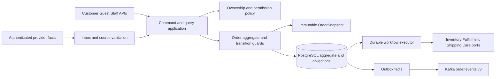

# 12 — Thiết kế Order Core

**Phiên bản:** `order-core-1.0-review` · **Ngày:** 17/10/2026 · **Trạng thái:** Đề xuất thiết kế để review.

[Chỉ mục](README.md) · [Payment 1.1](09_payment_sepay_vietqr_design.md) · [Cart/Checkout](11_cart_checkout_design.md) · [Snapshot schema](../../../03_api_specs/order-snapshot.v1.schema.json) · [Snapshot examples](../../../03_api_specs/order-snapshot.v1.examples.json) · [Order Core API candidate](../../../03_api_specs/order-core.candidate.openapi.yaml)

## 1. Scope, ownership và trách nhiệm

Order Core là nguồn dữ liệu chuẩn cho **trạng thái thương mại và quyết định thực hiện một đơn hàng**. Core nhận kết quả từ Checkout/Payment và facts/proofs của các provider, kiểm invariant rồi tự áp dụng chuyển trạng thái. Không service nào được sửa trực tiếp Order hoặc tự suy PAID/PROCESSING từ một HTTP200.

MVP: D2C Customer hoặc Guest, một merchant, một kho, một địa chỉ, VND; VIETQR/SePay và COD theo eligibility. Payment giữ receipt/allocation/refund; Inventory giữ stock/FEFO/reservation ledger; Fulfillment giữ accept/cancel task barrier và packing; Shipping giữ shipment/checkpoints; Care giữ quyết định hỗ trợ, refund/cancellation approval và completion barrier. Core chỉ giữ references/projections/evidence cần để quyết định.

Sau PLACE, thay đổi sản phẩm/số lượng/giá/địa chỉ/dịch vụ ship là **amendment riêng**, cần policy, repricing, barrier và audit; chưa hỗ trợ trong MVP. Không mở generic PATCH status/snapshot. Snapshot gốc luôn được giữ; claim ownership không sửa owner-at-placement trong snapshot.

### 1.1 Cấu trúc bên trong



| Thành phần | Interface nghiệp vụ | Trách nhiệm |
| --- | --- | --- |
| Order aggregate | ApplyDecision(state, verified evidence, policy, decision time) | Invariant và hợp lệ của transition, không network I/O |
| Snapshot policy | ValidateSnapshot / VerifySnapshotConsistency | Schema/version/hash, nguồn, money và immutable commercial data |
| Command application | Authorize → dedup → lock → guard → commit | Gắn actor/reason/version, tạo workflow/outbox atomic |
| Workflow executor | Claim → call/query → validate → apply | Durable progress/lease/keys, recovery external effects |
| Query projection | OwnerDetail / StaffQueue / History / SnapshotView | View theo quyền, allowed_actions là hint, không tạo quyền |
| Ports | Typed Inventory/Fulfillment/Shipping/Care proofs | Auth, association, version/hash và terminal outcome validation |

Đây là ranh giới thiết kế module, không yêu cầu mỗi thành phần là một service/process hoặc aggregate riêng.

## 2. Order aggregate và invariants

Aggregate root `Order` gồm identity, current owner reference, immutable snapshot reference, lifecycle, payment/stock projections, version, readiness generation, active hold/cancel references và provider associations. Items và các money columns là projection của cùng snapshot; jobs/ledgers/history là bản ghi liên quan có boundary riêng, không phải một object phải load toàn bộ mỗi lần query.

| ID | Invariant luôn đúng | Nơi enforce |
| --- | --- | --- |
| OC01 | Một Order/checkout operation; một current owner CUSTOMER hoặc GUEST | PLACE constraints, verified claim command |
| OC02 | Snapshot nghiệp vụ không đổi sau PLACE, mọi bản đọc có schema version | Snapshot validator, write boundary, integrity check |
| OC03 | Order/items/money/intent cùng commercial facts | T3 consistency validator và unique/FK/checks |
| OC04 | PAID lần đầu cần exact verified allocation, stock COMMITTED proof, voucher finalized nếu bật, không hold/cancel/refund blocking | Paid decision dưới Order lock |
| OC05 | Một first-paid fact cho mỗi Order; retries không tạo paid mới | Milestone uniqueness + aggregate outbox transaction |
| OC06 | Fulfillment chỉ accept qua current generation/verified permit và remote barrier | Order permit + Fulfillment atomic accept/cancel |
| OC07 | Cancelled không được mở lại bởi receipt/fact/retry cũ | Transition table + active workflow/generation guards |
| OC08 | Release chỉ dành reservation chưa committed; reversal là effect riêng | Typed resource proof validator |
| OC09 | Receipt luôn được bảo toàn dù Order held/cancelled/unmatched | Payment ingestion + Core không xóa ledger |
| OC10 | Hold/resume không gia hạn stock hoặc payment deadline | Deadline policy; resume resource query |
| OC11 | UNKNOWN không đồng nghĩa FAILED hoặc đã rollback | Durable obligation state/recovery |
| OC12 | Command/event/worker cùng đi qua guard, version và transaction | Không có direct bypass trong application boundary |
| OC13 | Owner hiện tại thay qua verified claim, không suy từ order code/phone | Identity/Profile proof + association checks |
| OC14 | Refund và return/reversal không tự đổi lifecycle thay nhau | Payment/Inventory/Order ownership separation |
| OC15 | History/outbox cùng commit với effect; event không mang raw PII/snapshot | Transaction writer + pinned event schemas |

Order root có nhiều trục độc lập: lifecycle, financial summary, resource projection, hold, cancellation workflow và readiness. Không thêm trạng thái HELD vào lifecycle chỉ để biểu diễn một control flag.

## 3. Snapshot model, schema version và consistency

### 3.1 Bốn mốc dữ liệu

| Mốc | Ý nghĩa | Thay đổi cho phép |
| --- | --- | --- |
| Quote preview | Khách nhìn thấy commercial proposal | Quote mới khi terms đổi; quote cũ không rewrite |
| Accepted input | Bằng chứng khách đã đồng ý, copy bền vững lúc T0 | Bất biến trong operation |
| Canonical snapshot | Kết quả kiểm lại coherent terms trước side effects | Provider có thể revalidate validity nhưng không đổi accepted commercial terms âm thầm |
| OrderSnapshot v1 | Bản chốt chính thức tại T3 | Không sửa nghiệp vụ; amendment/claim/fulfillment là records riêng |

`OrderSnapshot` là **một tài liệu có schema chính thức**, không phải DTO Quote đổi tên. Schema machine-readable và examples ở đầu tài liệu chỉ chứa điều kiện đã chốt, không chứa current status, receipt, refund, mutable task/shipment hoặc bearer token.

### 3.2 Nhóm field và authority

Mọi field schema v1 đều required; trường không áp dụng dùng explicit null theo schema, không dùng chuỗi rỗng/giá0 để thay dữ liệu thiếu.

| Nhóm | Field chủ yếu | Source/consistency |
| --- | --- | --- |
| Identity/version | snapshot_schema_version=1.0, snapshot_id, order_id, operation_id, merchant_id, warehouse_id, channel, placed_at | Server identity/T3 |
| Owner at placement | kind, principal_id, customer_id hoặc guest_session_id | Trusted principal + mapping; current owner là field riêng của Order |
| Provenance | quote/cart IDs/revision, selection_digest, quote_hash, accepted_at, canonicalized_at | Accepted operation; digest khớp selected items |
| Catalog evidence | snapshot_id, version, valid_until | Coherent Catalog snapshot hoặc atomic revalidation cùng terms |
| Items | line_id, sku_code, product_name, quantity, unit_price, line_subtotal, weight_grams, packaging, catalog_version | Catalog + accepted quantity; packaging/weight versioned |
| Address | recipient_name, phone_e164, street, province/ward code và label; source reference/version nullable theo kind | Profile verified address hoặc validated inline address |
| Shipping | carrier_code, service_code, quote_reference/version/valid_until, package_weight_grams, quoted_fee | Shipping quote của canonical address/items |
| Money | currency VND, subtotal, merchandise_discount, shipping_fee, shipping_discount, final_amount | Server checked arithmetic |
| Payment terms | VIETQR provider/receiver profile/version/deadline hoặc COD policy/reference/collect_amount | Payment/Shipping policy lúc PLACE; không lưu secret/account statement |
| Policies | order/checkout/payment/shipping policy versions, promotion policy nullable | Policy registry đã chọn, không placeholder giả |

V1 inline address vẫn phải có master-data validation reference. Saved address có profile_address_id và address_version; inline dùng null cho hai field đó. Owner CUSTOMER yêu cầu customer_id; GUEST yêu cầu guest_session_id, không gán customer_id giả. Label địa chỉ là bản tên đã chốt, không đọc tên sống để sửa lịch sử.

COD `payment_expires_at` trong snapshot là null vì không có hạn khách trả online; reservation acquisition expiry thuộc resource workflow. VIETQR deadline là min expiries theo Checkout11; vẫn lưu riêng quote validity và payment deadline, không dùng expires_at mơ hồ.

### 3.3 Structural và semantic validation

JSON Schema kiểm field/type/nullability/enum/limits; **application semantic validator** bắt buộc kiểm:

```text
line_subtotal = quantity * unit_price
subtotal = sum(line_subtotal)
0 <= merchandise_discount <= subtotal
0 <= shipping_discount <= shipping_fee
final_amount = subtotal - merchandise_discount + shipping_fee - shipping_discount
shipping.quoted_fee = money.shipping_fee
COD.collect_amount = money.final_amount
unique line_id and sku_code
accepted_at <= canonicalized_at <= placed_at
catalog/shipping validity still valid at placement
snapshot selection_digest = digest(selected SKU+quantity) = accepted operation selection_digest
snapshot items_digest = Inventory order-3.2 digest(sorted SKU+quantity) = reservation proof digest
snapshot warehouse_id = reservation proof warehouse_id (validated independently)
order columns/items/intent amount/method/owner scope = snapshot projection
```

VND dùng integer/BIGINT, max final/subtotal10^12, quantity1..999, tối đa100 lines, final>0. Kiểm multiplication/addition overflow trước ghi. Promotions disabled thì discounts0 và promotion policy null; thêm discount allocation/tax/B2B cần schema/policy mới, không giấu field tùy ý trong v1.

Provider thiếu packaging/weight/version hoặc canonical proof → SNAPSHOT_INPUT_INCOMPLETE, không tự dựng dữ liệu để PLACE. Địa chỉ/giá/dịch vụ thay đổi sau accepted → quote mới theo Checkout11; Catalog/Profile thay đổi sau PLACE không ảnh hưởng OrderSnapshot.

### 3.4 Immutable storage và evolution

Một canonical payload lưu encrypted; record giữ schema_version, logical_hash, encryption_key_ref và snapshot_id. Money/items columns là indexed projection ghi cùng T3 từ **cùng object đã validate**, không phải nguồn thứ hai tự cập nhật. Không bắt buộc một bảng OrderSnapshots riêng nếu encrypted payload thuộc Order và vẫn enforce được constraints.

`logical_hash` SHA-256 trên canonical plaintext theo profile `order-json-v1`: sorted object keys, array items sort sku_code, integer decimal không float, UTF-8, không whitespace không cần thiết, escaping JSON nhất quán và string normalization đã chốt lúc input. Fixture dùng UTF-8 non-ASCII không escape trừ ký tự JSON bắt buộc, Unicode NFC trước khi chốt input. Selection digest và items_digest đều tính trên array sorted `[{quantity,sku_code}]` theo [Inventory profile](../../../../packages/contracts/order-3.2.md), warehouse kiểm riêng; hai digest khác purpose/type dù có thể cùng giá trị. Mô tả cũ bọc warehouse đã được sửa khi implement Core, xem [ADR-002](../../adr/order-service/adr_002_digest_and_canonical_snapshot_profiles.md). Không đổi digest remote đang tồn tại hoặc dựng proof tương đương. Ciphertext hash khác logical hash; không dùng hash chứa địa chỉ thay items_digest.

Rotate encryption có thể đổi ciphertext/key metadata trong maintenance transaction có audit nhưng phải giữ plaintext logical_hash; bất biến là **nghiệp vụ**, không cấm re-encrypt. Unknown schema version→fail closed ở command quyết định tiền/kho; query trả lỗi hỗ trợ có reference thay vì đọc sai hoặc tự điền default. Schema mới version mới, dual-reader/cohort rollout; không backfill dữ liệu thương mại chưa từng biết vào snapshot cũ. Current owner, amendments, fulfillment evidence và actual shipping charge là records append-only riêng.

## 4. Lifecycle và transition guards

| Từ | Trigger | Sang | Guard bắt buộc |
| --- | --- | --- | --- |
| Chưa có Order | VIETQR PLACE | PENDING_PAYMENT | Reservation RESERVED đúng proof, snapshot valid, còn>30s, Intent cùng T3 |
| Chưa có Order | COD PLACE | CONFIRMED_COD | Stock COMMITTED, COD terms valid, financial UNPAID |
| PENDING_PAYMENT | Canonical receipt exact | PAYMENT_FINALIZING | Order lock, now<deadline, no blocking hold/cancel/refund; allocation atomic |
| PAYMENT_FINALIZING | Resource outcome | PAID | OC04; COMMITTED proof decision trước lease expiry; first-paid milestone unique |
| PENDING_PAYMENT | Timeout | CANCELLED_TIMEOUT | DB now>=deadline, chưa có allocation/finalize thắng |
| PENDING_PAYMENT | Owner cancel | CANCELLED_BY_USER | Trước deadline và chưa receipt allocation/finalization; cancel+release intent atomic |
| PENDING_PAYMENT | Verified Care cancellation approval | CANCELLED_BY_ADMIN | Cùng no-allocation/time guard; approval scope/version đúng, cancel+release intent atomic |
| PAYMENT_FINALIZING | Authoritative EXPIRED/RELEASED | CANCELLED_TIMEOUT | Không committed; preserve money+case; UNKNOWN không đủ |
| PAID/CONFIRMED_COD | Task accepted | PROCESSING | Correct task/order/generation + authoritative ACCEPTED proof |
| PROCESSING | Package sealed | PACKED | Trusted Fulfillment association/evidence/sequence |
| PACKED | Shipment dispatched | SHIPPED | Trusted Shipping dispatch checkpoint; CREATED chưa đủ |
| SHIPPED | Delivery outcome | DELIVERED/DELIVERY_FAILED | Shipment+attempt+version đúng; stale/out-of-order defer |
| DELIVERY_FAILED | New dispatched attempt | SHIPPED | Attempt mới hợp lệ, không replay dispatch cũ |
| DELIVERED | Completion decision | COMPLETED | Mục14 completion guard đầy đủ |
| PAID/CONFIRMED_COD | Approved cancellation | CANCELLED_BY_ADMIN hoặc BY_USER với COD unpaid | Fulfillment CANCELLED + full reversal proof, no unresolved effects |

Không có automatic cancellation của PROCESSING/PACKED/SHIPPED trong self-service MVP. Care return/exception workflow cần policy riêng; không mở transition ngược để xử lý return. Order terminal vẫn có thể nhận ledger facts/case/refund nhưng lifecycle không tự mở lại.

## 5. Command model, quyền và versioning

### 5.1 Common command contract

Mỗi command có owner/service principal, target order_id, X-Idempotency-Key16..128 printable ASCII, expected_version, reason_code và optional evidence/decision reference; actor lấy từ credential, không nhận actor_id thay thế. Customer dùng reason code giới hạn; free-text chứa PII không phát Kafka.

Pipeline: authorize scope → lock Order → query registry → replay same key/hash trước stale-version check → guard/version/decision clock → mutate root+workflow/history/outbox+registry cùng transaction → return200 terminal hoặc202 command resource. Changed body/key→409; stale version→409; outside object scope→404; thiếu permission→403; unavailable authority→503. Replay kiểm quyền hiện tại, không khôi phục effect hoặc tiết lộ response cũ sau owner claim.

Service facts dùng source event/command identity, verified evidence và source version thay client expected_version để tránh event trễ ghi đè state mới; vẫn lock và kiểm current root version/state. Không dùng expected_version của event cũ để cưỡng ép root quay lại.

### 5.2 Command matrix

| Command | Actor/permission | Preconditions | Tx / external effects | Postconditions/failure |
| --- | --- | --- | --- | --- |
| PlaceOrder | Checkout service/workflow | Accepted canonical snapshot/resource proof | T3 mục6 | Order+Intent nếu VIETQR; rollback whole T3 nếu lỗi |
| ApplyVerifiedReceipt | Payment module identity | Canonical receipt association; matching theo Payment1.1 | Receipt/allocation+FINALIZE work atomic; Inventory sau commit | FINALIZING hoặc durable case; giữ mọi receipt |
| FinalizeOrderResources | Workflow | Existing allocation, no conflicting terminal intent | Stable Inventory finalize/query, validate then Tpaid | PAID/ready intent hoặc UNKNOWN/reconcile |
| CancelPending | Customer/Guest checkout principal | Owner/scope; pending no allocation, DB clock | Cancel+release obligation, release ngoài SQL | Cancelled có compensation PENDING; late receipt không revive |
| RequestCancellationReview | Owner / `order.cancellation.request` | PAID/COD hoặc care-eligible state theo policy | Request+audit, gửi Care qua durable work | REVIEW_REQUEST_CREATED; không tự cancel/refund |
| ApplyCancellationApproval | Trusted Care service | Query verified decision bind Order/policy/scope/version | Hold+cancel workflow rồi barrier/reverse | CANCELLED chỉ sau proof; reject/manual khi task accepted |
| HoldOrder | Staff `order.hold`, scope/assignment | Nonterminal state phù hợp, no conflicting cancel | Tcontrol+optional barrier call | Admission blocked ngay sau commit; hard stop chỉ sau remote proof |
| ResumeOrder | Staff `order.resume` cho đúng hold | Mục9.3; không clear financial/system hold trái quyền | Query providers ngoài tx, Tresume guard lại | Resume một hold; ready generation mới chỉ khi còn eligible |
| ApplyProviderCheckpoint | Trusted source | Source association/version/sequence | Inbox+root/history/outbox atomic | Apply/defer/quarantine; no forced status |
| CompleteOrder | Completion workflow | Care serialized allow decision + financial/resource guards | Query decision then Tcomplete recheck | COMPLETED một lần hoặc giữ delivered/obligation |
| RecoverWorkflow | Staff `order.recover`, fresh MFA, scoped | Evidence/query plan cho obligation | Resume same key/stage, audit; không trực tiếp mark success | Job pending/manual, không bỏ UNKNOWN |

Customer/Guest read chỉ đúng current owner. Guest Cart/Checkout credential khác order-bound payment:read grant: grant Payment không được cancel/hold/resume hoặc đọc toàn bộ Order snapshot. Staff quyền theo permission **và** merchant/warehouse/assignment, không chỉ tên role; Admin không bypass business invariant. Recovery/hold/resume nhạy cảm yêu cầu MFA mới≤15m là policy đề xuất.

## 6. PLACE transaction và kết nối Checkout/Payment

T0 nhận request và T1/T2 acquire resource theo [Checkout11](11_cart_checkout_design.md); Order không tồn tại công khai trước T3. Order Core nhận canonical selected snapshot và resource outcome, không quay lại live Cart để quyết định quantity.

```text
BEGIN T3
  verify operation lease/epoch, canonical terms and resource proof
  validate OrderSnapshot v1 and cross-field consistency
  insert Order + immutable snapshot + item/money projections
  if VIETQR: insert one SEPAY PaymentIntent from same amount/deadline/profile
  if COD: preserve UNPAID and COMMITTED proof, schedule readiness work
  insert history + placed outbox + cart cleanup work
  mark submission guard CONSUMED and operation SUCCEEDED with order_id
COMMIT
```

Không network trong T3. Unique operation/order/intent and milestones bảo vệ concurrent replay. SQL commit ACK mất → query committed operation/order/snapshot/intent trước retry/compensation. Cleanup failure không invalidate Order. Receiver capability phải đủ trước tạo VIETQR intent; không tạo Order chờ một intent riêng sau commit.

## 7. Inventory orchestration và receipt/cancel/timeout concurrency

### 7.1 Decision order dưới cùng Order lock

Mọi receipt allocation, cancel/timeout decision, hold và paid-first decision phải serialize trên Order row, kiểm version/state và lấy DB clock **sau lock**. Idempotency key chỉ dedup, không thay locking/state guards. Stock expiry/finalize race phân xử tại Inventory DB clock; local Order time không chứng minh remote commit.

| Race | Winner/decision | Loser/recovery |
| --- | --- | --- |
| Receipt exact trước deadline vs owner cancel | Receipt allocation thắng → FINALIZING | Owner cancel bị409 REVIEW_REQUIRED; không release reservation đang finalize |
| Owner cancel vs receipt | Cancel commit trước → cancelled + release intent | Receipt vẫn lưu/case; không auto allocate |
| Timeout vs receipt ở đúng deadline | now>=deadline → timeout | Bank paid_at trước hạn không backdate decision; receipt→late case |
| Finalize RPC thành công, ACK mất vs timeout sweep | Chỉ authoritative COMMITTED proof đủ chốt | Sweep không blind cancel FINALIZING; query same reservation/key |
| Hold commit khi finalize đang bay | Local paid guard sau đó thấy hold và dừng PAID/ready | Remote effect có thể xảy ra; lưu COMMITTED proof, không release giả |
| Refund obligation vs paid-first | Cùng Order→intent→receipt lock order | Nếu refund budget đã reserve/settled thì paid guard từ chối; đã commit stock mở controlled compensation |
| Cancel terminal vs delayed stale worker/event | Terminal state/generation wins local | Query effect còn thiếu, không reopen lifecycle |

### 7.2 Finalization outcomes

Finalize key/action/request hash được lưu trước call; response phải đúng order/reservation/items_digest/warehouse, resource_version không stale và decision evidence đủ. RESERVED còn sống có thể finalize; COMMITTED replay đúng resource success dù query sau expiry. EXPIRED/RELEASED là terminal reject; unknown/network failure là caller observation, không terminal provider state.

Receipt đã allocate đúng hạn và Inventory decision commit trước lease expiry có thể đưa Order PAID sau local payment deadline, nếu không còn hold/cancel/refund blocking và snapshot terms đã được chấp nhận đúng thời điểm. Điều này khác receipt được xử lý lần đầu sau deadline: trường hợp đó không auto allocate. Không yêu cầu now<deadline lần nữa để phủ nhận COMMITTED effect đã được chứng minh.

Nếu Inventory terminal reject sau khi nhận tiền → giữ receipt/allocation trace, open reconciliation, no fulfillment; có thể cancel timeout khi proof cho biết không committed. Nếu outcome UNKNOWN → FINALIZING+hold/recovery, không tự refund/reverse cho đến khi biết effect hoặc Care quyết định có kiểm soát. Reverse chỉ bằng explicit reversal proof và full-reservation scope MVP.

## 8. Fulfillment readiness và accept barrier

Readiness predicate: lifecycle PAID hoặc eligible CONFIRMED_COD; resource proofs hợp lệ; không active blocking hold/cancel/refund; snapshot/method/policy đủ; current generation chưa closed. `OrderPaid` là fact thương mại, không là packing command và không trừ kho.

Order phát `fulfillment_ready(generation)` rồi Fulfillment xin permit bind order/generation/items_digest/request_key/audience/expiry. Provider validate permit online theo contract; Order chỉ cấp khi current predicate đúng dưới lock. Fulfillment serialize AcceptTask và CancelTask trên cùng order+generation record:

- ACCEPTED thắng: một task hợp lệ; cancel/hold không được tuyên bố đã dừng; source proof đưa Order PROCESSING dù local notification trễ.
- CANCELLED thắng: tombstone chặn mọi permit/event trễ của generation đó; không reopen bằng retry.
- Timeout/lost ACK: query GetTaskDecision với cùng identity; local READY=false không chứng minh task chưa accept.

Generation mới chỉ sau khi generation cũ đã có terminal cancel proof và không task accepted. Generation0 chưa từng phát ready/permit là trạng thái chưa được cấp quyền, không cần dựng remote proof giả để phát generation1 lần đầu. Không dùng generation mới để lách task đang chạy. Guard này áp dụng cả cancellation, hard hold và resume.

## 9. Cancel, Hold và Resume

### 9.1 Cancellation workflows

**Pending chưa allocate:** transaction Tcancel ghi cancelled/history/outbox/cancellation workflow+release intent. Nếu DB now>=payment deadline, target CANCELLED_TIMEOUT; trước hạn owner cancel→BY_USER, verified Care approval→BY_ADMIN. Staff ngoài owner không gọi owner-cancel để né approval; staff tạo review request hoặc dùng Care decision theo quyền. Lifecycle có thể terminal khi stock compensation PENDING; API phải trả riêng compensation_status. Inventory release query/tombstone đúng protocol, không nói stock đã nhả ngay lúc local cancel commit.

**PAID hoặc COD committed:** owner request review không tự chuyển trạng thái. Sau verified approval/policy, tạo blocking cancellation hold + invalidate new permits → query/cancel Fulfillment barrier → nếu CANCELLED mới reverse committed stock với proof/scope hợp lệ → commit terminal cancellation và outbox. ACCEPTED → reject self-cancel/refer Care; không chuyển PROCESSING ngược. Unknown giữ CANCELLATION_PENDING/MANUAL_REVIEW, không tự gọi refund thứ hai.

Cancellation có các stage/projection nghiệp vụ REQUESTED_REVIEW, APPROVED, STOPPING_FULFILLMENT, REVERSING_STOCK, SUCCEEDED, REJECTED, MANUAL_REVIEW; workflow.state chung dùng mapping tại [Runtime13 mục3](13_order_saga_worker_runtime.md), không trộn enum stage vào job/business state. compensation_status riêng NOT_REQUIRED/PENDING/SUCCEEDED/MANUAL_REVIEW. `CANCELLED_*` không ngụ ý money đã refunded. Approval revocation sau external effect đã xảy ra cần case/recovery, không giả rollback.

### 9.2 Hold semantics

Mỗi hold có hold_id/type/reason/actor/source/version/status, không chỉ một bool có thể bị workflow khác clear. Blocking summary là OR của active holds/cancellation/financial obligations.

| Hold | Tác dụng | Không suy ra |
| --- | --- | --- |
| OPERATIONAL + ADMISSION_ONLY | Chặn permit mới, ready publication và local auto paid/allocate decisions bị policy chặn | Không bảo đảm task đang bay hoặc đang chạy đã dừng |
| OPERATIONAL + REQUIRE_REMOTE_STOP | Admission block ngay; gọi barrier; status PENDING_REMOTE→ACTIVE khi CANCELLED proof | Chưa có proof thì chưa “hard stopped”; ACCEPTED trả REJECTED_TASK_ACCEPTED |
| FINANCIAL / CANCELLATION / INTEGRITY | Chặn transition/readiness theo obligation, do workflow quản lý | Staff resume thông thường không được xóa reason này |

Trong mọi hold, receipt ingestion, statement sync, ledger/refund reconciliation, query external UNKNOWN và audit **tiếp tục**. Hold không làm mất khoản tiền. Auto allocation và PAID lần đầu cần no blocking hold theo Payment1.1; RPC finalize đã bay có thể vẫn commit, nên phải query/lưu proof và chờ guard tiếp theo. Hold không gia hạn reservation/payment deadline. Timeout chưa allocated vẫn cancel/release đúng hạn dù held.

Hard hold thua barrier vì task ACCEPTED thì command REJECTED, hold mới ở REJECTED và không được hiển thị stopped; các hold tài chính khác vẫn giữ. Query source để cập nhật PROCESSING/task association nếu event chưa tới. Không tự reverse/thu hồi package đang xử lý.

### 9.3 Resume semantics

Resume chỉ giải quyết **một hold_id** được staff quyền tương ứng quản lý, expected_version/reason/key và scope hợp lệ. Đọc/query resource, barrier, Care/financial obligations ngoài SQL, rồi Tresume lock Order/hold và kiểm lại version/current obligations. Evidence đã stale hoặc thiếu proof → pending query/review, không tin UI flag.

Preconditions: Order chưa cancelled/completed; không active cancellation; no blocking financial/refund/case/integrity obligation; không untracked task accepted; generation cũ closed nếu đã có ready/permit; resource state đủ cho bước kế tiếp. Pending reservation phải còn sống; EXPIRED/RELEASED không resume bằng cách dùng Order cũ reserve lại. COMMITTED proof không bị phủ nhận chỉ vì expires_at đã qua; việc chốt PAID sau hold phải kiểm receipt/refund và decision proof ở mục7.

Resume một hold nhưng còn hold khác → chỉ đóng hold đó, chưa ready. Khi hold cuối được gỡ và PAID/COD resources đủ, Tresume tăng generation và tạo ready intent cùng history/outbox. Resume pending chưa trả tiền không cấp ready. Nếu hard hold/task barrier vẫn UNKNOWN thì command không báo thành công; giữ obligation đến authoritative result.

Refund đã terminal cũng không tự chứng minh đơn chưa fulfillment còn đủ điều kiện giao: sau refund cần explicit Care/policy decision về tiếp tục fulfillment; full refund không auto-ready. Rule này không đổi lifecycle lịch sử hoặc tự sửa quantity trong snapshot. Partial goodwill refund của đơn đã giao được xét riêng trong completion/return policy.

## 10. Durable jobs, retries, UNKNOWN và compensation

Runtime chung là [chương13](13_order_saga_worker_runtime.md): job registry, ba tầng state, observation ingestion khi stale, lease/heartbeat, scheduling và recovery. Chương này giữ aggregate guards và semantics compensation.

| External result | Durable local disposition | Hành vi tiếp theo |
| --- | --- | --- |
| Success proof đúng | Store command result/current state/evidence/version | Chuyển bước khi guard hiện tại còn đúng |
| Business reject terminal | Store reason/state/proof | Fail safe trước acquisition hoặc compensation/case sau effect |
| Timeout/UNKNOWN | Store obligation và next query time | Query trước blind retry; mutation replay same key/hash |
| Duplicate same effect | Registry/inbox/milestone no-op | Trả cùng outcome, không thêm event tài chính |
| Conflicting response | Append conflict evidence, hold/quarantine | Reconciliation; không overwrite known good proof |
| Worker crash/lost lease | Stage/input/key/outcome còn trong SQL | Worker mới claim epoch, query/resume same identity |

Job giữ kind/stage/input schema/hash/keys/remote association/outcome/attempts/run_after/lease/epoch theo Runtime13. Default execution attempt2s, lease10s, full-jitter cap30s,10 dispatched attempts hoặc15m/stage, cắt theo business deadline; từng kind dùng profile riêng. Hết execution budget không dừng reconciliation: query tiền/stock UNKNOWN có quota, next check và escalation độc lập, kể cả workflow MANUAL_REVIEW. Retry không làm mới commercial deadline hoặc remote key. Sau payment deadline query outcome, không phát finalize mới vô điều kiện. Stale proof vẫn được append/validate và chuyển compensation obligation khi current Order guard không cho tiếp tục.

Recovery command chỉ lập lại query/resume plan theo evidence; không cho staff PATCH job DONE, mark PAID, set stock COMMITTED hoặc reset identity. Step đã effect không thể compensate bằng local rollback. Release-before-late-reserve cần provider tombstone; committed reversal cần proof fulfillment stopped. Không có distributed exactly-once claim.

## 11. Persistence, locking và transaction boundaries

[Persistence17](14_order_persistence_messaging_design.md) và [DDL candidate](order_persistence_messaging.candidate.sql) là physical mapping chung; các tên logical order_workflows/resource_outcomes/order_command_registry ở đây map sang workflows/external_effects/command_registry. Không nhân đôi queues hoặc sources of truth.

| Record | Trách nhiệm / constraints |
| --- | --- |
| orders + immutable snapshot/items | Current root/projections, operation unique, owner discriminator, snapshot_id/hash/version |
| order_holds | Scoped hold IDs, source/type/mode/state, actor/reason, barrier association, version |
| order_cancellation_workflows | One active accepted cancellation/Order, approval/progress/proofs, result |
| order_command_registry | scope/action/key/hash+target+outcome; no key reuse to bypass unknown |
| order_milestones | unique(order_id,FIRST_PAID), completion/placement once facts |
| order_workflows/jobs/resource_outcomes | Durable keys/stages/lease/epoch/proofs; indexed unresolved age |
| order_history | Append-only order/version/entry sequence, actor/source/reason and changes |
| outbox/inbox/source_projections | Event identity, payload hash, source association/version, applied/deferred/rejected |
| snapshot_amendments/ownership_history | Reserved extension: original snapshot unchanged, verified decisions only |

Payment tables/Cart quote claims giữ ownership module tương ứng; cùng PostgreSQL không có nghĩa mọi bảng thuộc Order aggregate. Lock hierarchy chuẩn dùng Persistence17 mục5: Order → checkout/control → receipts → refunds → workflows → effects → jobs → event streams, cùng nhóm sort ID. Unmatched receipt path không lấy Order lock sau receipt; dùng linking workflow riêng. PLACE trước khi Order tồn tại có parent-lock exception được đặc tả riêng.

| Transaction | Ghi atomic | Network sau/trước transaction |
| --- | --- | --- |
| T3 | PLACE theo mục6 | No network inside |
| Treceipt | Receipt/allocation + FINALIZING/history/finalize work | Inventory call sau commit |
| Tpaid | Proof projection + FIRST_PAID milestone + PAID/history/outbox/ready intent | Proof đã verify, guard lại dưới lock |
| Tcontrol | Hold/cancel/command intent + invalidated readiness + history/outbox/registry | Barrier/release/reverse sau commit |
| Tresume | Close one hold + generation/ready intent nếu đủ + history/registry/outbox | Resource/barrier query trước, recheck version sau |
| Tconsume | Inbox disposition + root/projection/history/outbox/deferred work | Query thiếu prerequisite qua durable work |
| Tcomplete | Verified decision ref + COMPLETED milestone/history/outbox | Care serialized decision trước, local guard lại |

Không giữ SQL transaction qua service RPC. Remote proof bind request/order/resource/hash/version/audience; TTL và decision time kiểm đúng operation semantics. Lease fencing chỉ chặn local writer cũ, không làm RPC đã bay biến mất.

## 12. History, outbox/inbox và event ordering

| Thành phần | Ý nghĩa |
| --- | --- |
| Snapshot | Điều kiện thương mại đã chốt |
| History | Ai/nguồn nào đã thay đổi gì, khi nào, vì sao, version trước/sau |
| Job | Công việc/obligation đang cần hoàn tất |
| Outbox | Event fact commit cùng effect, chờ broker ACK |
| Inbox | Consumer disposition và dedup/source association |

Topic `order.events.v3`, partition key order_id, pinned CloudEvents/schema hiện có trong [Order v3 schemas](../../../../packages/events/schemas/order/v3/). Types placed, paid, fulfillment_ready, cancelled, completed, audit; payment receipt/refund facts độc lập theo Payment1.1. Không thêm snapshot/PII hoặc trường mới vào schema closed mà không version/review.

| Fact | Semantic / proof |
| --- | --- |
| placed | T3 committed; chưa cho phép packing |
| paid | First-paid milestone, allocation/resource proofs; không là command trừ kho |
| fulfillment_ready | Readiness intent cho generation, consumer phải xin permit |
| cancelled | Local cancellation committed, compensation_status có thể PENDING ở unpaid |
| completed | Care decision applied + financial/obligation guards |
| audit | Hold/resume/control changes với action/reason_code; không thay durable command result |

Logical Order event position là(order_id,version,ordinal); physical shared outbox dùng UNIQUE(aggregate_type,aggregate_id,aggregate_version,ordinal) và stable event UUID theo Persistence17. Ordinal deterministic, payload/time bất biến qua publish retry. Publisher serialize stream head, không phát next trước head ACK+SQL commit. DB epoch không fence Kafka request cũ: late duplicate có thể tới sau event mới; consumer dedup/prerequisite guards bắt buộc, không hứa raw broker order tuyệt đối qua failover. Version có thể có khoảng trống đối với một loại fact; consumer không đợi mọi integer version phải có paid event.

Consumer dedup(source,event_id)+hash và business resource/version. Cùng ID đổi payload→quarantine; source version cũ không undo state. Thiếu prerequisite→DEFERRED với payload/work durable; commit offset chỉ sau durable disposition. Version cao từ một source không tự cho phép bỏ checkpoint bắt buộc chưa thấy; query authoritative resource. Events không hứa global ordering giữa Inventory/Fulfillment/Shipping; Core guards quyết định khi nào apply.

## 13. Query API, ownership và data exposure

[OpenAPI candidate](../../../03_api_specs/order-core.candidate.openapi.yaml) mô tả Order list/detail/tracking/history, commands/cancellation, staff hold/resume/queue và scoped snapshot views. Trùng route baseline là candidate version/cohort replacement, không được deploy thay shape âm thầm. Command async trả Location scoped command resource; outcome phải được đọc theo kind (review request created khác Order cancelled).

| View | Quyền / nội dung |
| --- | --- |
| Customer detail/list | Current customer mapping đúng owner; totals, items, lifecycle/control/payment/resource summaries |
| Guest detail/list | Live Guest checkout session và owner scope; Order code không là proof; Payment grant chỉ dùng Payment API |
| Tracking | Associated task/shipment checkpoints đã xác minh, không suy trạng thái từ service URL tùy ý |
| Public history | Business timeline, không raw actor identity/PII/internal errors |
| Staff detail/queue | permission+merchant+warehouse+assignment; PII mặc định masked, reveal cần purpose/permission riêng |
| Internal snapshot view | Trusted service+purpose+task association; allowlist fields, audit, short-lived data use |

List dùng keyset(created_at,id); queue dùng(stage, sla_due_at nulls-last, created_at,id). Cursor có chữ ký, bind principal scope/filter/sort và permission-scope digest, TTL đề xuất15m; recheck rights mỗi page. Query snapshot từ immutable Order record, không refresh Catalog/Profile để sửa thông tin đơn cũ. Cache-Control no-store cho view có PII/command results.

`allowed_actions` trả hint tính từ policy/current state/version và authority đủ; server phải guard lại command lúc nhận. Provider unavailable thì action cần proof có thể là unavailable/pending, không mặc định allowed. Snapshot full chứa owner/provenance/PII là tài liệu nội bộ encrypted; public/staff APIs trả projection/redaction, không expose nguyên payload schema cho mọi người.

Internal snapshot purpose đề xuất: FULFILLMENT_PICK_PACK → SKU/qty/packaging, SHIPPING_CREATE → recipient/address/weight/COD amount, CARE_REVIEW → masked commercial view trừ khi có reveal grant. Caller gửi task/reference không đủ bằng chứng; Order phải verify actual association/audience/service ACL. Raw snapshot export không có public endpoint.

## 14. Completion, SLA, observability và reconciliation

DELIVERED chưa là COMPLETED. Guard: delivery checkpoint đúng association; settlement policy đủ (COD cần verified collected/settled theo contract, không tự từ delivery); elapsed return/support window; no active hold/cancellation/case hoặc unresolved refund/stock obligation; Care serialized ALLOWED completion decision còn hiệu lực và bind order/policy/version.

Care serialize case-open với completion decision: case trước decision→deny; case sau decision theo post-completion policy. Order lưu decision reference và guard lại dưới lock; local case projection không thay barrier. Mất ACK query same decision key. Full refund/financial inconsistency không tự auto-complete; chuyển review. Window7 ngày là default đề xuất cần Product/Care duyệt, không là quy định pháp lý hoặc cam kết đã áp dụng.

SLA tính từ từng state entry theo policy_version; không lấy created_at+4h cho mọi bước. Queue cần phân biệt business overdue, external UNKNOWN age và manual-review age. Metrics: receipt→paid, oldest unresolved resource, cancel/hold remote pending, deferred event age, snapshot integrity mismatch, outbox lag, command reject/version conflict; không gắn PII/order ID vào metric labels.

Reconciliation so resource proof với Inventory, task barrier với Fulfillment, shipment/settlement với Shipping, financial facts với Payment. Restore/read-repair không rewrite snapshot hoặc reset keys; reconcile provider outcomes mới hơn DB backup trước mở worker side effects. Ops recovery phải có actor/reason/assignee/evidence và deadline xử lý.

## 15. Acceptance, rollout và quyết định cần review

### 15.1 Acceptance matrix

| Test | Scenario | Oracle |
| --- | --- | --- |
| OC-T01 | Customer/Guest owner discriminator, changed current owner | Một current owner; snapshot owner-at-placement không đổi; old owner denied |
| OC-T02 | Snapshot thiếu/version lạ/PII ở event | Schema reject hoặc fail closed; event không chứa raw snapshot |
| OC-T03 | Money/items/digest/intent mismatch | T3 reject whole transaction, không Order bán sai giá/quantity |
| OC-T04 | Catalog/Profile đổi sau PLACE, encryption rotation | Logical snapshot giữ nguyên; ciphertext rotation không đổi logical_hash |
| OC-T05 | Concurrent receipt/cancel/timeout trước-bằng-sau hạn | Một legal local decision theo lock/DB clock; no premature PAID |
| OC-T06 | Inventory COMMITTED ACK mất, query sau deadline | Same effect; proof cho phép paid khi guard còn đủ, không fake release |
| OC-T07 | Hold/refund thắng trước paid-first | Receipt retained, no PAID/ready; remote proof/obligation vẫn được resolve |
| OC-T08 | Duplicate paid/finalizer hoặc delayed cancelled event | FIRST_PAID unique, cancelled không reopen |
| OC-T09 | AcceptTask vs CancelTask, delayed permit | Một remote barrier winner, closed generation không reopen |
| OC-T10 | Hard hold task ACCEPTED hoặc UNKNOWN | Không báo stopped; query/review; không clear hold unrelated |
| OC-T11 | Resume expired reservation/active refund/cancel | Reject/pending proof; không gia hạn hoặc reacquire Order cũ |
| OC-T12 | Hai hold khác nguồn, chỉ resume một | Hold còn lại vẫn block; new generation chỉ khi đủ guard |
| OC-T13 | Cancel pending với release timeout | Local cancelled + compensation pending, late receipt lưu case |
| OC-T14 | Cancel paid/COD với reversal fail/unknown | Không fake terminal success; full reversal proof và no second refund |
| OC-T15 | Worker crash/mất epoch sau remote success | Query/resume same key; stale writer không commit |
| OC-T16 | SQL commit ACK mất ở PLACE/control/paid | Registry/query xác định outcome, không duplicate effect |
| OC-T17 | Outbox crash/reorder, inbox altered payload | Stable IDs/order; quarantine/deferred durable trước ACK |
| OC-T18 | Shipping created/dispatched/out-of-order attempts | Chỉ dispatch hợp lệ→SHIPPED; stale không rollback lifecycle |
| OC-T19 | Care case-open vs completion, refund UNKNOWN | Serialized decision + local recheck; không complete sớm |
| OC-T20 | Staff permission/assignment/mfa/cursor scope change | Deny hoặc refresh cursor; no cross-scope data leak |
| OC-T21 | Snapshot internal purpose/task spoof | Reject; public/staff masking và audit đúng field allowlist |
| OC-T22 | Post-completion receipt/refund/case | Ledger/history giữ được; không reopen lifecycle |
| OC-T23 | Composite T3 VIETQR/COD, cleanup failure | Order+Intent iff VIETQR; cleanup độc lập hiệu lực Order |
| OC-T24 | Recovery muốn new key/mark DONE/force PAID | Command không cho bypass invariant; obligation preserved |

Các test trên là oracle thiết kế, chưa có kết quả runtime trong tài liệu này. Structural schema/example validation không chứng minh concurrency/distributed proofs đúng; cần deterministic barriers/failpoints và ledger hai phía khi nghiệm thu.

### 15.2 Rollout và review decisions

| Điểm | Đề xuất | Cần reviewer chốt |
| --- | --- | --- |
| Aggregate authority | Một Order writer/guard path | Ranh giới permission giữa staff và service decisions |
| Snapshot v1 | Required fields, explicit nulls, logical immutability | Provider có đủ packaging/source/version; encryption/retention policy |
| Hold | Admission-only hoặc required remote stop, nhiều hold độc lập | UI wording và quyền gỡ từng loại |
| Resume | Query proofs, không extend expired lease, generation mới | Manual escalation khi remote đã accept hoặc financial blocked |
| Cancel | Pending local terminal vs committed async proof | Care approval scope, full-reservation reversal MVP |
| Completion | Care serialized decision + settlement/window | Window/return policy và COD settlement authority |
| API/event | Candidate DTO/commands, pin v3 closed schemas | Route/cohort migration và consumer readiness |

Trình tự thiết kế→triển khai sau review: schema/constraints và snapshot golden fixtures → command/guard matrix → workflow proof adapters → concurrent/failure suite → consumers trước producer → cohort canary/rollback drain. Rollback giữ snapshot/ledger/registry/tombstones/obligations. Không dual-publish paid legacy cho cùng new-flow Order để kích hoạt effect hai lần.

### 15.3 Kiểm tra tài liệu/contract trong lượt soạn

- Snapshot schema Draft2020-12 hợp lệ; hai synthetic fixtures Customer/VIETQR và Guest/COD qua shape/format, money/datetime/digest checks và expected logical hash.
- Mười negative shape cases bị reject: missing/unknown schema version, mutable status trong snapshot, owner thiếu identity, quantity0, thiếu packaging, VIETQR thiếu deadline, inline address lẫn Profile reference, COD provider sai và promotion chưa hỗ trợ.
- Mười negative semantic cases có shape hợp lệ nhưng sai arithmetic, duplicate SKU, Shipping fee, COD collect amount, chronology/validity hoặc digests bị oracle thiết kế phát hiện. Chưa kiểm bằng provider receipt/reservation thực; quote_hash và references trong fixtures là minh họa.
- Core OpenAPI3.0.3 hợp lệ:15 paths/15 operations,7 schema examples;5 negative API cases bị reject gồm actor override, staff tự chọn financial hold, force recovery, pick-pack nhận địa chỉ và Care view FULL trái allowlist. Shipping FULL recipient hợp lệ ở đúng schema.
- Ba candidates Payment/Staff/Cart tiếp tục validate với18 examples;179 local links trong bộ Order+API README hợp lệ; Markdown code fences và v3 event schemas được kiểm static, event schema files giữ nguyên.
- Các kiểm tra này chỉ kiểm tài liệu/contracts và oracle dữ liệu mẫu. OC-T05–24 về concurrency, external effects, authorization thực và recovery vẫn là acceptance plan cần triển khai/nghiệm thu sau review.

### 15.4 Traceability với các nhóm review

| Nhóm yêu cầu | Nơi chốt |
| --- | --- |
| A — Aggregate invariants | Mục1–2, OC01–OC15 |
| B — Workflow concurrency | Mục4–5,7 và transaction map11 |
| C — Cancel/Hold/Resume | Mục8–9, command preconditions và explicit remote proof |
| D — Durable orchestration/compensation | Mục6–7,10–11, UNKNOWN disposition và stable keys |
| E — History/outbox/inbox/job/snapshot | Mục3,11–12, ordering và milestone identity |
| F — Query/authorization | Mục5,13, API candidate và purpose-bound views |

Nguồn: [Domain01](01_order_domain_and_boundary.md), [Lifecycle02](02_state_machine_and_lifecycle.md), [Persistence03](03_database_and_persistence.md), [Use cases04](04_usecases_and_saga_orchestration.md), [Contracts05](05_api_contracts_and_transports.md), [Verification06](06_testing_and_failure_recovery.md), [Payment09](09_payment_sepay_vietqr_design.md), [Checkout11](11_cart_checkout_design.md). Bản này cụ thể hóa các quyết định trên ở mức thiết kế; không đánh giá hoặc sửa mã nguồn ứng dụng.
