# Hiểu Order-service từ đầu: từ việc bán hai hộp kẹo đến thiết kế hệ thống

> **Phạm vi áp dụng MVP 1 — 15/10/2026:** đọc [quyết định giao bản đầu](13_mvp_delivery_decisions.md). Chỉ khách đăng nhập, VietQR chuyển khoản qua SePay Payment Gateway; không COD/Guest/voucher, không phương thức phụ, hoàn tiền thủ công có kiểm soát và dừng tự động tại DELIVERED. Các nhánh mở rộng dưới đây không bật trong MVP. Implementation sandbox của đợt đầu được ghi ở [báo cáo](14_mvp_implementation_and_adr_report.md); baseline 3.2 chưa được nghiệm thu tích hợp production.

Ngày viết: **15/10/2026**. Dành cho người lần đầu xây dựng phần đặt hàng và thanh toán trong hệ thống nhiều service.

Tài liệu giải thích bằng tiếng Việt trước, sau đó mới giới thiệu tên tiếng Anh để bạn đối chiếu với mã nguồn. Ví dụ xuyên suốt: **hai hộp kẹo, mỗi hộp 90.000 đồng, phí giao 20.000 đồng, tổng thanh toán 200.000 đồng**.

> Các sơ đồ là hình minh họa để học, không phải bằng chứng chương trình đã triển khai đầy đủ. Luồng mục tiêu theo thiết kế **3.2**. Chương trình hiện có là **sandbox 3.1** — môi trường chạy thử với nhiều hệ thống đối tác được mô phỏng. Contract đã bổ sung theo thiết kế, nhưng các service thật vẫn cần triển khai và kiểm thử. Phiên bản event **v3** là phiên bản thông báo, không phải thiết kế Order phiên bản 3.3.

## Cách đọc

Đọc phần 1–8 để nắm luồng thành công. Phần 9–14 giải thích lý do phải có các cơ chế xử lý lỗi. Phần 15–18 đối chiếu lịch sử thiết kế, những vấn đề còn mở và cách đọc xuống mã nguồn. Không cần học thuộc các tên tiếng Anh ở lần đọc đầu.

| Phần | Nội dung |
| --- | --- |
| [1](#phan-1) | Order-service làm việc gì trong cửa hàng? |
| [2](#phan-2) | Service, API và quyền sở hữu dữ liệu |
| [3](#phan-3) | Những chức năng đang nằm trong Order |
| [4](#phan-4) | Phân biệt giỏ hàng, bản tính tiền, yêu cầu đặt, đơn và tiền |
| [5](#phan-5) | Từ giỏ hàng đến đơn chờ thanh toán |
| [6](#phan-6) | Từ nhận tiền đến xác nhận đơn |
| [7](#phan-7) | Từ xác nhận đơn đến giao hàng và COD |
| [8](#phan-8) | Vì sao phải có nhiều trạng thái? |
| [9](#phan-9) | Lưu ý định trước, xử lý nền và transaction |
| [10](#phan-10) | Chống xử lý lặp và mất phản hồi |
| [11](#phan-11) | Công việc nhiều bước, thao tác bù và outbox |
| [12](#phan-12) | Hết hạn, tiền sai và đối soát |
| [13](#phan-13) | Hủy đơn đồng thời nhận việc đóng gói |
| [14](#phan-14) | Hoàn tiền khác nhập lại kho |
| [15](#phan-15) | Các phiên bản trước đã thay đổi như thế nào? |
| [16](#phan-16) | Bản hiện tại còn vấn đề gì? |
| [17](#phan-17) | Học và đọc mã nguồn theo thứ tự nào? |
| [18](#phan-18) | Từ điển và bài tập tự kiểm tra |

<a id="phan-1"></a>
## 1. Order-service làm việc gì trong cửa hàng?

Hãy tưởng tượng cửa hàng nhận một cuộc gọi: “Tôi mua hai hộp kẹo, giao tới địa chỉ này.” Người nhận đơn phải kiểm tra giá, hỏi kho, ghi đơn, hướng dẫn trả tiền, chuyển đóng gói và theo dõi giao hàng. Nếu khách đổi ý hoặc chuyển tiền sai, người đó còn phải phối hợp xử lý.

Order-service là phần mềm quản lý **hồ sơ đơn hàng và quá trình thực hiện đơn**. Nó biết đơn gồm gì, điều kiện mua đã chốt là gì, ai được xem hoặc hủy, đơn đã đến bước nào và còn công việc gì chưa xong.

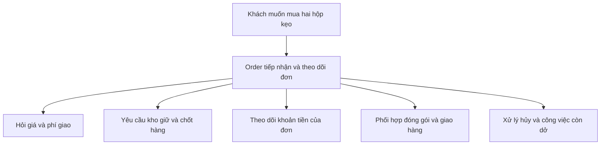

**Cách đọc:** các nhánh là các trách nhiệm phối hợp, không có nghĩa tất cả được gọi đồng thời. Phí giao cần địa chỉ và khối lượng; chốt kho cần điều kiện thanh toán hoặc COD; đóng gói cần đủ điều kiện thực hiện.

Order không tự quyết định số lượng trong kho hoặc lô kẹo nào được lấy. Nó yêu cầu Inventory, rồi dựa vào kết quả Inventory xác nhận. Đây là nền tảng để tránh hai service cùng tự sửa một sự thật theo hai cách khác nhau.

<a id="phan-2"></a>
## 2. Service, API và quyền sở hữu dữ liệu

### 2.1. Service là một chương trình có trách nhiệm riêng

Một service có mã xử lý, cấu hình chạy và nơi lưu dữ liệu thuộc phạm vi của mình. Các service có thể dừng hoặc khởi động lại độc lập. “Microservice” là cách tổ chức hệ thống thành nhiều chương trình như vậy, giao tiếp qua mạng.

Ví dụ Inventory quản lý tồn kho; Catalog quản lý sản phẩm và giá. Order hỏi chúng thay vì đọc hoặc sửa trực tiếp database của chúng.

### 2.2. API là cửa tiếp nhận yêu cầu có quy định

Bạn có thể coi API như một quầy giao dịch có mẫu phiếu: cần đưa thông tin gì, được phép yêu cầu gì và sẽ nhận câu trả lời nào.

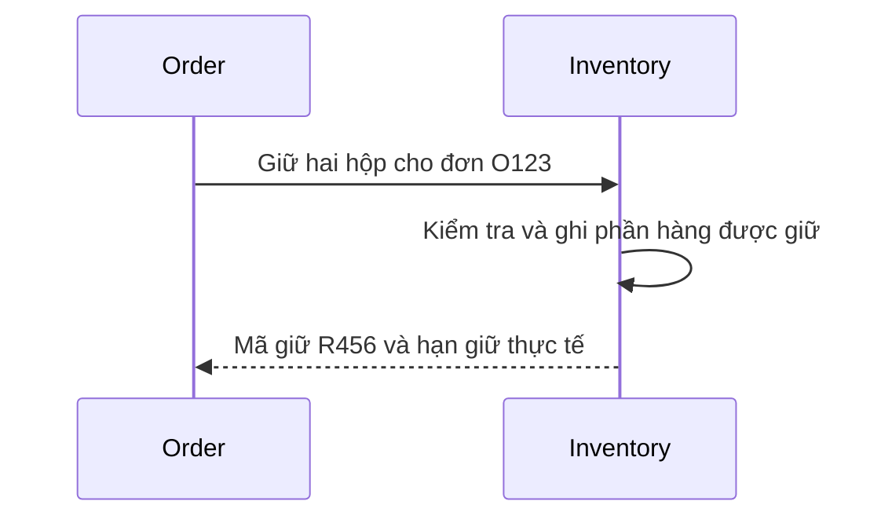

Order không được tự dựng câu trả lời “đã giữ thành công” khi không nhận được kết quả đáng tin.

### 2.3. Ai sở hữu sự thật nào?

| Bộ phận | Sự thật thuộc quyền quản lý |
| --- | --- |
| Catalog | Sản phẩm, giá và thông tin chuẩn để tính hàng |
| Profile / Identity | Hồ sơ, địa chỉ thuộc khách nào, người gọi là ai |
| Inventory | Tồn kho, phần hàng đã giữ, phần đã chốt và lô xuất |
| Order | Nội dung đơn đã chốt, vòng đời đơn và việc điều phối |
| Payment trong Order | Bản ghi tiền đã xác minh, phân bổ tiền, nghĩa vụ hoàn và đối soát |
| Fulfillment | Việc đã nhận công việc đóng gói, kiện hàng và bằng chứng |
| Shipping | Vận đơn và các mốc giao vận do hệ thống có thẩm quyền xác nhận |
| Care | Quyết định hỗ trợ/phê duyệt theo chính sách được thống nhất |
| Finance | Hạch toán và đối soát kế toán |

“Sở hữu” nghĩa là nơi có quyền quyết định và ghi dữ liệu gốc. Order có thể lưu lại thông tin kho để theo dõi, nhưng bản sao đó không thay thế kết quả quyết định ở Inventory.

<a id="phan-3"></a>
## 3. Order-service đang gộp những chức năng nào?

Trong dự án, Payment chưa là một service chạy độc lập. Nó là một phần chức năng bên trong Order-service. Một phần chức năng như vậy thường gọi là **module**.

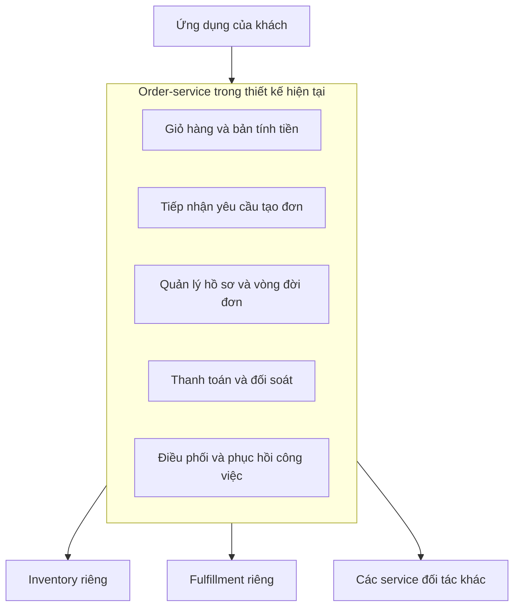

**Cách đọc:** khung lớn thể hiện các nhóm trách nhiệm cùng nằm trong phạm vi triển khai Order. Đây là sơ đồ chức năng, không khẳng định mã nguồn đã chia đúng thành năm thư mục tương ứng.

Gộp giúp giảm số chương trình phải vận hành và cho phép dữ liệu đơn–tiền phối hợp trong cùng cơ sở dữ liệu. Nhưng mã nguồn vẫn cần ranh giới: phần nhận thông báo ngân hàng không tự sửa kho; phần giỏ hàng không tự quyết định tiền đã vào.

Khi hệ thống lớn hơn, có nhiều loại giao dịch hoặc nhiều nhóm phát triển độc lập, có thể cân nhắc tách Payment. Khi đó phải thiết kế việc giao tiếp, quyền sở hữu dữ liệu và di chuyển dữ liệu. Tách sớm không tự làm hệ thống đúng hoặc dễ hiểu hơn.

<a id="phan-4"></a>
## 4. Các loại dữ liệu phải phân biệt

### 4.1. Từ ý định mua đến đơn thật

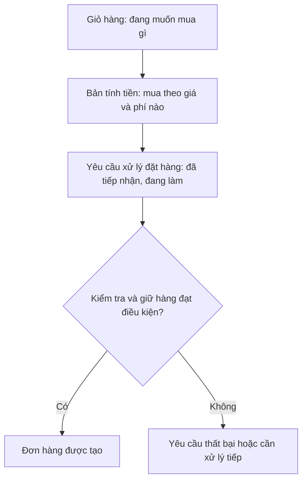

Giỏ hàng thay đổi được. Bản tính tiền có thời hạn và chưa giữ hàng. Hồ sơ yêu cầu đặt hàng cho phép hệ thống theo dõi cả trường hợp chưa tạo được đơn. Đơn thật chỉ xuất hiện sau khi bước tạo đơn đạt điều kiện.

| Tên trong tài liệu/mã | Nghĩa tiếng Việt | Câu hỏi nó trả lời |
| --- | --- | --- |
| Cart | Giỏ hàng | Khách đang chọn gì? |
| Quote | Bản tính tiền có thời hạn | Khách đồng ý mua theo điều kiện nào? |
| CheckoutOperation | Hồ sơ theo dõi yêu cầu đặt hàng | Việc tạo đơn đã làm tới đâu? |
| Order | Đơn hàng | Cửa hàng đã ghi nhận giao dịch mua nào? |
| Reservation | Phiếu giữ hàng tại kho | Đang giữ hàng nào, cho đơn nào, đến khi nào? |
| PaymentReceipt | Bản ghi khoản tiền đã xác minh | Thực tế đã nhận khoản tiền nào? |
| Allocation | Bản phân bổ tiền | Khoản tiền đó dùng cho đơn nào? |
| Refund | Hồ sơ/nghĩa vụ hoàn tiền | Cần hoàn khoản nào và đã hoàn tới đâu? |

### 4.2. Vì sao cần lưu thông tin đã chốt?

Giả sử khách mua với giá 90.000 đồng/hộp. Ngày mai Catalog tăng thành 95.000 đồng. Đơn cũ vẫn phải phản ánh điều kiện khách đã chấp nhận, không được tự tăng tiền.

Order lưu một **bản chụp thông tin tại thời điểm chốt**, thường gọi là *snapshot*: SKU, tên hàng, số lượng, giá, phí giao, địa chỉ đã xác minh và các tham chiếu phiên bản liên quan. Địa chỉ khách sửa trong Profile ngày mai cũng không tự đổi địa chỉ của đơn đang giao.

Trong ví dụ không khuyến mãi:

```text
Tiền hàng = 2 × 90.000 = 180.000 đồng
Tổng phải trả = 180.000 + 20.000 = 200.000 đồng
```

Với VND trong MVP, hệ thống dùng số nguyên, không tính tiền bằng số thực có phần lẻ. Các giới hạn số lượng/số tiền và kiểm tra tràn số vẫn cần được thực hiện trong code.

<a id="phan-5"></a>
## 5. Từ giỏ hàng đến đơn chờ thanh toán

### 5.1. Khách thêm hàng và xem tổng tiền

Giỏ hàng chỉ ghi nhận ý định mua. Order hỏi Catalog lấy giá/thông tin chuẩn, Profile lấy địa chỉ thuộc khách, rồi Shipping tính phí theo địa chỉ và khối lượng. Shipping cần dữ liệu của các bước trước, nên không phải cứ gọi mọi service cùng lúc là nhanh và đúng.

Giá do trình duyệt gửi lên không phải giá có thẩm quyền: người dùng có thể sửa yêu cầu. Nếu giá/phí chuẩn khác điều kiện khách đã chấp nhận, hệ thống phải báo để khách xem lại, không tự thu tổng mới.

### 5.2. Bấm đặt hàng: nhận yêu cầu trước, xử lý tiếp sau

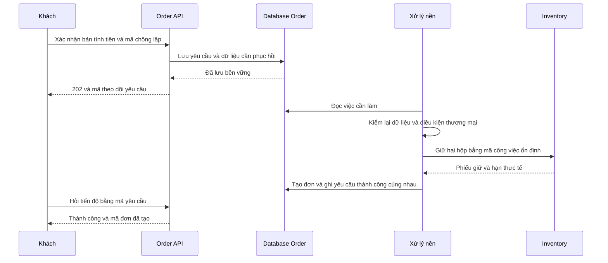

**Cách đọc:** đi từ trên xuống dưới. Dòng “kiểm lại” có thể phát sinh các cuộc gọi Catalog/Profile/Shipping, được rút gọn trong hình để tập trung vào việc tiếp nhận và giữ hàng. Nếu không đạt điều kiện thì không đi tiếp theo nhánh thành công này.

Tên **worker** chỉ bộ phận xử lý nền. Công việc chạy tiếp sau khi API đã phản hồi tiếp nhận, nên khách không phải giữ kết nối đến hết mọi bước. Việc ứng dụng hỏi lại tiến độ gọi là **polling**.

Mã HTTP cần phân biệt:

| Mã | Ý nghĩa trong luồng này |
| --- | --- |
| 202 | Đã nhận yêu cầu bền vững, vẫn đang hoặc sẽ xử lý |
| 201 | Khi gửi lại yêu cầu đã thành công, trả tham chiếu cùng đơn đã tạo |
| 409 | Có xung đột như cùng mã nhưng khác nội dung hoặc sai phiên bản |
| 410 | Kết quả lưu để trả lại đã hết thời hạn, mã cũ vẫn không được tự tái sử dụng |

Các mã khác và chi tiết lỗi xem OpenAPI. Một phản hồi 202 không cho phép giao diện báo “đặt thành công” ngay.

### 5.3. Kho thay đổi thế nào?

```text
Trước khi giữ:       số lượng theo sổ = 100, đang giữ = 0, bán tiếp được = 100
Giữ hai hộp:         số lượng theo sổ = 100, đang giữ = 2, bán tiếp được = 98
Chốt hai hộp:        số lượng theo sổ = 98,  đang giữ = 0, bán tiếp được = 98
```

Giải phóng trước khi chốt thì quay về 100/0/100, giả sử không có giao dịch khác. Chốt rồi không dùng thao tác “giải phóng phần giữ” để cộng hàng lại; đó là nghiệp vụ đảo phần đã chốt với điều kiện riêng.

Thời hạn giữ do Inventory xác nhận mới là căn cứ. Order không tự gán thêm 15 phút và coi đó là hạn của kho.

<a id="phan-6"></a>
## 6. Từ nhận tiền đến xác nhận đơn

### 6.1. Có QR chưa có nghĩa đã có tiền

**MVP hiện chọn SePay Payment Gateway:** Order lưu một lần thanh toán cho đơn rồi mở trang SePay. QR có số tiền và nội dung theo đơn. SePay báo về backend; Order lưu khoản thu rồi xác nhận kho. Tải lại trang không tạo lần thu mới. Xem [luồng MVP dễ đọc](13_mvp_delivery_decisions.md).


QR/hướng dẫn chuyển khoản giúp khách thực hiện giao dịch. Hệ thống còn phải nhận và xác minh thông tin từ ngân hàng/nhà cung cấp đã chọn.

**Provider** nghĩa là nhà cung cấp hoặc hệ thống đối tác. **Callback/webhook** là việc bên đó chủ động gọi API của mình để thông báo có giao dịch hoặc có thay đổi.

Thông báo phải được xác thực theo giao thức đã thống nhất; sau đó kiểm tài khoản nhận, định danh giao dịch, đơn vị tiền, số tiền, tham chiếu và ý nghĩa trạng thái. Dự án hiện chưa chốt/kiểm chứng adapter thanh toán thật, nên những chi tiết đó vẫn là điều kiện phải hoàn tất trước tích hợp.

### 6.2. Luồng mục tiêu khi nhận đúng 200.000 đồng

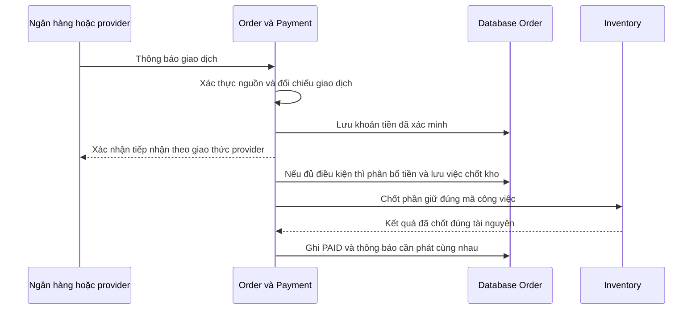

**Cách đọc:** hình bỏ qua voucher vì ví dụ chưa bật voucher. Phản hồi tiếp nhận cho provider chỉ được thực hiện sau khi thông tin cần thiết đã được lưu bền vững, theo giao thức của provider. Nó không có nghĩa đơn đã PAID. Nếu nghiệp vụ yêu cầu, các thay đổi receipt/phân bổ/job có thể gộp trong cùng transaction; hình tách để giải thích từng ý nghĩa.

Trong khoảng đã nhận tiền nhưng chưa chốt xong hàng:

```text
Khoản tiền: đã được xác minh
Đơn: đang hoàn tất xác nhận thanh toán
Kho: chưa có kết quả chốt đủ tin cậy ở phía Order
Đóng gói: chưa được phép bắt đầu theo luồng mới
```

Tên trạng thái đơn là `PAYMENT_FINALIZING`. Giao diện nên giải thích “Đã nhận tiền, đang xác nhận đơn”, thay vì chỉ ghi “chưa thanh toán”.

### 6.3. PAID là quy ước riêng cần hiểu

Trong dự án, lần đầu chuyển đơn sang `PAID` cần khoản tiền được phân bổ đủ và stock đã chốt; nếu bật voucher thì voucher cũng phải hoàn tất. PAID không chỉ là nhận được callback.

Đây là lựa chọn thiết kế, không phải cách đặt tên bắt buộc của mọi hệ thống. Nó giúp chặn đóng gói sớm nhưng dễ gây hiểu nhầm nếu không tách trạng thái tiền khỏi trạng thái đơn.

<a id="phan-7"></a>
## 7. Từ xác nhận đơn đến giao hàng, và trường hợp COD

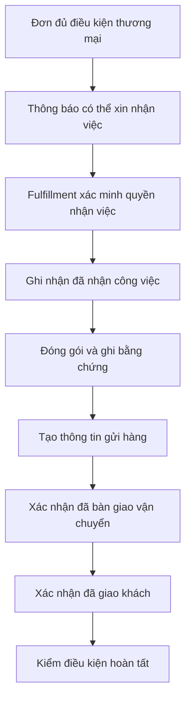

Một **event** là thông báo một sự việc đã xảy ra. `OrderPaid` thông báo đơn trả trước đã được xác nhận theo quy tắc đã nêu. `FulfillmentReady` thông báo đơn đủ điều kiện để Fulfillment kiểm tra và xin nhận việc. Nó chưa phải bằng chứng task đã nhận.

Một **command** là yêu cầu thực hiện một hành động, ví dụ “hãy chốt phiếu giữ này”. Không nên dùng một thông báo có tên “đã thanh toán” để ngầm mang nhiều lệnh độc lập mà thiếu điều kiện phối hợp.

Trong target, thông báo Order đi qua Kafka — một hệ thống trung chuyển/lưu thông báo cho các chương trình nhận xử lý. Chương trình phát gọi là *producer*, chương trình nhận gọi là *consumer*. Tên nhóm thông báo là *topic*. Không cần học cấu hình Kafka trước khi hiểu sự việc được thông báo có nghĩa gì.

Phân biệt rõ:

- Tạo vận đơn chưa chứng minh bưu tá đã lấy hàng.
- Chốt stock là quyết định trên sổ tồn, chưa phải mốc hàng rời kho.
- Giao thành công chưa tự chứng minh đã thu và đối soát đủ tiền COD.
- Hoàn tất cần các điều kiện nghiệp vụ và nghĩa vụ liên quan được đáp ứng.

**COD** là trả tiền khi nhận hàng. Đơn COD đủ điều kiện có thể được chốt hàng và đưa đi đóng gói khi trạng thái tiền vẫn “chưa thu”. Target dùng `CONFIRMED_COD`, không giả lập một lần thanh toán trước. Thu/đối soát tiền COD sau đó cập nhật trục thanh toán, không kéo vòng đời giao hàng quay lại PAID.

**Phần COD trên chỉ giải thích thiết kế cũ. MVP đã bỏ COD, không bật luồng này.**

<a id="phan-8"></a>
## 8. Vì sao không dùng một trạng thái duy nhất?

Một đơn có thể đang giao nhưng chưa thu tiền COD; hoặc đã hủy nhưng đã nhận tiền muộn. Do đó phải theo dõi nhiều câu hỏi độc lập.

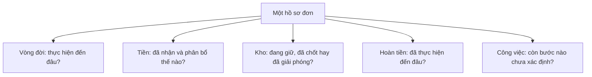

Ví dụ sau hợp lệ:

| Trục | Giá trị dễ hiểu |
| --- | --- |
| Đơn | Đã hủy |
| Kho | Đã giải phóng phần giữ |
| Tiền | Nhận muộn và đang cần đối soát |
| Hoàn tiền | Chưa được phê duyệt |
| Công việc | Cần người xử lý khoản tiền muộn |

Nếu chỉ lưu “đã hủy”, hệ thống sẽ không biết nghĩa vụ tiền còn tồn tại. Nếu đổi trạng thái đơn thành “đã thanh toán”, lại làm mất sự thật đơn đã bị hủy.

Các trạng thái thường gặp:

| Tên | Nghĩa |
| --- | --- |
| PENDING_PAYMENT | Đơn đang chờ thanh toán |
| PAYMENT_FINALIZING | Đã bước vào quá trình xác nhận sau khi phân bổ tiền |
| PAID | Đơn trả trước đã đủ điều kiện xác nhận theo quy ước dự án |
| PROCESSING | Công việc thực hiện đơn đã được nhận hợp lệ |
| PACKED / SHIPPED / DELIVERED | Đã đóng gói / đã bàn giao vận chuyển / đã giao khách |
| COMPLETED | Đủ điều kiện hoàn tất |
| MANUAL_REVIEW | Cần người kiểm tra, không được giả định công việc đã xong |

Chưa cần học thuộc mọi tên. Hãy tập mô tả đủ các trục cho một tình huống trước.

<a id="phan-9"></a>
## 9. Ghi ý định trước, xử lý nền và transaction

### 9.1. Vì sao thứ tự ghi dữ liệu quan trọng?

Nếu gọi giữ hàng thành công rồi Order dừng trước khi ghi rằng mình đã gọi, hệ thống có thể mất dấu phần hàng đang giữ. Target yêu cầu lưu trước “tôi chuẩn bị làm việc X”, sau đó mới gọi ra ngoài.

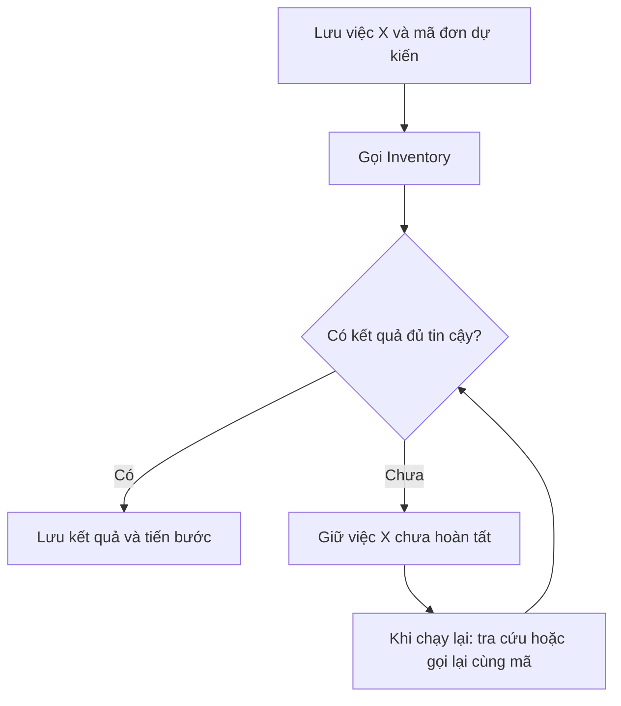

Tên chuyên ngành là **durable intent**: ý định thực hiện công việc đã được ghi bền vững. Mã đơn dự kiến giúp các bước liên hệ cùng một đối tượng trước khi đơn public được tạo; nó chưa cho phép khách đọc một Order chưa tồn tại.

### 9.2. Transaction là gì?

Một **transaction** là nhóm thay đổi cơ sở dữ liệu được thực hiện theo cơ chế cùng chốt hoặc cùng hủy, trong phạm vi cơ sở dữ liệu hỗ trợ nó.

Ví dụ khi tạo đơn, muốn lưu đơn, dòng sản phẩm, lịch sử, kết quả yêu cầu đặt và thông báo cần phát cùng nhau. Nếu có đơn mà không có dòng sản phẩm, dữ liệu không nhất quán.

Nhưng transaction của Order không bao phủ được tiền ở ngân hàng hay dữ liệu trong database riêng của Inventory. Không giữ transaction Order mở suốt thời gian chờ mọi service trả lời rồi cho rằng các service đã cùng chốt.

### 9.3. Khi hai yêu cầu cùng sửa một đơn

Ví dụ yêu cầu hủy và thông báo tiền cùng đến. Cơ sở dữ liệu cần cách phân xử, chẳng hạn khóa bản ghi trong transaction hoặc kiểm số phiên bản.

**Version** là số phiên bản. Nếu nhân viên đọc đơn phiên bản 7 nhưng trước khi thao tác đơn đã lên phiên bản 8, hệ thống có thể từ chối việc sửa dựa trên dữ liệu cũ, yêu cầu đọc lại. Số phiên bản của Order và số phiên bản tài nguyên Inventory thuộc hai nơi khác nhau, không dùng thay cho nhau.

<a id="phan-10"></a>
## 10. Gửi lại yêu cầu và mất phản hồi

### 10.1. Chống xử lý lặp

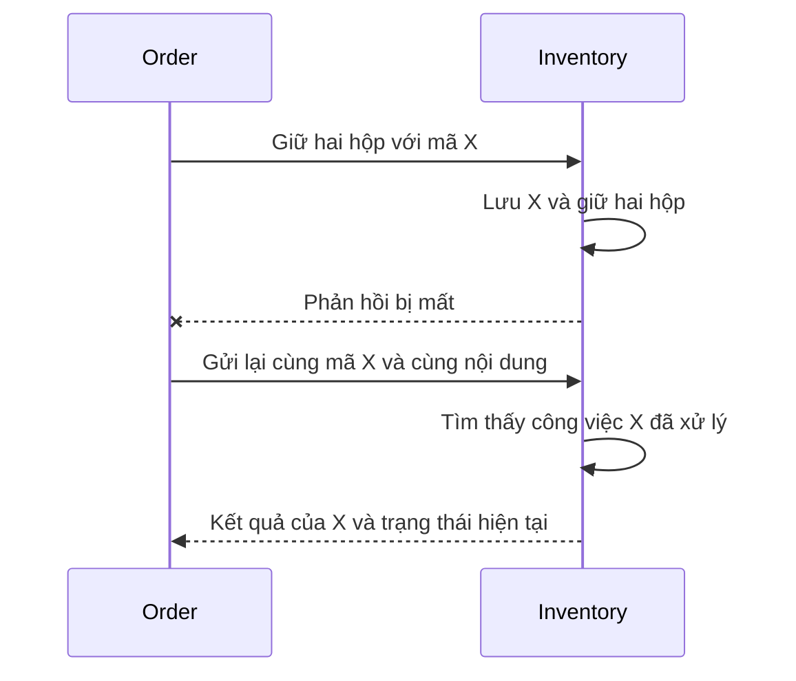

**Idempotency key** là mã chống xử lý lặp của một ý định. Cùng công việc thì giữ cùng mã khi gửi lại, không sinh mã mới vì chưa nhận được phản hồi.

Nếu cùng X nhưng đổi từ hai thành ba hộp, service phải báo xung đột. **Request hash** là dấu nhận diện được tính từ nội dung để phát hiện sự thay đổi đó. Nó không thay thế xác thực người gọi.

Registry là sổ lưu mã và kết quả đã xử lý. Cache Redis có thể hỗ trợ tốc độ, nhưng trong target sổ chống lặp quan trọng phải lưu bền vững. Mất cache không được biến một công việc cũ thành công việc mới.

### 10.2. Timeout không chứng minh thất bại

**Timeout** nghĩa là hết thời gian chờ. Khi Order chưa nhận được câu trả lời, có thể yêu cầu chưa tới, đang xử lý hoặc đã xong nhưng mất phản hồi.

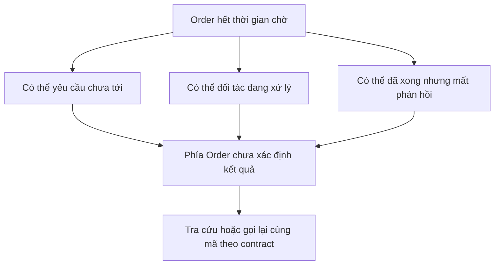

Tên `UNKNOWN` mô tả việc người gọi chưa biết kết quả. Không tự đổi nó thành “thất bại chắc chắn” rồi giải phóng hoặc hoàn tiền tùy ý.

**Retry** là thử lại. Thường cần giãn các lần thử và giới hạn tốc độ để tránh càng lỗi càng bị dồn yêu cầu. Hết số lần thử không có nghĩa tác động ở xa chưa xảy ra: nghĩa vụ chưa rõ vẫn phải được lưu, có thể chuyển người xử lý.

### 10.3. Cần phân biệt kết quả công việc gốc với trạng thái hiện tại

Giữ hàng bằng X từng thành công lúc 10:00; đến 10:15 phiếu giữ đã hết hạn. Gọi lại X không được trả một chữ “thành công” rồi khiến Order tưởng đang còn hàng được giữ.

Target cần cả hai thông tin: công việc X trước đây đã được áp dụng thế nào, và tài nguyên hiện đang ở trạng thái nào. **Proof/evidence** ở đây là dữ liệu kết quả có thể xác minh từ service có thẩm quyền: đúng đơn, đúng phiếu, đúng danh sách hàng/kho, phiên bản và quyết định. Một chuỗi “đã chốt” do caller tự gửi không phải bằng chứng.

<a id="phan-11"></a>
## 11. Công việc nhiều bước, thao tác bù và outbox

### 11.1. Saga không phải transaction chung cho mọi service

**Saga** là quá trình nghiệp vụ nhiều bước, có lưu tiến độ và cách xử lý khi không thể hoàn tất. Trong thiết kế này, Order là bên điều phối.

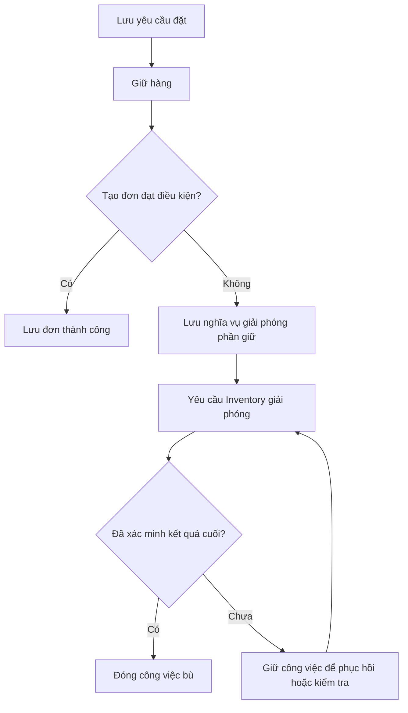

**Compensation** là thao tác bù: giải phóng phần giữ, hoặc quy trình hoàn tiền nếu đã phát sinh tiền và đủ điều kiện. Bù cũng có thể lỗi và cần thử lại, nên phải được theo dõi như công việc thật.

Không thể “rollback” một lần giao hàng đã xảy ra bằng cách đổi vài cột dữ liệu. Khi hàng đã đi, quy trình có thể là yêu cầu trả hàng, kiểm định và quyết định xử lý.

### 11.2. Outbox giải quyết mất thông báo sau khi lưu đơn

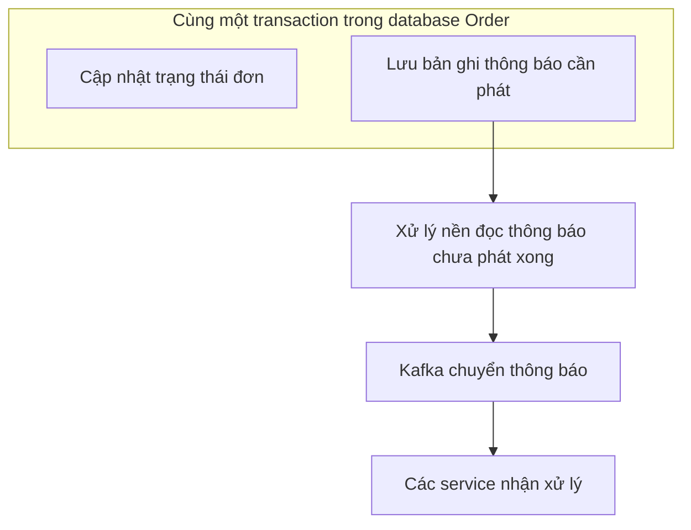

**Outbox** là nơi lưu các thông báo cần phát. Nhờ lưu cùng transaction với thay đổi đơn, nếu Order dừng sau khi chốt dữ liệu thì vẫn còn bản ghi để phát tiếp.

Thông báo vẫn có thể được phát lặp, ví dụ gửi thành công nhưng dừng trước khi ghi đã gửi. Bên nhận cần ghi nhận mã thông báo đã xử lý để tránh thực hiện lặp. Cơ chế phía nhận thường gọi là **inbox** hoặc sổ chống lặp thông báo.

Trong một luồng phải có một nơi ra lệnh cho một tác động. Nếu vừa gọi chốt kho trực tiếp vừa để consumer nghe paid tự chốt lần nữa, hệ thống có hai đường gây cùng tác động. Target chuyển paid thành thông báo sự thật, không dùng nó làm lệnh trừ kho thứ hai.

<a id="phan-12"></a>
## 12. Hết hạn, tiền sai và đối soát

### 12.1. Nhiều thời hạn khác nhau

| Thời hạn | Ý nghĩa |
| --- | --- |
| Bản tính tiền | Điều kiện cho khách xem có hiệu lực tới khi nào? |
| Giữ hàng | Kho còn cam kết giữ phần hàng tới khi nào? |
| Giá/phí từ provider | Snapshot/quote của đối tác còn hợp lệ tới khi nào? |
| Chờ một lần gọi | Sau bao lâu người gọi dừng chờ phản hồi? |

Hết thời gian chờ một cuộc gọi không có nghĩa phần giữ hàng đã hết hạn. Hai loại thời gian này khác nhau.

Target lấy hạn thanh toán theo hạn phù hợp sớm nhất của các ràng buộc liên quan. Ví dụ stock tới 10:15 nhưng shipping quote chỉ tới 10:05 thì không tự hứa khách có đủ 15 phút. Chính sách thời hạn còn cần được kiểm tra với provider và cách giao diện giải thích.

### 12.2. Tiền đến sát lúc hết hạn

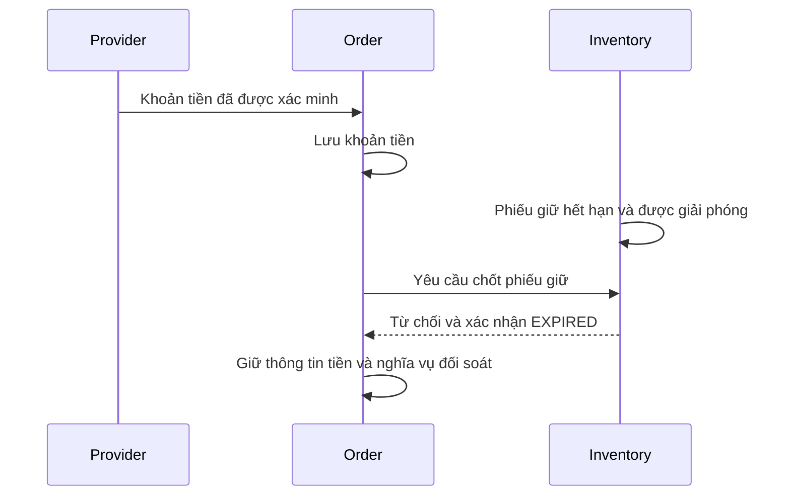

Không tự làm sống lại phần giữ đã hết hạn, vì hàng có thể đã được cấp cho người khác. Không nói “chưa nhận tiền” khi đã xác minh khoản tiền thật. Không cho đóng gói khi thiếu điều kiện hàng.

Tại Inventory, thao tác chốt, giải phóng và hết hạn phải có cách phân xử chung. Target quy định thời điểm quyết định theo đồng hồ database của Inventory sau khi lấy khóa cần thiết: trước hạn mới chốt, bằng hoặc sau hạn thì hết hạn; công việc đã chốt thành công được gửi lại không bị đảo vì thời gian hiện tại đã qua hạn.

### 12.3. Đối soát là gì?

**Reconciliation** nghĩa là đối chiếu các nguồn và xử lý chênh lệch. Ví dụ hệ thống mình có receipt nhưng chưa ghép được đơn; hoặc provider đã nhận tiền nhưng callback bị mất, cần tra cứu/sao kê để tìm khoản đó.

| Tình huống | Cách hiểu đúng |
| --- | --- |
| Một giao dịch gửi hai callback | Một khoản tiền, không ghi hai lần |
| Khách chuyển hai giao dịch khác nhau | Hai khoản tiền thật, phải giữ đủ thông tin |
| Chuyển thiếu/thừa | Không giả thành đúng tiền; giữ để xử lý theo chính sách |
| Chuyển muộn vào đơn đã hủy | Giữ tiền để đối soát, không tự hồi sinh đơn |
| Không xác định được đơn | Lưu khoản tiền chưa ghép được, không tạo order ID giả |

MVP hiện chọn tự động xử lý trường hợp đúng chính xác số tiền. Các trường hợp lệch không bị bỏ đi; mức tự động hóa còn hạn chế và cần quy trình người xử lý.

<a id="phan-13"></a>
## 13. Hủy đơn đồng thời nhận việc đóng gói

### 13.1. Vì sao nhìn trạng thái Order chưa đủ?

Fulfillment có thể đã nhận việc nhưng thông báo về Order chưa tới. Vì vậy “Order chưa hiện PROCESSING” không chứng minh bên kho chưa bắt đầu nhận trách nhiệm.

Target đặt một điểm phân xử tại Fulfillment, gọi là **barrier**. Bạn hiểu là chốt kiểm soát xem nhận việc hay hủy quyền nhận việc thắng trước.

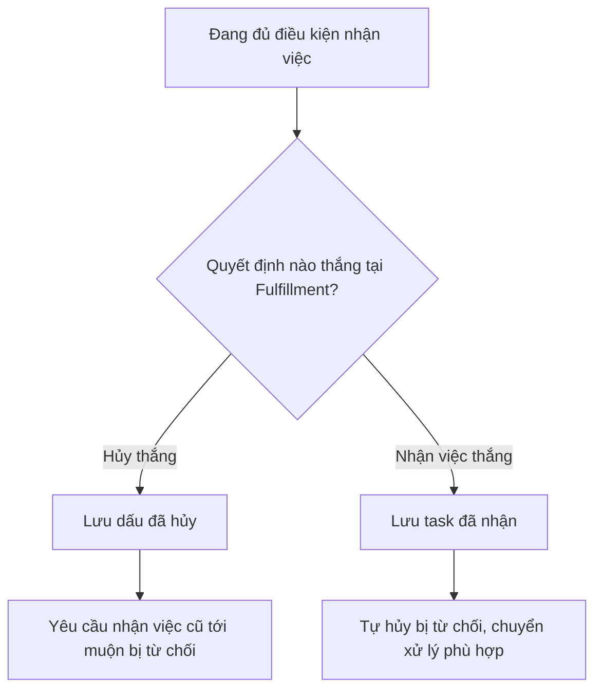

Target còn có **permit**, là thông tin cho phép xin nhận việc do Order cấp sau khi kiểm điều kiện. Fulfillment phải xác minh nó thật sự được cấp và còn hợp lệ. Có permit chưa có nghĩa đã nhận task; quyết định cuối vẫn phân xử cùng yêu cầu hủy tại Fulfillment.

**Generation** là số phiên của lần cho phép. Phiên 1 bị hủy thì thông báo/permit phiên 1 không được mở lại công việc. Nếu cho tiếp tục, phải xác minh điều kiện và cấp phiên mới, đồng thời không tạo task trùng nếu đã có task được nhận.

Order đặt cờ tạm dừng tại mình trước khi gọi hủy ở xa. Một yêu cầu nhận việc đã được kiểm trước đó và đang bay vẫn có thể thắng tại Fulfillment. Cờ local không phải khóa tức thời cho cả hệ thống; chỉ được báo dừng chắc chắn khi có bằng chứng bên có thẩm quyền đã chặn việc.

### 13.2. Hủy tới trước giữ hàng thì sao?

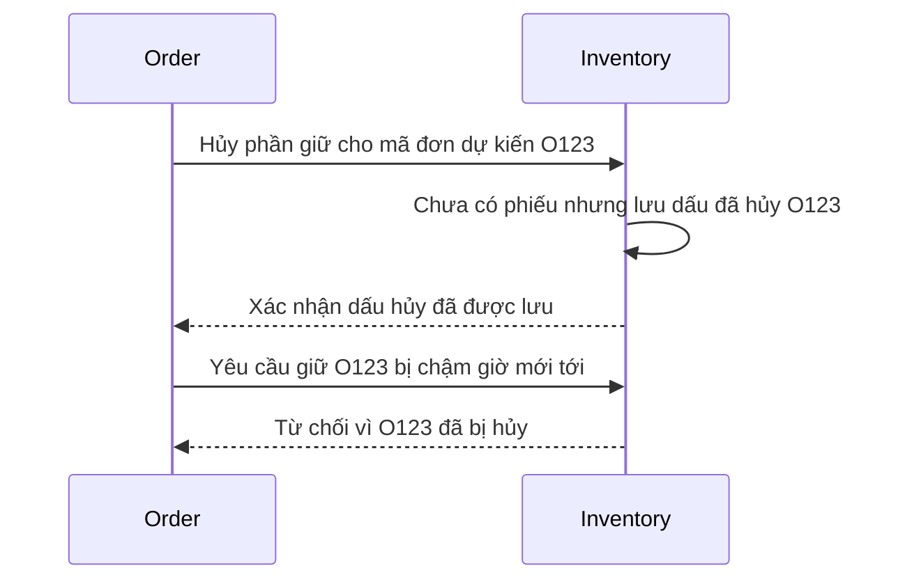

Dấu lưu để chặn yêu cầu tới muộn gọi là **tombstone**. Nếu Inventory chỉ trả “không tìm thấy” rồi thôi, yêu cầu giữ đang bay vẫn có thể tới sau và giữ hàng ngoài ý muốn. Tra cứu không thấy tại một thời điểm không chứng minh tài nguyên sẽ không xuất hiện sau đó.

Hai thao tác phải được phân xử cả khi chưa có bản ghi phiếu giữ. Chỉ khóa một dòng chưa tồn tại không tự giải quyết được cuộc đua đó; đây là phần Inventory cần hiện thực đúng trong database.

<a id="phan-14"></a>
## 14. Hoàn tiền khác nhập lại kho

**MVP dùng hoàn tiền thủ công có kiểm soát:** người có quyền duyệt, một người nhận việc, giữ ngân sách hoàn và chỉ ghi thành công sau đối chiếu giao dịch ngân hàng. Chưa gọi API hoàn tiền tự động. Xem [các bước cụ thể](13_mvp_delivery_decisions.md#7-hoàn-tiền-thủ-công-nhưng-không-tùy-tiện).


Khách được hoàn tiền không chứng minh hàng đã quay về. Đơn bị hủy không chứng minh task chưa nhận. Hàng quay về cũng chưa chắc còn bán được, ví dụ hết hạn hoặc cần cách ly.

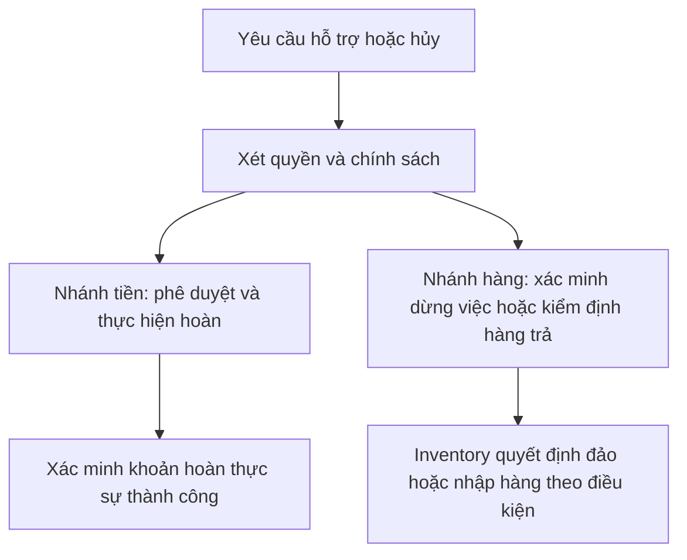

**Cách đọc:** hai nhánh liên quan nhưng không tự kích hoạt nhau chỉ vì nhánh kia có kết quả. Có thể một trường hợp chỉ xử lý tiền mà không có hàng nhập lại.

Trong thiết kế: Care phê duyệt trong phạm vi quyền/policy; Payment của Order thực hiện hoàn và tra cứu kết quả; Finance ghi nhận kế toán. Không có hai bên cùng thực thi một khoản hoàn.

Nếu gửi lệnh hoàn bị mất phản hồi, phải hỏi lại hoặc thử cùng mã. Trong lúc chưa rõ, số tiền của yêu cầu đó vẫn chiếm nghĩa vụ hoàn, không được coi như chưa từng xảy ra để cho phép hoàn thêm vượt mức.

Thao tác đảo stock đã chốt, tên **reversal**, phải có bằng chứng và lưu dấu riêng. Nó khác **release**, là giải phóng phần giữ chưa chốt. Với hàng đã giao/dispatch, cần quy trình hàng trả và kiểm định phù hợp; không áp dụng máy móc thao tác đảo đơn giản của giai đoạn trước thực hiện.

<a id="phan-15"></a>
## 15. Các phiên bản thiết kế trước đã thay đổi thế nào?

### 15.1. HLD và LLD khác nhau ở đâu?

**HLD** là bản thiết kế tổng thể: ai làm gì, giao tiếp thế nào, luồng chính qua đâu. **LLD** là bản chi tiết: dữ liệu, điều kiện, thứ tự ghi/gọi, khóa, API và xử lý lỗi.

HLD có ghi “dùng saga” không tự bảo đảm LLD/code đã lưu ý định trước khi gọi. Những chi tiết đó cần được cụ thể hóa và kiểm thử.

### 15.2. Vấn đề nổi bật của luồng HLD đầu

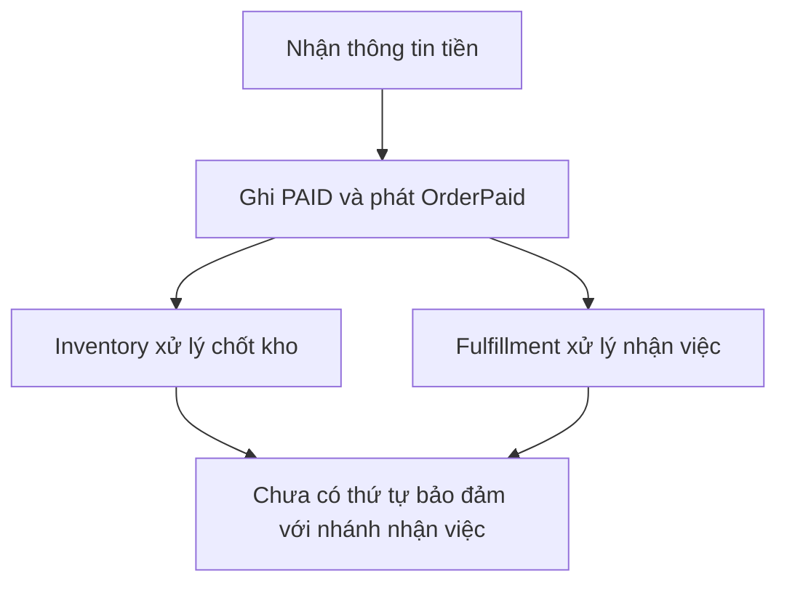

Ưu điểm: luồng ngắn, các bên nhận thông báo độc lập, dễ trình bày. Điểm thiếu: không quy định đầy đủ bằng chứng kho đã chốt trước khi bắt đầu thực hiện, cách xử lý hết hạn và xung đột giữa các nhánh. Một số tài liệu còn mô tả khác nhau về event và command.

Không phải cứ dùng event là sai. Có thể thiết kế một lệnh chốt bất đồng bộ, nhận kết quả cuối rồi mới cho Fulfillment tiếp tục. Bản hiện tại chọn worker gọi gRPC có thời gian chờ giới hạn vì phù hợp hướng triển khai MVP; sự an toàn vẫn đến từ quy tắc và phục hồi, không đến từ tên giao thức.

### 15.3. Luồng target đã đổi thành

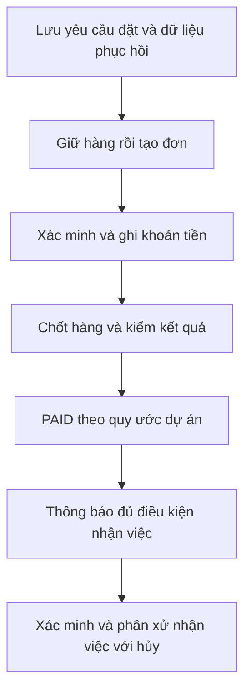

Đổi lại, cần thêm công việc nền, query, lưu kết quả, giao thức phân xử và các màn hình đang xử lý. Luồng thành công dài hơn nhưng mô tả rõ trách nhiệm khi một bước chưa rõ kết quả.

### 15.4. Lịch sử và cách đánh giá công bằng

| Bản | Điểm đạt được | Vấn đề/giới hạn |
| --- | --- | --- |
| HLD đầu | Chia service và định hướng điều phối đơn | Chưa đủ quy tắc stock trước fulfillment và các cuộc đua |
| LLD 2.0 | Thêm dữ liệu, version, lịch sử, outbox | Có sequence giữ hàng trước khi lưu đủ định danh/ý định; chống lặp phụ thuộc cache chưa đủ bền vững |
| Candidate 3.0 | Đề xuất chốt trước PAID và tách các trục state | Chưa thống nhất đầy đủ với contract/implementation |
| Sandbox 3.1 | Có operation, worker, dữ liệu tiền và simulator có trạng thái | Chưa là tích hợp provider thật, còn các đường xử lý chưa đạt target |
| Design 3.2 | Làm rõ quyền sở hữu, timeout, expiry, proof, hủy/nhận việc và migration | Tăng độ phức tạp, cần nhiều capability mới và bằng chứng thực tế |

HLD walkthrough cũ đã có ý định lưu draft/saga trước reserve. Không gán lỗi thứ tự trong một sequence LLD 2.0 cho mọi tài liệu HLD. Việc Inventory chưa có FinalizeReservation là thiếu capability cho lựa chọn thiết kế mới, không tự động chứng minh Inventory đã sai HLD gốc. Lỗi như trả “đã giải phóng” cho tài nguyên thực sự đã chốt là loại vấn đề khác.

Chi tiết có nguồn và mốc SHA trong [báo cáo thay đổi thiết kế](10_order_design_change_report.md) và [review Inventory lịch sử](09_inventory_integration_review_2026-10-13.md).

<a id="phan-16"></a>
## 16. Bản hiện tại còn vấn đề gì?

### 16.1. Những lựa chọn cần đánh giá tiếp

| Điểm | Lợi ích | Chi phí/rủi ro còn lại |
| --- | --- | --- |
| Gộp Payment trong Order | Ít thành phần triển khai, thuận tiện transaction nội bộ | Dễ trộn trách nhiệm nếu mã nguồn không chia ranh giới |
| PAID sau chốt hàng | Chặn việc thực hiện đơn chưa chắc có hàng | Dễ nhầm với thời điểm tiền thực sự đã nhận |
| Permit và barrier | Xử lý được hủy đồng thời nhận việc | Nhiều bước, database và giao thức khó hơn cho PBL |
| Chốt stock rồi voucher nếu bật | Có thứ tự kiểm soát | Không có transaction chung; stock thành công và voucher lỗi vẫn cần policy xử lý |
| Hạn thanh toán theo nhiều ràng buộc | Tránh nhận điều kiện thương mại đã hết hiệu lực | Có thể làm cửa sổ trả tiền quá ngắn, cần provider và UI thống nhất |
| Nhiều feature được mô tả | Có hướng mở rộng | Người mới dễ nghĩ phải triển khai hết cùng lúc |

Đây là **trade-off**: lợi ích đi kèm chi phí/hạn chế. Không đánh giá tốt chỉ bằng số lượng bảng, state hay RPC.

MVP dễ học và kiểm chứng hơn là D2C, chuyển khoản, một kho, chưa voucher. Việc giảm quyền tự hủy sau chốt kho cũng có thể giảm phạm vi tự động hóa, nhưng là thay đổi chính sách cần thống nhất; tài liệu này không tự thay policy target.

### 16.2. Thiết kế có rồi nhưng runtime còn thiếu

Các điểm đã được ghi trong [ADR/gaps](07_decisions_and_contract_gaps.md), không phải phát hiện bằng một lượt chạy integration mới của tài liệu này:

- Order vẫn chủ yếu dùng adapter gọi simulator; typed adapter/provider thật chưa hoàn chỉnh.
- Có đường compensation chưa xác minh chặt chẽ tài nguyên đã kết thúc đúng trạng thái trước khi đóng công việc.
- Luồng COD/chốt/hủy chưa kiểm đồng bộ đầy đủ identity/digest/version như target.
- Simulator reversal vẫn biểu diễn kết quả theo cách cũ, chưa có toàn bộ proof của protocol mới.
- Một số kiểm tra expiry và cơ chế thử lại chưa đúng policy target.
- Database và phản hồi runtime chưa ánh xạ đủ những trường mới trong contract.

**Adapter** là phần mã chuyển giao tiếp với một đối tác cụ thể về cách hiểu mà ứng dụng cần. Ví dụ adapter Inventory chuyển request/response gRPC và kiểm chúng, thay vì để nghiệp vụ Order tự đoán ý nghĩa từng field.

### 16.3. Viết contract không tự làm chương trình hoạt động

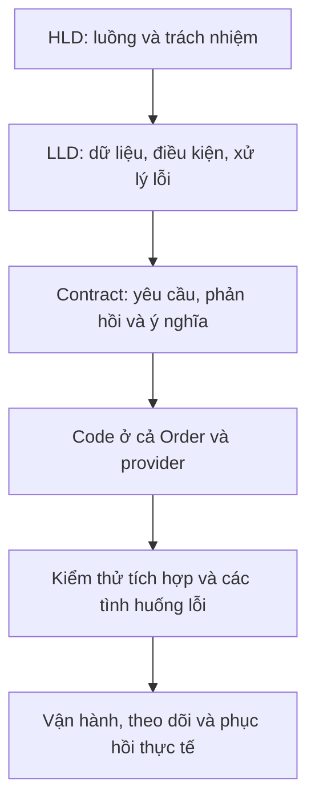

**Contract** là bản thỏa thuận giao tiếp. Proto mô tả message/RPC; OpenAPI mô tả HTTP API; event schema mô tả thông báo. Chúng cần phần semantics bằng văn bản vì cấu trúc field không tự mô tả được mọi quy tắc tranh chấp và quyền quyết định.

Đợt vừa qua đã kiểm cấu trúc contract, compile proto/Go, ví dụ và payload sai. Chưa chứng minh các cuộc đua tại database Inventory/Fulfillment thật. Chưa chốt và kiểm chứng provider thanh toán thật. Chưa có đủ bằng chứng khôi phục dữ liệu rồi tiếp tục các nghĩa vụ đang dở.

**Simulator** là hệ thống đối tác mô phỏng. Nó hữu ích để thử Order, nhưng chỉ phản ánh những quy tắc đã được lập trình trong mô phỏng, không tự đại diện cho provider thật.

### 16.4. Vì sao event v3 nhưng thiết kế 3.2?

Đó là hai cách đánh phiên bản khác nhau. Design 3.2 là bộ quyết định kiến trúc. Event v3 là định dạng thông báo mới có các field bắt buộc mà payload v2 runtime chưa có. Giữ v2 cũ tránh làm payload hiện hữu trở thành không hợp lệ.

Khi chuyển đổi phải cho consumer hiểu v3 trước, rồi bật producer cho nhóm Order mới. Nhóm đơn theo một luồng/version được gọi là **cohort**. Một đơn không được vừa chạy chốt qua RPC vừa chạy consumer cũ chốt lại vì paid. Dừng rollout mới cũng không được xóa nghĩa vụ của những đơn đã phát sinh.

<a id="phan-17"></a>
## 17. Học và đọc dự án theo thứ tự nào?

### 17.1. Bốn vòng đọc

1. **Luồng thành công:** hai hộp, 200.000 đồng, còn hàng, trả đúng tiền, giao thành công. Viết dữ liệu và service quyết định sau mỗi bước.
2. **Dừng sau từng bước:** nếu Order dừng ngay sau khi kho làm xong thì đọc dữ liệu nào để tiếp tục? Chưa cần bàn lỗi hiếm.
3. **Lặp và chậm:** khách bấm hai lần, callback hai lần, mất phản hồi, yêu cầu cũ đến muộn.
4. **Ngoại lệ nghiệp vụ:** thiếu/thừa/muộn tiền, hết hạn, hủy khi task đang nhận, hoàn tiền, hàng trả.

### 17.2. Đọc tài liệu rồi lần xuống mã

| Thứ tự | Nguồn | Tìm câu trả lời |
| --- | --- | --- |
| 1 | [HLD Order](00_order_service_hld.md) | Ai có quyền quyết định? |
| 2 | [Domain và bất biến](01_order_domain_and_boundary.md) | Những đối tượng nào khác nhau, điều gì luôn phải đúng? |
| 3 | [Vòng đời](02_state_machine_and_lifecycle.md) | Khi nào được chuyển bước? |
| 4 | [Use cases](04_usecases_and_saga_orchestration.md) | Một yêu cầu chạy qua những việc gì? |
| 5 | [Persistence](03_database_and_persistence.md) | Dữ liệu nào phải lưu cùng transaction? |
| 6 | [Contracts](05_api_contracts_and_transports.md) và [wire semantics](../../../../packages/contracts/order-3.2.md) | Mỗi bên gửi/nhận gì, xử lý lại thế nào? |
| 7 | [Service README](../../../../services/order-service/README.md) | Chạy môi trường nào và giới hạn nào? |
| 8 | [internal/transport](../../../../services/order-service/internal/transport/) | Nhận HTTP/gRPC và kiểm người gọi ở đâu? |
| 9 | [internal/app](../../../../services/order-service/internal/app/) | Nghiệp vụ và điều phối thực tế đang làm gì? |
| 10 | [internal/domain](../../../../services/order-service/internal/domain/) và [migrations](../../../../services/order-service/migrations/) | Cấu trúc dữ liệu, quy tắc và ràng buộc lưu trữ? |
| 11 | [Integration tests](../../../../services/order-service/tests/integration/) | Tình huống nào đã có bài kiểm tra, dùng dependency nào? |

Đây là chỉ dẫn đọc, không có nghĩa mỗi thư mục đã đáp ứng đủ thiết kế 3.2. Nếu đọc code thấy khác target, đối chiếu [chương gaps](07_decisions_and_contract_gaps.md) trước khi kết luận tài liệu hay code nào là nguồn đúng cho runtime.

### 17.3. Theo dõi một đơn bằng một bảng

Khi đọc code hoặc thử sandbox, lập bảng này cho từng tình huống. Mã ghi dưới đây là ví dụ minh họa, không phải ID fixture có sẵn.

| Thời điểm | Dữ liệu cần biết | Đơn | Tiền | Kho | Việc còn dở |
| --- | --- | --- | --- | --- | --- |
| Khách bấm đặt | Operation X và mã đơn dự kiến | Chưa có | Chưa nhận | Chưa xác định | Kiểm tra/giữ hàng |
| Đặt thành công | Order O123, phiếu R456 | Chờ thanh toán | Chưa nhận | RESERVED | Chờ tiền hoặc hết hạn |
| Tiền đúng đã phân bổ | Receipt T, allocation | Đang xác nhận | Đã nhận | Đang chốt/chưa rõ | Lấy kết quả chốt |
| Chốt xong | Stock decision/version | PAID | CONFIRMED | COMMITTED | Phát ready và nhận việc |
| Fulfillment nhận | Task và generation | PROCESSING | CONFIRMED | COMMITTED | Đóng gói/giao |

Đặt câu hỏi “đã lưu gì?” cụ thể hơn “đã chạy tới hàm nào?”. Một hàm đã chạy không chứng minh dữ liệu đã commit hoặc tác động ở xa đã được xác định.

<a id="phan-18"></a>
## 18. Từ điển và bài tập tự kiểm tra

### 18.1. Những từ cần tra nhanh

| Thuật ngữ | Nghĩa dùng trong tài liệu |
| --- | --- |
| Backend | Phần chương trình phía máy chủ xử lý dữ liệu và nghiệp vụ |
| API / endpoint | Cửa giao tiếp / một điểm gọi cụ thể |
| Request / response | Yêu cầu / phản hồi |
| HTTP / gRPC | Hai cách giao tiếp qua mạng dùng trong dự án |
| Database / PostgreSQL | Cơ sở dữ liệu / hệ quản trị đang lưu dữ liệu bền vững chính |
| Redis / cache | Công cụ lưu dữ liệu nhanh / bản lưu hỗ trợ; trong target không thay registry chống lặp bền vững |
| Worker / job | Bộ phận xử lý nền / công việc cần xử lý |
| Durable intent | Ý định đã lưu bền vững trước tác động bên ngoài |
| Transaction / commit | Nhóm thay đổi cùng chốt / chốt nhóm thay đổi đó; commit stock có nghĩa nghiệp vụ đã giải thích riêng |
| State / transition / guard | Trạng thái / chuyển trạng thái / điều kiện cho phép chuyển |
| Invariant | Quy tắc bắt buộc luôn được giữ, ví dụ không tự đóng gói khi chưa có điều kiện hàng |
| Idempotency / replay | Chống tạo tác động lặp / gửi lại cùng ý định |
| Timeout / retry / UNKNOWN | Hết thời gian chờ / thử lại / người gọi chưa xác định kết quả |
| Query | Hỏi thông tin/kết quả, không phải ra lệnh thay đổi |
| Saga / compensation | Quá trình nhiều bước có phục hồi / thao tác bù nghiệp vụ |
| Outbox / inbox | Sổ thông báo cần phát / sổ thông báo đã nhận-xử lý để chống lặp |
| Receipt / allocation | Khoản tiền đã xác minh / phân bổ khoản tiền cho đơn |
| Reconciliation / refund | Đối soát / hoàn tiền |
| Reserve / finalize / release / reverse | Giữ / chốt / giải phóng phần giữ / đảo phần đã chốt theo điều kiện |
| Snapshot / version / digest | Bản chụp dữ liệu đã chốt / số phiên bản / dấu nhận diện nội dung, ví dụ danh sách hàng |
| Barrier / permit / generation | Điểm phân xử / thông tin cho phép / số phiên cho phép |
| Tombstone | Dấu đã hủy lưu lại để chặn yêu cầu tới muộn |
| Feature gate | Điều kiện bật/tắt tính năng; chưa đủ capability/test thì chưa bật |
| Runtime / sandbox | Chương trình đang chạy / môi trường chạy thử |
| Adapter / simulator | Mã kết nối đối tác cụ thể / đối tác mô phỏng |
| Contract / schema | Thỏa thuận giao tiếp / cấu trúc dữ liệu được chấp nhận |
| Race condition | Kết quả phụ thuộc việc các thao tác đồng thời được phân xử thế nào |
| Rollout / rollback | Bật triển khai theo đợt / quay về cấu hình hoặc phiên bản trước với kế hoạch xử lý dữ liệu đã phát sinh |

### 18.2. Tự giải thích tám câu hỏi

1. Khách thêm hàng vào giỏ thì vì sao chưa được coi là đã có hàng giữ?
2. Order trả 202 rồi ứng dụng mất mạng, khách gửi lại thì phải giữ mã nào?
3. Inventory chốt thành công nhưng mất phản hồi, vì sao không tự giải phóng theo timeout?
4. Tiền đến sau khi đơn bị hủy thì giữ thông tin ở đâu và có hồi sinh đơn không?
5. Hai callback giống nhau khác hai giao dịch chuyển tiền thật như thế nào?
6. Order chưa hiện PROCESSING thì vì sao chưa thể kết luận Fulfillment chưa nhận việc?
7. Đã hoàn tiền thì vì sao không tự cộng tồn kho?
8. Compile proto thành công thì còn thiếu những bước nào trước khi gọi là tích hợp thành công?

Gợi ý đối chiếu: câu 1 ở phần 4–5; câu 2–3 ở phần 9–10; câu 4–5 ở phần 12; câu 6 ở phần 13; câu 7 ở phần 14; câu 8 ở phần 16.

Khi giải thích bất kỳ bước nào, dùng bốn câu: **ai quyết định; dữ liệu nào đã lưu; nếu dừng/mất phản hồi thì làm gì; bằng chứng nào cho phép tiến bước**. Trả lời được bốn câu đó cho luồng thành công và các ngoại lệ là mục tiêu của việc học thiết kế Order này.
