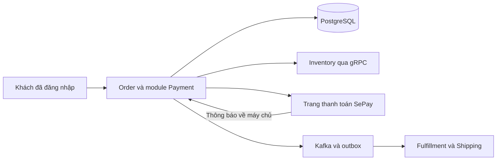
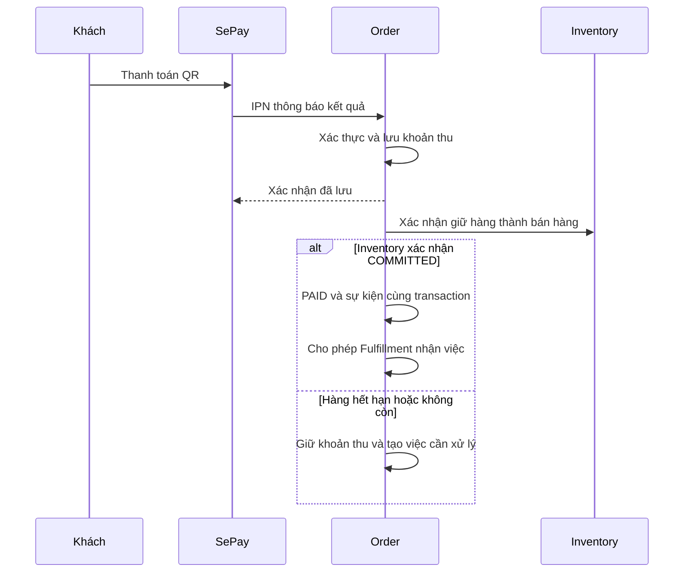

# Order MVP 1 — quyết định phạm vi và luồng triển khai

Ngày chốt: 15/10/2026. **Phạm vi đợt giao đầu của Order, chưa bao phủ toàn bộ MVP 1.0 sản phẩm.** Implementation sandbox và ADR ghi tại [báo cáo đợt triển khai](14_mvp_implementation_and_adr_report.md); các dependency production vẫn cần nghiệm thu.

Tài liệu này thu hẹp baseline 3.2 thành phạm vi MVP 1. Khi tài liệu cũ còn mô tả COD, Guest, Promotion, refund tự động hoặc Care completion, đó là thiết kế mở rộng, không phải yêu cầu giao bản đầu. Các bảo đảm chống mất tiền, trùng tác động và sai kho của baseline 3.2 vẫn giữ nguyên. Không thay đổi wire version chỉ vì thu hẹp tính năng.

## 1. Chốt sản phẩm

| Nội dung | Quyết định MVP 1 |
| --- | --- |
| Người mua | Đã đăng nhập; không Guest checkout hoặc claim |
| Đơn hàng | Website D2C, VND, một kho, một địa chỉ, không tách giao hàng |
| Phương thức duy nhất | VietQR chuyển khoản ngân hàng qua **SePay Payment Gateway** |
| Phương thức phụ | Hoãn cả hai; không hiện nút chưa hoạt động |
| COD | Không hỗ trợ; API từ chối trước khi ghi operation hay giữ hàng |
| Giá và phí | Catalog và Shipping cung cấp snapshot/quote; Order chốt tổng tiền khách đồng ý |
| Khuyến mại | Không voucher, điểm thưởng, trả góp, đặt cọc |
| Hoàn tiền | Toàn bộ một khoản thu, có duyệt và thực hiện thủ công có kiểm soát; chưa gọi API hoàn tiền tự động |
| Hủy | Khách tự hủy khi chưa ghi nhận tiền; sau đó yêu cầu người quản trị xem xét |
| Giao hàng | Fulfillment/Shipping vẫn sở hữu đóng gói/giao nhận; Order chỉ theo dõi bằng chứng |
| Hoàn tất | MVP dừng tự động tại DELIVERED; chưa phát COMPLETED và chưa bật nghiệp vụ phụ thuộc nó |

Chọn ít tính năng để giao được bản chạy trọn luồng. Thẻ, ví điện tử và NAPAS QR chỉ bổ sung sau một quyết định mới; không cố tạo ba lựa chọn thanh toán cho đủ số lượng.

## 2. Công nghệ và ranh giới

Giữ Go + Chi, PostgreSQL, Redis, gRPC/Protobuf, Kafka và worker lưu công việc trong PostgreSQL. Payment là module trong Order. Không thêm service thanh toán, workflow engine hoặc hàng đợi mới.

PostgreSQL lưu sự thật về đơn, tiền và công việc chưa xong. Redis giữ giỏ/báo giá tạm. Worker là tiến trình lấy công việc đã lưu để thực hiện tiếp. Kafka thông báo sự việc đã xảy ra; Inventory không trừ kho lần nữa khi nhận OrderPaid.

## 3. Checkout: giữ hàng rồi mới cho thanh toán

1. Khách xem giỏ và báo giá. Chưa giữ kho.
2. Xác nhận bằng một mã chống gửi trùng. Order kiểm đăng nhập, quyền sở hữu, phương thức và báo giá; lưu operation trước tác động ra ngoài. Trả 202 để giao diện theo dõi tiến trình.
3. Worker lấy lại giá/phí có thời hạn. Giá thay đổi thì yêu cầu khách xác nhận lại, không tự thu số mới.
4. Ghi ý định giữ hàng rồi gọi Inventory với mã thao tác cố định. Mất phản hồi thì truy vấn/thử lại cùng mã; không suy ra thất bại.
5. Giữ hàng thành công và còn đủ thời gian thì tạo Order PENDING_PAYMENT, cùng payment_attempt. Form có chữ ký được tạo khi khách bấm mở thanh toán; không cần thêm job gọi API tạo payment trước khi trả form. Operation thành công nghĩa đơn đã được tạo, không nghĩa đã trả tiền.
6. Giao diện mở trang thanh toán do SePay cung cấp. MVP không tự dựng trang nhập thông tin thẻ hoặc nhúng QR bằng một API ảnh độc lập.

Báo giá xem trước có hạn 5 phút. Yêu cầu giữ hàng tối đa 15 phút; thời hạn trả tiền thực tế là thời điểm sớm nhất của hạn giữ hàng, điều kiện thương mại và hiệu lực giá/phí. Còn không quá 30 giây thì không mở thanh toán mới. Giao diện hiển thị hạn thực tế, không luôn hứa đủ 15 phút.

## 4. Một đơn, một lần thanh toán đang dùng

MVP chỉ tạo một `payment_attempt` cho mỗi Order. Đây là bản ghi nội bộ nhận diện lần thanh toán, không phải giao dịch ngân hàng. Tạo mã hóa đơn merchant duy nhất, ổn định từ attempt; tải lại trang không tạo mã mới. Một attempt vẫn có thể nhận nhiều giao dịch thực tế, vì khách có thể chuyển hai lần.

Lưu ý định trước khi tạo form gửi SePay. Backend ký form theo tài liệu SePay; khóa bí mật không đưa xuống trình duyệt. Lưu môi trường, số tiền, tiền tệ, mã hóa đơn, hạn nội bộ và mã phía SePay khi đã biết. Callback có thể đến trước khi lưu mã SePay: đối chiếu bằng mã hóa đơn đã lưu, sau đó ghi liên kết dưới khóa giao dịch.

Không tự tạo attempt mới khi mất phản hồi hoặc khách tải lại. Truy vấn nhà cung cấp bằng định danh mà API thực hỗ trợ; không giả định SePay có idempotency/cancel/query-by-invoice nếu chưa kiểm chứng. Nếu chưa xác định được kết quả, giữ trạng thái đang xác minh và chuyển hàng đợi xử lý; không yêu cầu khách trả thêm lần nữa.

Muốn đặt lại sau hết hạn: checkout mới và Order mới. QR/form cũ có thể vẫn dẫn đến chuyển tiền; hạn nội bộ không phải cam kết ngân hàng chặn tiền. Khoản đến đơn cũ phải được giữ lại để xử lý, không chuyển âm thầm sang đơn mới.

## 5. Nhận tiền và xác nhận đơn

IPN là thông báo trực tiếp từ SePay về backend. Không dùng trang success khách truy cập làm bằng chứng trả tiền. Xác thực đúng cơ chế của SePay; kiểm người nhận/merchant, môi trường, mã hóa đơn, trạng thái, VND và số tiền. Chỉ trả ACK thành công sau lưu bền; công việc xác nhận kho chạy sau đó.

Chỉ tự động gán **một giao dịch đúng đủ tổng tiền** cho Order đang chờ và còn hạn. Chống trùng bằng provider + môi trường + transaction ID; cùng ID nhưng dữ liệu khác phải giữ để kiểm tra. Thiếu/thừa tiền, nhiều khoản nhỏ, tiền đến muộn, không tìm thấy đơn hoặc khoản thứ hai đều vào danh sách đối soát, không tự cộng tiền hay hồi sinh đơn.

Đã nhận tiền nhưng chưa chốt được kho: hiển thị “Đã nhận tiền, đang xác nhận đơn”. Chỉ PAID khi khoản thu hợp lệ và Inventory COMMITTED. Trường hợp kho chắc chắn không còn thì giữ đơn không được giao, mở nghĩa vụ xử lý/hoàn tiền. Kết quả kho chưa biết thì truy vấn trước, không vội hoàn tiền và nhả kho.

## 6. Hủy, hết hạn và giao hàng

- Chưa có tiền: khách tự hủy. Hủy và nhận tiền cạnh tranh dưới cùng khóa Order. Lưu việc nhả kho; màn hình phân biệt đơn đã hủy với kho đang được nhả. Khoản tiền đến sau vẫn được lưu.
- Hết hạn: cùng nguyên tắc với hủy; Inventory có quyền hết hạn reservation một cách nguyên tử với finalize. Không kéo dài giữ hàng vì khách mở lại trang.
- Đã nhận tiền/đang xác nhận: khách gửi yêu cầu hỗ trợ, không tự hủy. Người quản trị xem kết quả kho trước khi quyết định.
- Đã chốt kho nhưng Fulfillment chưa nhận: người quản trị yêu cầu dừng. Chỉ sau bằng chứng CancelTask thắng AcceptTask mới đảo kho đã commit. Hoàn tiền là việc riêng.
- Fulfillment đã nhận hoặc đang giao: không tự hủy/đảo kho. Chuyển xử lý vận hành. Hàng về phải được kiểm nhận bởi Inventory trước khi có thể bán lại.

Vẫn giữ cơ chế permit/AcceptTask/CancelTask của baseline 3.2. Đây là nơi xác định việc chuẩn bị hàng hay hủy thắng khi hai thao tác cùng xảy ra; một cờ hủy trong DB Order không đủ dừng service khác.

Shipping xác nhận DELIVERED không tự phát COMPLETED. Bản đầu không tích điểm, đóng cửa sổ đổi trả hoặc ghi nhận doanh thu bằng COMPLETED. Finance/Notification phải được thông báo rõ giới hạn này; nếu cần COMPLETED thì phải thiết kế và kiểm chứng quy tắc trước khi bật.

## 7. Hoàn tiền thủ công nhưng không tùy tiện

MVP không phụ thuộc API refund SePay chưa được kiểm chứng. Người duyệt tạo nghĩa vụ hoàn toàn bộ một khoản thu đã xác minh; khoản trùng được hoàn riêng, không hoàn lại khoản đã gán hợp lệ cho đơn. Chưa hỗ trợ hoàn một phần hoặc trả một phần hàng.

1. Lưu lý do, khoản thu gốc, người duyệt, người nhận đã xác minh và số tiền. Khóa khoản thu, giữ ngân sách hoàn tiền trước khi thực hiện; tổng hoàn đã xong + đang xử lý không vượt tiền nhận.
2. Chỉ một người thực hiện được nhận việc bằng chuyển trạng thái nguyên tử. Ghi mã công việc trước khi chuyển khoản ngoài hệ thống; không đồng thời gọi API refund tự động.
3. Người có quyền chuyển tiền bằng công cụ ngân hàng được phép dùng. Không coi việc nhấn nút hoặc tải ảnh lên là bằng chứng đã hoàn.
4. Ghi mã giao dịch ngân hàng và bằng chứng đối chiếu; người kiểm tra có quyền xác nhận kết quả. Khi có thể, người kiểm tra khác người thực hiện. Chỉ lúc đó ghi SUCCEEDED và sự kiện refund.
5. Mất phản hồi hoặc người thực hiện không biết đã chuyển chưa: UNKNOWN, vẫn giữ ngân sách. Kiểm tra sao kê trước khi thao tác lại; không tự giao cho người khác chuyển lần hai.

Trạng thái APPROVED/SUBMITTED/UNKNOWN/SUCCEEDED là trạng thái nghiệp vụ; `execution_mode=MANUAL_BANK_TRANSFER` phân biệt nguồn thực hiện. Bằng chứng manual gồm ngân hàng/tài khoản nguồn tham chiếu, mã giao dịch, thời điểm và người kiểm tra; không gắn nhãn là SePay refund proof. Cần ánh xạ contract có kiểm thử trước khi phát sự kiện; không sửa ledger trực tiếp bằng SQL để xử lý vận hành.

Trade-off: cần người trực và thời gian xử lý dài hơn; đổi lại tránh phụ thuộc một khả năng hoàn tiền chưa xác minh. Phải có danh sách việc tồn và quy trình xử lý trước khi nhận tiền thật.

## 8. Phục hồi và đối soát

Giữ outbox/inbox, công việc bền vững và mã thao tác ổn định của baseline 3.2. Thử lại có giãn cách; hết ngân sách tự động thì chuyển người xử lý, không xóa nghĩa vụ.

Đề xuất lịch MVP: truy vấn giao dịch đang chưa rõ mỗi 60 giây theo giới hạn API; sau 15 phút chuyển review, không đánh dấu thất bại nếu chưa có kết quả chắc chắn. Đối chiếu toàn bộ giao dịch mỗi ngày, có cửa sổ đọc chồng và chống trùng; phải bao gồm đơn đã hủy/hết hạn và giao dịch chưa khớp đơn. Nếu API không cung cấp đầy đủ, dùng đối chiếu sao kê thủ công có kiểm soát. Lịch là cấu hình, cần điều chỉnh theo hạn mức thực.

## 9. Thay đổi persistence và API cần triển khai tiếp

- Thêm `payment_attempts`: order_id unique trong MVP, merchant_invoice unique theo provider/môi trường, amount/currency/expiry, provider_order_id nullable, trạng thái tiền suy ra từ Order/receipt; tiến độ query lưu ở sepay_scan. Không thêm trạng thái chuẩn bị giả vì tạo form là thao tác local. Không tự đồng nhất trạng thái SePay với trạng thái Order.
- Khoản thu có môi trường và định danh giao dịch; lưu payload tham chiếu/hash phục vụ kiểm chứng. Dữ liệu nhạy cảm được bảo vệ, không đưa vào sự kiện.
- Refund thêm execution mode, người nhận việc, bằng chứng ngân hàng và xác nhận kiểm tra. Nghĩa vụ đang UNKNOWN không được giải phóng ngân sách.
- API checkout chỉ chấp nhận chuyển khoản đã chọn và người mua đã đăng nhập. Phương thức khác trả lỗi validation trước side effect. Không xóa/reuse tag enum COD trong proto cũ.
- API công khai cần trả tiến trình chuẩn bị thanh toán và hành động mở trang SePay; contract này đã được bổ sung ở [OpenAPI profile mvp1](../../../03_api_specs/order-service.mvp1.openapi.yaml), giữ riêng với target 3.2.
- Các thao tác duyệt/nhận việc/xác nhận hoàn tiền dùng API quản trị có quyền và audit, đã có trong profile mvp1. Không dùng endpoint refund tự động cũ thay thế quy trình manual.

## 10. Điều kiện giao MVP

**Demo dev:** dùng SePay Gateway sandbox, dependency simulator phải ghi rõ; kiểm một luồng đặt → trả tiền → chốt kho → giao, và các ca lỗi bắt buộc dưới đây. Demo không chứng minh đã tích hợp Inventory/Shipping thật.

**Trước nhận tiền thật:** tài khoản SePay được kích hoạt đúng phương thức; khóa và dữ liệu dev/pro tách biệt; callback xác thực; API truy vấn và cách đối soát được thử; Inventory/Fulfillment thật đáp ứng giao thức; người xử lý có màn hình công việc tồn và hoàn tiền; chạy giao dịch thật có kiểm soát và diễn tập khôi phục. Không chỉ đổi URL rồi tuyên bố production-ready.

Ca bắt buộc: checkout trùng; callback trùng/giả/sai môi trường; khách đóng trình duyệt; mất callback; mất ACK finalize; tiền tới sau hết hạn/hủy; chuyển hai lần; kho hết hạn sau nhận tiền; service restart giữa các bước; hai người cùng nhận việc hoàn tiền; hoàn tiền đã chuyển nhưng chưa ghi nhận; AcceptTask cạnh tranh CancelTask.

## 11. Khác thiết kế trước và lý do

| Trước | MVP 1 | Đánh đổi |
| --- | --- | --- |
| Provider chưa chọn | SePay Payment Gateway, VietQR transfer | Phụ thuộc một bên; adapter riêng để thay sau |
| COD và trả trước | Chỉ trả trước | Ít lựa chọn, giảm thu hộ và đối soát vận chuyển |
| Dự kiến một chính/hai phụ | Một phương thức hoạt động | Không cần đổi phương thức/nhiều attempt trong bản đầu |
| Guest và khách đăng nhập | Chỉ đăng nhập | Thêm bước cho khách, giảm rủi ro xác minh chủ đơn |
| Refund qua provider theo capability | Manual có duyệt, giữ ngân sách, bằng chứng | Tốn vận hành; không chờ API chưa xác minh |
| Care completion tự động có barrier | Giữ DELIVERED, hoãn COMPLETED | Chưa bật downstream cần completion |
| Nhiều nhánh mở rộng cùng trình bày | Chỉ luồng chính ở tài liệu MVP này | Các contract mở rộng giữ để tương thích, không bật mặc định |

## 12. Nguồn xác minh nhà cung cấp

- [SePay Gateway: các phương thức](https://developer.sepay.vn/vi/cong-thanh-toan/gioi-thieu): VietQR transfer, NAPAS QR và thẻ quốc tế; **không suy ra NAPAS QR là thẻ nội địa**.
- [Sandbox](https://developer.sepay.vn/vi/cong-thanh-toan/sandbox): giao dịch giả lập, thông tin xác thực riêng.
- [Bắt đầu tích hợp](https://developer.sepay.vn/vi/cong-thanh-toan/bat-dau): form có chữ ký, trang SePay và IPN.
- [QR theo số tiền/nội dung](https://developer.sepay.vn/vi/tien-ich-khac/tao-qr-code): tạo ảnh QR không thay thế xác nhận tiền.

Các nguồn được kiểm tra ngày 15/10/2026 trong phiên thiết kế. Khả năng hủy yêu cầu, định danh truy vấn, xử lý hết hạn và hoàn tiền phải được xác nhận ở API/sandbox cụ thể; thiết kế này không tự gán những khả năng đó cho SePay.
