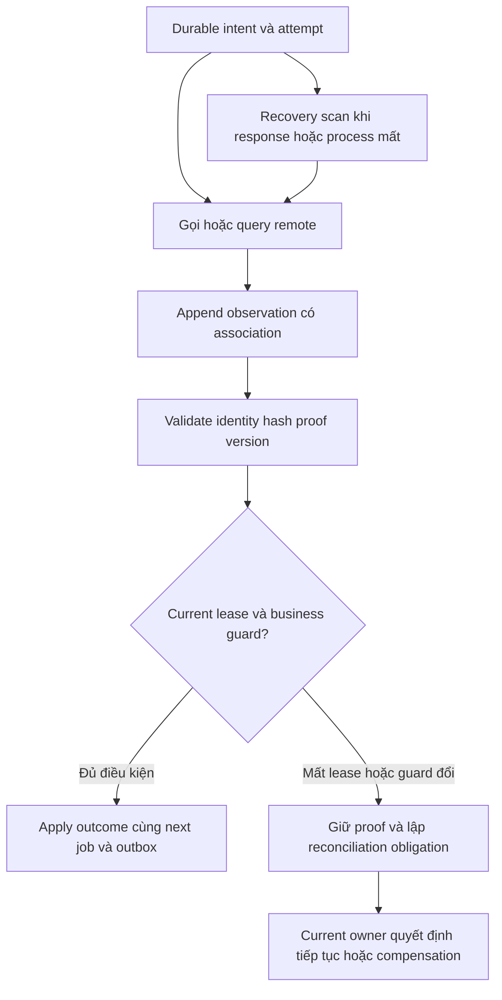

# 13 — Order Saga và Worker Runtime

**Phiên bản:** `order-worker-runtime-1.0-review` · **Ngày:** 17/10/2026 · **Trạng thái:** Đề xuất thiết kế để review, chưa phải bằng chứng triển khai.

## 1. Phạm vi và thứ tự áp dụng

Đặc tả runtime chung cho orchestration trong Order-service: durable job model, claim/lease/epoch, external effects, proof ingestion, retry/reconciliation, compensation và vận hành. PostgreSQL giữ tiến trình; worker có thể chạy cùng deployment hoặc tách deployment mà không đổi semantics. Không chọn thêm workflow platform trong phiên bản này.

[Checkout11](11_cart_checkout_design.md) định nghĩa các bước placement và cleanup; [Payment09](09_payment_sepay_vietqr_design.md) định nghĩa receipt/refund/provider semantics; [Order Core12](12_order_core_design.md) định nghĩa business guards, snapshot và transitions. Chương này là nguồn chung cho worker execution, không cấp quyền bỏ qua guard của các chương đó. [Persistence03](03_database_and_persistence.md) giữ các local transaction boundaries; [Saga04](04_usecases_and_saga_orchestration.md) giữ luồng nghiệp vụ.

Amendment để review: giới hạn 10 attempts/15 phút trước đây là **default execution budget**, không phải giới hạn tồn tại của mọi job hoặc nghĩa vụ. Reconciliation có policy riêng và tiếp tục khi workflow cần manual review. Enum runtime mới không đổi trực tiếp các enum REST operation/Order đã công bố; adapter projection phải map rõ ở mục3.

Transport giữ nguyên: Order worker → Inventory bằng gRPC command/query; Kafka mang facts như OrderPaid/OrderCancelled/FulfillmentReady. Ready fact không thay thế Fulfillment permit/barrier; nhận OrderPaid không phải lệnh trừ kho. Không tuyên bố exactly-once xuyên các hệ thống.

## 2. Invariants bắt buộc

| ID | Invariant |
| --- | --- |
| SW01 | Persist intent, immutable input/hash, stable key và recovery association trước mọi external effect |
| SW02 | Checkout có thể chưa có Order; recovery theo operation/planned_order_id, không chỉ scan orders |
| SW03 | Mất lease chỉ mất quyền apply tiến trình; external effect có thể vẫn đã xảy ra |
| SW04 | External proof từ worker cũ không được bỏ qua: có append-only observation path và authoritative query fallback từ durable intent |
| SW05 | UNKNOWN là external outcome, không phải business/job state; NOT_FOUND đơn lẻ không chứng minh effect chưa xảy ra |
| SW06 | Cùng action/input dùng cùng stable key/hash qua mọi epoch/attempt; input khác không replay cùng key |
| SW07 | Chỉ current owner/epoch còn hạn được apply job/workflow; business mutation còn phải qua aggregate guard/version |
| SW08 | Hết execution budget không xóa obligation, giải phóng refund budget hoặc dừng reconciliation chưa có terminal proof |
| SW09 | Lease, stage deadline và business deadline độc lập; retry/heartbeat không reset các deadline nghiệp vụ |
| SW10 | Proof đúng vẫn phải được lưu dù Order đã đổi state; việc chuyển Order và việc compensation là quyết định riêng |
| SW11 | RESERVED dùng release; COMMITTED dùng reversal có approval/barrier phù hợp; tiền dùng refund workflow riêng |
| SW12 | Local commit và follow-up job/outbox intent atomic; network call luôn ngoài SQL transaction |
| SW13 | Cancel/hold không hủy RPC đang bay; terminal Order không được hồi sinh bởi late proof/event |
| SW14 | Mọi unresolved obligation có owner, next check hoặc explicit operational block, cùng alert; không có nghĩa vụ bị bỏ quên |

## 3. Ba tầng trạng thái và external outcome

| Tầng | Giá trị chuẩn | Ý nghĩa |
| --- | --- | --- |
| Business | Giữ enum Order/Payment/Refund ở các chương tương ứng | Trạng thái nghiệp vụ được phép expose qua contract |
| Workflow | RUNNING, WAITING_EXTERNAL, COMPENSATING, MANUAL_REVIEW, COMPLETED | Tiến trình một mục tiêu nghiệp vụ, không phải thread/process |
| Job | READY, LEASED, RETRY_WAIT, PARKED, DONE | Trạng thái một đơn vị công việc được scheduler quản lý |
| External outcome | NOT_ATTEMPTED, UNKNOWN, SUCCEEDED, REJECTED, CONFLICT | Kết quả của một effect/query; resource_state và proof lưu riêng |

`COMPLETED` cần `completion_outcome=SUCCEEDED|REJECTED|COMPENSATED`; không dùng nó để che unresolved effect thuộc chính workflow. Placement đã thành công có thể COMPLETED trong khi workflow cleanup hoặc payment độc lập còn chạy. Local Order CANCELLED có thể tồn tại cùng cancellation workflow COMPENSATING. Projection operation chỉ FAILED khi failure và compensation đã an toàn; giữ COMPENSATING/MANUAL_REVIEW khi chưa đủ proof.

Workflow transitions: RUNNING → WAITING_EXTERNAL/COMPENSATING/MANUAL_REVIEW/COMPLETED; WAITING_EXTERNAL → RUNNING/COMPENSATING/MANUAL_REVIEW; COMPENSATING → WAITING_EXTERNAL/MANUAL_REVIEW/COMPLETED. MANUAL_REVIEW chỉ về RUNNING/COMPENSATING qua decision có evidence và quyền, hoặc COMPLETED khi đã đủ terminal proof và business resolution. Observation/reconciliation được chạy khi workflow MANUAL_REVIEW, không tự cấp lại quyền mutate thương mại đã hết hạn.

Job transitions: READY/RETRY_WAIT đến hạn → LEASED; LEASED → DONE/RETRY_WAIT/PARKED. Lease hết hạn được reclaim thành LEASED với epoch mới sau recovery check. PARKED chỉ được requeue bằng recovery có audit/schema hợp lệ hoặc policy đã sửa. Không dùng DEAD để ngụ ý nghĩa vụ tài chính đã chấm dứt.

`DONE` nghĩa trách nhiệm của job đó đã hoàn thành hoặc đã chuyển giao durable sang successor/reconciliation job; không đồng nghĩa business success. Việc chuyển giao phải atomic và trả được obligation/job reference. Reconciliation job không DONE khi chỉ vì query timeout hoặc thấy NOT_FOUND chưa đủ thẩm quyền.

Projection CheckoutOperation giữ contract hiện hữu:

| Điều kiện nội bộ | Operation status trả ra |
| --- | --- |
| T0 accepted, chưa bắt đầu execution | ACCEPTED |
| Workflow RUNNING, đã bắt đầu | PROCESSING |
| WAITING_EXTERNAL đang chờ retry/query | WAITING_RETRY |
| Có compensation đang xử lý, kể cả chờ query compensation | COMPENSATING |
| Cần decision/evidence manual | MANUAL_REVIEW |
| COMPLETED/SUCCEEDED, Order đã PLACE commit | SUCCEEDED |
| COMPLETED/REJECTED hoặc COMPENSATED, không còn acquisition obligation | FAILED |

MANUAL_REVIEW và compensation precedence được xác định trước RUNNING/WAITING_EXTERNAL; không project một mutation job DONE thành operation SUCCEEDED. Các nhãn cancellation như REQUESTED_REVIEW/STOPPING_FULFILLMENT/REVERSING_STOCK ở Order Core là **stage/projection của cancellation**, không thêm chúng vào workflow.state chung. Terminal SUCCEEDED/REJECTED ở projection map sang completion_outcome, vẫn giữ compensation_status độc lập.

## 4. Durable model và constraints

[Persistence17](17_order_persistence_messaging_design.md) cụ thể hóa physical mapping, global lock order và commit recovery. jobs dùng chung cho workflow aggregates; OUTBOX_PUBLISH map trực tiếp scheduler/lease của event_streams, không có job lease thứ hai cùng quyết định progress. payment_work_items là logical compatibility role khi migrate, không là queue mới chạy song song cùng effect.

Đây là target logical model, không phải SQL migration. Có thể map checkout_operations, jobs và payment_work_items hiện hữu vào cùng runtime protocol; không duy trì hai bản job có lease độc lập cho cùng work unit.

| Record | Fields và ràng buộc tối thiểu |
| --- | --- |
| workflow | workflow_id, kind/version, aggregate_type/id, optional order_id, stage, state, completion_outcome, version, policy_version, stage_started_at/deadline, business_deadlines, case/assignee |
| job | job_id, workflow_id, kind, input_version, immutable input/hash, logical_work_key UNIQUE, state, lane, priority, run_after, owner/lease_until/epoch, execution/reconciliation counters, policy snapshot, created/updated_at |
| external_effect | effect_id, workflow_id, action, provider/scope/resource, stable_key, request_hash, request_version, dispatch intent, latest outcome, terminal proof reference, next_reconcile_at, obligation state/version |
| external_attempt | attempt_id, effect_id, dispatch sequence, worker_epoch, started/deadline/completed_at, transport disposition; append-only attempt history |
| external_observation | observation_id, effect/attempt association, authenticated source, evidence hash/ref, resource version/decision time, observed_at, validation state; append-only, dedup by source identity/hash |
| runtime_case/audit | reason, affected obligation, assignee, severity, next action/due time, decision scope/version; không chứa command mark-paid tùy ý |

Aggregate types: CHECKOUT_OPERATION, ORDER, PAYMENT_OBSERVATION, RECEIVER_SYNC_RUN, REFUND, OUTBOX_STREAM, INBOX_ITEM. Một job có đúng một primary aggregate; order_id là nullable association. Không ép unmatched payment hoặc pre-placement checkout phải có FK Order.

`logical_work_key` nhận diện work unit, không phải key remote. Unique remote identity theo provider + scope + action + stable_key; trùng identity khác request_hash → CONFLICT, không overwrite. Reconciliation tham chiếu cùng effect_id, không sinh một effect khác. Một reversal là action mới có effect_id/key riêng, tham chiếu committed effect gốc.

Persist input có version và hash canonical; secrets/PII mã hóa hoặc dùng reference có quyền. Unsupported input version → PARKED + case; không đoán payload. Durable obligation vẫn cho phép recovery query bằng association đã được xác thực. Workflow version pin lúc tạo; migration explicit, giữ keys/proofs/deadlines. New worker phải đọc được phiên bản đang còn active trước rollout.

Index tối thiểu: (lane, run_after, lease_until) cho jobs; unresolved obligation + next_reconcile_at; effect identity; pending observation validation; workflow aggregate; outbox aggregate sequence. Retention theo nghĩa vụ và replay window, không purge bằng job TTL đơn thuần.

## 5. Claim, lease, heartbeat và shutdown

### 5.1 Claim

1. Scheduler chọn lane có capacity và dependency quota; mở transaction ngắn dùng DB clock.
2. Claim batch nhỏ đến hạn qua FOR UPDATE SKIP LOCKED; job READY/RETRY_WAIT hoặc LEASED đã hết hạn, không PARKED. Với reclaim, không mặc định được phát mutation lại.
3. Gán owner instance UUID, lease_until=DB now+10s, tăng epoch; commit. Chỉ claim số lượng có thể dispatch ngay, không ôm hàng chờ network.
4. Preflight kiểm lại stage/business guard, effect intent và attempt trước; UNKNOWN hoặc attempt cũ chưa rõ → query trước. Chuẩn bị/persist attempt trước send; crash giữa chuẩn bị và send cũng được coi có thể đã gửi.
5. Gọi remote ngoài transaction, attempt timeout mặc định2s. Sau response/timeout đi qua observation và apply ở mục6.

Claim không lock Order rồi giữ lock lúc gọi network. Apply tuân global hierarchy ở Persistence17: Order nếu có → checkout/control → receipts → refunds → workflow → effect → job → event streams; pre-placement/unmatched dùng parent exception đã định nghĩa. Heartbeat/claim chỉ lock job hoặc publisher stream, không giữ lock đó rồi lấy Order. Observation ingestion append/dedup độc lập; không tạo một đường lock ngược về aggregate.

### 5.2 Ba deadline

| Mốc | Authority | Quy tắc |
| --- | --- | --- |
| lease_until | PostgreSQL runtime | Quyền kỹ thuật của worker; mặc định10s, có thể renew hợp lệ |
| stage_deadline | Versioned workflow policy | Ngân sách execution của stage, đặt một lần; default15m khi dùng E_DEFAULT |
| business_deadline | Payment/commercial policy hoặc remote resource authority | Giới hạn được phép thực hiện nghiệp vụ; local clock không sửa được expiry Inventory |

Execution cutoff là min(stage_deadline, deadline nghiệp vụ liên quan trừ safety margin). Query/reconciliation sau cutoff có cửa sổ vận hành riêng; không áp payment expiry để ngừng tìm tiền/stock. Remote decision proof trước expiry có thể hợp lệ dù query sau expiry theo Order Core12. Không lấy thời điểm trả response làm decision time.

### 5.3 Heartbeat và worker bị treo

Heartbeat default mỗi3s, CAS owner+epoch+lease còn hạn, cộng tối đa10s từ DB now; không renew lease đã hết hạn. Chỉ renew khi có attempt còn trong bounded timeout hoặc có progress checkpoint hợp lệ. Giữ process sống không đủ điều kiện renew vô hạn. Mutation lease không vượt execution cutoff; execution cắt thì chuyển query/reconciliation owner mới theo policy.

Query/sync dài phải chia page/batch, mỗi slice có deadline default30s và request timeout2s; checkpoint progress trước slice tiếp theo. Slice mới là scheduling unit, không reset stage execution budget. Payment sync mất epoch vẫn restart window theo Payment09; checkpoint không biến pagination thành snapshot token. Limiter chặn lâu thì persist run_after/release job thay vì heartbeat chờ quota mãi.

Graceful shutdown: ngừng claim, chờ attempt đang chạy trong grace default5s; persist observation/outcome nếu còn quyền. Hết grace đánh dấu attempt chưa rõ nếu ghi được, không giả cancel remote; chỉ handoff lease sớm sau khi không còn sender local và vẫn query trước ở owner mới. Process bị kill dựa vào expired lease + durable intent. Fencing ở remote vẫn cần stable key/tombstone, kể cả shutdown sạch.

Lease kỹ thuật10s này không thay claim5 phút của nhân viên thực hiện manual refund trong Payment09. Manual bank execution là workflow có STARTED/evidence/budget guards riêng; worker mất lease hoặc human claim hết hạn sau STARTED không được tạo quyền chuyển tiền cho executor khác.

## 6. Execute → observe → validate → apply

### 6.1 Observation khác quyền mutate

Worker cũ được phép **append evidence** cho effect/attempt đã được cấp trước đó dù mất lease. Đây là internal ingestion path có xác thực workload, kiểm association và payload bounds; nó không được sửa job/workflow/Order, checkpoint, budget hoặc resource projection trực tiếp. Observation không mặc nhiên là canonical proof: validator kiểm issuer, resource/order/planned ID, action, stable key, request hash/digest, warehouse, generation, resource version và decision time tùy contract.

Stale worker bị từ chối apply phải chuyển response sang đường append này. Append lỗi thì retry bounded và alert; không hứa response trong memory sẽ tồn tại sau crash. Bảo đảm phục hồi dựa thêm vào durable intent và obligation scanner: query authoritative provider dù chưa có observation. Không chỉ scan job LEASED, Order active hoặc outbox chưa gửi.

Provider phải có query/idempotency/tombstone semantics đủ chứng minh effect. Nếu không có, giữ UNKNOWN + manual evidence process, đóng capability gate cho automation tương ứng; không suy ra an toàn từ im lặng. Raw response giả/mismatch được quarantine, không dùng để reverse hay mark success.

### 6.2 Apply transaction

Current worker lock aggregate/workflow/effect/job, kiểm owner+epoch+lease, input/policy version, current Order version/hold/cancel, và proof freshness. Trong cùng commit: validated observation disposition + effect projection + workflow progress + job disposition + successor/reconciliation/compensation obligation + business history/outbox nếu được phép. Không tăng Order version chỉ vì heartbeat/query không đổi nghiệp vụ.

Observation đúng nhưng guard đổi → vẫn lưu external fact, không bỏ qua vì “Order đã cancelled”. Proof cũ có thể chứng minh original command đã COMMITTED nhưng current state đã REVERSED; lưu cả lịch sử, không downgrade current resource state. Conflict cùng version/hash hoặc resource transition bất khả thi → quarantine/case, query authority; không last-write-wins theo thời gian response.

Nếu mất lease giữa validate và commit, fenced update thất bại thì rollback apply; observation append trước đó vẫn còn để current owner xử lý. Nếu commit ACK mất, đọc registry/effect/workflow/milestone trước quyết định retry/compensate. Không gọi remote compensation chỉ vì SQL client báo timeout.

## 7. Execution retry và reconciliation là hai policy

### 7.1 Execution budget

`execution_retry_budget` lưu max_attempts, stage_deadline, attempt timeout, backoff, retriable classes và business cutoff. Default E_DEFAULT: tối đa10 dispatched execution attempts hoặc15m/stage, full jitter [0,min(30s,0.5s*2^retry_index)], RPC2s. Mutation/query có counter riêng; probe không reset mutation counter. Count attempt khi durable dispatch intent được ghi; crash trước send có thể tính một attempt theo hướng an toàn. Claim/heartbeat không tính attempt.

429/Unavailable/DeadlineExceeded chỉ retry theo semantics: request có thể đã đến provider thì query trước replay same key. Business reject xác định không retry để vượt guard; request hash conflict phải review. Honor Retry-After, breaker và quota; nếu delay vượt cutoff thì chuyển reconciliation, không gửi sớm để “kịp hạn”. Retry-After/chờ quota không reset stage deadline.

Hết budget: transaction chuyển workflow MANUAL_REVIEW khi cần quyết định, job mutation PARKED hoặc DONE với durable handoff, tạo/giữ reconciliation job và case. Không cho staff reset counters/key để phát effect mới. Resume execution cần policy/approval/version mới được audit và original commercial guard còn đúng; không được replay mutation khi vẫn UNKNOWN mà chưa query.

### 7.2 Reconciliation budget

`reconciliation_budget` là giới hạn **tải trong một cửa sổ**, không phải hạn xóa nghĩa vụ: max probes/window, min/max interval, dependency quota, escalation_due_at, evidence requirements và closure condition. Khởi điểm R_CRITICAL query sau2s, backoff full jitter trần30s trong15m đầu; sau đó tối đa1 probe/5m/obligation, giới hạn12 probe/giờ. Jitter ở pha chậm giữ khoảng cách tối thiểu; quota hết thì defer sang window kế tiếp. Các số là policy dự án để đo, không là SLA provider.

Query tài khoản SePay phải batch/coalesce và đi qua dispatcher Payment09; không một probe/receipt biến thành một request riêng. Financial UNKNOWN kéo dài có thể giảm tần suất theo policy được review, nhưng không tự terminal sau24h/7d. Alert sau execution cutoff và tái cảnh báo theo unresolved age; phải có assignee/deadline phản hồi. Query bị auth/capability block vẫn giữ next operational check, case và alert, không hot-loop.

Manual review chặn **decision/effect chưa được phê duyệt**, không chặn receipt ingestion, account sync, authoritative queries hoặc lưu proof. Reconciliation có thể xác nhận effect terminal tự động; đóng workflow/case chỉ khi cả resource outcome lẫn business resolution đã đủ. Provider đã query được refund SUCCEEDED thì ghi settlement một lần; không tự tạo refund mới.

### 7.3 Profiles theo loại việc

| Profile | Execution | Khi hết budget / tiếp tục |
| --- | --- | --- |
| E_DEADLINE | E_DEFAULT, cắt theo commercial/resource deadline | R_CRITICAL query effect; không finalize mới vô điều kiện |
| E_COMPENSATE | E_DEFAULT, approval/barrier còn hiệu lực | R_CRITICAL; unresolved stock/barrier vẫn có owner |
| E_CLEANUP | Default100 attempts hoặc7d, cap delay15m; CAS lại mỗi lần | PARKED + case; không rollback Order; manual replay còn phải qua cart guards |
| E_DELIVERY | Từng cycle10 attempts/15m, cap30s | Alert và lên cycle mới có rate cap; durable event/inbox không bị bỏ vì retry exhausted |
| E_SYNC | Page/slice bounded, retry transient theo Payment09 | Giữ coverage gap/checkpoint, lên lịch sync/reconcile tiếp; không đánh dấu complete giả |
| E_REFUND | Mutation chỉ khi capability/approval cho phép; E_DEFAULT và approval cutoff | UNKNOWN giữ refundable budget, R_CRITICAL không giới hạn tuổi tự terminal |

Execution profiles chỉ là defaults versioned; policy từng kind ở registry phải được cấu hình trước activation. Cart cleanup không có nghĩa vụ tiền/stock nhưng replay window/marker retention vẫn ràng buộc. Outbox/Inbox không được PARKED vô thời hạn mà không có case/block và recovery schedule cho stream bị chặn.

## 8. Job Registry chính thức

Mỗi entry pin `kind + input_version + executor_version + policy_version`. Hai bảng cùng hàng kind dưới đây tạo thành một registry entry; áp dụng common fields ở mục4. V1 là input_version=1 cho mọi entry trong bản review này. Không activate entry nếu adapter/proof/query capability chưa được nghiệm thu.

### 8.1 Identity, deadline, lane và retry

Key là **logical identity**; adapter map sang wire key đã thống nhất với provider, không tự đổi key đang tồn tại. Mọi entry có request_hash của immutable input; query local không phát remote key mới. `N/A` nghĩa không có remote mutation, không phải bỏ dedup local.

| Kind | Aggregate / input v1 | Stable remote key hoặc local work identity | Deadline liên quan | Profile / lane |
| --- | --- | --- | --- | --- |
| CHECKOUT_VALIDATE | CHECKOUT_OPERATION / accepted input ref | local checkout:{op}:validate | Accepted commercial terms, stage | E_DEADLINE / INTERACTIVE |
| INVENTORY_RESERVE | CHECKOUT_OPERATION / planned ID, items digest, warehouse | checkout:{op}:reserve | Canonical acquisition cutoff, remote expiry | E_DEADLINE / CRITICAL |
| COD_FINALIZE | CHECKOUT_OPERATION / reservation and COD terms | Pinned inventory-finalize key cho planned ID/resource | Resource expiry, COD terms | E_DEADLINE / CRITICAL |
| ORDER_PLACE | CHECKOUT_OPERATION / canonical snapshot and proofs | local checkout:{op}:place; unique operation→Order | Placement safety margin theo Checkout11 | E_DEADLINE / INTERACTIVE |
| PAYMENT_FINALIZE | ORDER / allocation and resource refs | Pinned inventory-finalize key cho Order/resource | Allocation eligibility, resource expiry | E_DEADLINE / CRITICAL |
| INVENTORY_RELEASE | CHECKOUT_OPERATION hoặc ORDER / target reservation/planned ID | Pinned release-by-order key/action | Cleanup obligation; acquisition expiry không đóng proof | E_COMPENSATE / COMPENSATION |
| INVENTORY_REVERSE | CHECKOUT_OPERATION hoặc ORDER / committed effect, approval, stop proof | reversal:{approved_operation_id}:{resource} | Approval validity và barrier scope | E_COMPENSATE / COMPENSATION |
| RESOURCE_RECONCILE | CHECKOUT_OPERATION hoặc ORDER / effect_id | Query original stable identity/resource, không key effect mới | Không cắt vì payment expiry | R_CRITICAL / RECONCILE |
| FULFILLMENT_READY | ORDER / readiness generation | local ready:{order}:{generation}; stable outbox ID | Current eligibility/generation | E_DELIVERY / BARRIER |
| FULFILLMENT_ACCEPT_QUERY | ORDER / order, generation, task ref | Query barrier(order,generation); không gọi AcceptTask thay Fulfillment | Current generation; query cũ để reconcile | R_CRITICAL / BARRIER |
| FULFILLMENT_CANCEL | ORDER / generation, cancellation/hold decision | Pinned cancel:{order}:{generation}, decision hash | Approval/hold validity; keep unresolved barrier | E_COMPENSATE / BARRIER |
| ORDER_TIMEOUT | ORDER / expected payment deadline/policy | local timeout:{order}:{deadline_version} | DB now và no-allocation guard | E_DEFAULT / TIMER |
| CART_CLEANUP | CHECKOUT_OPERATION / cart incarnation, revision, selection | cleanup_key đã pin trong Checkout11 | Replay/marker retention; không payment expiry | E_CLEANUP / CLEANUP |
| PAYMENT_OBSERVATION_RESOLVE | PAYMENT_OBSERVATION / provider observation ref | local observation identity; API read coalesced | Verification due_at cho UX, không chấm dứt tiền | E_SYNC / PAYMENT_SYNC |
| PAYMENT_ACCOUNT_SYNC | RECEIVER_SYNC_RUN / receiver, stream, fixed window/filter | receiver+stream single run; immutable run hash | Slice/coverage policy Payment09 | E_SYNC / PAYMENT_SYNC |
| PAYMENT_RECONCILE | PAYMENT_OBSERVATION hoặc ORDER / receipt/case/account association | Query canonical UUID/account coverage | Không tự hết hạn theo Order | R_CRITICAL / RECONCILE |
| REFUND_EXECUTE | REFUND / approved amount, currency, budget refs | Pinned refund operation key; capability gated | Approval validity trước mutation | E_REFUND / COMPENSATION |
| REFUND_RECONCILE | REFUND / execution attempt/provider refs | Query original refund identity; không tạo lần chuyển mới | Không tự terminal vì elapsed time | R_CRITICAL / RECONCILE |
| INBOX_REPLAY | INBOX_ITEM / source,event hash, prerequisite refs | source+event identity/checkpoint | Prerequisite và source version | E_DELIVERY / DELIVERY |
| OUTBOX_PUBLISH | OUTBOX_STREAM / stream position,event ref | Stable event_id, aggregate version+ordinal | Không expiry xóa event | E_DELIVERY / DELIVERY |
| ORDER_COMPLETION_CHECK | ORDER / delivered/window/decision refs | local completion:{order}:{policy_version} | Completion window, settlement/Care guards | E_DEFAULT / TIMER |

Finalize key phải cùng logical action/resource khi COD hoặc payment recovery đi tới cùng effect; không lấy worker kind/epoch làm identity remote mới. Các key baseline đã pin là authority, bảng này không là migration đổi key. Voucher feature disabled; bật lại phải thêm entries hold/finalize/release/reconcile và proof riêng trước rollout.

### 8.2 Proof, rejection, UNKNOWN và compensation

| Kind | Expected proof / success | Business rejection | UNKNOWN recovery / compensation |
| --- | --- | --- | --- |
| CHECKOUT_VALIDATE | Coherent Catalog, validated address, Shipping terms và totals được chấp nhận | Invalid SKU/address, PRICE_CHANGED | Query/revalidate authority; không external acquisition nên không compensation stock |
| INVENTORY_RESERVE | Current RESERVED, đúng planned ID/digest/warehouse, expiry hợp lệ | Insufficient/unavailable/expired | Query original key; release-by-order/tombstone nếu abandon, không coi NOT_FOUND là an toàn |
| COD_FINALIZE | Inventory COMMITTED đúng resource/digest/decision time | Resource terminal không đủ điều kiện | Query; placement impossible sau commit → reversal obligation, không release |
| ORDER_PLACE | Local committed Order/snapshot/intent theo method, operation result | Terms invalid / insufficient remaining lease | Read operation/Order/intent khi SQL ACK mất; release hoặc reversal theo effect thật |
| PAYMENT_FINALIZE | COMMITTED proof; PAID chỉ khi no blocking hold/refund/cancel và guard đủ | Expired/released, blocked allocation | Query effect; giữ receipt và case, compensation có kiểm soát nếu committed nhưng không thể tiếp tục |
| INVENTORY_RELEASE | RELEASED/EXPIRED hoặc verified cancellation tombstone | Already COMMITTED / identity mismatch | Query; COMMITTED chuyển obligation sang reversal review, không mark released |
| INVENTORY_REVERSE | REVERSED đúng committed association và approved scope | Task accepted / approval invalid | Query original reversal; giữ stock obligation và Care case |
| RESOURCE_RECONCILE | Authoritative current state + original command outcome | Conflict/mismatch là review, không effect failure giả | Reschedule query; lập next step/compensation theo guards |
| FULFILLMENT_READY | Ready intent/outbox generation được commit khi guard đủ | Hold/cancel/financial block | Recheck Order/outbox; invalidate generation nếu cần, remote cancel barrier cho task đang bay |
| FULFILLMENT_ACCEPT_QUERY | Authenticated ACCEPTED/CANCELLED/current task association | Generation mismatch hoặc conflicting proof | Query same generation; accepted không bị local cancellation giả đảo ngược |
| FULFILLMENT_CANCEL | Terminal CANCELLED barrier serialization với AcceptTask | ACCEPTED → Care exception | Query; không reverse committed stock trước stop proof |
| ORDER_TIMEOUT | Guarded cancelled + release obligation/history/outbox atomic | Allocation/finalizing/current state khác | Query local state; không blind cancel FINALIZING, dùng resource reconciliation |
| CART_CLEANUP | Lua marker/result: APPLIED hoặc safe skip theo Checkout11 | Changed/replaced/missing là terminal safe skip | Replay same cleanup identity/CAS; không compensation Order |
| PAYMENT_OBSERVATION_RESOLVE | Canonical API UUID receipt hoặc durable case/quarantine | Invalid/mismatched evidence | Account sync tiếp; notification age/404 không chứng minh chưa nhận tiền |
| PAYMENT_ACCOUNT_SYNC | Mỗi row durable disposition và checkpoint đúng window | Malformed row tạo review/coverage incomplete | Restart/dedup theo Payment09; không mark bank reconciled bằng fetch success |
| PAYMENT_RECONCILE | Canonical receipt + resolved allocation/case có evidence | Late/under/over/unmatched theo Payment09 | Tiếp tục account coverage/query; không tự refund hoặc cộng partial |
| REFUND_EXECUTE | Verified submission/settlement theo capability | Definitive reject có proof; approval invalid | UNKNOWN giữ budget, handoff REFUND_RECONCILE; không gửi lần thứ hai |
| REFUND_RECONCILE | Terminal verified settlement hoặc verified no-effect theo Payment09 | Inconclusive/NOT_FOUND không phải reject terminal | Giữ budget, query/sao kê/manual evidence; terminal FAILED mới xét release budget |
| INBOX_REPLAY | Prerequisite proof và inbox disposition+business writes atomic | Poison/conflict → durable quarantine | Deferred query; giữ ordering/offset semantics Persistence03 |
| OUTBOX_PUBLISH | Broker ACK rồi fenced mark published đúng stream position | Invalid event → quarantine/case, block stream tương ứng | Retry stable ID; ACK mất có thể duplicate, không bỏ qua event lỗi |
| ORDER_COMPLETION_CHECK | Care serialized decision + settlement/window/no obligation guards | Active case/refund/hold, chưa đủ window | Query decision/source; không force completed, reschedule đúng eligibility |

## 9. Cancel/hold khi RPC đang bay

Ví dụ minh họa **approved cancellation hoặc hold** thắng local guard khi finalize đang chạy. Owner self-cancel không được vượt no-allocation guard chỉ để tạo race này; PAYMENT_FINALIZING không phải pending tự hủy tự do.

| Thời điểm | Sự kiện | Disposition bắt buộc |
| --- | --- | --- |
| t0 | Worker epoch7 persist finalize intent, gửi RPC | Có effect_id/key/hash và recovery association |
| t1 | Approved cancel đặt blocking hold, invalidate ready, mở cancellation workflow | Không tuyên bố remote RPC đã dừng hoặc kho đã nhả |
| t2 | Lease hết, owner mới epoch8 nhận việc | Query same identity trước replay mutation |
| t3 | Inventory trả COMMITTED cho worker epoch7 | Epoch7 không apply Order; append authenticated observation |
| t4 | Current owner validate/query proof | Ghi committed fact dù Order không còn được PAID/ready |
| t5 | Cancellation còn được phép tiếp tục | Query/cancel Fulfillment barrier; có stop proof và approval mới reverse |
| t6 | REVERSED verified | Hoàn tất stock obligation và cancellation khi các guard khác đủ; refund độc lập |

Nếu worker7 crash trước append, scanner từ intent ở t0 vẫn query ra COMMITTED. Nếu Fulfillment đã ACCEPTED, workflow giữ case/hold theo policy và chuyển Care; không giả CANCELLED rồi reverse hàng đang giao. Nếu refund đã được thực hiện, late finalize proof không được tạo FIRST_PAID/ready mới. Nếu reservation đã RELEASED/EXPIRED thì không dùng COMMITTED của một resource khác để hợp thức hóa.

Pending cancel trước reserve response cũng dùng cùng invariant: release-by-order/tombstone serialize với acquisition; late reserve proof phải query current resource state. NOT_FOUND không thay thế tombstone. Compensation UNKNOWN không được đóng vì local Order đã terminal.

## 10. Scheduling, fairness và backpressure

Registry lane tách CRITICAL, COMPENSATION, RECONCILE, BARRIER, INTERACTIVE, TIMER, PAYMENT_SYNC, DELIVERY, CLEANUP. Đây là logical lanes, không bắt buộc chín process. Không dùng một FIFO toàn service; cũng không dùng strict priority có thể bỏ đói cleanup/reconciliation.

Scheduler dùng weighted fair scheduling giữa lanes, aging theo ready age, và earliest eligible deadline trong lane. Mỗi enabled lane phải có positive service share; lane rỗng cho mượn capacity, có việc thì thu hồi ở ranh giới attempt/slice. Config phải đủ tổng capacity để phục vụ các share qua các scheduling rounds; shared workers có thể dùng deficit round robin. Per-aggregate coalescing/limit ngăn một Order hoặc receiver chiếm toàn pool; outbox vẫn giữ order trong từng aggregate stream.

Policy deployment phải khai báo total concurrency, lane weights/min share/max in-flight, dependency concurrency/rate cap và alert về oldest eligible age. Chưa chốt thứ tự hoặc tỷ lệ cố định trước load test; ưu tiên dự kiến cho finalize gần expiry và compensation, đồng thời dành capacity cho query UNKNOWN, delivery và cleanup. Fairness chỉ cam kết cho việc eligible khi dependency khả dụng; provider block phải được ghi nhận/alert riêng.

Quota dependency là trần chung trên mọi lane/replica. SePay giữ dispatcher/egress quota và fast/background fairness ở Payment09, không cộng quota mới cho runtime chung. Breaker không tính business rejection; circuit mở vẫn giữ lịch probe có giới hạn, không fan-out hàng nghìn query. Scan/page/checkpoint có bounded size, mọi trigger periodic đều coalesce theo logical key/window.

Backlog/coverage không đáp ứng deadline → giảm admission theo policy có audit, ví dụ gate QR mới khi không thể xác minh tiền; không discard job đang nhận. Worker capacity, PostgreSQL claim latency và external rate limit phải được đo cùng nhau; tăng replica không mặc nhiên tăng provider quota.

## 11. Compensation và manual review

Compensation là forward workflow, không là SQL rollback. Mỗi step có original effect reference, approval/policy scope, stable compensating key, expected proof và reconciliation path. Nếu có nhiều resource, compensate ngược acquisition order khi semantics cho phép; từng effect giữ outcome riêng, không một boolean compensated chung.

MANUAL_REVIEW cần case có reason, evidence, obligation, assignee, next_action_due_at và automated checks còn chạy. Staff được yêu cầu query/resume, bổ sung evidence hoặc đưa verified decision theo quyền. Không PATCH job DONE, mark Order PAID, giả stock COMMITTED, reset remote identity hoặc giải phóng refund budget bằng comment.

Reconciliation phát hiện effect terminal sẽ cập nhật facts/projections theo guards; chỉ resolve case khi cả proof và quyết định nghiệp vụ đủ, có audit. Một quyết định đã phê duyệt nhưng bị revoke sau external effect cần case mới/recovery theo effect thực tế; không xóa lịch sử để mô phỏng rollback.

## 12. Recovery, observability và vận hành

Scanner định kỳ khởi điểm10s cho expired leases/orphan intents và30s cho due obligations, batch bounded/fair. Đây là defaults để đo; unique work key + transaction ngăn scan tạo job trùng. Kiểm các trường hợp: effect chưa có terminal proof nhưng thiếu job; observation chưa validate; completed/terminal Order còn resource obligation; manual review thiếu assignee/next check; outbox stream blocked; sync coverage gap. Timers tạo durable work, không giữ nghĩa vụ chỉ trong memory.

| Signal | Hành động vận hành |
| --- | --- |
| oldest ready age / claim latency theo lane | Kiểm capacity/fairness, tránh tăng replica vượt quota |
| lease reclaim, heartbeat fail, stale apply rejected | Kiểm worker stall/timeout; query inflight effects, không reset keys |
| unresolved effect count/age và reconcile coverage | Alert theo severity/amount, phân công owner, giữ probes |
| execution exhausted / parked / manual case overdue | Sửa dependency/input/policy hoặc bổ sung decision có audit |
| proof conflict / observation validation lag | Quarantine, query authority, chặn business transition liên quan |
| outbox lag/blocked stream / inbox deferred age | Replay đúng identity và ordering sau khi giải quyết prerequisite |
| SePay coverage gap / quota saturation | Dùng runbook Payment09, backfill và gate admission khi cần |

Log/trace nối workflow_id, job_id, effect_id, attempt_id, aggregate reference, epoch, policy/input version; metric labels không dùng order_id/PII hoặc raw provider payload. Audit actor/reason/decision/evidence cho mọi manual recovery. Dashboard phân biệt Order state, workflow state, job state, resource outcome và compensation status.

Restore/PITR: tạm chặn mutation workers/admission phù hợp, phục hồi durable intent/keys, query provider effects mới hơn backup và đối soát sao kê/barriers; chỉ mở mutation sau khi có recovery disposition. Không thấy trong restored DB không chứng minh external chưa thực hiện. Mất cả intent/association cần recovery bằng provider/account evidence và manual case trước automation.

## 13. Acceptance trước khi triển khai

Đây là oracles cần nghiệm thu bằng concurrency/fault/integration tests; viết tài liệu không chứng minh các test đã chạy.

| ID | Scenario | Oracle |
| --- | --- | --- |
| SW-T01 | Hai replica claim cùng job | Một current lease, epoch tăng đơn điệu, no double local apply |
| SW-T02 | Worker treo rồi heartbeat sau expiry | Renew bị từ chối, query/reclaim không đổi remote identity |
| SW-T03 | Crash trước/sau send và trước persist response | Durable intent dẫn tới query, không duplicate acquisition |
| SW-T04 | Stale worker có COMMITTED response | Append evidence được; direct apply bị chặn; current owner reconcile |
| SW-T05 | Stale worker crash trước append | Orphan intent scanner tìm proof bằng query |
| SW-T06 | Approved cancel/hold cạnh tranh finalize inflight | Proof không mất, no stale PAID/ready; barrier rồi reversal đúng scope |
| SW-T07 | Cancel trước reserve, NOT_FOUND rồi late reserve | Tombstone/current terminal proof, không fake compensated |
| SW-T08 | Execution hết10 attempts/15m | Manual case/handoff atomic; UNKNOWN reconciliation tiếp tục |
| SW-T09 | Refund UNKNOWN kéo dài nhiều ngày | Budget vẫn giữ, probes/alerts có giới hạn, không phát refund thứ hai |
| SW-T10 | Payment/stock deadline qua nhưng query thấy commit trước expiry | Lưu proof và áp đúng Order Core guard, không đánh mất effect |
| SW-T11 | Heartbeat/process sống nhưng stage hết hạn | Không gia hạn execution vô hạn, không reset commercial deadline |
| SW-T12 | Finalize backlog liên tục | Reconcile/delivery/cleanup vẫn được positive share, đo oldest age |
| SW-T13 | Provider429/circuit mở trên nhiều replica | Quota chung, honor Retry-After, không hot-loop hoặc mất obligation |
| SW-T14 | Outbox broker ACK mất, poison giữa stream | Stable ID duplicate; không publish vượt poison cùng stream |
| SW-T15 | Unsupported input version | PARKED/case, không effect đoán payload, recovery association còn |
| SW-T16 | Proof mismatch hoặc response cũ sau reversal | Quarantine hoặc giữ historical proof, không downgrade current state |
| SW-T17 | SQL commit ACK mất sau PAID/placement | Read registry/milestone, không paid/place/compensate lần hai |
| SW-T18 | Graceful shutdown và force kill | No new claims; attempt bounded; handoff/expired lease query safe |
| SW-T19 | Restore backup cũ hơn remote effects | Reconcile trước mutation, giữ stable keys và nghĩa vụ tiền/kho |
| SW-T20 | Workflow manual review, late receipt/proof tới | Ingestion/query tiếp; business transition chỉ khi guard/decision đủ |
| SW-T21 | Payment sync mất epoch giữa page | Checkpoint fenced; restart window/dedup theo Payment09 |
| SW-T22 | Aggregate chưa có Order hoặc payment unmatched | Job claim/query/recovery không cần Order FK |
| SW-T23 | Case được resolve nhưng stock/refund proof chưa terminal | Reject closure hoặc giữ obligation riêng có owner/job |
| SW-T24 | Lane/dependency config invalid hoặc share bằng0 | Reject activation; không tuyên bố fairness từ strict priority |

Review cần chốt policy concurrency/weights từ tải thực tế, provider proof/query capability, observability thresholds và ownership runbooks trước production. Bản này chốt semantics và registry; không tự đóng các integration gaps ở [ADR07](07_decisions_and_contract_gaps.md).
