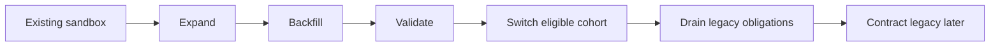

# 18 — Implementation Roadmap cho Order-service

**Phiên bản:** `order-implementation-roadmap-1.0-review` · **Ngày:** 17/10/2026 · **Trạng thái:** Kế hoạch triển khai sau review; các giai đoạn/PR/milestone bên dưới chưa được nghiệm thu bởi tài liệu này.

**Cập nhật runtime24/10/2026:** [ADR010](../../adr/order-service/adr_010_connected_checkout_lifecycle_and_test_bridge.md) và [báo cáo09](../../../04_testing/order-service/09_connected_order_service.md) bổ sung evidence connected TEST từ Cart đến COMPLETED, Kafka và webhook bridge. Đây không phải acceptance toàn bộ roadmap/production; owning services, full cancellation/reversal và canonical Dashboard OMP vẫn giữ gate.

## 1. Mục tiêu, phạm vi và nguồn chuẩn

Triển khai MS-04 bằng các phần nghiệp vụ nhỏ có thể kiểm thử xuyên tầng, từ Core guards đến placement, payment confirmation và lifecycle. Mỗi phần triển khai phải có đủ constraints, identities và recovery tương ứng. Không lấy việc đã viết schema/contract làm bằng chứng runtime hoàn thành.

| Tài liệu | Quyết định dùng khi triển khai |
| --- | --- |
| [HLD00](00_order_service_hld.md), [Domain01](01_order_domain_and_boundary.md), [Lifecycle02](02_state_machine_and_lifecycle.md) | Boundary, ownership, transport và các trục trạng thái |
| [Persistence03](03_database_and_persistence.md), [Saga04](04_usecases_and_saga_orchestration.md), [Contracts05](05_api_contracts_and_transports.md) | Baseline transactions, nghiệp vụ và wire contracts |
| [Verification06](06_testing_and_failure_recovery.md), [ADR07](07_decisions_and_contract_gaps.md) | Evidence, integration gaps, feature gates |
| [Sandbox08](08_implementation_and_acceptance.md) | Historical evidence cần audit trước reuse; không đại diện thiết kế mới |
| [Payment09](09_payment_sepay_vietqr_design.md), [Payment review10](10_payment_sepay_review_resolution.md) | SePay/VietQR, observation/receipt, reconciliation, manual refund và Guest payment access |
| [Checkout11](11_cart_checkout_design.md) | Redis admission, SQL acceptance, quote consumption, PLACE+Intent và cleanup |
| [Core12](12_order_core_design.md) | Invariants, snapshot, transitions, owner/control và milestones |
| [Worker13](13_order_saga_worker_runtime.md) | Durable effects, registry, stale proof, execution/reconciliation và recovery |
| [Persistence/Messaging17](14_order_persistence_messaging_design.md) | Physical mapping, isolation, commit UNKNOWN, stream publisher, inbox/replay và restore |

Phạm vi ưu tiên là D2C VIETQR/SePay, một địa chỉ/kho, VND, Customer/Guest theo capability. COD là capability riêng; voucher/loyalty, marketplace, B2B, gifts và automatic refund chưa mở theo roadmap này. Dùng candidate API/schema theo explicit version/cohort, không thay shape baseline ngầm. Candidate DDL42 bảng là schema review cho empty namespace, không phải upgrade migration chạy nguyên file trên sandbox.

## 2. Bốn điều chỉnh được áp dụng

| ID | Điều chỉnh | Dependency và gate |
| --- | --- | --- |
| RM01 | Shipping Quote phải có sớm | Contract/fixture ở giai đoạn0, adapter tối thiểu trước giai đoạn5; kiểm service thật trước mở checkout thực tế |
| RM02 | Payment confirmation khác quyền nhận tiền thật | Giai đoạn6 dành cho test; manual reconciliation/refund/approval/evidence và operational gates phải đạt trước production money |
| RM03 | Cancel/timeout chia Core guards và full Saga | Guards từ giai đoạn1, race handling/recovery chạy cùng Payment ở6; barrier/reversal hoàn thiện ở7 |
| RM04 | Nền tảng được mở rộng theo workflow đã kiểm chứng | PR2 có PostgreSQL tests, PR3 có operation/Inventory harness, giai đoạn4 có Kafka tests; không chờ UI hoặc toàn bộ registry mới kiểm tích hợp |

Shipping Quote bao gồm address/service eligibility, fee, currency, quote identity/version và validity. Shipping lifecycle bao gồm shipment creation, dispatch, tracking, delivered/settlement. Đây là hai capability có thời điểm tích hợp khác nhau.

## 3. Chín giai đoạn và Definition of Done

Các giai đoạn biểu diễn dependency và điều kiện đi tiếp, không yêu cầu chín đợt merge lớn. Có thể chia nhiều PR nhỏ; một capability chưa đủ dependency giữ gated. Metrics/audit/auth cơ bản đi cùng mỗi giai đoạn, giai đoạn8 nghiệm thu khả năng vận hành toàn luồng.

| Bước | Phạm vi tối thiểu | Definition of Done / evidence | Chưa cấp quyền |
| --- | --- | --- | --- |
| 0 — Contracts & MVP | Pin Inventory/Catalog/Shipping Quote/Identity, event/schema versions, capability matrix, legacy/new cohort routing | Typed fixture cho proof/query/error; rõ owner của missing capability; Shipping quote input/output/expiry được thống nhất | Fixtures không chứng minh provider implementation |
| 1 — Core | Money, canonical identities/hash, immutable snapshot, business transitions, ownership, minimum allocate/finalize/cancel/timeout/hold guards, milestone decisions | Meaningful domain tests: valid/invalid transitions, deadline boundary, snapshot arithmetic/immutability, scope/version và proof requirements; domain không import infrastructure SDK | Chưa gọi Reserve, SePay hoặc mutate database |
| 2 — Persistence | Migration đợt đầu theo slice, repositories/transaction runner, idempotency/quote consumption, root/history/outbox atomic, SQLSTATE/commit recovery | PostgreSQL thật: concurrent same/different keys, quote uniqueness, rollback, commit ACK loss lookup, actual constraints; adapter đọc/ghi được cohort mới | DDL parse không thay PostgreSQL execution |
| 3 — Worker + Inventory | INVENTORY_RESERVE, RESOURCE_RECONCILE/query, INVENTORY_RELEASE; durable intent/attempt/proof, lease/epoch, execution/reconciliation, compensation | PostgreSQL + controllable Inventory test adapter: remote success/lost ACK/crash/reclaim/stale proof/tombstone; original keys không đổi. Provider contract suite trước integration activation | Chưa gọi fixtures là real Inventory acceptance |
| 4 — Messaging | Stream outbox publisher, head replay/fenced progress; một concrete fact consumer có inbox/dedup/deferred/quarantine, offset/rebalance | Kafka+PostgreSQL integration: ACK lost, stale publisher, duplicate/conflicting ID, deferred prerequisite, contiguous offset prefix và rebalance | DB lease không cam kết raw Kafka log tuyệt đối ordered qua failover |
| 5 — Cart → Checkout → Order | Cart projection/CAS, selected Quote, SQL T0, VALIDATE→RESERVE→PLACE, Order+Snapshot+PaymentIntent, operation polling và cleanup | Milestone A; Catalog/Profile/Shipping Quote adapter đủ dùng, coherent terms và proof được validate; checkout thực tế cần real dependency suite | Chưa mở nhận tiền production |
| 6 — SePay Payment | Instructions/QR, HMAC observation, API resolver/account sync, canonical receipt, exact allocation, resource finalize/query, guarded PAID, reconciliation; pending cancel/timeout race | Milestone B trong môi trường kiểm thử; under/over/late/unmatched và resource UNKNOWN giữ đủ evidence/budget/case; deadline/hold/refund guards được recheck | PAID trong test không phải production-money release gate |
| 7 — Fulfillment + Controls | Ready generation/permit/accept-query/cancel barrier, multi-hold/resume, approved cancellation/reversal, staff reconciliation/manual refund | Có stop proof trước reversal; concurrent accept/cancel và late finalize proof đúng; manual refund có ACL/approval/budget/evidence/audit và diễn tập vận hành | Chưa tự enable automatic refund hoặc bypass capability thiếu |
| 8 — Lifecycle + Production | Shipping shipment/checkpoints, settlement/Care completion, COD nếu bật; fault/restore/capacity/runbooks và staged rollout | Milestone C và production gates mục7; signed evidence theo capability. COD bật chỉ khi COD finalization/settlement suite đạt | COD hoặc feature ngoài scope chưa đạt phải giữ tắt |

Shipping Quote adapter triển khai trong giai đoạn0–5, không đợi shipment lifecycle ở8. T3 VIETQR có local PaymentIntent ngay giai đoạn5; HMAC/API sync ingestion thuộc6. Pending cancel/timeout executor hoàn thiện trước hoặc cùng integration6, không chờ full cancellation ở7.

## 4. Ba PR đầu và integration harness

### 4.1 PR #1 — Order Core Foundations

Đây là đơn vị triển khai bắt đầu sau khi dependency/scope0 đã đủ cho Core. Trước sửa code cần đọc module hiện hữu và instructions áp dụng, map phần reuse với Core12; không tạo domain model thứ hai cùng authority hoặc xóa đường legacy đang có obligations.

| Phần | Deliverable |
| --- | --- |
| Money | Integer VND, bounds/checked arithmetic, positive Order final, explicit currency |
| Business identity | Order/planned operation identity, command/effect scopes, canonical hashes; request hash khác items digest |
| Snapshot | Typed versioned model theo [schema v1](../../../03_api_specs/order-snapshot.v1.schema.json), cross-field validation và immutable accepted terms |
| Order decisions | Transition guards nhận explicit decision time/current version/verified evidence; không tự đọc wall clock hoặc gọi network trong domain |
| Ownership | Current owner scope tách owner-at-placement; Guest/Customer discriminator và authorization inputs |
| Minimum controls | Eligibility cho allocation/finalize/first PAID, pending cancel/timeout; hold/cancel/refund blocking và no terminal revival |
| Milestones | Semantics FIRST_PAID/COMPLETED unique; actual unique constraints được thêm cùng persistence slice |

Gate PR1: money bounds/overflow; snapshot schema+arithmetic và thay đổi input không sửa snapshot đã chấp nhận; legal/illegal transitions; before/equal/after deadline; cancel/allocation/hold inputs; owner/version conflict; late proof không revive terminal state. Unit tests kiểm domain decisions, còn actual races/locks được kiểm ở PR2/Payment6. Domain không phụ thuộc trực tiếp Redis, Kafka, SePay hoặc database driver.

Không cần full staff API, full cancellation Saga, all jobs hoặc all tables để hoàn tất PR1. Port/type chỉ thêm khi phục vụ use case sắp triển khai. PR review phải nêu invariant nào đã được code/tests bảo vệ, invariant nào còn cần transaction/provider authority; không ghi toàn Core DONE chỉ vì đã có enum.

### 4.2 PR #2 — Persistence & Transaction Foundation

Deliverables: expand migration đầu cho accepted operation/identities/quote claims và Core persistence cần thiết; transaction runner; repositories theo use case; root/history/outbox append atomic; commit outcome lookup. Shared outbox aggregate identity NOT NULL, không dùng nullable order_id để bảo vệ uniqueness.

Gate trên PostgreSQL thật: same key/hash replay, changed hash conflict; hai keys cùng quote chỉ một accept; unique operation→Order/planned ID; failure giữa writes rollback sạch; COMMIT thành công nhưng response mất thì lookup đúng result. Tách SQL40P01/40001 retry khỏi COMMIT UNKNOWN. Không giữ SQL transaction qua Redis/network. Schema tests thực thi migration/upgrades trên representative legacy fixtures; candidate DDL không dùng thay upgrade plan.

Các trường/bảng runtime còn thiếu được bổ sung trong migration của PR3; Payment và các bảng controls thêm ở slice sử dụng. Mỗi migration giữ old cohort reader/writer compatible đến phase Switch.

### 4.3 PR #3 — Worker Runtime + Inventory Adapter

Deliverables: job/effect/attempt/observation persistence đủ cho ba responsibilities reserve/query/release; claim/heartbeat/epoch, stale evidence ingestion, strict proof validator, retry budget và reconciliation, release/tombstone compensation. Tên job query canonical là **RESOURCE_RECONCILE** trong Registry13; không thêm INVENTORY_QUERY thành entry trùng responsibility.

Harness phải đi kèm PR3: PostgreSQL thật + Inventory test adapter điều khiển được response delay, commit-before-ACK-loss, current resource state và tombstone. Test tạo durable operation trực tiếp theo application acceptance boundary, không cần UI; driver này không mở một public checkout bypass quote.

Gate: crash trước/sau RPC và trước persist proof; remote reserve success nhưng local timeout; lease reclaim khi old RPC đang bay; stale writer bị chặn apply nhưng proof vẫn được lưu/query; no duplicate reservation; compensation chỉ close với terminal proof/tombstone, không NOT_FOUND giả. Khi Inventory thật chưa đủ capability, tiếp tục phát triển dưới gate và ghi rõ evidence level, không tự nhận provider acceptance đã đạt.

## 5. Ba milestone tích hợp

### Milestone A — Order Placement, hoàn thành giai đoạn5

```text
Cart → Quote → CheckoutOperation → Reserve → PLACE
     → Order + Immutable Snapshot + PaymentIntent → Cart cleanup
```

Evidence bắt buộc: một quote chỉ một accepted operation, một operation chỉ một Order; SQL input sống qua Redis TTL/loss; T3 atomic gồm Intent/history/outbox/cleanup; snapshot đúng canonical terms; lost RPC/SQL ACK recovery cùng identity. Unit/adapter tests và real-dependency integration results ghi riêng.

### Milestone B — Payment Confirmation, hoàn thành giai đoạn6

```text
VietQR instructions → bank webhook test fixture/test environment
→ durable observation → API v2 test evidence → canonical receipt
→ exact allocation → Inventory COMMITTED proof → guarded PAID
```

Dùng Bank Webhooks/API v2 test capability theo Payment09; hosted gateway IPN không thay flow đã chọn. Fixture/mock PASS khác provider sandbox integration PASS, và cả hai không chứng minh receiver live đã đủ capability.

Evidence bắt buộc: duplicate observation/receipt không allocate hai lần; exact before deadline được xét dưới lock; late/under/over/unmatched không tự PAID; allocation/finalize cạnh tranh cancel/timeout/hold chỉ có disposition hợp lệ; UNKNOWN và exhausted execution vẫn reconcile; stale COMMITTED proof có đường xử lý. Nếu inventory đã commit đúng hạn, local completion sau deadline vẫn theo Core12, không dùng now để phủ nhận proof.

### Milestone C — Order Lifecycle End-to-End, hoàn thành giai đoạn7–8 theo scope

```text
PAID → Fulfillment Ready → PROCESSING → PACKED → SHIPPED
     → DELIVERED → COMPLETED
```

`SHIPPED` là business state hiện hành, không thêm enum SHIPPING. Ready chưa phải task accepted; DELIVERED chưa phải settled/COMPLETED. Evidence gồm accept/cancel barrier, cancellation/compensation/reversal, manual refund, replay và restore trước mutation. COD có suite riêng CONFIRMED_COD/UNPAID→fulfillment→verified settlement, không giả Order paid từ delivery.

Milestone C scope ghi rõ capabilities bật; feature tùy chọn chưa bật không bắt buộc để phát hành cohort VIETQR. Minimum cancellation/refund/recovery cần cho tiền thật vẫn là mandatory gate.

## 6. Migration từ sandbox và chuyển cohort



1. **Expand:** thêm schema/index/read compatibility, feature flags off; giữ original IDs/keys và baseline contracts.
2. **Backfill:** chunk nhỏ, pin source cohort/policy, map connection/transaction identities; record thiếu proof vào recovery, không suy resource terminal từ Order status.
3. **Validate:** constraints/data integrity và real transaction tests; dual reads/shadow comparison được phép, dual remote effect writers không được phép.
4. **Switch:** một effect chỉ một execution authority. Ngừng claim/fence old worker, xử lý inflight UNKNOWN, reconcile rồi mới chuyển owner. DB epoch riêng không fence remote RPC cũ hoặc old process sau PITR; dùng remote keys/proofs/tombstones.
5. **Contract:** chỉ bỏ legacy khi Orders/jobs/receipts/outbox và compensation/refund obligations đã drain hoặc được chuyển giao durable có evidence. Không xóa identity để dọn schema. Rollback routing không replay terminal effects.

Migration có thể lặp theo từng slice; không cần đợi toàn42 bảng trước Milestone A. Mỗi slice phải có forward/recovery plan và tương thích với cohort còn hoạt động.

## 7. Production gates và cách nghiệm thu

### 7.1 Gate trước nhận tiền thật

| Gate | Evidence bắt buộc |
| --- | --- |
| Checkout dependencies | Real Catalog/Profile/Shipping Quote/Inventory contract validation cho cohort; coherent terms/expiry/owner mapping đúng |
| Payment receiver | Receiver/config/auth/canonical identity và account coverage được nghiệm thu; credentials/environment tách biệt |
| Race/recovery | Receipt–cancel–timeout–finalize và stale proof/UNKNOWN suites đạt; không có direct mark-paid bypass |
| Manual reconciliation | Staff API/UI/ACL, case/assignee/escalation, account/bank evidence và runbook diễn tập |
| Manual refund | Verified approval, reserved budget, human claim/start/evidence, settlement verification, no second send khi UNKNOWN; nhân sự có thể thực hiện theo runbook |
| Fulfillment/control | Ready/accept/cancel và stop/reversal semantics đạt cho capability bật; task UNKNOWN có recovery |
| Messaging | Real Kafka ACK/failover/inbox/rebalance và consumer contract compatibility; no paid-triggered stock deduction cho new cohort |
| Operations | Monitoring/alerts, secrets/access, backup/decrypt/restore reconciliation và admission/mutation gates được diễn tập |

Giai đoạn6 chỉ hoàn tất payment test integration. Bật QR/checkout public nhận tiền thật cần đủ các gate liên quan của7–8 và ghi release evidence riêng. Automatic refund vẫn tắt đến khi capability/approval/test riêng đủ, dù manual refund đã đạt.

### 7.2 Test theo slice, không dồn cuối

| Mốc | Test focus / nguồn oracle |
| --- | --- |
| PR1 | Core12 OC invariants và semantic snapshot tests |
| PR2 | Persistence17 PM-T01/02/11/16/19, real PostgreSQL constraints/commit recovery |
| PR3 | Worker13 SW-T01–11/16–18/22 theo responsibilities đã triển khai; Persistence17 PM-T03 |
| Messaging4 | PM-T04–08/12–14/18, real Kafka+PostgreSQL, ordering/offset/rebalance |
| Placement5 | Checkout11 CC matrix áp dụng và Milestone A |
| Payment6 | Payment09 SP matrix áp dụng, Core race tests và Milestone B |
| Controls7 | Hold/resume/barrier/reversal/refund concurrency và staff procedure acceptance |
| Production8 | PM-T09/10/15/17/20 và toàn fault/restore suite theo enabled scope; Milestone C |

Các nhóm trên là mapping ưu tiên, không loại bỏ các tests khác cần cho invariant cùng slice. Mỗi PR ghi exact tests chạy, môi trường/provider/version, kết quả và unresolved gates. Test mock, integration simulator, provider test và live capability evidence là bốn mức khác nhau.

## 8. Tracking, review và việc bắt đầu

**Payment checkpoint24/10/2026:** đã implement opt-in TEST webhook observation, canonical API reconciliation/ledger, exact allocation, finalization proof adapter, Payment reads, Guest grant authority cục bộ và manual refund/reconciliation controls. [ADR009](../../adr/order-service/adr_009_sepay_payment_runtime_and_capability_gates.md), [evidence](../../../04_testing/order-service/08_sepay_payment_implementation.md) và [runbook](../../../../services/order-service/SEPAY_TEST.md). Không đánh dấu Milestone B end-to-end hoặc toàn stage6/7 đã hoàn tất: public target checkout/timeout/control executor, Inventory3.2 provider acceptance, Care/Finance/Identity authority và target publisher vẫn là dependency gates. Public Cloudflare URL hiện giữ capture; new legacy VIETQR acceptance bị chặn khi bật adapter.

**PR2 checkpoint17/10/2026:** expand migration004, transaction/idempotency/commit recovery, encrypted Core hydration, atomic PLACE/outbox/Intent/intents và cohort fences đã có code; [evidence](../../../04_testing/order-service/05_persistence_foundation.md) gồm real PostgreSQL và41 legacy full-stack integration tests. [ADR004–006](../../adr/order-service/README.md) ghi physical mapping/gap/choices. Target executor và publisher chưa active; tiếp theo là PR3, không đánh dấu toàn stage5/6 đã hoàn thành vì persistence có T3 writer.

**Implementation checkpoint17/10/2026:** PR1 Core foundations đã có code và [local verification](../../../04_testing/order-service/04_order_core_foundations.md). [ADR001–003](../../adr/order-service/README.md) ghi quyết định/gap thực tế. Đây không phải PR đã publish hoặc toàn Core đã production-ready; migration/application wiring và real-stack tests thuộc các slice tiếp theo. Các dòng tương lai bên dưới giữ vai trò kế hoạch và không được đọc thành evidence đã đạt.

Mỗi PR gắn slice, invariant IDs, migration/cohort impact, tests và rollback/recovery disposition. Tên PR#1/#2/#3 là nhãn kế hoạch, chưa là GitHub PR đã tạo. Không gán DONE cho stage chỉ vì merge code nếu dependency/integration evidence chưa đạt.

Điểm bắt đầu là **PR #1 — Order Core Foundations**, chốt model/guard contracts theo mục4.1 rồi mới ghép persistence. Sau PR2 đã có real PostgreSQL evidence, sau PR3 đã có operation-driven recovery harness; đây là các kết quả chạy được trước khi UI/Payment hoàn chỉnh.

Bản roadmap này cập nhật thứ tự và acceptance từ review, không chứng minh code mới hoặc production capability đã triển khai. Không áp dụng migrations, gọi provider, gửi tiền hoặc mở feature gates trong lượt viết kế hoạch.
