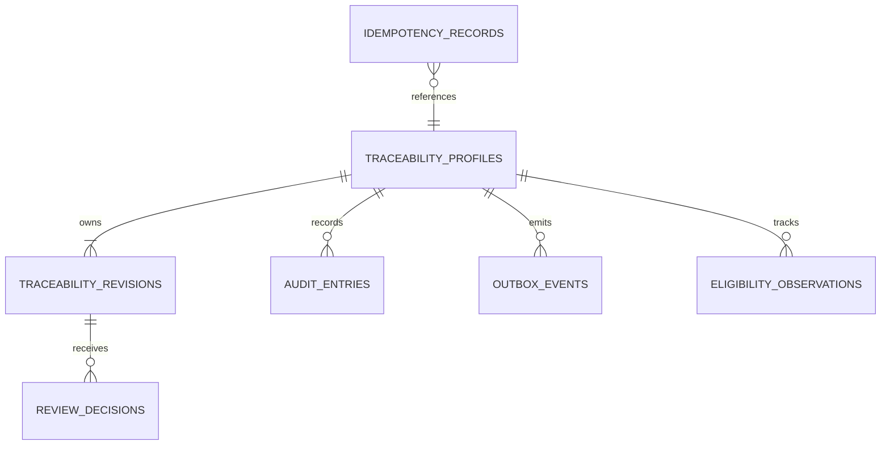

# Thiết kế dữ liệu Traceability

Trạng thái: thiết kế trước migration; implementation và PostgreSQL tests phải
chứng minh từng invariant. Xem [thiết kế dịch vụ](./03_service_design.md).

## 1. Bảng và quan hệ

| Bảng | Key và dữ liệu chính | Ràng buộc |
| --- | --- | --- |
| schema_migrations | version, checksum, applied_at | Migration serialization/advisory lock |
| service_metadata | singleton, mode | DB không được đổi sandbox ↔ integration |
| traceability_profiles | UUID, mode, product_id, sku_code, source_namespace, batch_id, qr_code, status, version, public_revision, ever_published | UNIQUE(namespace,batch_id), QR unique; binding immutable |
| traceability_revisions | profile_id, number, status, content JSONB, dependency_snapshot JSONB, contributor UUID[], created_by, timestamps | PK(profile_id,number); one working revision partial unique |
| review_decisions | UUID, profile/revision FK, actor, decision, reason, version, decided_at | Append-only, no self decision; one decision per submitted revision |
| audit_entries | UUID, profile/revision, actor/action/reason, safe before/after JSONB, request_id, occurred_at | Append-only, no secret/full evidence |
| outbox_events | UUID, profile_id, aggregate_version, type/topic/key, JSONB CloudEvent, state, attempts, lease_until, retry_at, error_code | Immutable payload/id; indexes Pending/retry; no fake publish ack |
| idempotency_records | principal_id, action, key, fingerprint, status_code, safe response JSONB, resource_id | Composite PK, fingerprint conflict 409, commit atomically |
| eligibility_observations | profile_id, public_revision, reason, observed_state, cutoff | Unique transition identity, worker rerun dedup |

Content JSONB chứa certificate/evidence/ingredient snapshots được version cùng
revision để tránh child table sửa âm thầm sau submit. Không dùng JSONB để bỏ
validation: application kiểm tra cấu trúc và DB tối thiểu kiểm tra object/array
types. Review decision và state metadata giữ ở cột typed, không ẩn trong JSON.
Thiết kế này cụ thể hóa danh sách model trong quyết định: certificate/evidence
references là thành phần revision bất biến, không bắt buộc thành bảng mutable riêng.

## 2. Constraints và triggers cần thực hiện

1. Version >= 1; revision number >= 1; statuses CHECK. Binding mode/product/SKU/
   namespace/Batch/QR không được update, kể cả khi thay public revision.
2. Partial unique(profile_id) khi revision Draft/In review/Approved. Một public
   revision partial unique khi status Published. Publish transaction phải archive
   metadata bản cũ trước rồi set bản mới, commit không có hai Published.
3. Public pointer composite FK(profile_id,number) tới revision cùng profile;
   deferred constraint trigger tại commit yêu cầu pointer Published và ever_published.
   Profile suspended/archive vẫn giữ pointer lịch sử nhưng public guard chặn.
4. Immutable revision trigger: content/snapshot/contributors chỉ thay khi Draft;
   submit có thể set snapshot và status trong cùng update Draft→In review.
   Không được đổi nội dung đồng thời Approved→Published hoặc Published→Archived.
5. Contributors chỉ bổ sung, phải gồm creator. Clone kế thừa mọi contributor
   của nội dung được dùng; actor thay nội dung được thêm bởi command, không nhận
   contributor list từ HTTP body. Decision insert kiểm tra actor không thuộc list.
6. State transition trigger khớp matrix, không cho direct Approved→Draft hoặc
   Suspended→Active. Permission runtime ở application, DB trigger không tự xác minh JWT.
7. Decision/audit không update/delete với runtime role. Không cho xóa revision/
   profile có history. Runtime role không sở hữu bảng/trigger và không có DDL.
8. Outbox payload immutable; claim/attempt/status/lease có thể update. Event type/
   aggregate version UNIQUE phù hợp để retry command/worker không tạo fact trùng.

## 3. Command transaction

Peer verification chạy ngoài TX. Bên trong: claim/check idempotency → lock profile
→ CAS expected version → lock working revision → validate domain guards → thay
state → append decision/audit/outbox → tăng version → lưu safe response → commit.
Create giữ Batch uniqueness và QR bằng DB; collision QR retry có giới hạn.
Không đánh dấu idempotency success trước khi business commit. Unique conflict
phải được ánh xạ đúng, không xem mọi SQL exception là duplicate request.

Tests phải dùng hai DB connections độc lập cho concurrency; kiểm tra final state
trong DB, không chỉ HTTP responses. Failpoint insert outbox cần chứng minh rollback
cả public pointer, revision, version, audit và idempotency record.

## 4. Migration và vận hành

DB riêng `om_traceability_db`. Migrator có quyền DDL; runtime role chỉ có grants
cần thiết. Migration up transaction/checksum/version; down chỉ trong isolated tests.
Không truncate/startup reset. Test tạo schema/DB disposable theo run ID, cleanup
chỉ tài nguyên có prefix/scope test; không dùng DB peer hoặc DB configured production.
Backup/restore giữ public QR binding và idempotency/audit history cùng dữ liệu.

## 5. Việc phải kiểm chứng trước P2 Done

- Migration empty/up/down/up và checksum mismatch.
- Batch/QR/working revision/public pointer uniqueness bằng SQL thật.
- Direct SQL sửa content submitted/Published hoặc binding bị từ chối.
- Reviewer là contributor bị chặn; audit/decision không bị ghi đè.
- CAS và concurrent publish, đồng thời same idempotency key/body.
- Runtime role không thể DDL/disable trigger hoặc sửa/xóa audit.
- Publish failure rollback không để success record hoặc partial event.
