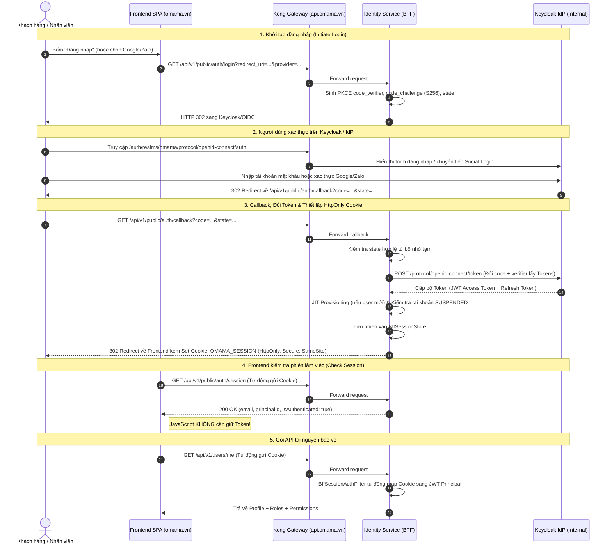

# Hợp Đồng Tích Hợp Xác Thực & Phân Quyền (Frontend Auth & IAM Contract)

> **Dành cho:** Kỹ sư Web Frontend (React, Next.js, Vue) & Mobile App (Flutter, React Native, iOS, Android).  
> **Kiến trúc:** **Backend-for-Frontend (BFF Pattern)** theo chuẩn **RFC 9700** & **RFC 7636 PKCE**.  
> **Cổng tiếp nhận duy nhất (Single Ingress):** **Kong API Gateway** (`https://api.omama.vn`).  
> **Phiên bản:** 2.0.0 (Tuân thủ bài giảng Mục 3.3 & 3.3.1 - RESTful API Specification).

---

## 1. Nguyên Tắc Kiến Trúc & Cổng Vào Duy Nhất (Kong Gateway)

Frontend (Web & Mobile) **chỉ biết một domain duy nhất** là Kong API Gateway:
- **Local Dev Gateway:** `http://localhost:8000`
- **Production Gateway:** `https://api.omama.vn`

Toàn bộ các thành phần hạ tầng nội bộ gồm **Keycloak** (Port 8080) và **Identity Service** (Port 8016) đều nằm trong mạng Docker riêng biệt (Private Network). Kong Gateway phân phối traffic như sau:

| URL công khai tại Kong | Upstream Service | Mục đích |
| :--- | :--- | :--- |
| `/auth/realms/omama/protocol/openid-connect/*` | `keycloak:8080` | Trang hiển thị đăng nhập Keycloak & Social Login cho trình duyệt |
| `/auth/resources/*` | `keycloak:8080` | Static CSS/JS/Theme của trang đăng nhập Keycloak |
| `/api/v1/public/auth/*` | `identity-service:8016` | BFF Session Management (Login, Callback, Session, Refresh, Logout) |
| `/api/v1/users/*`, `/api/v1/admin/*` | `identity-service:8016` | IAM Core APIs (Profile, User Lifecycle, Roles & Permissions) |

### Bảo vệ Token tuyệt đối theo RFC 9700 (Loại bỏ ROPC Password Grant)
- **Không lưu Access Token hoặc Refresh Token trong `localStorage` hay `sessionStorage` của trình duyệt** để triệt tiêu hoàn toàn nguy cơ bị đánh cắp Token khi xảy ra tấn công XSS (Cross-Site Scripting).
- **Identity Service đóng vai trò là BFF (Backend-for-Frontend):** Lưu trữ Access Token và Refresh Token trong bộ nhớ server.
- **Trình duyệt chỉ nhận và gửi một Cookie bảo mật duy nhất:** `OMAMA_SESSION` với cờ `HttpOnly`, `Secure`, `SameSite=Lax`.

### 1.2. Mô hình Phân lập Danh tính Doanh nghiệp (Enterprise Persona Separation)
- **Tài khoản Nhân viên (`EMPLOYEE`):** Sử dụng email công vụ (`@omama.vn`), vận hành các phân hệ nội bộ tại `/admin/**` và có thể xem catalog Storefront ở chế độ chỉ đọc. Được phân quyền chi tiết theo vai trò (`iam_roles`) và phạm vi (`Scope: GLOBAL, STORE, WAREHOUSE`); không được dùng Cart, Checkout, Customer Order hoặc Address.
- **Tài khoản Khách hàng (`CUSTOMER`):** Người dùng hoặc nhân viên khi mua sắm cá nhân sẽ sử dụng tài khoản `CUSTOMER` độc lập (email cá nhân).
- **An toàn phiên làm việc:** Tuyệt đối không dùng chung một tài khoản mang quyền hạn quản trị nội bộ để lướt web mua sắm trên thiết bị cá nhân/mạng công cộng nhằm ngăn ngừa triệt để rủi ro rò rỉ Token đặc quyền.
- **Quy trình Offboarding:** Khi nhân viên nghỉ việc, Admin khóa tài khoản `EMPLOYEE` mà không làm gián đoạn tài khoản `CUSTOMER` mua sắm cá nhân của họ.

---

## 2. Sơ Đồ Luồng Xác Thực BFF (Authorization Code + PKCE)



---

## 3. Quy Chuẩn Payload Dữ Liệu (Chuẩn RESTful Mục 3.3.1)

Toàn bộ các API phản hồi tuân theo định dạng bọc chuẩn (**Envelope Format**):

```json
{
  "success": true,
  "code": "SUCCESS",
  "message": "Thao tác thành công",
  "data": { ... },
  "requestId": "req-8f4b-1234",
  "timestamp": "2026-10-31T14:30:00+07:00"
}
```

Trường hợp lỗi:

```json
{
  "success": false,
  "code": "INVALID_ARGUMENT",
  "message": "Dữ liệu yêu cầu không hợp lệ hoặc đã hết hạn",
  "errors": [],
  "timestamp": "2026-10-31T14:30:00+07:00"
}
```

---

## 4. Chi Tiết Các Endpoint BFF Dành Cho Frontend

### 4.1. Khởi tạo Đăng nhập (`GET /api/v1/public/auth/login`)
Frontend gọi endpoint này khi người dùng nhấn nút "Đăng nhập" để lấy URL chuyển hướng an toàn.

- **URL:** `GET https://api.omama.vn/api/v1/public/auth/login`
- **Query Parameters:**
  - `redirect_uri` *(optional)*: Trang Frontend muốn quay lại sau khi đăng nhập xong (Ví dụ: `https://omama.vn/checkout`). Mặc định là `https://omama.vn`.
  - `provider` *(optional)*: Tên nhà cung cấp SSO nếu muốn vào thẳng đăng nhập mạng xã hội (Ví dụ: `google`, `facebook`, `zalo`, `apple`). Nếu để trống, sẽ hiển thị trang đăng nhập Keycloak chuẩn.
- **Response Web mặc định:** `302 Found` sang Keycloak/OIDC. Chế độ JSON chỉ dành cho client yêu cầu rõ `format=json` hoặc `Accept: application/json`.
- **Hành động của Web Frontend:**
  ```javascript
  window.location.href = `${apiBase}/public/auth/login?redirect_uri=${encodeURIComponent(returnUrl)}`;
  ```

---

### 4.2. Tiếp nhận Callback từ Keycloak (`GET /api/v1/public/auth/callback`)
> Endpoint này do **trình duyệt tự động chuyển hướng đến**, Frontend SPA không cần gọi qua Axios/Fetch.

- **URL:** `GET https://api.omama.vn/api/v1/public/auth/callback?code={code}&state={state}`
- **Hành vi của Backend BFF:**
  1. Kiểm tra tính hợp lệ của `state` để chống CSRF.
  2. Dùng `code` và `code_verifier` gọi Keycloak Token Endpoint lấy Tokens.
  3. Tự động khởi tạo hồ sơ (JIT Provisioning) nếu người dùng lần đầu đăng nhập.
  4. Lưu phiên vào `BffSessionStore`.
  5. Đính kèm Header `Set-Cookie`:
     ```http
     Set-Cookie: OMAMA_SESSION=d7b5b5c9-9481-4b72-9d3e-9080b06b2308; Path=/; Max-Age=2592000; HttpOnly; SameSite=Lax
     ```
  6. Phản hồi **`HTTP 302 FOUND`** với Header `Location: https://omama.vn` (hoặc URL mà Frontend truyền vào từ `redirect_uri`).

---

### 4.3. Kiểm tra Trạng thái Phiên (`GET /api/v1/public/auth/session`)
Được Frontend gọi mỗi khi tải lại trang (F5) hoặc khởi động ứng dụng để kiểm tra người dùng đã đăng nhập hay chưa.

- **URL:** `GET https://api.omama.vn/api/v1/public/auth/session`
- **Yêu cầu quan trọng:** Bắt buộc phải bật `withCredentials: true` (hoặc `credentials: 'include'`) để gửi Cookie `OMAMA_SESSION`.
- **Response `200 OK` (Khi đã đăng nhập):**
  ```json
  {
    "success": true,
    "code": "SUCCESS",
    "message": "Lấy thông tin phiên làm việc thành công",
    "data": {
      "sessionId": "d7b5b5c9-9481-4b72-9d3e-9080b06b2308",
      "principalId": "e9f8d7c6-1111-2222-3333-444455556666",
      "email": "customer@omama.vn",
      "authenticated": true,
      "expiresAt": "2026-10-31T15:30:00Z"
    }
  }
  ```
- **Response `200 OK` (Khi chưa đăng nhập hoặc phiên hết hạn):**
  ```json
  {
    "success": true,
    "code": "SUCCESS",
    "data": {
      "sessionId": null,
      "principalId": null,
      "email": null,
      "authenticated": false,
      "expiresAt": null
    }
  }
  ```

---

### 4.4. Gia hạn Phiên làm việc (`POST /api/v1/public/auth/tokens/refresh`)
Dùng để gia hạn phiên làm việc chủ động từ Frontend mà không bắt người dùng đăng nhập lại.

- **URL:** `POST https://api.omama.vn/api/v1/public/auth/tokens/refresh`
- **Headers:** Tự động gửi cookie qua `withCredentials: true`.
- **Response `200 OK`:**
  ```json
  {
    "success": true,
    "code": "SUCCESS",
    "message": "Làm mới phiên làm việc thành công",
    "data": {
      "sessionId": "d7b5b5c9-9481-4b72-9d3e-9080b06b2308",
      "principalId": "e9f8d7c6-1111-2222-3333-444455556666",
      "email": "customer@omama.vn",
      "authenticated": true,
      "expiresAt": "2026-10-31T15:45:00Z"
    }
  }
  ```

---

### 4.5. Đăng xuất Tài khoản (`POST /api/v1/public/auth/logout`)
Hủy phiên làm việc phía server, thu hồi Token trên Keycloak và xóa Cookie trên trình duyệt.

- **URL:** `POST https://api.omama.vn/api/v1/public/auth/logout`
- **Response `200 OK`:**
  - Header: `Set-Cookie: OMAMA_SESSION=; Path=/; Max-Age=0; HttpOnly; SameSite=Lax`
  ```json
  {
    "success": true,
    "code": "SUCCESS",
    "message": "Đăng xuất thành công",
    "data": null
  }
  ```

---

### 4.6. Lấy Hồ Sơ & Phân Quyền (`GET /api/v1/users/me`)
Gọi để lấy hồ sơ chi tiết, danh sách Roles và Permissions nghiệp vụ để render UI và phân quyền nút bấm/menu.

- **URL:** `GET https://api.omama.vn/api/v1/users/me`
- **Cơ chế xác thực:** Tự động gửi Cookie `OMAMA_SESSION` (BFF Filter tại backend sẽ tự động chuyển đổi sang Principal), hoặc gửi kèm `Authorization: Bearer <token>` nếu là Mobile App.
- **Response `200 OK`:**
  ```json
  {
    "success": true,
    "code": "SUCCESS",
    "message": "Thao tác thành công",
    "data": {
      "principalId": "e9f8d7c6-1111-2222-3333-444455556666",
      "idpSubject": "f8a7b6c5-2222-3333-4444-555566667777",
      "email": "manager.danang@omama.vn",
      "principalType": "EMPLOYEE",
      "provisioningStatus": "ACTIVE",
      "roles": [
        {
          "roleCode": "STORE_MANAGER",
          "roleName": "Quản lý cửa hàng",
          "scopeType": "STORE",
          "scopeId": "STORE_DN_01"
        }
      ],
      "permissions": [
        "STORE_INVENTORY_VIEW",
        "STORE_ORDER_APPROVE",
        "STORE_DISCOUNT_APPLY"
      ]
    }
  }
  ```

---

### 4.7. Đăng ký Tài khoản Khách hàng Mới (`POST /api/v1/public/customer-registrations`)
Hỗ trợ Idempotency chống tạo tài khoản trùng lặp khi người dùng bấm gửi nhiều lần.

- **URL:** `POST https://api.omama.vn/api/v1/public/customer-registrations`
- **Headers:** `Content-Type: application/json`
- **Request Body:**
  ```json
  {
    "email": "newcustomer@omama.vn",
    "rawPassword": "Password@123",
    "firstName": "Văn Dương",
    "lastName": "Hoàng",
    "idempotencyKey": "REG-UUID-CLIENT-GEN",
    "requestFingerprint": "fp-device-fingerprint"
  }
  ```
- **Response `200 OK`:**
  ```json
  {
    "success": true,
    "code": "SUCCESS",
    "message": "Đăng ký tài khoản thành công",
    "data": {
      "principalId": "a1b2c3d4-1111-2222-3333-444455556666",
      "status": "ACTIVE",
      "message": "Đăng ký tài khoản thành công"
    }
  }
  ```

---

## 5. Mẫu Triển Khai Phía Web Frontend (Next.js / React / Axios)

### 5.1. Cấu hình Axios Client (`apiClient.ts`)

> **QUAN TRỌNG NHẤT:** Luôn bật `withCredentials: true` để trình duyệt tự động gửi và nhận Cookie `OMAMA_SESSION` giữa `omama.vn` và `api.omama.vn`.

```typescript
import axios from 'axios';

export const api = axios.create({
  baseURL: import.meta.env.VITE_API_BASE_URL || 'https://api.omama.vn',
  withCredentials: true, // BẮT BUỘC: Cho phép gửi và nhận HttpOnly Cookie
  timeout: 10000,
  headers: {
    'Content-Type': 'application/json',
  },
});

// Response Interceptor: Tự động xử lý khi phiên hết hạn
api.interceptors.response.use(
  (response) => response,
  async (error) => {
    if (error.response?.status === 401) {
      // Phiên làm việc đã hết hạn hoặc chưa đăng nhập
      console.warn('Phiên làm việc hết hạn, cần đăng nhập lại');
    }
    return Promise.reject(error);
  }
);
```

### 5.2. React Auth Context & Hook (`AuthContext.tsx`)

```typescript
import React, { createContext, useContext, useEffect, useState } from 'react';
import { api } from './apiClient';

interface UserProfile {
  principalId: string;
  email: string;
  principalType: string;
  roles: Array<{ roleCode: string; roleName: string; scopeType: string; scopeId: string | null }>;
  permissions: string[];
}

interface AuthContextType {
  user: UserProfile | null;
  isAuthenticated: boolean;
  isLoading: boolean;
  login: (provider?: string) => Promise<void>;
  logout: () => Promise<void>;
}

const AuthContext = createContext<AuthContextType | null>(null);

export const AuthProvider: React.FC<{ children: React.ReactNode }> = ({ children }) => {
  const [user, setUser] = useState<UserProfile | null>(null);
  const [isAuthenticated, setIsAuthenticated] = useState<boolean>(false);
  const [isLoading, setIsLoading] = useState<boolean>(true);

  // Kiểm tra phiên đăng nhập khi khởi động trang
  useEffect(() => {
    const checkSession = async () => {
      try {
        const sessionRes = await api.get('/api/v1/public/auth/session');
        if (sessionRes.data.data.authenticated) {
          setIsAuthenticated(true);
          // Lấy hồ sơ và danh sách quyền
          const profileRes = await api.get('/api/v1/users/me');
          setUser(profileRes.data.data);
        } else {
          setIsAuthenticated(false);
          setUser(null);
        }
      } catch (err) {
        setIsAuthenticated(false);
        setUser(null);
      } finally {
        setIsLoading(false);
      }
    };

    checkSession();
  }, []);

  const login = (provider?: string) => {
    const params = new URLSearchParams({ redirect_uri: window.location.href });
    if (provider) params.set('provider', provider);
    window.location.href = `${API_BASE}/public/auth/login?${params.toString()}`;
  };

  const logout = async () => {
    try {
      await api.post('/api/v1/public/auth/logout');
    } finally {
      setIsAuthenticated(false);
      setUser(null);
      window.location.href = '/';
    }
  };

  return (
    <AuthContext.Provider value={{ user, isAuthenticated, isLoading, login, logout }}>
      {children}
    </AuthContext.Provider>
  );
};

export const useAuth = () => {
  const context = useContext(AuthContext);
  if (!context) throw new Error('useAuth must be used within an AuthProvider');
  return context;
};
```

---

## 6. Mẫu Cấu Hình Kong Gateway (Declarative `kong.yml`)

Để toàn bộ kiến trúc hoạt động mượt mà trên hostname duy nhất `https://api.omama.vn`, dưới đây là cấu hình Kong Ingress mẫu:

```yaml
_format_version: "3.0"

services:
  # 1. Identity Service BFF (Spring Boot port 8016)
  - name: identity-service
    url: http://identity-service:8016
    routes:
      - name: identity-auth-routes
        paths:
          - /api/v1/public/auth
        strip_path: false
      - name: identity-core-routes
        paths:
          - /api/v1/users
          - /api/v1/admin
          - /api/v1/public/customer-registrations
        strip_path: false

  # 2. Keycloak OIDC Endpoints (Keycloak port 8080)
  - name: keycloak-service
    url: http://keycloak:8080
    routes:
      - name: keycloak-oidc-browser-routes
        paths:
          - /auth/realms/omama/protocol/openid-connect/auth
          - /auth/resources
        strip_path: false

plugins:
  # Bật CORS cho phép cookie cross-subdomain từ https://omama.vn
  - name: cors
    config:
      origins:
        - "https://omama.vn"
        - "http://localhost:3000"
      credentials: true
      methods:
        - GET
        - POST
        - PUT
        - PATCH
        - DELETE
        - OPTIONS
      headers:
        - Accept
        - Content-Type
        - Authorization
```

---

## 7. Bảng Mã Lỗi Chuẩn Hóa

| HTTP Status | Mã lỗi `code` | Ý nghĩa | Hành động của Frontend |
| :--- | :--- | :--- | :--- |
| `400` | `INVALID_ARGUMENT` | Dữ liệu gửi lên sai định dạng hoặc state hết hạn | Báo lỗi người dùng hoặc yêu cầu bấm đăng nhập lại |
| `401` | `UNAUTHORIZED` | Phiên làm việc không tồn tại hoặc đã hết hạn | Hiển thị trạng thái Chưa đăng nhập / Nút Đăng nhập |
| `403` | `FORBIDDEN` | Tài khoản không có quyền trên tài nguyên | Hiển thị màn hình 403 "Bạn không có quyền truy cập" |
| `404` | `RESOURCE_NOT_FOUND`| Không tìm thấy tài nguyên | Hiển thị thông báo không tìm thấy |
| `409` | `STATE_CONFLICT` | Tài khoản bị khóa (`SUSPENDED`) | Hiển thị cảnh báo: "Tài khoản của bạn đã bị tạm khóa" |
| `422` | `VALIDATION_FAILED` | Lỗi validate dữ liệu nhiều trường | Map mảng `errors` vào form input |
| `500` | `INTERNAL_SERVER_ERROR` | Lỗi hệ thống ngoài dự kiến | Báo người dùng thử lại sau |
