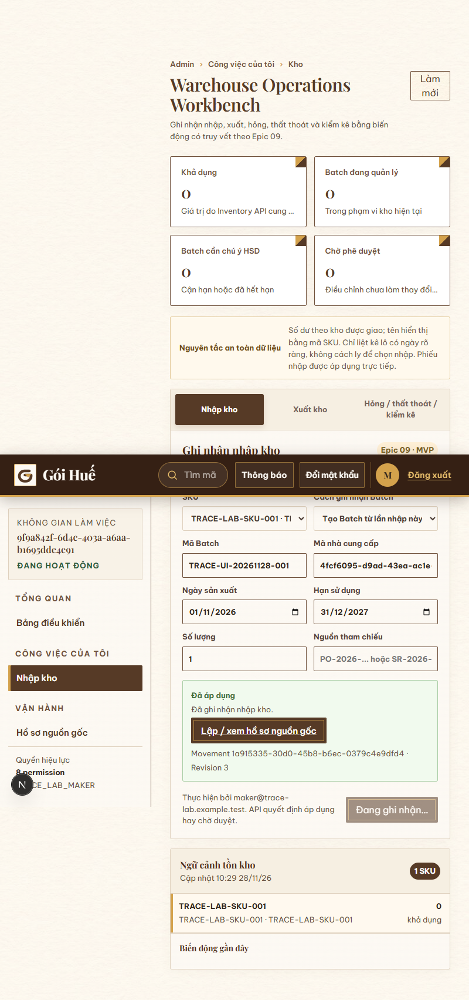
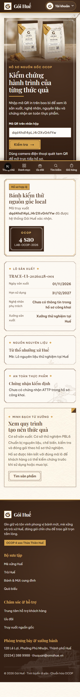
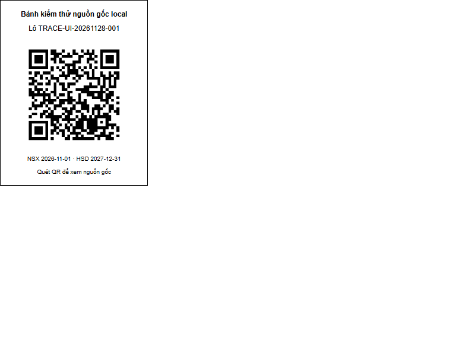

# Kiểm chứng luồng nguồn gốc trên local — 28/11/2026

Nhánh: `codex/traceability-order-flow`, worktree riêng. Baseline `dev@ac5395c5` / PR #175 của Dương; nhánh Order của Dương được đối chiếu tại `20322d1c`. Không merge nhánh Order đang làm vào nhánh này, không sửa projection giá/checkout/migration000013 của Dương, không thử trên production/release.

## Phần triển khai bổ sung

| Phần | Đầu ra |
| --- | --- |
| Inventory | Receipt trả binding trong cùng transaction/idempotent response; BatchSource trả warehouse_id field9; workbench đọc số dư/lô/revision thật theo giao quyền của hai permission xem kho |
| Identity | StaffAuthorization trên listener TLS riêng; kiểm service credential và JWT nhân viên, principal ACTIVE, effective grants hiện hành; transport allowlist Traceability/Inventory và customer Order read |
| IAM migration V27 | Bổ sung INVENTORY_VIEW, WAREHOUSE_WORKBENCH_VIEW còn thiếu trong danh mục; không tự cấp quyền hoặc tạo assignment GLOBAL |
| Fulfillment | PackageRevision field14 packed_lines lấy từ snapshot niêm phong; extension lỗi không phá proof Shipping cũ |
| Order | GET /api/v1/orders/{order_id}/traceability kiểm ownership trước peer; kiểm locator/proof với frozen lines, tổng số lượng và SKU; resolver gRPC có chunk100/concurrency2/outer budget5s, không sửa lifecycle |
| Web | Nhập kho → batch-context/by-batch → draft → scan OCOP → gửi duyệt → người khác duyệt/công bố → chuẩn bị/tải/in QR; chi tiết đơn có panel nguồn gốc tải độc lập |
| Gateway | Route scoped Traceability v2, workbench GET và Identity adapter v1; internal RPC không được route public |
| Media | Chỉ sửa đóng gói: OpenSSL cho Prisma/Alpine, giữ Prisma CLI theo lock, shared proto và artifact build đúng context; API/RPC nghiệp vụ của Dương không đổi |

Identity adapter dùng `/api/v1/admin/trace-api/**` theo rule riêng của Identity; downstream vẫn là `/api/v2/admin/trace/**`. Đường Web là `/api/admin/trace/**`. Contract adapter hiện hành: [Web BFF draft](../../03_api_specs/traceability-web-bff-draft.openapi.yaml), [Identity BFF draft](../../03_api_specs/traceability-workflow-bff-draft.openapi.yaml). Đây là additive draft, chưa promote stable.

## Môi trường thật đã chạy

Chạy riêng Keycloak, Identity, Catalog, Inventory, Traceability, Media, Kong, PostgreSQL, Redis và MinIO; Web chạy Next.js local. Chỉ publish loopback. Dữ liệu, tài khoản, kho, chứng nhận và CA đều là fixture local; không dùng tài khoản cá nhân hoặc chứng nhận thật.

| Bề mặt local | Cổng host |
| --- | --- |
| Web HTTPS → Next.js | 3300 → 3301 |
| Keycloak HTTPS | 3443 |
| Kong | 18000 |
| Identity HTTP / staff TLS RPC | 18016 / 19116 |
| Inventory admin HTTP / TLS RPC | 28001 / 18001 |
| Catalog gRPC | 19005 |
| Traceability HTTP / TLS resolver | 18003 / 19003 |
| Media HTTP / gRPC | 18007 / 19007 |
| MinIO HTTPS → S3 | 39000 → 19000 |
| PostgreSQL / Redis | 15433 / 16380 |

Kafka relay/consumer không bật trong lab này; outbox giữ bản ghi PENDING. Không suy ra đã nghiệm thu Kafka hoặc toàn bộ checkout–shipping từ kết quả dưới. TLS private CA được cấu hình tường minh; không cài CA vào trust store hệ điều hành. Browser kiểm thử dùng profile cô lập với cấu hình chứng chỉ lab. `TRACEABILITY_OIDC_CA_FILE` bổ sung CA riêng mà vẫn kiểm hostname/chain/issuer, không có TLS bypass trong service.

## Kết quả quan sát qua trình duyệt

1. Đăng nhập nhân viên bằng authorization code/PKCE qua Keycloak thật. Identity trả đúng permission/scope tuples. Đã sửa điểm làm mất permissionGrants khi Web chuyển `/users/me` thành phiên `/api/auth/me`.
2. Nhập một lô mới qua form. Receipt APPLIED trả batchId/batchCode/skuCode/warehouseId. Số lượng nhập thử thực tế là **15**; workbench đọc lại đúng 15. Mở hồ sơ từ kết quả receipt, không ghi thêm phiếu để lấy binding.
3. Context kiểm Inventory TLS gRPC và Catalog GetProductVariant/GetTraceabilityBinding hiện hành. Tạo draft201 cho đúng binding, chưa công khai.
4. Tải PDF fixture 686bytes qua upload-session → presigned PUT MinIO → complete → metadata READY. Evidence là document:fileId. Lưu và submit200/IN_REVIEW qua Media gRPC validation thật.
5. Tài khoản reviewer khác mở scan đã lưu, nhận application/pdf/200/686bytes; approve200, publish200/PUBLISHED/public_revision1. Durable Media binding có đúng một job, bound_at đã có, attempts1.
6. Khách chưa đăng nhập mở QR trên viewport390px, nhận hồ sơ công khai đúng lô/chứng nhận. Optional nghệ nhân/ATTP vắng có thông báo rõ ràng, không dựng dữ liệu.
7. QR canvas và PNG tải xuống được **giải mã độc lập bằng jsQR** ra đúng URL public; PNG512×512, SVG tải được. In gọi lại kiểm tra public eligibility. Đã sửa lỗi bản in trắng/QR vượt khung bằng portal trực tiếp dưới body và kích thước CSS ưu tiên: tem66mm, QR50mm; kiểm tra x=0/y=0 và QR nằm trong viền. afterprint dọn bản in. Chưa in bằng máy in vật lý.
8. Tạo revision2, đổi tên thành bản nháp chưa công bố và lưu. QR không đổi, public_revision vẫn1, tem vẫn lấy tên bản công khai, không lấy tên bản nháp.
9. Trạng thái UI410 được kiểm bằng HTTP response fixture trên browser: thông báo hồ sơ dừng công khai và không hiện record cũ. Root lab thật được giữ ACTIVE. Các điều kiện410 của backend vẫn thuộc bộ Go tests riêng.

## Authorization và tính độc lập

| Ca live, cùng một profile | HTTP |
| --- | --- |
| Nhân viên được giao kho sở hữu | 200 |
| Nhân viên chỉ có kho khác | 403 |
| Token vẫn còn grant nhưng gỡ read_internal khỏi IAM hiện hành | 403 |
| Khôi phục grant fixture, giữ token cũ | 200 |

Thay đổi IAM ở ca trên là fixture DB cô lập để kiểm token/current-grant intersection, không phải nghiệm thu quy trình quản trị revoke/sync Keycloak. Role name không được dùng để mở rộng phạm vi.

Order có test kết hợp **PostgreSQL thật + snapshot Core hợp lệ + gRPC wire peers fixture**: một dòng chia hai lô3+2, kết quả mixed availability, resolver offline vẫn giữ hai dòng UNAVAILABLE; packed_lines không đủ trả root UNAVAILABLE/empty. Đơn vẫn PACKED và version3, không ghi thay đổi lifecycle. Ownership sai403, không tồn tại404, staff bị chặn; không lấy allocation đang sống. Đây chưa phải luồng checkout/đóng gói/vận chuyển thật xuyên toàn bộ service.

## Kiểm tra tự động

| Kiểm tra | Kết quả/phạm vi |
| --- | --- |
| Traceability go test ./... với PostgreSQL | 236 pass, 3 Kafka skip |
| Identity Gradle test với PostgreSQL, JDK21 | 128 test, 0 failure/error, 1 provisioning-Keycloak skip; login/profile/staff RPC được kiểm live ở lab riêng |
| Inventory go test ./... với PostgreSQL | 226 pass, 3 skip trong full suite: Kafka procurement, receipt harness env riêng, terminal lifecycle harness env riêng; chạy riêng TestReceiptAgainstPostgres với đúng env sau đó pass; receipt/form và BatchSource đã kiểm live |
| Fulfillment go test ./... với PostgreSQL | 57 pass, 1 Kafka skip |
| Order go test ./... với PostgreSQL Core | 307 pass, 64 skip của các harness chưa cấp Kafka/Redis/provider env; có hai test mới cho ownership và frozen projection |
| Web typecheck/lint/test | Pass; 70 file / 292 test. Lint có một warning payment-workspace có sẵn, không có error |
| Media Dockerfiles | Cả hai build pass; image Coolify chạy API/gRPC/Prisma/MinIO thật, image local kiểm non-root, artifact/shared proto và Prisma5.22/OpenSSL3 |
| Go vet | Order, Inventory, Traceability pass |
| Next.js production build | Pass sau sửa workflow và in tem |
| Redocly | Hai stable, hai draft-planned và hai BFF draft đều pass; warning hiện hữu không được gọi là error |
| MVP static contract/codegen gate | Pass; kiểm spec/schema/proto/copies/negative guards, không thay live acceptance |

Log chi tiết và fixture chạy nằm trong ignored `services/traceability-service/.sandbox/traceability-cross-service-20261127/`; không commit JWT/cookie/private key/password/signed upload URLs. Ba ảnh đã chọn ở trên không chứa credential. Những run lỗi khi dựng môi trường được giữ trong log, không tính thành pass; run Media ban đầu phát hiện thiếu OpenSSL rồi mới được sửa và chạy thật.

Muse API đã thử nhưng trả no_accounts_available; không có bằng chứng nào trong report này được gán là Muse thực hiện. Browser QA được chạy bằng Chrome profile cô lập từ công cụ local. Đã dừng các dịch vụ Muse do lượt kiểm tra này khởi động.

## Điều kiện ghép/release

- Dương tiếp tục phần Order theo plan của bạn ấy. Ghép riêng phần traceability read/provider/stubs và wiring nhỏ; không thay pricing projection, snapshot canonicalizer hoặc migration000013 bằng code fixture.
- Chạy migration Identity V27 và gán role bundle theo **WAREHOUSE UUID** thật. Người nhập/lập và người duyệt phải là hai principal khác nhau. Không có auto-grant GLOBAL trong migration.
- Cấp private peer credentials/TLS theo env examples; migrate Traceability000003, runtime grants và warehouse-write guard trước khi bật scoped/media/resolver flags. PUBLIC_WEB_BASE_URL phải khớp public storefront; Web upload capability key là server-only.
- Media OCOP_CERTIFICATE theo policy PUBLIC_READ hiện hành: chỉ tải scan được phép công khai. Checksum metadata không được mô tả thành chứng thực pháp lý/kiểm tra mật mã nội dung bởi Media; không giả đã có versioned object immutability ngoài provider hiện hành.
- Hồ sơ SUSPENDED/ARCHIVED không có restore trong contract này; UI ghi rõ trước thao tác. Không thêm resume hoặc đổi nghiệp vụ trong đợt này.
- Review PR rồi mới đưa lên release theo quy trình nhóm. Chưa deploy hoặc kiểm thử production; cần ghép các PR và chạy acceptance Kafka/Order–Fulfillment trên môi trường tích hợp trước promotion stable.
