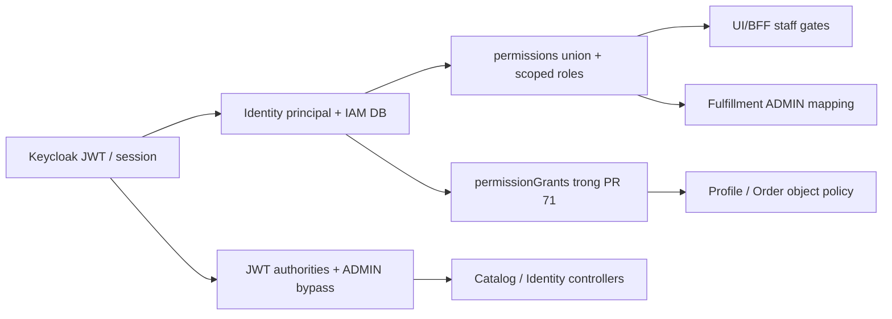

# Hồ sơ rà soát Administration và phân quyền IAM

**Ngày rà soát:** 07/11/2026. **Loại tài liệu:** tổng hợp bằng chứng và khoảng trống; không phải quyết định phê duyệt chính sách.

Đọc cùng [sổ quyết định còn mở](iam-open-decisions.md). Các phương án trong hai tài liệu này không tự cấp quyền, tạo role, mở mutation UI hoặc sửa phạm vi nghiệp vụ.

## 1. Snapshot và giới hạn kết luận

| Nguồn | Revision đã đối chiếu | Ý nghĩa |
|---|---|---|
| `origin/dev` | `36c083c57320cde8a38974a523795b5d6ff7942f` | Baseline đã merge của dự án |
| `codex/profile-order-api-authorization`, PR #71 | `ed46f9eb1c819d27eddda8fe8fee00aa5ef27a01` | Bổ sung grants và enforcement Profile/Order; chưa được coi là code đã có trên dev |
| `origin/codex/order-admin-integration` | `087a18869c8ac44c8df298db1c92d3ec03f7f240` | Nhánh nối Web Admin Order/BFF/DTO và auth cũ; chưa merge nguyên trạng |
| `origin/feat/analysis-service` | `2c662a0` | Analytics có PilotAuth riêng; không nằm trong baseline dev nêu trên |

PR #71: [GitHub](https://github.com/hvduong2k5/DUT.PBL6/pull/71). Snapshot cần cập nhật khi merge hoặc đổi nhánh; đọc code worktree này không đồng nghĩa tính năng đã triển khai trên dev. Đây là rà soát tĩnh, không phải lần chạy lại toàn bộ test/deployment.

Trong ngữ cảnh quản trị, “administration” là quản lý System Access/Role/Permission. `admission` của Fulfillment là quyết định tiếp nhận công việc dựa trên permit, trạng thái đơn và bằng chứng tồn kho; hai khái niệm không thay thế nhau.

## 2. Nguồn và cách đọc khi mâu thuẫn

| Nguồn | Cung cấp điều gì | Không được suy diễn |
|---|---|---|
| [EPIC 22](../01_requirements/epics/EPIC_22_Administration.md) | Story, nguyên tắc quản trị, mục 8 còn mở | Có story không có nghĩa mọi policy đã duyệt |
| [Decision register Access Management](../ui_web/ACCESS_MANAGEMENT_POLICY_DECISIONS.md) | 54 mục AUTH/ACC/ROLE/PERM/ASSIGN/GOV; trạng thái đã chốt/tạm áp dụng/chưa chốt | Đề xuất trong một dòng không phải quyết định đã được duyệt |
| [EPIC 02](../01_requirements/epics/EPIC_02_Customer_Profile.md) | Employee Profile, HR, phân biệt hồ sơ và System Access | Có department không tự sinh quyền quản lý department |
| [EPIC 23](../01_requirements/epics/EPIC_23_Audit_Security.md) và [NFR](../01_requirements/03_Non_Functional_Requirements.md) | Audit, privacy, quyền đặc biệt và integrity | Có bảng audit không chứng minh pipeline chống sửa/xóa đã hoàn chỉnh |
| [Identity API decisions](../../services/identity-service/docs/api-contract-decisions.md) | Quyết định kỹ thuật có nhãn CHỐT/DRAFT/DEPRECATED | Nhãn CHỐT trong service không tự giải quyết mâu thuẫn với Epic/UI |
| [Identity–Keycloak boundary](../../services/identity-service/docs/keycloak-identity-boundary.md) | Ownership credential, principal, authorization | Không suy ra mọi service đã dùng cùng một cơ chế |
| [Admin Access API matrix](../ui_web/ADMIN_ACCESS_DATA_API_MATRIX.md) | Projection và permission gate UI/BFF đang có | Mock/read-only không phải backend IAM production |
| [MVP identity/authorization](../ui_web/MVP_PUBLIC_IDENTITY_AUTHORIZATION.md), [owner BFF](../ui_web/IDENTITY_OWNER_BFF_MVP.md), [runbook MVP](mvp_delivery.md) | Persona, session, luồng Customer và mốc tích hợp | Ghi chú TEST/PENDING ở mốc cũ cần đối chiếu cập nhật mới hơn |
| [Bảng quyền MVP](mvp_permissions.md), [Profile/Order](profile-order-api-authorization.md) | Lát cắt enforcement đã quan sát và PR #71 | Không phải ma trận toàn bộ chức năng đã được owner duyệt |
| [Identity gap report cũ](../../services/identity-service/contract-gap-va-ke-hoach.md), [checklist](../../services/identity-service/docs/implementation-checklist.md) | Lịch sử gap và kế hoạch | Các câu “chưa có implementation” không còn mô tả đúng toàn bộ snapshot hiện tại |

Khi khác nhau: ghi cả yêu cầu, quyết định tạm và hành vi code; chỉ rõ owner cần xác nhận. Không chọn một nguồn làm đúng tuyệt đối chỉ vì mới hơn hoặc đã có code. [Sổ còn mở](iam-open-decisions.md) giữ nguyên trạng thái của 54 mục gốc và ghi chênh lệch implementation riêng.

## 3. Những khái niệm và ownership đã có căn cứ

| Thành phần/khái niệm | Trách nhiệm |
|---|---|
| Keycloak | Credential, OIDC/PKCE, JWT/JWKS, MFA và session IdP; không tự viết bộ phát JWT production thứ hai |
| Identity principal | `principal_id`, issuer/subject, loại `CUSTOMER` hoặc `EMPLOYEE`, trạng thái provisioning; nguồn định danh nội bộ |
| Employee Profile | Họ tên, phòng ban, hợp đồng, chức vụ, chứng nhận, PII; Profile sở hữu |
| System Access | Tài khoản được dùng hệ thống hay không, role/permission/assignment và hiệu lực; không đồng nhất với hồ sơ HR |
| Role | Nhóm permission; tên role không phải quyền trên mọi tài nguyên |
| Permission | Quyền làm hành động trên loại tài nguyên; khác scope, trạng thái đơn và phân công công việc |
| Assignment | Ai được role nào, phạm vi nào, thời gian nào, nguồn cấp và thu hồi |
| Scope | Giới hạn dữ liệu của quyền; kho/phòng ban là phạm vi được cấp, không phải thuộc tính tự động cấp quyền |
| Capability Customer | Khả năng mua hàng/quản lý hồ sơ theo trạng thái domain; không dùng bộ quyền HR cho Customer |
| Owning service | Kiểm ownership, object scope, trạng thái, version, idempotency, assignment và approval của domain |
| BFF/UI | Persona gate, projection và UX; ẩn menu không thay authorization backend |
| Gateway/internal credential | Định tuyến, loại header giả, bảo vệ transport/caller; credential service không cấp quyền nhân viên |
| Audit | Dấu vết actor/action/target/outcome/context; khác log hiệu năng và không tự chứng minh action được phép |

`sub` là subject IdP; `user_id` là principal UUID nội bộ; CustomerID/EmployeeProfileID là ID domain khác. Trong lát cắt đã tích hợp, principal type lấy từ Identity và kiểm ACTIVE, không suy từ realm role CUSTOMER/ADMIN. Employee mua sắm cá nhân dùng tài khoản Customer riêng. Employee Profile có thể chưa gắn System Access; thay department/chức vụ không tự đổi role.

Nguồn: [persona/BFF](../ui_web/MVP_PUBLIC_IDENTITY_AUTHORIZATION.md), [VerifiedActor](../../services/identity-service/src/main/java/com/hvduong/identity/security/VerifiedActor.java), [PrincipalAccess](../../services/identity-service/src/main/java/com/hvduong/identity/security/PrincipalAccess.java), [Profile ownership ADR](../02_architecture/adr/profile-service/adr_004_identity_ownership_and_verified_claims.md).

## 4. Mô hình dữ liệu Identity quan sát được

| Dữ liệu | Implementation hiện tại | Khác biệt/chưa chốt |
|---|---|---|
| Principal | CUSTOMER/EMPLOYEE; PENDING/ACTIVE/FAILED/SUSPENDED sau V6 | Không ánh xạ một-một với INVITED/PENDING_ACTIVATION/ACTIVE/LOCKED/DISABLED của UI |
| Role | Code unique, `is_enabled`, `is_protected`, version | Không có lifecycle ACTIVE/INACTIVE/ARCHIVED đầy đủ như UI |
| Permission | Code, resource/action, risk level, `scope_required`; unique resource/action | Metadata risk/scope không tự enforce MFA hoặc kiểm scope ID tồn tại |
| Role–Permission | Quan hệ nhiều-nhiều | Direct permission, inheritance, Deny không có mô hình hoàn chỉnh hiện tại |
| Assignment | ACTIVE/REVOKED/EXPIRED; valid_from/until; version; unique active principal/role/scope | Future assignment dùng ACTIVE với valid_from tương lai; UI có SCHEDULED riêng |
| Scope enum | GLOBAL, WAREHOUSE, STORE, REGION, DEPARTMENT, BRANCH, BUSINESS_UNIT | Enum kỹ thuật không phải xác nhận mỗi domain hỗ trợ từng loại scope; UI còn dùng thuật ngữ ALL |
| Policy rủi ro cao | Rule JSON versioned, DRAFT/ACTIVE/RETIRED; decision log | Cần chứng minh caller binding, chọn đúng policy/scope, input schema, approval và callers thật |
| Audit/outbox | Bảng local và business/audit writes trong service | Không suy ra đã có Audit explorer/export, tamper evidence hoặc central pipeline đủ mọi nguồn |

Nguồn [V1](../../services/identity-service/src/main/resources/db/migration/V1__create_principals_and_provisioning.sql), [V2](../../services/identity-service/src/main/resources/db/migration/V2__create_iam_role_permission_model.sql), [V3](../../services/identity-service/src/main/resources/db/migration/V3__create_special_permission_policies.sql), [V6](../../services/identity-service/src/main/resources/db/migration/V6__allow_suspended_provisioning_status.sql), [assignment mapper](../../services/identity-service/src/main/resources/mapper/IamRoleAssignmentMapper.xml).

## 5. Hiện không chỉ có hai cơ chế staff

Diagram chỉ tóm tắt các nguồn quyền đang khác nhau; không xác nhận chúng tương đương.

| Module | Nguồn/guard quan sát được | Phạm vi và giới hạn |
|---|---|---|
| Identity REST admin trên dev | Verified EMPLOYEE ACTIVE ở HTTP gate; controller dùng JWT `permissions` hoặc `hasRole('ADMIN')` | Persona DB check không thay việc kiểm lại grant hiện hành; thu hồi permission không đồng nghĩa JWT cũ mất authority ngay |
| Catalog admin trên dev | JWT realm roles/permissions; `hasRole('ADMIN') or hasAuthority(...)` | Chưa dùng grant gắn từng assignment scope; không suy từ đã kiểm Profile/Order sang Catalog |
| Profile trên dev | Customer identity/ownership; HR endpoint trước #71 dùng role forwarding nội bộ | Chưa có policy nhân viên theo grants của #71 |
| Profile trong #71 | `/users/me` fresh grants; VIEW/CREATE/COMPLIANCE và sensitive riêng | GLOBAL/DEPARTMENT là capability implementation; department hạn chế HR chưa được business chốt |
| Order trên dev | Keycloak customer path; sandbox HS256 có role/warehouse; staff reads/manager guards cũ | Sandbox role model không phải IAM production |
| Order trong #71 | Fresh grants; scope warehouse của đúng permission; SQL filter trước pagination | READ/SENSITIVE/CANCEL_REQUEST/HOLD/RECOVERY; Care/Fulfillment/Finance barriers vẫn áp dụng |
| Fulfillment trên dev | Verify JWT + `/users/me`; chỉ map role ADMIN GLOBAL/WAREHOUSE thành bộ `fulfillment.*` nội bộ | Có service-local permission/scope/assignee checks, nhưng chưa dùng `permissionGrants` và chưa là IAM fine-grained đã chuẩn hóa |
| Inventory trên dev | Terminal/packing/read gRPC dùng credential service; read token riêng cho Catalog | Không phải chứng minh API nhân viên điều chỉnh/nhập/xuất đã có IAM scope |
| Shipping trên dev | HTTP/gRPC dùng internal token; cả một số route có tên `/admin/shipping` | Chữ admin trong URL không chứng minh có staff IAM; provider webhook là credential khác |
| Payment trong Order | `payment.*`, connection/receiver scope, MFA ở action tương ứng | #71 từ chối IAM staff ở protocol Finance cũ; ORDER_VIEW không cấp quyền refund |
| Web Admin Access | Verified Employee session; flat permission gate; upstream `admin/access/*` projection | Read-only; backend Identity mutation không đồng nghĩa UI đã mở hoặc đã nối thật |
| Analytics nhánh `feat/analysis-service` | `PilotAuth`: RS256 hoặc session; live Identity; pilot allowlist + ADMIN GLOBAL; session còn cần INVENTORY_MANAGEMENT_VIEW/BATCH_VIEW | Policy pilot tạm thời, chưa có ma trận quyền Analytics hoàn chỉnh; không tính là enforcement đã merge dev |
| Care/Notification/khối chỉ có proposal | Trong checkout dev/#71 không tìm thấy implementation đủ để kết luận staff enforcement | Cần owner cung cấp endpoint/caller/permission/object policy; không đánh dấu “đã bảo vệ” chỉ dựa vào thiết kế |

Bằng chứng code: [Identity security](../../services/identity-service/src/main/java/com/hvduong/identity/security/SecurityConfig.java), [Catalog security](../../services/catalog-service/src/main/java/com/hvduong/catalog/config/SecurityConfig.java), [Catalog controller](../../services/catalog-service/src/main/java/com/hvduong/catalog/api/CatalogAdminController.java), [Profile auth](../../services/profile-service/internal/infrastructure/security/oidc.go), [Order auth](../../services/order-service/internal/app/identity.go), [Fulfillment auth](../../services/fulfillment-service/internal/transport/auth.go), [Inventory caller auth](../../services/inventory-service/internal/presentation/grpc/terminal.go), [Shipping routes](../../services/shipping-service/internal/transport/httpapi/router.go), [PaymentActor](../../services/order-service/internal/persistence/payment_refund.go), [Finance gate](../../services/order-service/internal/app/payment_staff.go), [Web Access handler](../../apps/web-user/src/features/employee/access/server/handler.ts).

Analytics branch evidence: `git show origin/feat/analysis-service:services/analytics-service/src/analytics_service/api.py`, class `PilotAuth`; không đặt local file link tới code chưa có trong checkout này.

## 6. Danh mục permission và lệch contract UI

| Nhóm seed | Mã đã tìm thấy | Trạng thái |
|---|---|---|
| Identity V7 | USER_VIEW, USER_STATUS_MANAGE, USER_PASSWORD_RESET, USER_SESSION_REVOKE, EMPLOYEE_INVITE, EMPLOYEE_INVITATION_REVOKE, ROLE_VIEW, ROLE_MANAGE, ROLE_ASSIGN, PERMISSION_VIEW, PERMISSION_MANAGE, AUDIT_LOG_VIEW, AUDIT_LOG_EXPORT | 13 mã; seed không chứng minh tất cả đã có API thực thi |
| Catalog V8 | CATALOG_VIEW, CATALOG_MANAGE, CATALOG_APPROVE | 3 mã; còn ADMIN bypass |
| Profile V9/#71 | EMPLOYEE_PROFILE_VIEW, EMPLOYEE_PROFILE_CREATE, EMPLOYEE_PROFILE_SENSITIVE_VIEW, EMPLOYEE_COMPLIANCE_VIEW | 4 mã; chỉ ở #71 tại snapshot |
| Order V9/#71 | ORDER_VIEW, ORDER_SENSITIVE_VIEW, ORDER_CANCEL_REQUEST, ORDER_HOLD_MANAGE, ORDER_RECOVERY_EXECUTE | 5 mã; permission không tự mở business capability |

Nguồn [V7](../../services/identity-service/src/main/resources/db/migration/V7__seed_identity_roles_and_permissions.sql), [V8](../../services/identity-service/src/main/resources/db/migration/V8__seed_catalog_permissions.sql), [V9/#71](../../services/identity-service/src/main/resources/db/migration/V9__seed_profile_order_permissions.sql).

Seed ADMIN tạo role và liên kết permission, không tự gán mọi principal thành ADMIN. GLOBAL là scope của assignment nhân viên, không phải quyền public hay quyền dành cho mọi Customer.

Các lệch cần giải quyết trước nối UI thật:

- UI dùng `EMPLOYEE_ACCOUNT_VIEW`, `ACCESS_REVIEW_VIEW`; V7 không seed hai mã này. Không tự alias USER_VIEW sang EMPLOYEE_ACCOUNT_VIEW vì tài nguyên/quyền hiển thị có thể khác.
- UI gọi `/admin/access/employees`, `/roles`, `/permissions` và projection có impact/sources/calculatedAt. Identity có `/admin/users`, `/roles/{roleId}`, `/roles/{roleId}/permissions`; không phải cùng contract.
- UI detail có roleCode; backend Role API dùng UUID roleId. Lifecycle và error/concurrency cũng chưa tương đương.
- Code các module có UPPER_SNAKE_CASE và `fulfillment.*`/`payment.*`; risk level hoặc tên tương tự không tạo alias được duyệt.

## 7. Scope: điều đã biết và điều không được suy diễn

### 7.1 Kho

[HLD tổng thể](../02_architecture/high_level_design.md) có câu đa kho, nhưng [System Design](../02_architecture/system_design.md) mô tả một kho tồn dùng chung. [Order MVP](../02_architecture/services/order-service/00_order_service_hld.md) và [Order Core](../02_architecture/services/order-service/12_order_core_design.md) chốt một kho/một địa chỉ; [Fulfillment](../02_architecture/services/fulfillment-service/README.md) chưa bật split shipment/multi-warehouse. Inventory hiện có primary key theo SKU, default central warehouse, và [stock read](../../services/inventory-service/internal/presentation/grpc/stock_read.go) từ chối warehouse-scoped reads.

Do đó: baseline hiện tại là single shared pool, chưa phải quản trị đa kho đầy đủ. Kiểm warehouse binding vẫn cần để tránh sai proof/tài nguyên và cấp quyền kho; thêm warehouse filter trong auth không triển khai multi-warehouse stock/allocation/fulfillment.

### 7.2 Phòng ban

[Employee domain](../02_architecture/services/profile-service/04_employee_compliance_domain.md) và [migration Profile](../../services/profile-service/migrations/000001_init_schema.up.sql) có nhiều department. [US-USER-03](../01_requirements/epics/EPIC_02_Customer_Profile.md) mô tả quản lý nhân sự và từ chối ngoài quyền; chưa xác định HR phải bị chia silo theo department.

Department trên hồ sơ là nơi nhân viên trực thuộc. DEPARTMENT trên assignment là phạm vi dữ liệu được phép quản lý. Không tự lấy trường thứ nhất làm trường thứ hai. HR toàn doanh nghiệp có thể dùng GLOBAL khi được cấp đúng permission; đây là phương án cần owner xác nhận, chưa phải role mẫu được tự động seed trong #71.

### 7.3 Cặp permission–scope

#71 giữ mỗi permission với scope của cùng assignment. Không ghép permission union từ role A với scope của role B. Ví dụ ORDER_VIEW kho A và ORDER_SENSITIVE_VIEW kho B không cho xem thông tin nhạy cảm của đơn kho A. Scope không đúng loại hoặc không đúng tài nguyên không mở quyền.

Khả năng code hỗ trợ nhiều assignments không tự chốt AUTH-03/04/07; ALL/GLOBAL, kênh/chi nhánh/assigned-only và sự giao nhau giữa merchant/warehouse vẫn cần chính sách chung.

## 8. Lifecycle và đồng bộ quyền chưa thống nhất

1. Invitation backend tạo principal PENDING/invitation, có accept/revoke/expiry. Không có bằng chứng ở đây cho phép coi toàn bộ liên kết HR Profile, kênh gửi, MFA và kích hoạt nhân viên là đã nghiệm thu.
2. Assignment hiệu lực được tính từ ACTIVE và valid_from/until. Trạng thái lưu DB, trạng thái trình bày và actual access là ba thứ khác nhau.
3. `getProfileBySubject` trong #71 bỏ role disabled khi trả grants. JWT controllers vẫn đọc authorities đã nằm trong token.
4. [RoleAssignmentService](../../services/identity-service/src/main/java/com/hvduong/identity/application/iam/impl/RoleAssignmentServiceImpl.java) sync permission union vào Keycloak user attributes khi gán/thu hồi, có catch bỏ qua lỗi. [RoleManagementService](../../services/identity-service/src/main/java/com/hvduong/identity/application/iam/impl/RoleManagementServiceImpl.java) đổi tập permission của role không có cùng bước resync toàn bộ assignee trong các method đã rà. Chỉ giảm TTL token chưa đủ nếu thuộc tính nguồn vẫn stale.
5. Realm template có mapper `permissions`; không suy ra realm đang triển khai luôn đúng template hoặc token đang chứa scope. Cần owner nghiệm thu mapping và rotation/revocation thực tế.
6. Cơ chế bảo vệ protected ADMIN tồn tại, nhưng không tương đương đã có chính sách last-active-admin, self-assignment, separation of duties và approval đầy đủ.
7. Role update kiểm version đọc từ DB; [UpdateRoleRequest](../../services/identity-service/src/main/java/com/hvduong/identity/dto/request/UpdateRoleRequest.java) không có expectedVersion. Không quảng bá là đã ngăn stale form phía client chỉ vì SQL có optimistic check.

## 9. Request path, latency và fail-closed

Profile/Order #71 gọi fresh `/users/me` cho bearer path, HTTP timeout 2 giây. Fulfillment cũng có live Identity call; BFF có thể thêm session/persona/capability calls. JWT/JWKS cache không phải cache grants. `/users/me` còn đọc role/permission theo assignment và có thể lấy email qua Keycloak, nên chi phí không chỉ là một HTTP hop.

Lợi ích của lát cắt fresh grants là request tiếp theo thấy revoke/expiry/disabled role; request đã được nhận trước thay đổi không bị hoàn tác. Identity lỗi thì staff API không dùng quyền cũ để tiếp tục. Ngược lại Catalog/Identity JWT authorities có semantics thu hồi khác. Đây là dependency availability/latency có chủ ý, không phải cơ chế miễn phí hay kiến trúc cuối cùng đã được duyệt toàn hệ thống.

[Identity API decisions](../../services/identity-service/docs/api-contract-decisions.md) nói Gateway validate JWT local và không gọi Identity cho mọi request thông thường. Không đồng nhất khẳng định về Gateway với service không gọi `/users/me`; cần một quyết định rõ về đường request tổng thể, SLO và thời hạn revoke trước khi thêm cache. Nếu dùng cache, owner phải chấp nhận khoảng stale quyền và định nghĩa action bắt buộc đọc tươi; không fallback ALLOW chỉ vì Identity down.

## 10. Quyền rủi ro cao, Admission và dữ liệu nhạy cảm

- [SpecializedPermissionService](../../services/identity-service/src/main/java/com/hvduong/identity/application/authorization/impl/SpecializedPermissionServiceImpl.java) có rule evaluator/decision log, deny khi thiếu policy; hiện chọn policy đầu từ query theo action/version. Có query theo scope trong mapper nhưng chưa dùng ở đường evaluate đã rà. Đây chưa phải chứng minh engine authorization đầy đủ cho actor/resource.
- [Identity gRPC](../../services/identity-service/src/main/java/com/hvduong/identity/grpc/IdentityGrpcService.java) nhận userId/context từ request. Cần kiểm chứng workload identity/mTLS/method ACL ở deployment và ràng buộc delegated actor; không thấy đủ bằng chứng trong handler/config đã rà để xác nhận đường high-risk production an toàn.
- Không tìm thấy caller nghiệp vụ trực tiếp của CheckSpecializedPermission trong service source đã rà ngoài Identity server; test evaluator không thay acceptance Finance/Order/B2B.
- Money permissions cần connection/receiver, recent MFA ở action tương ứng, approval authority, hạn mức và chống tự duyệt. Mã risk_level HIGH/CRITICAL không tự enforce các điều đó.
- `ORDER_CANCEL_REQUEST` vẫn gặp CARE_APPROVAL_REQUIRED ở Core; hold với Fulfillment thật vẫn có stop-handshake gate. Admission nhận task cần đúng readiness/permit/generation/digest/warehouse/stock, không thể bỏ bằng quyền admin.
- Profile sensitive permission và Order recipient permission tách khỏi VIEW; [media policy Fulfillment](../02_architecture/services/fulfillment-service/07_media_security_and_authorization.md) còn có assignee/purpose/case và capability URL. Thu hồi quyền không thu hồi ngay presigned URL đã phát; phải chốt TTL hoặc authenticated proxy theo yêu cầu.
- Audit local không đồng nghĩa có audit before/after đủ mọi mutation, export riêng, tamper evidence, legal hold hoặc fail-closed cho mọi lỗi audit. Các policy này còn mở ở EPIC 23.

## 11. Nhánh, migration và kiểm chứng

Nhánh `codex/order-admin-integration` có V8 Order read permissions, đụng V8 Catalog trên dev. #71 dùng V9 nhưng cùng ORDER_VIEW/ORDER_SENSITIVE_VIEW; metadata action/risk của hai bản seed còn khác. Flyway trùng version không được xử lý bằng SQL ON CONFLICT. Nếu migration đã áp dụng ở môi trường nào, cần xem history thực tế và kế hoạch forward migration riêng; không tùy tiện sửa file đã chạy.

#71 thay phần auth/seed tương ứng, không thay toàn bộ Web Admin Order: nhánh cũ còn adapter UI, BFF/proxy, list/detail DTO và route detail admin. Cần port có chọn lọc lên cùng grant model, giữ một đường auth; không merge nguyên hai nhánh.

Kiểm chứng đã có ở lát cắt #71: signed JWT/JWKS, spoofed header, department/warehouse scope trước pagination, sensitive masking, revoke/expiry/disabled role và PostgreSQL recovery guard; CI real stack còn kiểm Customer/Employee persona và purchase/packing/Shipping/native Dart. Những test này không duyệt policy 54 mục, không chứng minh mọi staff service chuẩn hóa và không cấp quyền trên dev thật.

Trước rollout cần thêm acceptance của owner: role mẫu không đặc quyền, đúng ID scope thật, một actor không có quyền, một actor ngoài scope, HR có phạm vi đúng, mã quyền UI/backend khớp; thử revoke xuyên Catalog/Identity/Fulfillment/Profile/Order; kiểm IAM mutation/last admin/approval/audit failures thay vì chỉ happy path.

## 12. Bàn giao để chốt tiếp

Sổ [iam-open-decisions.md](iam-open-decisions.md) là danh sách làm việc: 54 decision IDs có nguồn, 20 vấn đề đối chiếu implementation và toàn bộ 14 câu hỏi Audit mục 8. Owner trong sổ là **vai trò cần tham gia**, chưa phải người đã nhận việc. Những phương án được nêu để thảo luận không được dùng làm permission seed mặc định.

Ưu tiên: chốt phạm vi MVP và authority/revocation; chốt ai có quyền quản lý quyền và bảo vệ Admin; thống nhất lifecycle/scope/permission contract; sau đó mới mở UI mutation và hoàn thiện role mẫu, Audit, export, access review theo lát cắt được nghiệm thu.
