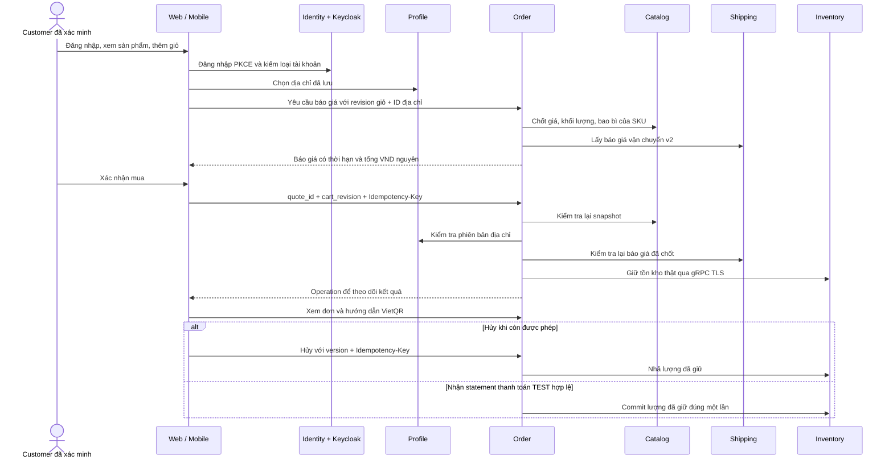

# Chạy và nghiệm thu luồng MVP

Bản tích hợp nối Identity trên `dev` (gồm #45, #48), Web #49, Catalog #19 và Mobile `0c0dd05`. Đọc bảng quyền tại [mvp_permissions.md](mvp_permissions.md). Mọi thay đổi đi qua PR vào `dev`.

## Luồng người dùng



Giỏ MVP mua toàn bộ các dòng hiện tại. Muốn bỏ món nào thì xóa khỏi giỏ trước khi lấy báo giá; chưa có checkout một tập con của giỏ. Báo giá mới là số tiền quyết định, giá trên màn hình giỏ chỉ phục vụ hiển thị. Thay giỏ, giá hoặc địa chỉ sau báo giá có thể buộc lấy báo giá mới. Khi mạng lỗi ở bước xác nhận, giữ cùng Idempotency-Key để hỏi lại kết quả, không tạo khóa mới để thử mua lần nữa.

Customer mới đăng ký được tạo qua outbox/Kafka sang Profile nhưng còn `PENDING_VERIFICATION`: sửa hồ sơ được, mua hàng và lưu địa chỉ nhận hàng còn bị chặn. Fixture cấp sẵn hai Customer ACTIVE để nghiệm thu; không tự xác minh mọi tài khoản mới.

Employee dùng các màn hình nội bộ. Có role CUSTOMER cũ hoặc có bản ghi Profile không làm Employee trở thành người mua. Web, Mobile, Identity proxy và API Profile/Order đều có chặn tương ứng.

## Bằng chứng tự động và giới hạn

`scripts/test-web-identity.py` tạo môi trường riêng với PostgreSQL, Redis, Kafka, Keycloak, Kong và chạy Identity, Profile, Catalog, Order, Inventory TLS, Shipping cùng Web. Không dùng DB đang làm việc của thành viên. Các phép kiểm gồm:

- Đăng ký lặp cùng khóa, xung đột nội dung, outbox/Kafka retry và Profile provisioning.
- Đăng nhập Web; Mobile PKCE với cookie state, callback trả JSON chỉ cho flow native đã được server lưu; refresh và logout.
- Employee có cả role CUSTOMER cũ vẫn bị từ chối mua hàng, kể cả gọi thẳng API bằng JWT.
- Catalog kiểm credential, giá chưa đến hiệu lực, sản phẩm chưa duyệt, snapshot bị đổi giá; tồn hiển thị đọc Inventory TLS thật.
- Địa chỉ Profile có mã tỉnh/phường và so sánh version khi sửa/xóa/chọn mặc định.
- Báo giá, xác nhận lặp cùng khóa, xem operation/đơn/payment instructions; hủy hoàn lại tồn; statement TEST commit tồn đúng một lần.
- Shipping v2 và lịch sử revision/event; kiểm quyền sở hữu đơn giữa hai Customer.
- Khi có `--flutter`: dùng chính repository Dart bật bởi `RepositoryFactory`, gọi API thật để xem sản phẩm, tìm kiếm, sửa địa chỉ, giỏ, báo giá, xác nhận, xem đơn và hủy.

Đây là MVP chạy trong sandbox. Catalog và báo giá Shipping là service thật; hãng vận chuyển là **FAKE**, packing và statement SePay là **provider TEST**, không chuyển tiền ngoài hệ thống. Chưa tích hợp mã Fulfillment đang được phát triển riêng, chưa nghiệm thu GHN/SePay ngoài môi trường thử nghiệm, chưa có bằng chứng Finance để mở COD/hoàn tất đơn COD. Order hiện chủ động từ chối khởi động ở production mode. Không coi test Dart chạy trên máy là nghiệm thu giao diện Android/iOS trên thiết bị.

## Chạy toàn bộ

Cần Docker đang chạy, Python có dependencies của `packages/contracts/mvp/requirements.txt`, Java 21, Gradle 9.2.0, Go 1.27.3, Node 22 và Flutter 3.44.9 (Dart 3.12.2). Chạy ở gốc repo:

```sh
python -m pip install -r packages/contracts/mvp/requirements.txt
cd apps/web-user
npm ci
cd ../mobile-app
flutter pub get
cd ../..
python scripts/test-web-identity.py --gradle gradle --flutter flutter
```

Có thể truyền đường dẫn executable bằng `--go`, `--java`, `--gradle`, `--flutter`. Windows cần `JAVA_HOME` trỏ Java 21. Kết quả ở `.system_generated/web-identity/result.json`; CI giữ result và build/test log đã chọn, không upload credentials.

Thêm `--keep-running` để giữ stack sau bài kiểm tra và xem Web. `ready.json` trong thư mục kết quả chứa URL và tài khoản tổng hợp riêng cho fixture; không commit/chia sẻ file này. Tạo file `stop` trong cùng thư mục để dừng và dọn các container/process của fixture. Nếu không có cờ này, script tự dọn sau khi chạy.

Kiểm tra nhanh riêng từng ứng dụng:

```sh
# apps/web-user
npm run verify:mvp
npm run build
# apps/mobile-app
flutter analyze --no-pub
flutter test --no-pub
# gốc repo
python packages/contracts/mvp/verify.py
```

## Cấu hình tích hợp

Fixture tự tạo cấu hình TEST. Nếu chạy service riêng, dùng `.env.example` của từng service và bổ sung:

| Thành phần | Cấu hình | Ý nghĩa |
|---|---|---|
| Order, Profile, Catalog | `IDENTITY_URL` | Origin Identity, để gọi `/api/v1/users/me` bằng JWT đã xác minh; Order/Profile yêu cầu HTTPS với chứng chỉ được tin cậy, ngoại lệ HTTP loopback chỉ dành cho fixture TEST |
| Order | `ORDER_AUTH_MODE=keycloak`, `ORDER_OIDC_ISSUER`, `ORDER_OIDC_AUDIENCE`, `ORDER_OIDC_JWKS_URL` | Kiểm chữ ký và ràng buộc JWT |
| Profile | `PROFILE_AUTH_MODE=keycloak`, các `PROFILE_OIDC_*` | Cùng issuer/audience phù hợp cấu hình Keycloak |
| Order | `ORDER_CATALOG_URL`, `ORDER_WAREHOUSE_ID`, `ORDER_QUOTE_CARRIER_CODE`, `ORDER_QUOTE_SERVICE_CODE` | Catalog nội bộ và tuyến kho/hãng/dịch vụ vận chuyển |
| Order / Catalog | `ORDER_INTERNAL_TOKEN` / `CATALOG_INTERNAL_TOKEN` | Cùng credential server cho snapshot HTTP, ít nhất 32 ký tự, không gửi xuống UI |
| Catalog | `HTTP_PORT=8006`, `GRPC_PORT=8005` | Kong gọi HTTP 8006; gRPC giữ cổng riêng |
| Catalog | `CATALOG_INVENTORY_TARGET`, `CATALOG_INVENTORY_TOKEN_FILE`, `CATALOG_INVENTORY_CA_FILE`, `CATALOG_INVENTORY_SERVER_NAME` | Đọc tồn hiển thị bằng TLS và credential nội bộ; lỗi đọc trả tồn chưa biết, không giả thành 0 |
| Order | Các `ORDER_SHIPPING_*`, `SEPAY_INVENTORY_*` theo runbook Order | TLS/credential tích hợp Shipping, Inventory; fixture chỉ cho Shipping loopback TEST không TLS |
| Identity | `CUSTOMER_API_GATEWAY_URL`, `FRONTEND_BASE_URL`, `AUTH_REDIRECT_URI` | BFF Web và callback public thống nhất với Keycloak |
| Identity | `KEYCLOAK_MOBILE_CLIENT_ID=mobile-app`, `KEYCLOAK_MOBILE_REDIRECT_URI=omama://auth/callback` | Bật callback native duy nhất đã đăng ký trong Keycloak; mặc định redirect native rỗng là tắt |

Web dùng `.env.identity.example`, giữ access/refresh token ở Identity; không trả bearer token cho JavaScript. Principal ID là định danh Identity, Customer ID là định danh Profile: phải tra ánh xạ thật, không lấy một ID thay cho ID kia.

Mobile bật backend thật bằng các define (thay URL/cổng theo môi trường):

```sh
flutter run --dart-define=DATA_SOURCE=backend --dart-define=AUTH_MODE=identity \
  --dart-define=API_BASE_URL=https://api.omama.vn \
  --dart-define=IDENTITY_BASE_URL=https://api.omama.vn/api/v1 \
  --dart-define=IDENTITY_AUTHORIZATION_ORIGINS=https://auth.omama.vn
```

Ứng dụng native dùng bearer token trong bộ nhớ/secure storage và cookie phiên khi refresh; không gửi bearer hết hạn kèm request refresh. Web callback chỉ redirect, native callback mới trả token JSON. Cookie state được giữ riêng tới callback để chống tráo phiên đăng nhập.

TEST loopback có thể thêm `IDENTITY_ALLOW_HTTP=true`. Khi chạy Android qua USB/emulator, có thể `adb reverse` cả cổng Gateway và Keycloak, dùng cùng host `127.0.0.1` như issuer fixture. Cần tự nghiệm thu deep link/trình duyệt và màn hình trên thiết bị; không đổi issuer tùy tiện sang IP khác. Không bật HTTP cho môi trường public.

## Contract Catalog bổ sung

[catalog-checkout.openapi.yaml](../03_api_specs/catalog-checkout.openapi.yaml) mô tả adapter HTTP nội bộ mới. Proto canonical `omamx.catalog.v1.CatalogService.GetCheckoutSnapshot` cũng được triển khai; không suy ra rằng mọi method legacy khác của service này đã có implementation.

Public HTTP cung cấp `/api/v1/categories`, `/products`, `/products/search`, `/products/{slug}`, `/products/variants/{sku}` theo DTO snake_case của Web. Mobile được hỗ trợ alias `q`/`query`, `pageSize`/`page_size`; truyền hai giá trị khác nhau bị 400. Giá public vẫn là Money object; giá checkout là VND nguyên. `stock_available: null` nghĩa là chưa biết, không phải hết hàng. Inventory reserve mới quyết định có giữ được hàng hay không.

Snapshot lưu bền ID, channel, payload và thời hạn. `catalog_version` là fingerprint int64 để **so sánh bằng**, không dùng làm số thứ tự tăng dần. Giá/metadata chốt cùng transaction; giá tương lai không được lấy. Revalidate sai khi snapshot hết hạn, giá hoặc trạng thái thay đổi. Báo giá mua từ Order hiện dùng bảng giá `D2C_WEB` chung cho cả hai giao diện; chưa cung cấp lựa chọn bảng giá riêng theo Mobile. Không tự mở nhiều channel giá trước khi chốt contract Order.
