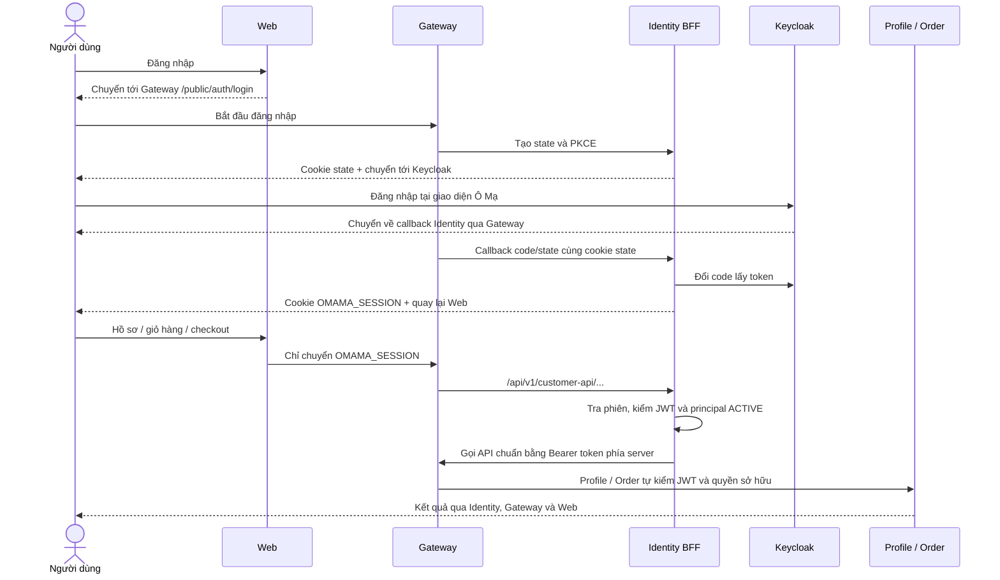

# Đồng bộ MVP theo Identity của PR #45

Nguồn chuẩn cho đăng nhập là PR #45 của `hvduong2k5`, người phụ trách Identity. Bản tích hợp này ghép phần Customer/Order của #43/#44 vào hướng đó. Không merge nguyên ba PR độc lập: phần tích hợp cũ quản lý token ở Web đã được thay bằng phiên do Identity quản lý.

## Những điểm đã đổi theo owner

- Endpoint, cookie và callback theo `docs/03_api_specs/frontend-auth-contract.md`: `/api/v1/public/auth/login`, `callback`, `session`, `tokens/refresh`, `logout` và `OMAMA_SESSION`.
- Identity giữ access/refresh token trong `BffSessionStore`. Web không tạo/lưu các cookie token `oma_access_token`/`oma_refresh_token` ở chế độ mới. Helper có tên cũ `getTrustedAccessToken` chỉ mang session ID opaque trong mode này; header gửi đi là Cookie, không phải Bearer.
- `/api/v1/customer-api/...` là adapter tài nguyên của Identity BFF để phiên cookie dùng được với Profile/Order đang nhận JWT. Adapter chỉ chuyển các đường dẫn Customer cho hồ sơ/địa chỉ, capabilities, cart, checkout, operation, order và payment đọc. Nó không cho URL tùy ý, admin/internal, không chuyển header định danh do browser gửi, không trả token hoặc cookie của upstream. Profile/Order vẫn tự kiểm JWT và ownership.
- Web vẫn giữ các URL `/api/auth/*` để UI hiện tại gọi, nhưng chúng là adapter tới Identity. `/api/auth/oidc/login` chỉ chuyển hướng tới Identity; Web không đổi authorization code. Catalog công khai đi qua route Catalog thông thường tại Gateway.
- Callback phải có state khớp cookie của chính trình duyệt. Cookie mutation phải có Origin đúng `FRONTEND_BASE_URL`; Web cũng kiểm Origin theo `WEB_PUBLIC_URL`. Return URL chỉ thuộc origin Frontend được cấu hình.
- Giữ validation đăng ký, HMAC fingerprint do server tính, transaction/outbox, retry Kafka và Customer pending chỉ được sửa hồ sơ. Việc hợp nhất theo owner không tự cấp quyền mua cho Customer chưa xác minh.

## Cấu hình

Web dùng `apps/web-user/.env.identity.example`. Identity dùng `.env.example` của service, bổ sung `CUSTOMER_API_GATEWAY_URL` là origin Gateway nội bộ có thể gọi được. Không đặt URL này trỏ ngược vào `/customer-api`; adapter gọi các route chuẩn `/api/v1/profile`, `/cart`, `/orders`, ...

`AUTH_REDIRECT_URI` phải đúng callback Identity công khai và có trong redirect URI của Keycloak. `KEYCLOAK_PUBLIC_URL` là URL trình duyệt tới Keycloak; issuer của Identity/Profile/Order phải khớp issuer thực. Giữ `KEYCLOAK_SCOPE=openid` theo owner. Chỉ thêm `profile email` khi realm đã có và gán các client scope đó; realm import hiện tại không mặc định cung cấp chúng. Giữ mapper `user_id`, audience `omama-api`, CUSTOMER role và quyền admin Keycloak theo cấu hình đã nghiệm thu.

Khi Web và Gateway ở `omama.vn` / `api.omama.vn`, dùng cookie domain `.omama.vn`, HTTPS và `COOKIE_SECURE=true`. Nếu dùng host khác nhau không cùng miền, cần bố trí ingress/cookie phù hợp; không đưa token ra JavaScript để xử lý. Fixture dùng cùng host loopback, khác port, cookie không Secure riêng cho TEST.

Session/state của owner hiện ở bộ nhớ một Identity instance. Restart sẽ mất phiên; MVP chạy một instance. Chưa nghiệm thu nhiều replica hoặc lưu phiên bền bằng Redis. Không tuyên bố đạt production chỉ vì test local pass.

## Kiểm tra và phạm vi

Chạy `npm run verify:mvp` và `npm run build` tại Web; chạy `python scripts/test-web-identity.py --gradle gradle` từ gốc repo. Script dùng Identity #45, theme Ô Mạ, cookie phiên, PKCE callback của Identity và kiểm lại cả bốn luồng Customer/Order. Kết quả nằm trong `result.json`/CI; không commit `ready.json`, cookie hay mật khẩu.

Phạm vi còn giữ như #44: Catalog/terms, statement SePay, packing dùng provider TEST; hãng vận chuyển FAKE. Không thay thế nghiệm thu Catalog, Fulfillment, SePay/GHN bên ngoài, xác minh Customer lên ACTIVE hoặc mobile runtime.

PR tích hợp phải được review cùng owner Identity. Sau khi merge #45 vào dev, rebase/retarget PR tích hợp về dev, chạy lại CI rồi merge qua review. #43/#44 được thay thế bởi bản tích hợp này; không merge chúng thêm lần nữa sau khi bản mới đã vào dev.
