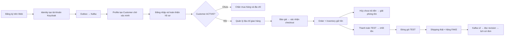

# Kiểm tra bốn luồng Customer – Order – Inventory – Shipping

Nhánh này nối tiếp PR #43. Không push trực tiếp `dev`; chỉ merge sau review và CI. Tài liệu phân biệt phần code đã nối với phần đã có bằng chứng chạy thành công trong `result.json` của CI.

## Người dùng đi qua những bước nào?



`principal` là tài khoản Identity, `Customer` là hồ sơ mua hàng. Hai ID khác nhau. `PENDING_VERIFICATION` có nghĩa hồ sơ tồn tại nhưng chưa được xác minh; nhập số điện thoại không tự biến hồ sơ thành ACTIVE.

## Luồng 1: hồ sơ và địa chỉ

Web đi qua Gateway tới Profile thật. Bài kiểm tra sửa hồ sơ, từ chối version cũ, lấy danh mục khu vực, thêm hai địa chỉ, đổi mặc định, sửa/xóa với `If-Match` và từ chối tài khoản khác đọc/sửa/xóa/chọn mặc định địa chỉ đó. Xóa địa chỉ mặc định phải chọn lại đúng một địa chỉ còn lại.

`GET /api/v1/locations/checkout` lấy từ chính bảng `administrative_units` mà Profile dùng kiểm tra quan hệ tỉnh–phường khi ghi địa chỉ. Không suy mã từ tên và không dùng một danh sách khác trong UI. Dataset hiện có trong migration là dữ liệu dự án; trước rollout team phải rà soát/import bộ mã và phạm vi giao hàng được chấp thuận. Bài TEST bổ sung một phường có nhãn Synthetic TEST, không coi là dữ liệu hành chính quốc gia.

## Luồng 2: đăng ký và tạo Customer

Trong OIDC mode, form đăng ký dùng **email bắt buộc**, họ/tên và mật khẩu 12–128 ký tự, gọi Identity qua BFF/Gateway. Không dùng form đăng ký bằng số điện thoại của mock cũ và không trả token sau đăng ký. Sau khi tạo tài khoản, người dùng đăng nhập qua PKCE.

Identity tự tính HMAC fingerprint từ payload; bỏ qua fingerprint do client gửi. Khóa `IDENTITY_REGISTRATION_FINGERPRINT_KEY` phải có ít nhất 32 bytes, giữ ổn định giữa replicas. Đổi khóa làm mất khả năng so sánh các yêu cầu đăng ký cũ; cần kế hoạch rotation riêng. Giữ cùng idempotency key và payload khi retry; đổi payload với key cũ nhận 409. Hai yêu cầu đồng thời chỉ được gọi Keycloak một lần.

Khởi tạo principal/operation và hoàn tất principal/operation/outbox nằm trong các transaction thực sự. Test lỗi ghi outbox phải rollback cả activation lẫn trạng thái operation. Nếu crash sau khi Keycloak tạo tài khoản nhưng trước khi finalize DB, operation còn PENDING; không tự tạo lại bằng key mới. Recovery/reconciliation cho cửa sổ này vẫn cần quy trình vận hành, chưa tuyên bố tự động khôi phục mọi lỗi liên hệ thống.

Profile nhận event thật từ Kafka và tạo Customer một lần. Khi DB lỗi tạm thời, consumer giữ và retry chính message đang lỗi, không fetch/commit message sau làm mất event trước. Customer mới chỉ có `PROFILE_MANAGE`; địa chỉ, giỏ hàng và checkout vẫn chặn. Không có bước tự xác minh điện thoại hay tự cấp ACTIVE.

Fixture tắt `verifyEmail` riêng trong realm TEST để kiểm tra provisioning và PKCE không cần email server. Realm production vẫn giữ xác minh email; email delivery và quy trình cấp trạng thái Customer ACTIVE chưa được nghiệm thu ở đây. Client admin cần các quyền quản trị được cấp qua `realm-management`; fixture dùng realm-admin trong realm tạm, không dùng credential production.

## Luồng 4: Web checkout – Order – Inventory

Web dùng `Idempotency-Key`, truyền revision và `If-Match` khi xóa giỏ. Order nhận tên header chuẩn và giữ tương thích `X-Idempotency-Key`; hai header khác giá trị bị từ chối. Lặp checkout cùng key phải trả cùng operation và đúng một Order.

Địa chỉ Profile sinh UUID v7. Web phải nhận dạng UUID này khi gửi `shipping_address_id`; không chỉ cho UUID v1–v5. Bài tích hợp lấy địa chỉ mặc định thật từ Profile cho checkout, kiểm cả version và ownership của nguồn địa chỉ. Đã kiểm thêm bằng trình duyệt: lưu hồ sơ, thêm địa chỉ mặc định, từ Cart qua Checkout nhận báo giá 32.000 VND cho SKU TEST và xác nhận tạo Order PENDING_PAYMENT; lịch sử/detail hiển thị riêng đơn đã hủy và đơn đã giao. Đây vẫn là hàng/giá TEST, không phải chứng nhận Catalog thật.

BFF yêu cầu representation `Accept: application/vnd.omama.customer-mvp+json, application/json`. Order chuyển dữ liệu canonical sang DTO public đã pin: quote, trạng thái/stage operation, lịch sử/detail và cancellation. Representation canonical cũ được giữ cho consumer hiện có. Đây là chuyển đổi dữ liệu đọc; không thay đổi snapshot lưu trữ hay bỏ qua policy/ownership. Operation có `updated_at` do DB ghi mỗi lần thay đổi. Response có `Vary: Accept`.

Inventory dùng provider terminal thật, gRPC TLS, token riêng, PostgreSQL thật. Bài kiểm tra tạo đơn chưa trả tiền rồi hủy và giải phóng tồn; tạo đơn thứ hai, nhận chứng từ TEST, chốt tồn đúng một lần. Số lượng tồn/outbox cần được kiểm riêng, không chỉ dựa vào chữ thành công trên UI.

Catalog, terms/revalidation và nguồn statement SePay trong fixture vẫn là provider TEST. Không gửi tiền thật. Chưa nghiệm thu Catalog PR #19 hoặc kết nối SePay sandbox bên ngoài. Đơn hàng sau khi đã đặt dùng snapshot bất biến; snapshot public trong lịch sử là projection để đọc, không phải quote mới được dùng lại.

## Luồng 5: Shipping và lịch sử đơn

Order đăng ký consumer riêng cho `shipping.events.v2`. Kafka chỉ thông báo có thay đổi; adapter gọi `GetShipmentRevision(shipment_id, resource_version)` tới Shipping, kiểm đúng Order, kind, generation và thời điểm rồi mới đưa vào xử lý Order. Seal lấy từ revision của provider. Không lấy trạng thái hiện tại để giả revision cũ và không suy rằng giao hàng đồng nghĩa đã quyết toán COD.

Cấu hình Order:

```dotenv
ORDER_SHIPPING_GRPC=shipping-service:9012
ORDER_SHIPPING_TOKEN_FILE=/run/secrets/order-shipping-token
ORDER_SHIPPING_CA_FILE=/run/secrets/shipping-ca.pem
ORDER_SHIPPING_SERVER_NAME=shipping.internal
```

Shipping hỗ trợ `SHIPPING_GRPC_TLS_CERT_FILE` và `SHIPPING_GRPC_TLS_KEY_FILE`. Nếu đã chỉ định TLS mà file không hợp lệ thì không khởi động. Chế độ TEST có `ORDER_SHIPPING_ALLOW_LOCAL_INSECURE=true` chỉ cho địa chỉ loopback cụ thể, không cho hostname service hay IP mạng. Không dùng cờ này khi deploy.

Shipping service, PostgreSQL, outbox và Kafka chạy thật; hãng vận chuyển là `FAKE`. Đóng gói do fixture TEST tạo bằng chứng cho Order, chưa nghiệm thu Fulfillment service. Bài kiểm tra shipment → bàn giao → webhook có chữ ký → DELIVERED → lịch sử/tracking; webhook sai chữ ký và truy cập đơn của tài khoản khác bị chặn. Địa chỉ nội bộ hỗ trợ tỉnh/phường mà không bịa district. GHN staging và ánh xạ địa chỉ riêng của GHN vẫn cần nghiệm thu riêng.

Tracking public hiện chỉ có `shipment_id` và `order_status`. UI không tự dựng timeline/carrier ngoài contract. `DELIVERED` là đã giao, chưa phải `COMPLETED`; completion/Care/Finance/COD settlement vẫn giữ policy và gate hiện có.

## Chạy và đọc bằng chứng

```sh
python -m pip install -r packages/contracts/mvp/requirements.txt
cd apps/web-user
npm ci
npm run verify:mvp
cd ../..
python scripts/test-web-identity.py --gradle gradle
```

Cần Docker, Node 22, Go 1.27.3, Java 21 và Gradle 9.2.0. Có thể truyền `--go`, `--java`, `--gradle`. `--keep-running` giữ stack riêng để xem UI; tạo file `.system_generated/web-identity/stop` để dừng. Secret/account test chỉ lưu trong thư mục ignored, không commit/upload `ready.json` hay realm/cookie. CI chỉ upload kết quả và log build đã chỉ định.

Không đổi registry toàn MVP thành verified chỉ vì bốn bài này pass. Các phần chưa nghiệm thu gồm xác minh/onboarding tới ACTIVE, Catalog thật, Fulfillment thật, GHN staging, statement SePay bên ngoài, Care/Finance/completion và mobile runtime.
