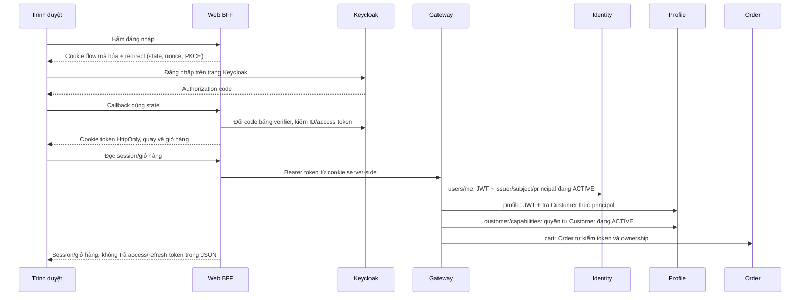

# Nối Web – Identity – Gateway – Profile – Order

## Thay đổi cho luồng người dùng

Khi bật `WEB_AUTH_MODE=oidc`, khách bấm **Tiếp tục đăng nhập** trên Web, nhập thông tin tại Keycloak và được đưa về cửa hàng. Web giữ token trong cookie HttpOnly, xác minh token và đối chiếu hồ sơ Customer từ backend trước khi cho đọc Profile/giỏ hàng. Làm mới phiên dùng refresh token; đăng xuất chuyển sang Keycloak để kết thúc cả phiên SSO.



Ba ID có ý nghĩa khác nhau: `sub` là tài khoản Keycloak, `user_id` là principal bất biến của Identity, còn `Profile.id` là Customer. Không lấy Customer ID bằng cách sao chép `sub`/`user_id`. Identity tra DB theo **issuer + subject**, kiểm principal ACTIVE và khớp `user_id`. Profile tự kiểm JWT rồi tra Customer bằng `user_id`. Web đối chiếu cả hai kết quả; thiếu hoặc lệch mapping thì chặn.

## Cấu hình môi trường thật

Web dùng `apps/web-user/.env.oidc.example` làm mẫu. Hai upstream đều trỏ cùng Gateway base `/api/v1`; không đưa token/JWKS secret/credential nội bộ ra biến `NEXT_PUBLIC_*`.

```dotenv
WEB_AUTH_MODE=oidc
WEB_PUBLIC_URL=https://omama.vn
WEB_OIDC_ISSUER=https://keycloak.omama.vn/realms/omama
WEB_OIDC_CLIENT_ID=frontend-web
WEB_OIDC_API_AUDIENCE=omama-api
WEB_OIDC_COOKIE_SECRET=<ngẫu nhiên, ít nhất 32 bytes; đồng nhất giữa Web replicas>
WEB_OIDC_ALLOW_LOCAL_HTTP=false
CUSTOMER_CORE_UPSTREAM_URL=http://gateway:8000/api/v1
CUSTOMER_EXTENSIONS_UPSTREAM_URL=http://gateway:8000/api/v1
```

Keycloak client `frontend-web` phải là **public client**, Standard Flow bật, PKCE S256 bắt buộc, Direct Access Grants tắt. Đăng ký chính xác redirect URI `https://omama.vn/api/auth/oidc/callback` và post-logout URI `https://omama.vn/api/auth/oidc/logged-out`; không dùng wildcard cho deployment. Duy trì `audience-scope` và `order-customer` từ realm template để access token có `omama-api`, `order-api`, role CUSTOMER và `user_id` từ `app_user_id`. Web chỉ yêu cầu scope `openid`, không phụ thuộc realm có công bố scope profile/email riêng.

Identity thêm kiểm audience `IDENTITY_OIDC_AUDIENCE` (mặc định `omama-api`) cùng issuer/signature/expiry của resource server. Chỉ Identity mới quản lý liên kết subject→principal và trạng thái principal. `/users/me` không trả principal thuộc realm khác hoặc principal đang bị đình chỉ.

Profile vẫn cần `PROFILE_INTERNAL_TOKEN` cho các lời gọi nội bộ hiện có. Bật public bearer profile bằng:

```dotenv
PROFILE_AUTH_MODE=keycloak
PROFILE_OIDC_ISSUER=https://keycloak.omama.vn/realms/omama
PROFILE_OIDC_AUDIENCE=omama-api
PROFILE_OIDC_JWKS_URL=https://keycloak.omama.vn/realms/omama/protocol/openid-connect/certs
PROFILE_OIDC_ALLOW_LOCAL_HTTP=false
```

Các URL OIDC phải dùng HTTPS. Cờ cho HTTP chỉ dành cho fixture loopback (`localhost`/`127.0.0.1`), không vô hiệu kiểm TLS với hostname bất kỳ. Cấu hình OIDC sai không tự chuyển về internal/sandbox. Nếu đã gửi Bearer sai, Profile không thử lại bằng credential/header nội bộ.

Gateway chuyển `/api/v1/users/me` tới Identity và `/api/v1/profile`, `/api/v1/customer/capabilities` tới Profile. Nó loại `X-User-ID`, `X-User-Role`, `X-Internal-Token` và các header định danh nội bộ khỏi request public. Profile tự xác minh JWT; plugin JWT HS256 fixture cũ không cấp quyền cho public Profile. Các route admin khác không được nghiệm thu trong lát cắt này.

Order tiếp tục cấu hình Keycloak hiện có với audience `order-api`; credential Order→Profile được dùng qua kết nối nội bộ trực tiếp, không qua route public đã strip header.

## Capabilities và trường hợp bị chặn

API support mới là `GET /api/v1/customer/capabilities`, contract tại `docs/03_api_specs/customer-access.support.openapi.yaml`. Profile là owner: Customer có mapping ACTIVE nhận các quyền Customer cơ bản; Customer inactive có danh sách rỗng, không có mapping trả 403. Danh sách quyền không chứng minh provider đã sẵn sàng, không bật COD/voucher/guest/B2B hay quyền nhân viên/tài chính.

Employee không có realm role CUSTOMER vẫn có thể có session Identity, nhưng chưa được dùng Customer features trong lát cắt này. Employee có CUSTOMER role còn phải có mapping Customer hợp lệ. Không tự nâng quyền từ role/header do browser gửi.

`WEB_AUTH_MODE=legacy` chỉ phục vụ các mock feature local cũ, bị từ chối trong production. OIDC mode không gọi lại password-login proxy khi provider lỗi. Form đăng ký/recovery cũ chưa được nối trong lát cắt này; không dùng password grant để né luồng PKCE.

## Chạy kiểm tra hai phía

Từ repository root, cần Docker, Node 22/npm, Go 1.27.3, Java 21, Gradle 9.2.0 và dependency Web đã cài:

```sh
cd apps/web-user
npm ci
npm run verify:mvp
cd ../..
python scripts/test-web-identity.py --gradle gradle
```

Có thể chỉ rõ `--go`, `--java`, `--gradle`. Script tạo riêng PostgreSQL/Redis/Keycloak/Kong, schema Identity/Profile và hai tài khoản test; build Identity/Profile từ source, chạy Web thật và Order handler thật. Nó chỉ thay upstream host/port trong bản copy Kong cho fixture, giữ route/plugin thật. Không dùng Mockoon, không gọi ngân hàng hay hệ thống chia sẻ. Cookie/credential test lưu trong `.system_generated/web-identity/`, không commit/upload các file đó.

Các assertion kiểm: PKCE/callback/state/nonce, session không lộ token, mapping Customer khác principal, hai tài khoản có giỏ hàng riêng, Profile, capabilities, refresh/logout, CSRF và header giả. `--keep-running` giữ fixture để xem bằng trình duyệt; tạo file `stop` trong output directory để dừng. CI `web-identity.yml` chạy lại regression Web/Profile/Identity và bài này; một số test có fixture riêng vẫn SKIP trong lượt chạy thông thường, không được coi là nghiệm thu live.

Đã chạy local ngày 31/10/2026: Web typecheck/lint và 97 tests PASS, production build PASS; Profile 109 test/subtest PASS (Kafka delivery fixture SKIP), JWT/middleware race checks PASS. Bài thực chạy hai tài khoản khác nhau; đã thử thêm trên trình duyệt thật: Web login → Keycloak → Cart của tài khoản → Profile → logout → Keycloak yêu cầu đăng nhập lại. Giỏ test có SKU seed riêng, không dùng làm bằng chứng Catalog/đặt đơn.

Web nhận thời hạn session dưới dạng metadata không bí mật để tự gọi lại `/auth/me` trước khi token hết hạn; BFF refresh trong cửa sổ 30 giây cuối. Các request refresh đồng thời trong cùng process được gộp, không tự retry mutation nghiệp vụ. Identity/Customer bị đình chỉ vẫn bị chặn dù JWT chưa hết hạn, qua bước đối chiếu backend trước hành động của BFF.

## Giới hạn và phần tiếp theo

Đây là lát cắt **đăng nhập → session → Profile → Cart**, chưa phải mua hàng trọn vẹn. Cart test được seed để chứng minh ownership và adapter, không lấy sản phẩm từ Catalog. Identity account và Customer test được seed qua API/DB trong fixture, không chứng minh registration/outbox provisioning từ UI. Môi trường Profile dùng Vault mock riêng cho mã hóa PII fixture; không nghiệm thu Vault/Kafka delivery hay staff API.

Catalog vẫn chưa có implementation trong dev; cần review/ghép PR #19 và adapter snapshot/giá/version. Sau đó nối Shipping quote, terms/revalidate, bật Inventory terminal trong cấu hình TEST chung và chạy UI quote→accept→poll→Order→VietQR TEST. COD/voucher/guest/paid cancellation vẫn giữ gate. Registry của toàn bộ MVP chưa được đổi thành verified.

Refresh có gộp các request đồng thời trong một process Web; khi vận hành nhiều replica cần thống nhất chính sách refresh-token reuse/rotation hoặc dùng session coordination chung. Cookie key rotation làm session cũ hết hiệu lực; không tắt kiểm nonce/state để giữ session qua đổi key.
