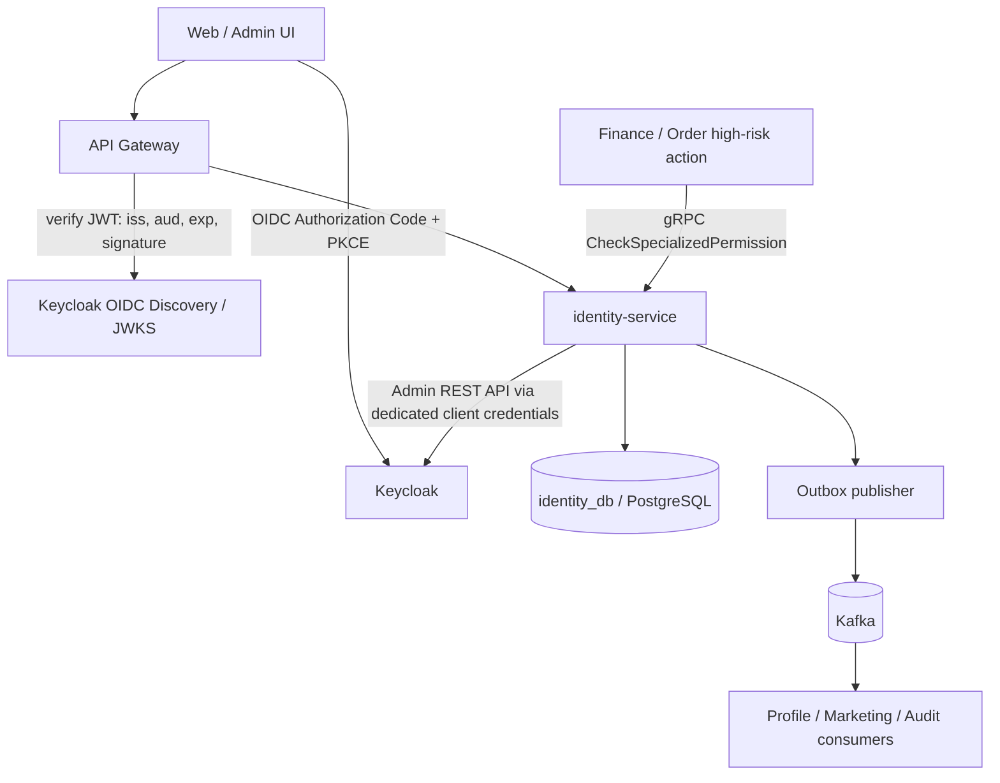

# Identity Service — Architecture

## Component responsibilities

## Identity ownership

### Keycloak owns
- Credentials and password policies.
- OIDC login, MFA / required actions where configured, browser session, logout, refresh-token lifecycle and password reset.
- Account enabled/disabled flag and federated/social identities.
- Signing keys and OIDC discovery/JWKS.
- Coarse roles and client scopes used by ordinary API authorization.

### identity-service owns
- `principal_id` mapping to Keycloak subject and provisioning workflow state.
- Registration/invitation orchestration, idempotency metadata and reconciliation records.
- Fine-grained role assignment with scope/time constraints, specialized permission policies and decision/audit history.
- Domain event outbox and the custom REST/gRPC contracts that have been explicitly approved.

### Domain services own
- Profile fields → Profile Service.
- Order ownership, guest order grants, cancellation eligibility → Order Service.
- Guest session/cart → Checkout/Cart domain.
- Stock holds → Inventory Service.
- Ticket access → Support Service.

## Registration flow

1. Create `identity_principals` with a pre-generated `principal_id` and `provisioning_status=PENDING`; create `registration_operations` with idempotency metadata in one local transaction.
2. Create user through Keycloak Admin REST API. Do not store password in `identity_db`; use Keycloak-required actions/verification flow.
3. Set restricted Keycloak attribute `app_user_id=<principal_id>` and `app_registration_operation_id=<operation_id>` so claims and reconciliation can correlate records.
4. After Keycloak returns the external subject, update `idp_subject`, set provisioning state `ACTIVE`, insert `UserRegistered` outbox event, and mark operation completed in one local DB transaction.
5. Profile consumes the versioned event idempotently. Identity does not write Profile's database.
6. A reconciliation job handles the failure window where Keycloak user creation succeeded but the local update failed. Never compensate by deleting an account unless the business policy explicitly permits it.

External Keycloak + PostgreSQL cannot commit as one ACID transaction. Treat this as an idempotent saga with observable states and reconciliation.

## Authentication and internal calls

- Frontend uses OIDC Authorization Code + PKCE. The frontend does not call a custom endpoint that accepts username/password and locally issues a JWT.
- Gateway and each exposed service validate JWT locally using issuer/audience/signature/expiry and a cached JWKS. Do not call Identity synchronously to validate every normal request.
- `CheckSpecializedPermission` is only for designated high-risk decisions. Define canonical action names, context schema, timeout and fail-closed behavior before implementation.
- Downstream services trust identity context only from an authenticated internal caller; Gateway removes/replaces spoofable inbound `X-User-*` headers.
- Service-to-service authentication is separate from the end-user identity: use unique service credentials/tokens and TLS/mTLS as required.

## Token claims (proposed)

- `iss`: exact Keycloak realm issuer.
- `sub`: Keycloak external subject.
- `user_id`: stable internal UUID from the protected `app_user_id` attribute mapper.
- `aud`: specific API audience (for example `catalog-api`, `order-api`); do not reuse a token for unrelated audiences.
- `scope`/role claims: coarse grants only. Scope-specific/time-limited staff authorization is evaluated by IAM policy where required.

## Failure policy

- Login/password reset depend on Keycloak availability.
- Requests with a valid JWT may continue while the verifier's JWKS cache and token validation policy allow it; new/unknown key IDs must follow a defined refresh/failure path.
- High-risk authorization fails closed on evaluator timeout/unavailability unless an explicit risk-approved ADR says otherwise.
- Kafka failures do not roll back a completed external login; use transactional outbox for domain events and retry/DLQ. Do not put secrets in events.
