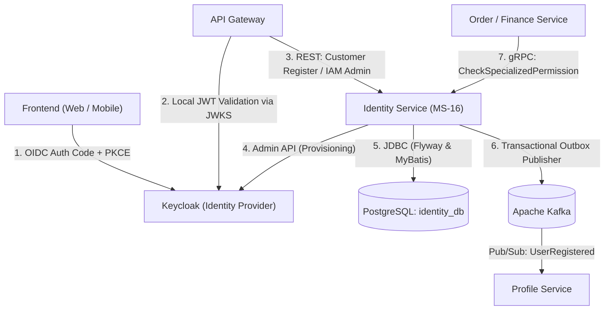
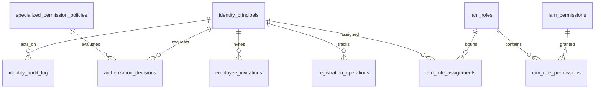

# BÁO CÁO CÔNG VIỆC TUẦN
### Dự án PBL6: Hệ thống Thương mại Điện tử Đặc sản Huế "Mè Xửng O Mạ"

* **Họ và tên:** Hoàng Văn Dương
* **MSSV:** 102230288
* **Lớp:** 22T_DT2
* **Tuần thực hiện:** Tuần 09
* **Phân hệ phụ trách:** Identity Service (MS-16)

---

## 1. MỤC TIÊU TRONG TUẦN
1. **Thiết kế & Quy hoạch kiến trúc:** Quy hoạch ranh giới dữ liệu giữa Keycloak và Identity Service; chuẩn hóa Layered Architecture (API, Application, Domain, Infrastructure).
2. **Tích hợp Cơ sở dữ liệu:** Khởi tạo PostgreSQL schema với 5 migration script (Flyway V1–V5), thiết lập MyBatis Mapper và cấu hình TypeHandler cho UUID.
3. **Tích hợp Identity Provider (Keycloak):** Cấu hình Spring Security OAuth2 Resource Server xác thực JWT; tích hợp Keycloak Admin Client SDK cho luồng provisioning tài khoản.
4. **Hiện thực hóa Core Logic:**
   - Luồng đăng ký tài khoản có tính idempotent và Transactional Outbox.
   - Quản lý phân quyền IAM có phạm vi (Scoped Role Assignment) và thời hạn cho nhân viên nội bộ (`EMPLOYEE`).
   - Xây dựng gRPC Service Adapter (`CheckSpecializedPermission`) cho các quyết định quyền đặc biệt (ABAC/PBAC) có rủi ro tài chính cao.
   - Cài đặt worker nền `OutboxPublisher` phát sự kiện qua Kafka và quy trình mời nhân viên (`EmployeeInvitation`).
5. **Kiểm thử tự động:** Xây dựng bộ Unit Test & Integration Test đạt độ bao phủ cao cho toàn bộ các layer.

---

## 2. CÔNG VIỆC ĐÃ THỰC HIỆN

### 2.1. Khởi tạo dự án & Chuẩn hóa cấu hình Build
- Cấu hình dự án trên nền tảng **Java 21** và **Spring Boot 3.3.4**, quản lý phụ thuộc bằng Gradle Wrapper.
- Tích hợp `com.google.protobuf (0.9.4)` và bộ thư viện `grpc-server-spring-boot-starter (3.1.0)`, `grpc-protobuf (1.62.2)`, liên kết trực tiếp với thư viện hợp đồng dùng chung `packages/proto`.

### 2.2. Tầng lưu trữ (Persistence) & Quản lý Schema Database (Giai đoạn 1)
- Xây dựng và thực thi thành công 5 script Flyway Migration (`V1` đến `V5`):
  - `V1`: Khởi tạo bảng `identity_principals`, `registration_operations`, `employee_invitations`.
  - `V2`: Thiết lập mô hình RBAC/IAM gồm `iam_roles`, `iam_permissions`, `iam_role_permissions`, `iam_role_assignments`.
  - `V3`: Xây dựng chính sách versioned `specialized_permission_policies` và bảng ghi nhận phán quyết `authorization_decisions`.
  - `V4`: Thiết lập bảng ghi nhật ký kiểm toán bất biến `identity_audit_log`.
  - `V5`: Thiết lập bảng sự kiện giao dịch `outbox_events`.
- Xây dựng `UuidTypeHandler` tùy biến cho MyBatis để giải quyết triệt để tương thích kiểu `java.util.UUID` trên PostgreSQL.
- Định nghĩa các file Mapper XML với `<resultMap>` tường minh, chống lỗi mapping thuộc tính.

### 2.3. Tích hợp Keycloak & Security (Giai đoạn 2)
- Cấu hình `SecurityConfig` theo mô hình Stateless OAuth2 Resource Server: xác thực JWT thông qua JWKS URI của Keycloak, phân tách quyền truy cập giữa `/api/v1/public/**` và `/api/v1/admin/**`.
- Cấu hình `KeycloakAdminClient` giao tiếp an toàn với Keycloak Admin REST API sử dụng Client Credentials Grant riêng biệt.
- Xây dựng tài liệu mẫu `realm-export.template.json` phục vụ tự động hóa triển khai Realm `omama`.

### 2.4. Đăng ký tài khoản Idempotent & Transactional Outbox (Giai đoạn 3)
- Triển khai `RegistrationOrchestrator`:
  - Kiểm tra trùng lặp qua `idempotencyKey` và `requestFingerprint`.
  - **Tách biệt transaction:** Khởi tạo trạng thái `PENDING` trong database cục bộ $\rightarrow$ Gọi Keycloak Admin API tạo User $\rightarrow$ Cập nhật trạng thái `ACTIVE` và ghi sự kiện vào `outbox_events` trong transaction cục bộ mới. Đảm bảo không giữ kết nối database khi gọi API bên ngoài.

### 2.5. Phân quyền IAM Nhân viên có Phạm vi (Giai đoạn 4)
- Xây dựng `RoleAssignmentService` và `IamAssignmentController`:
  - Thực thi ràng buộc nghiệp vụ: Chỉ cho phép gán quyền cho chủ thể có loại `EMPLOYEE`.
  - Hỗ trợ phân quyền đa phạm vi: `GLOBAL`, `WAREHOUSE`, `STORE`, `REGION`, `DEPARTMENT`...
  - Bắt buộc `scopeId` khi gán quyền phi-Global; kiểm soát thời hạn hiệu lực (`validFrom`, `validUntil`).

### 2.6. Thẩm duyệt Phân quyền động qua gRPC (Giai đoạn 5)
- Triển khai gRPC Adapter `IdentityGrpcService` kế thừa `IdentityServiceGrpc.IdentityServiceImplBase`.
- Xây dựng `SpecializedPermissionService` đánh giá chính sách động (ABAC/PBAC):
  - Hạn mức hoàn tiền (`AMOUNT_THRESHOLD`): Ví dụ kiểm tra `refund_amount` vượt 10.000.000 VND sẽ yêu cầu cấp duyệt cao hơn (`DIRECTOR_APPROVAL_REQUIRED`).
  - Tỷ lệ chiết khấu B2B (`PERCENT_THRESHOLD`): Ví dụ kiểm tra `discount_percentage` vượt 25%.
  - Áp dụng nguyên tắc **Fail-closed**: Mặc định từ chối (`is_allowed = false`) khi không tìm thấy policy hoặc xảy ra sự cố nội bộ.
  - Tự động ghi nhận phán quyết vào `authorization_decisions` và nhật ký kiểm toán `identity_audit_log`.

### 2.7. Worker Outbox, Audit & Lời mời nhân viên (Giai đoạn 6 & 7)
- **`OutboxPublisher`:** Cài đặt background worker quét định kỳ bảng `outbox_events` với cơ chế Exponential Backoff Retry để phát sự kiện lên Kafka `identity.events.v1`.
- **`AuditService`:** Module ghi nhật ký kiểm toán độc lập (`Propagation.REQUIRES_NEW`), ghi vết toàn bộ hành vi bảo mật và thay đổi IAM.
- **`EmployeeInvitationService`:** Điều phối quy trình gửi lời mời nhân viên nội bộ, chấp nhận và thu hồi lời mời.

---

## 3. KẾT QUẢ VÀ SẢN PHẨM BÀN GIAO

1. **Mã nguồn hoàn chỉnh:** Module `services/identity-service` biên dịch sạch sẽ (`gradlew compileJava` thành công 100%), tuân thủ tuyệt đối chuẩn package `com.hvduong.identity`.
2. **Bộ hợp đồng gRPC:** Sinh mã tự động từ `packages/proto/identity/v1/identity.proto` và `packages/proto/common/v1/`.
3. **Kết quả kiểm thử tự động (16/16 tests PASS 100%):**

| Nhóm kiểm thử | Loại kiểm thử | Số lượng test | Kết quả |
|---|:---:|:---:|:---:|
| `SpecializedPermissionServiceTest` | Unit Test | 5 | ✅ PASS |
| `IdentityGrpcServiceTest` | Unit Test (gRPC) | 3 | ✅ PASS |
| `RoleAssignmentServiceTest` | Unit Test | 3 | ✅ PASS |
| `EmployeeInvitationServiceTest` | Unit Test | 3 | ✅ PASS |
| `IdentityPrincipalMapperIntegrationTest` | Integration Test (DB) | 2 | ✅ PASS |
| **Tổng cộng** | | **16** | **✅ 16/16 PASS** |

4. **Tài liệu bàn giao:** Đầy đủ trong thư mục `services/identity-service/docs/`:
   - `architecture.md`: Kiến trúc phân tầng và nguyên tắc ranh giới hệ thống.
   - `database-design.md`: Thiết kế chi tiết các bảng cơ sở dữ liệu.
   - `api-contract-decisions.md`: Quyết định hợp đồng OIDC, REST, gRPC và Kafka.
   - `implementation-checklist.md`: Danh mục kiểm tra tiến độ theo từng giai đoạn.
   - `runbook.md`: Hướng dẫn vận hành và xử lý sự cố.

---

## 4. TỒN ĐỒNG VÀ PHỤ THUỘC
1. **Kiểm thử tích hợp End-to-End với Gateway:** Cần phối hợp với API Gateway để kiểm thử luồng OIDC Authorization Code + PKCE trực tiếp với Keycloak trên môi trường thật.
2. **Liên kết với Profile Service:** Profile Service cần triển khai Kafka Consumer để nhận sự kiện `identity.events.v1.UserRegistered` từ Outbox Publisher nhằm tự động khởi tạo hồ sơ người dùng.
3. **Tích hợp CI/CD:** Cấu hình GitHub Actions tự động kiểm tra build, lint và chạy bộ test khi tạo Pull Request vào nhánh chính.

---

## 5. KẾ HOẠCH TUẦN TIẾP THEO
1. Đóng gói Identity Service thành Docker Image và cấu hình vào `docker-compose.yml` chung của toàn hệ thống (chạy kèm Keycloak, Postgres, Kafka).
2. Tiến hành kiểm thử liên thông: **Frontend $\rightarrow$ Gateway $\rightarrow$ Keycloak $\rightarrow$ Identity Service $\rightarrow$ Profile Service**.
3. Bổ sung các bài test kiểm tra bảo mật (Security Regression Tests): Thử nghiệm với Token hết hạn, sai Issuer/Audience, token giả mạo chữ ký và kiểm tra ngưỡng Rate Limiting.
4. Chuẩn bị tài liệu báo cáo nghiệm thu hoàn thành phân hệ Identity Service.

---

## 6. THIẾT KẾ CHI TIẾT IDENTITY SERVICE

### 6.1. Mục tiêu và phạm vi thiết kế
Identity Service (MS-16) đóng vai trò là lớp tích hợp định danh và quản lý quyền dùng chung cho toàn bộ kiến trúc microservices của dự án Mè Xửng O Mạ. Thiết kế không nhằm xây dựng lại một hệ thống xác thực từ đầu, mà kết hợp sức mạnh của **Keycloak** (cho các năng lực IAM nền tảng) với **Spring Boot Service** (xử lý nghiệp vụ phân quyền chi tiết, mapping dữ liệu và chính sách đặc thù của dự án).

#### 6.1.1. Mục tiêu cốt lõi
* Chuẩn hóa định danh nội bộ (`principal_id` dạng UUID) cho Customer và Employee, thiết lập quan hệ ánh xạ với `subject` do Keycloak cấp.
* Điều phối quy trình đăng ký tài khoản (provisioning workflow), lời mời nhân viên với cơ chế đảm bảo tính idempotent.
* Quản lý ma trận phân quyền IAM chi tiết theo tài nguyên (Resource), hành động (Action), phạm vi (Scope) và thời hạn hiệu lực.
* Cung cấp quyết định phân quyền động cho các hành động có rủi ro tài chính cao thông qua giao thức gRPC tốc độ cao.
* Ghi nhận nhật ký kiểm toán bất biến (Audit Logging) và phát tán sự kiện nghiệp vụ qua Transactional Outbox Pattern.
* Phân định chặt chẽ ranh giới dữ liệu và bảo mật thông tin xác thực.

#### 6.1.2. Ranh giới sở hữu dữ liệu (Data Ownership)

| Thành phần | Nguồn chân lý (Source of Truth) & Trách nhiệm chính |
|---|---|
| **Keycloak** | Chính sách mật khẩu, xác thực OIDC, MFA, SSO session, vòng đời Refresh Token, Social Identities, Signing Keys/JWKS, trạng thái enable tài khoản, Role/Scope mức coarse-grained. |
| **identity-service + identity_db** | Principal ID nội bộ, điều phối đăng ký tài khoản, lời mời nhân viên, quyền IAM theo phạm vi/thời hạn, chính sách & quyết định phân quyền đặc biệt, audit log, transactional outbox. |
| **Profile Service** | Thông tin cá nhân (họ tên, avatar, ngày sinh, địa chỉ giao hàng) và hồ sơ khách hàng. Tự động khởi tạo Profile dựa trên sự kiện `UserRegistered` từ Kafka. |
| **Order / Cart / Checkout** | Giỏ hàng, session của khách vãng lai (Guest) thuộc sở hữu của Cart/Checkout; đơn hàng và quyền sở hữu đơn hàng của Guest thuộc sở hữu của Order Service. |
| **Domain Services** | Tự thực thi các rule nghiệp vụ nội bộ của mình (giữ tồn kho, hủy đơn hàng, kiểm tra trạng thái sản phẩm...). |

> **Nguyên tắc thiết kế bất biến:** Tuyệt đối không lưu trữ mật khẩu, hash mật khẩu, refresh token, session đăng nhập hoặc recovery token trong `identity_db`. Không tạo tài khoản Keycloak cho khách vãng lai (Guest).

---

### 6.2. Kiến trúc tổng thể và hệ thống phụ thuộc
Identity Service giữ vị trí trung gian điều phối, kết nối chặt chẽ với các thành phần hạ tầng:

#### Hệ thống phụ thuộc và Quy tắc tích hợp

| Hệ thống / Contract | Mục đích | Quy tắc tích hợp |
|---|---|---|
| **Keycloak / OIDC** | Đăng nhập, SSO, MFA, cấp phát JWT Token/JWKS, Admin REST API. | Frontend đi qua OIDC Authorization Code + PKCE; Identity Service dùng Service Account riêng có quyền tối thiểu để gọi Admin API. |
| **API Gateway** | Định tuyến và xác thực JWT tại cửa ngõ. | Cache JWKS cục bộ; xác minh chữ ký, issuer, audience, thời hạn; xóa/ghi đè các header danh tính không đáng tin cậy từ Internet. |
| **PostgreSQL (identity_db)** | Lưu trữ dữ liệu Principal, IAM, Policy, Audit và Outbox. | Database và DB user riêng; Flyway quản lý migration; chỉ Identity Service được quyền truy cập trực tiếp. |
| **Apache Kafka** | Phát tán domain events (`UserRegistered`, `UserDeactivated`...). | Đọc từ Outbox và phát sau khi transaction DB đã commit; tuân thủ chuẩn CloudEvents 1.0; Consumer xử lý idempotent. |
| **Order / Finance (gRPC)** | Thẩm duyệt các hành động có rủi ro tài chính cao. | Gọi đồng bộ qua RPC `CheckSpecializedPermission`; bắt buộc thiết lập deadline/timeout và áp dụng cơ chế Fail-closed. |

---

### 6.3. Công nghệ mã nguồn mở và thành phần tái sử dụng

| Công nghệ / Thư viện | Phiên bản | Vai trò trong Identity Service | Ghi chú & Tái sử dụng |
|---|:---:|---|---|
| **Java** | 21 (LTS) | Ngôn ngữ phát triển chính | Sử dụng các tính năng mới: Pattern Matching, Records, Virtual Threads. |
| **Spring Boot** | 3.3.4 | Framework nền tảng | Đồng bộ convention cấu hình, logging, exception và testing trong monorepo. |
| **Spring Security** | 6.x | Bảo vệ REST Endpoint | Sử dụng OAuth2 Resource Server để validate JWT từ Keycloak. |
| **MyBatis Starter** | 3.0.3 | Truy cập dữ liệu PostgreSQL | Sử dụng Mapper Interface + XML SQL; bổ sung `UuidTypeHandler` cho kiểu UUID. |
| **PostgreSQL** | 15+ / 18 | Cơ sở dữ liệu quan hệ | Nguồn chân lý cho metadata định danh, phân quyền và kiểm toán. |
| **Flyway** | Core | Quản lý vòng đời migration | Các file migration V1–V5 là bất biến sau khi đã áp dụng. |
| **gRPC & Protobuf** | 1.62.2 / 3.25.3 | Giao tiếp RPC nội bộ | Tái sử dụng trực tiếp contract `packages/proto/identity/v1/identity.proto`. |
| **Spring Kafka** | 3.x | Phát tán sự kiện Outbox | Tích hợp KafkaTemplate cho nền tảng Transactional Outbox. |
| **Lombok & MapStruct**| 1.18.x / 1.5.5 | Giảm thiểu boilerplate code | Sinh mã getter/setter, builder và mapper tự động tại compile-time. |

#### Các thành phần tuyệt đối không tự xây dựng lại:
* Không tự viết form đăng nhập, hàm băm mật khẩu (bcrypt/argon2) và cơ chế tự cấp JWT độc lập với Keycloak.
* Không tạo các bảng `password_hash`, `refresh_tokens`, `sessions` trong database của Identity Service.
* Không yêu cầu API Gateway phải gọi đồng bộ sang Identity Service để xác minh token cho các request thông thường (Gateway tự xác thực bằng JWKS cache).

---

### 6.4. Thiết kế cơ sở dữ liệu (`identity_db`)

Cơ sở dữ liệu được tổ chức thành 3 nhóm chức năng rõ ràng, khởi tạo qua Flyway scripts từ V1 đến V5:

#### 6.4.1. Nhóm định danh & Provisioning (Flyway V1)
* **`identity_principals`:** Lưu trữ `principal_id` (UUID), `principal_type` (`CUSTOMER`, `EMPLOYEE`), trạng thái provisioning (`PENDING`, `ACTIVE`, `FAILED`), cùng cặp `(idp_issuer, idp_subject)` từ Keycloak. Áp dụng Optimistic Concurrency Control qua cột `version`.
* **`registration_operations`:** Kiểm soát tính idempotent của quá trình đăng ký qua `idempotency_key` và mã băm `request_fingerprint`.
* **`employee_invitations`:** Quản lý vòng đời lời mời gia nhập dành cho nhân viên nội bộ (`PENDING`, `ACCEPTED`, `REVOKED`, `EXPIRED`).

#### 6.4.2. Nhóm IAM Roles & Assignments (Flyway V2)
* **`iam_roles` & `iam_permissions`:** Danh mục vai trò và quyền hạn chi tiết trong hệ thống (như `catalog.product.approve`, `finance.refund.approve`).
* **`iam_role_permissions`:** Bảng liên kết nhiều-nhiều giữa vai trò và quyền hạn.
* **`iam_role_assignments`:** Gán vai trò cho Principal kèm phạm vi (`scope_type`: `GLOBAL`, `STORE`, `WAREHOUSE`...) và khoảng thời gian hiệu lực (`valid_from`, `valid_until`).

#### 6.4.3. Nhóm Phân quyền đặc biệt, Quyết định, Audit & Outbox (Flyway V3, V4, V5)
* **`specialized_permission_policies` (V3):** Chính sách thẩm duyệt rủi ro cao được version hóa (`policy_version`), chứa cấu hình rule JSONB (`rule_config`), cấp duyệt yêu cầu (`required_approval_level`) và cờ `fail_closed`.
* **`authorization_decisions` (V3):** Lưu trữ lịch sử thẩm duyệt (`ALLOW`, `DENY`, `REQUIRES_APPROVAL`), mã lý do (`reason_code`), correlation ID và bối cảnh tóm tắt.
* **`identity_audit_log` (V4):** Nhật ký kiểm toán bảo mật bất biến (Append-only), lưu trữ vết tác vụ, actor, IP nguồn và kết quả thao tác.
* **`outbox_events` (V5):** Bảng lưu trữ sự kiện chờ gửi lên Kafka (`PENDING`, `PROCESSING`, `PUBLISHED`, `DEAD`), bảo đảm nguyên tắc Transactional Outbox.

---

### 6.5. Luồng hoạt động chi tiết của các tính năng

#### 6.5.1. Luồng đăng ký tài khoản Khách hàng (Customer Registration)
1. **Kiểm tra Idempotency:** Nhận request, kiểm tra `(operation_type, idempotency_key)` trong bảng `registration_operations`. Nếu đã tồn tại với cùng fingerprint, trả về kết quả cũ ngay lập tức; nếu khác fingerprint, trả về lỗi `409 Conflict`.
2. **Khởi tạo PENDING:** Tạo bản ghi `identity_principals` và `registration_operations` ở trạng thái `PENDING` trong transaction cục bộ và commit ngay.
3. **Gọi Keycloak Admin API:** Gọi Keycloak để tạo User và thiết lập mật khẩu ban đầu (thực hiện **ngoài** transaction database để tránh giữ connection pool).
4. **Hoàn tất & Ghi Outbox:** Mở transaction cục bộ mới:
   - Gắn thuộc tính `app_user_id = principal_id` vào Keycloak User.
   - Cập nhật trạng thái Principal sang `ACTIVE`, lưu `idp_subject`.
   - Cập nhật Operation sang `COMPLETED`.
   - Ghi sự kiện `UserRegistered` vào bảng `outbox_events`.

#### 6.5.2. Luồng đăng nhập và xác thực Token tại Gateway
1. Khách hàng thực hiện đăng nhập trên giao diện (Web/Mobile) thông qua luồng **OIDC Authorization Code + PKCE** trực tiếp với Keycloak.
2. Keycloak xác thực danh tính và trả về Access Token (JWT) có chứa `sub` (Keycloak ID), `user_id` (Principal ID nội bộ), và danh sách role mức coarse-grained.
3. Khi người dùng gửi request tới API Gateway, Gateway sử dụng public key từ bộ nhớ đệm JWKS để xác thực chữ ký số, tính hợp lệ và thời hạn token mà không cần gọi đồng bộ sang Identity Service.

#### 6.5.3. Luồng kiểm tra quyền đặc biệt qua gRPC (`CheckSpecializedPermission`)
1. Các service nội bộ (Order Service, Finance Service) khi gặp hành động rủi ro cao (hoàn tiền lớn, chiết khấu vượt khung) sẽ gửi gRPC request tới Identity Service kèm theo `action`, `user_id`, và `context_attributes`.
2. `SpecializedPermissionService` tìm kiếm chính sách đang `ACTIVE` trong bảng `specialized_permission_policies`:
   - Nếu không tìm thấy: Áp dụng **Fail-closed**, từ chối quyền (`is_allowed = false`, `reasonCode = POLICY_NOT_FOUND`).
   - Nếu tìm thấy: Phân tích cấu hình `rule_config`:
     - Đối với `AMOUNT_THRESHOLD`: So sánh số tiền yêu cầu với hạn mức. Nếu vượt ngưỡng, trả về `is_allowed = false` kèm `requiredApprovalLevel = DIRECTOR_APPROVAL_REQUIRED`.
     - Đối với `PERCENT_THRESHOLD`: So sánh phần trăm chiết khấu với hạn mức tối đa.
3. Ghi nhận phán quyết vào `authorization_decisions` và lưu nhật ký vào `identity_audit_log`.
4. Trả về Protobuf response cho service gọi.

#### 6.5.4. Luồng phát tán sự kiện bất đồng bộ qua Transactional Outbox
1. Mọi thay đổi nghiệp vụ quan trọng đều ghi một bản ghi sự kiện vào `outbox_events` trong cùng transaction cơ sở dữ liệu.
2. Background component `OutboxPublisher` định kỳ quét các sự kiện có `delivery_status = 'PENDING'`.
3. Gửi sự kiện lên Kafka topic `identity.events.v1`.
4. Khi nhận được xác nhận (Acknowledge) từ Kafka broker: Cập nhật trạng thái thành `PUBLISHED` và ghi nhận `published_at`.
5. Trường hợp Kafka gặp sự cố: Tăng số lần thử lại (`attempt_count`), tính toán thời điểm thử tiếp theo theo luật lũy thừa (Exponential Backoff). Nếu vượt quá số lần tối đa, chuyển sang trạng thái `DEAD` để kích hoạt cảnh báo kỹ thuật.

---

### 6.6. Chiến lược xử lý sự cố và Tính chịu lỗi (Fault Tolerance)

| Tình huống sự cố | Hành vi xử lý của hệ thống | Mục đích & Lý do kỹ thuật |
|---|---|---|
| **Keycloak tạm thời không khả dụng** | Các thao tác đăng nhập, đổi mật khẩu hoặc đăng ký mới sẽ bị từ chối với lỗi phù hợp. Các API thông thường vẫn hoạt động bình thường nhờ Gateway cache JWKS để kiểm tra JWT. | Không tự dựng cơ chế xác thực dự phòng không an toàn. |
| **PostgreSQL `identity_db` gặp sự cố** | Từ chối các tác vụ ghi quyền, đăng ký hoặc kiểm tra quyền động. Không trả về thành công khi chưa ghi được audit log. | Bảo vệ tính toàn vẹn dữ liệu và yêu cầu kiểm toán an ninh. |
| **Kafka Broker bị gián đoạn** | Các giao dịch nghiệp vụ trong database vẫn commit thành công; sự kiện được lưu an toàn trong bảng `outbox_events` và tự động retry khi Kafka phục hồi. | Tránh tình trạng cascade failure làm nghẽn toàn bộ ứng dụng. |
| **gRPC Thẩm duyệt quyền bị Timeout** | Áp dụng nguyên tắc **Fail-closed**: Mặc định từ chối hành động rủi ro cao. | Đảm bảo an toàn tuyệt đối cho tài chính và dữ liệu của doanh nghiệp. |
| **Thu hồi quyền nhân viên (Revoke)** | Ghi nhận trạng thái `REVOKED` ngay trong database. Đối với các quyền rủi ro cao, gRPC kiểm tra trực tiếp DB sẽ có tác dụng ngay lập tức; các quyền thông thường sẽ hết hiệu lực theo chu kỳ ngắn của Access Token (15 phút). | Cân bằng giữa hiệu năng của Stateless JWT và yêu cầu thu hồi quyền tức thì. |

---

### 6.7. Kết luận thiết kế và Đánh giá
Phân hệ **Identity Service** đã được quy hoạch kiến trúc và hiện thực hóa đúng chuẩn thiết kế microservices hiện đại. Việc phân định rõ ràng giữa **Identity Provider nền tảng (Keycloak)** và **Business Identity & IAM Engine (Spring Boot Service)** giúp hệ thống vừa tận dụng được các chuẩn bảo mật OIDC/OAuth2 công nghiệp, vừa đảm bảo tính linh hoạt tối đa cho các chính sách phân quyền đặc thù của dự án Mè Xửng O Mạ.

Toàn bộ mã nguồn, cấu hình database migration, gRPC contract adapter, outbox background worker và bộ test tự động (16/16 tests pass) đã sẵn sàng phục vụ cho các giai đoạn tích hợp toàn diện tiếp theo của đề tài.

