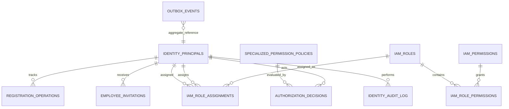

# Identity Database Design (PostgreSQL)

## ER overview

`OUTBOX_EVENTS.aggregate_id` is a string rather than FK because outbox must support events from different aggregate types and preserve events even if a domain record is archived.

## Tables and ownership

### `identity_principals`

The internal principal mapping. `principal_id` is the cross-service UUID; `(idp_issuer, idp_subject)` identifies the corresponding Keycloak subject. `provisioning_status` describes provisioning workflow only; it is **not** a mirror of Keycloak's enabled/disabled state.

### `registration_operations`

Tracks idempotent registration. Stores only a request fingerprint and status/error code, not request JSON, password, token or PII. Build the fingerprint with HMAC-SHA-256 and an external secret.

### `employee_invitations`

Tracks invitation lifecycle metadata. The invitation/action token and credential remain in Keycloak; do not store raw invitation tokens in this database.

### `iam_roles`, `iam_permissions`, `iam_role_permissions`, `iam_role_assignments`

Fine-grained, scope/time-bound IAM for staff operations. Coarse application roles remain in Keycloak; do not mirror them here. `scope_id` is required for scoped assignment and null for `GLOBAL`. Role assignment code must verify the target is an employee, validate the actor's authorization, record audit, and transition expired assignments to `EXPIRED` before creating a new active assignment.

`iam_permissions.permission_code` should use a canonical namespace, for example `catalog.product.approve`, `inventory.stock.adjust`, `finance.refund.approve`.

### `specialized_permission_policies`

Versioned, declarative policies for designated high-risk actions (for example threshold-based refund or B2B discount). `rule_config` must be validated against a known schema in application code. **Never execute SQL, JavaScript, SpEL, or arbitrary expressions from this JSON.** Updating a policy means creating a new version and retiring/activating rows in a transaction.

### `authorization_decisions`

Decision trace for `CheckSpecializedPermission`: actor, action, outcome, reason, policy/version and sanitized context summary. Do not store sensitive payment data, tokens, passwords or unnecessary PII.

### `identity_audit_log`

Append-oriented security/admin audit. Changes to users/roles/policies and high-risk decision summaries should have correlation IDs. This table and the outbox row should be written in the same local transaction for events that require guaranteed publication. Restrict update/delete permissions at the database/application roles level; production retention/immutability policy is still required.

### `outbox_events`

Transactional event envelope to publish only after commit. Consumers must be idempotent because outbox delivery is at-least-once. Suggested event types include `UserRegistered`, `UserDeactivated`, `PasswordChanged`, and `AuditRecordEvent`, but do not publish until versioned event schemas are approved in `packages/events`.

## Intentionally omitted

| Data | Owner | Reason not in `identity_db` |
|---|---|---|
| Password hash, MFA secrets, login attempt/brute-force state | Keycloak | Avoid recreating credential security and account lock state |
| Refresh tokens, SSO sessions, password reset tokens | Keycloak | Avoid a second, inconsistent token/session authority |
| Social identity links | Keycloak | Use its identity brokering/linking model |
| Name, avatar, addresses, profile fields | Profile Service | Domain ownership and data minimization |
| Guest session/cart | Cart/Checkout | Guest does not need a Keycloak user |
| Guest order grant/OTP proof and order ownership | Order Service | Grant is scoped to a specific order |
| Payment/shipping/order state | Corresponding services | Keep service data ownership boundaries |

## Operational rules

- Use the `identity_db` database and DB user dedicated to this service.
- Do not allow other service accounts to read/write these tables directly.
- Use migrations only through Flyway; never edit an applied migration.
- Keep `V1`–`V5` immutable after deployment; add `V6+` for later schema changes.
- Set `updated_at` through triggers defined in migrations. Keep optimistic `version` updates in application SQL (`WHERE version = :expectedVersion` and increment on success).
- Keep only minimal JSON in audit/outbox; sanitize exception text before persisting `last_error`.
